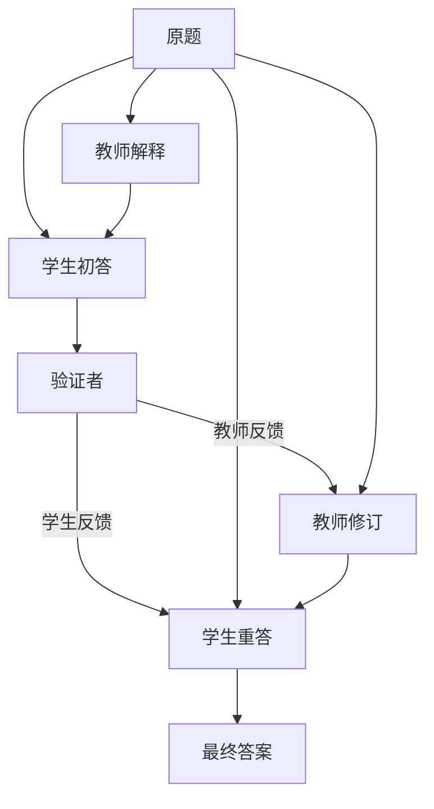

[[00-Agent-Memory-Experience-Reuse|← 论文索引]] · 对照：[[AFlow-2025-Workflow-Optimization|AFlow]]、[[GPTSwarm-2024-Optimizable-Agent-Graphs|GPTSwarm]]、[[MemEvolve-2026-Memory-System-Meta-Evolution|MemEvolve]]

# ADAS：从手工搭建智能体转向代码空间中的系统设计搜索

> [!abstract] 一句话说明作者做了什么
> 让一个模型阅读已有智能体的代码、设计说明和验证分数，写出新的 Python 解题流程；实际评测后加入档案，反复搜索可复用的智能体系统。
> 输入是目标领域、验证题、评分器、基础调用接口与初始方案；产出是一组系统设计及分数，可以从中选取并部署。更新的是外部程序和提示词，基础 LLM 权重不训练。

> [!info] 阅读范围与选择理由
> 2026-10-26 阅读 ICLR 正式版全部 34 页（正文、参考文献、附录 A–K），并核对官方搜索代码、提示词、结果档案和数据组织。本次没有付费重新运行模型搜索或复现表格成绩。
> 这是一篇补充的关键基础工作，不是最新论文：它是 AFlow 明确比较的前序方法，有助于理解“为什么把系统设计本身当作优化对象”。已检查本仓库两个主题的可见笔记与本会话历史；此前记忆主题八篇未含本文，不声称查遍不可访问的历史。

## 1. 论文信息

- **题目**：Automated Design of Agentic Systems。
- **作者**：Shengran Hu、Cong Lu、Jeff Clune。
- **机构**：University of British Columbia、Vector Institute；第三位作者另列 Canada CIFAR AI Chair 身份。
- **发表**：ICLR 2025 主会。arXiv 首版为 2024 年；项目页另列 NeurIPS 2024 Open-World Agent Workshop Outstanding Paper，不能将其称为 ICLR 主会获奖。
- **领域名称**：自动化智能体系统设计（Automated Design of Agentic Systems, ADAS）。
- **实际算法**：元智能体搜索（Meta Agent Search）。领域愿景比本文已实现的算法范围更大。
- **原文**：[ICLR 页面](https://proceedings.iclr.cc/paper_files/paper/2025/hash/36b7acf6f6010652b3f2a433774a66fe-Abstract-Conference.html) · [正式全文](https://proceedings.iclr.cc/paper_files/paper/2025/file/36b7acf6f6010652b3f2a433774a66fe-Paper-Conference.pdf)。
- **项目与实现**：[项目页](https://www.shengranhu.com/ADAS/) · [官方仓库](https://github.com/ShengranHu/ADAS)。
- **代码核对版本**：`2702bee8fefda42255efc5be9f60e3bd3db96ae4`，核对日期 2026-10-26。

## 2. 出发点：作者为什么把问题改写为“设计系统”？

### 2.1 先看一个普通解题场景

> [!example] 贯穿教学例子，不是论文原始测试题
> “学校买了 4 盒笔，每盒 12 支，发给学生 17 支后还剩多少？”
> 正确答案为 $4\times12-17=31$。这里的数量只为解释信息流，不对应论文成绩。

直接调用模型，它可能漏掉减法；先让模型解释，可能改善，也可能只是输出更长；增加一个检查者，检查者也可能同意错误答案。对某一题有效的流程，未必对整个题集有效。

常见研究路线是人为提出一种新流程：增加反思、专家、投票或分解。作者关注的更上一层问题是：**为什么由研究者一次次手工挑这些组件及连接方式，能不能把这项设计工作也自动化？** 原文 §1 用 AutoML、神经架构搜索与 AI-generating algorithms 的历史作类比；这是研究动机，不是自动设计必然优于人工设计的定理。

### 2.2 为什么只优化 prompt 不够？

“请仔细思考”只能改变一次调用的指令。要增加一个验证者、让其分别反馈给教师和学生、再执行两次修订，就需要改变调用次数、信息依赖和控制流。

因此作者将搜索对象扩大为一个程序：程序中的字符串定义指令，函数调用决定谁做什么，变量传递决定谁看见什么，循环和分支决定何时重试或停止。[论文 §2–3]

### 2.3 为什么选代码，而不是只选图中的边？

作者给出三方面理由：代码可表达丰富的流程；可复用已有工具和框架；LLM 已具备写代码的先验能力。它将“能否表示一种设计”和“怎样搜索到好设计”分开。

> [!important] 表达能力与可搜索性分开
> Python 图灵完备，只说明表示能力很强。有限上下文、有限生成长度、现有 API、评分器和搜索预算，仍然限制实际可发现的系统。不能推出“本文能找到任意最优 agent”，也不能把论文方法当作通用自我进化理论。

## 3. 架构、输入输出与两层运行

| 层次 | 输入 | 实际工作 | 输出与反馈 |
| --- | --- | --- | --- |
| 外层设计 | 档案、目标描述、基础框架 | 元模型生成并调试 `forward` 程序，评测一批验证题 | 设计代码、说明、验证分数 |
| 内层执行 | 一道题、某个候选 `forward` | 程序按控制流调用若干模型模块或提供的工具 | 当前题最终答案 |
| 最终使用 | 新题、选定程序 | 运行该程序 | 新题答案；不必再跑整次外层搜索 |

主实验外层使用 `gpt-4o-2024-05-13`，内层及基线使用 `gpt-3.5-turbo-0125`。[附录 E–F]

作者预先实现的框架包括：

- `Info(name, author, content, iteration_idx)`：包装任务、模型结果和工具反馈，保留内容标签、来源及轮次。
- 论文称 `FM_Module`、代码称 `LLMAgentBase`：指定输出字段、名字、角色、温度和模型；把输入 `Info` 格式化进 prompt，调用 API 并解析 JSON。
- `AgentSystem` 及评测器：把生成的函数装入系统，逐题运行并评分。
- ARC 额外提供运行示例网格和将变换程序用于目标网格的工具。
- 数据加载、评分、并发调用和档案 JSON 持久化。

**自动生成的是在这些能力之上如何组织任务处理的 `forward(self, taskInfo)`，不是重新实现 API 服务、全部数据加载器和评测器。** 不等于从空白发现所有工具。

## 4. 方法：从一次搜索到一个实际程序

### 4.1 外层一轮发生什么？

1. 用人工基线初始化档案。ARC 为五种；其余四领域为七种。空初始化是单独消融。
2. 将当前档案和框架说明提供给元模型，请其提出有价值的新设计，并输出设计说明、名称及完整 Python 函数。
3. 做两次反思：先检查相对档案的新颖性和实现，再检查代码问题。
4. 实际在验证题上执行候选。若执行报错，带错误信息让元模型修复并重试。
5. 把可评测候选和分数加入档案。**不是只有比历史最好成绩高的方案才保存。**
6. 下一轮再看扩大的档案，直到达到外层迭代上限。ARC 25 轮，其余四领域 30 轮。[论文 §3、附录 C/I]

为什么保留暂时不好的设计？因为一个设计中的局部想法可能在后续组合中有用，作者称其为“垫脚石”（stepping stones）。ARC 的搜索记录展示了先出现不同反馈点子，后来再组合的过程；但这只是过程案例，不能替代“完整档案 vs 只保留最佳”消融。

### 4.2 档案到底是什么记忆？如何检索？

代码 `get_prompt(current_archive)` 对所有条目执行 JSON 序列化，直接组成输入；没有向量 top-k 检索、搜索树遍历、UCT 或 MCTS 节点选择。

主要字段是：

```json
{
  "thought": "模型生成的设计说明",
  "name": "系统名称",
  "code": "def forward(self, taskInfo): ...",
  "fitness": "验证成绩及 bootstrap 区间",
  "generation": 4
}
```

公开的评测结果文件另含 `test_fitness`；标准搜索主循环以验证档案为输入，测试评测在后续独立阶段进行。不能因为公开结果含测试分数，就断言代码每一轮用测试分数优化。

- **生成**：元模型写设计，评测器计算验证成绩。
- **筛选**：两轮自反思、执行错误调试；没有独立新颖性裁判或形式保证。
- **存储**：本地 JSON 档案，包含不同成绩的方案。
- **读取**：整份档案进入元模型 prompt，不是按当前题检索。
- **更新**：追加设计及成绩；未实现复杂去重、遗忘和容量管理。
- **共享**：跨搜索轮次给外层元模型使用。内层教师/学生/验证者传递的是当前题 `Info`，不能等同于共享长期经验库。

附录 A.2 明确将“读取详细执行日志以诊断成败模式”列为未来方向；当前标准外层反馈主要是数值成绩与运行报错，不能写成完整轨迹诊断系统。

### 4.3 真实发现的程序：教师—学生—验证者

官方 `results/mgsm_gpt3.5_results.json` 第 4 代的 **Dynamic Role-Playing Architecture** 与表 2 的数学最好方案一致。名称虽然“Dynamic”，实际代码是一个固定的五次调用流程：

| 次序 | 调谁 | 传入什么 | 返回什么 |
| --- | --- | --- | --- |
| 1 | 教师 | 原题、解释指令 | 解题说明 |
| 2 | 学生 | 原题、教师说明 | 解答分析、答案 |
| 3 | 验证者 | 原题、学生分析与答案 | 判定、给教师的反馈、给学生的反馈 |
| 4 | 教师 | 原题、给教师的反馈 | 修订后的说明 |
| 5 | 学生 | 原题、修订说明、给学生的反馈 | 最终分析与答案 |



在教学题中，教师可能先说明先算总数；学生漏减 17；验证者提示剩余数量与原总数的区别；教师和学生按反馈修订。**这只是可能的教学执行，不是原文提供的实际对话，不保证验证者总能指出错误。**

实现边界尤其重要：

- 三个模块默认调用同一个基础模型，名称与指令区分职责；没有训练三个专家模型。
- 验证者是 LLM 文本检查，不是可执行数学证明器。
- `final_verdict` 被生成，但代码未据此分支或早停，始终执行后续两次调用。
- 同一 `LLMAgentBase` 实例不自动保存对话历史，输入由代码显式传入。第二次教师调用并未直接附上其旧解释。
- 学生最后一次调用读取的是新解释与学生反馈，不是自动继承所有旧消息。
- 第 4 代归档验证成绩 54.7%，测试成绩 53.4%；不是一次五调用执行就得到这两个分数。

这说明“运行图”并非另存一张必须遍历的图数据库。`[taskInfo, explanation]` 等列表和函数调用本身，就明确规定了信息依赖。

### 4.4 两类 Python 代码不能混淆

ARC 中至少有两个层次：

- 外层生成的 `forward`：规定采样几个解法、如何测试、如何审查与集成，可用于很多 ARC 题。
- 内层生成的 `transform(grid)`：回答当前 ARC 题的网格变换程序。

作者工具实际执行 `transform` 检查**题面已提供的示例**；最终将其用于题内测试输入，再由外部评分器与参考网格做精确匹配。不能把题面示例测试称为偷看隐藏答案。

论文 ARC 最好设计包括五个初始程序、示例执行反馈、人类风格意见、专家意见、三轮修订及最终集成。其设计是搜索产物，不能将这些所有高级模块都算成作者固定提供的算子库。

### 4.5 有 RL、参数蒸馏或递归优化器吗？

本文没有 LLM 参数训练、策略梯度、PPO/GRPO 或参数蒸馏。分数通过后续 prompt 影响代码生成，而不是反向传播更新模型。

档案里出现“Reinforcement”“Meta-Learning”等自动起名，不代表代码实现了对应学习算法。高阶 ADAS——让设计者也被自动优化——在 §6 是未来方向，本文没有实证实现无界递归自我改进。

## 5. Benchmark：实际测什么、如何评测？

| 基准 | 输入及交付 | 本文切分/预算 | 判定方式 |
| --- | --- | --- | --- |
| ARC 子集 | 题内若干示例网格、一个目标网格；生成变换代码或最终网格 | 正文称简单小网格子集，验证 20、测试 60；每题评测五次；外层 25 轮 | 最终网格与参考结果精确匹配 |
| DROP | 文章与需要计数/比较/离散推理的问题；输出短答案 | 验证 128、测试 800；评测一次；one-shot 题面 | 规范化答案 F1，非 LLM 裁判 |
| MGSM | 多语言小学数学应用题；输出数值 | 验证 128、测试 800 个语言条目；评测一次 | 数值字符串的有限规范化后比较 |
| MMLU | 多学科选择题；输出选项 | 验证 128、测试 800；评测一次 | 选项正确率 |
| GPQA diamond | 生物/物理/化学的困难选择题 | 验证 32、测试 166；每题五次 | 选项正确率 |

四领域各自独立搜索 30 轮，不是用一个共同程序同时优化全部领域。除 DROP 外，其余四领域题面按论文为 zero-shot；ARC 的题内输入输出对属于任务定义，不是外层验证集。

另外将 MGSM 发现的方案迁移至 GSM8K、GSM-Hard、SVAMP、ASDiv，以及 DROP、MMLU、GPQA；将 ARC 的方案迁移至 Claude-Haiku、GPT-4o、Claude-3.5-Sonnet。[§4.3、附录 B]

**这些主要是最终答案可判分的题目，系统内部虽可多次调用模型，并不等于长程网页/软件环境交互 benchmark。** 作者附录 A.2 也明确将复杂多步环境作为后续方向。

### 5.1 MGSM 的公开默认划分需要额外隔离

MGSM 官方说明：同一 250 道 GSM8K 数学题被译成十种语言，另有英文版。公开实现 `get_all_examples` 合并 11 份各 250 行文件，然后按语言条目整体打乱、取前 128/后 800。

**本次代码/数据审计，不是论文报告结果，也没有调用 LLM：**

1. 读取官方 ADAS 仓库固定版本的全部 11 份 TSV，均 250 行。
2. 对照英文、中文文件，250 行目标答案一致，首题确实为同一鸭蛋题的译本；结合 MGSM 官方定义按行号识别底题。
3. 重建 `shuffle_seed=0` 的 Python 默认切分：
   - 验证集 128 条，涉及 101 个底题 ID；
   - 测试集 800 条，涉及 242 个底题 ID；
   - 两侧共享 100 个底题 ID；
   - 312 个测试语言条目的底题在验证侧有译本。

因此默认“未见语言条目”不等于“完全未见底题”。该发现指向公开默认协议；未取得作者实际运行参数和逐题日志，不能断言所有论文运行都严格对应这一统计，更不能据此断言全部收益由重复造成。

MGSM 本身源自 GSM8K，MGSM→GSM8K 的迁移也需要按原题来源显式去重后再作强泛化结论。

## 6. 关键结果、消融与结论边界

### 6.1 主结果

表 1，均采用 GPT-3.5 执行，以下“±”为论文呈现的 95% bootstrap 区间宽度近似表示，**不是不同搜索随机种子的标准差**：

| 方法 | DROP F1 /100 | MGSM 正确率% | MMLU 正确率% | GPQA 正确率% |
| --- | ---: | ---: | ---: | ---: |
| CoT | 64.2 ±0.9 | 28.0 ±3.1 | 65.4 ±3.3 | 29.2 ±3.1 |
| LLM Debate | 60.6 ±0.9 | 39.0 ±3.4 | 65.6 ±3.3 | 31.4 ±3.2 |
| 提示词优化 OPRO | 69.1 ±0.9 | 30.6 ±3.2 | 67.6 ±3.2 | 32.9 ±3.2 |
| Meta Agent Search | **79.4 ±0.8** | **53.4 ±3.5** | **69.6 ±3.2** | **34.6 ±3.2** |

- DROP 相对最好人工基线 Role Assignment 65.8，提高 13.6 F1 分；相对 OPRO 为 10.3。
- MGSM 相对最好人工基线 LLM Debate 39.0，提高 **14.4 个百分点**；相对 OPRO 为 22.8。
- GPQA 相对 OPRO 仅 1.7 个百分点，置信区间大幅重叠，不能把四个领域的证据强度说成一致。
- 最好人工基线因任务不同而变，不能只拿 CoT 当最强对照。

### 6.2 初始化消融反而提示不要简单相信某种叙事

表 6，空档案初始化与人工基线初始化：

| 初始化 | DROP | MGSM | MMLU | GPQA |
| --- | ---: | ---: | ---: | ---: |
| 空档案 | 73.9 | **67.5** | 68.5 | 32.7 |
| 有基线档案 | **79.4** | 53.4 | **69.6** | **34.6** |

它说明方法不完全依赖给定人工程序，但不能说“已有设计越多必然越好”。数学空初始化更好，作者提出可能是更宽的探索空间；这是解释性假说，未由充分的搜索种子、机制隔离实验确认。

空初始化仍有基础框架、任务描述、提示词和预训练模型先验，不等于完全没有人类知识。

### 6.3 搜索轨迹不单调

已发布 MGSM 档案中，第 4 代测试为 53.4%，第 30 代为 26.9%；ARC 也有生成轮次缺号。它展示的是“曾经发现好系统”，不是“每一代都比上一代强”。

公开搜索里 `n -= 1; continue` 位于 Python `for` 循环中，并不会重试同一索引；失败一轮可能跳过。这解释了不能将配置 30 轮等同于成功保存 30 个候选。未追溯日志，不把每个缺号具体归因于一种异常。

### 6.4 迁移有价值，但要读具体行与选择协议

- 表 2，数学方案 Dynamic Role-Playing 转至 GSM8K 69.5%，最好人工基线 43.6%，差 25.9 个百分点；对 MGSM/GSM8K 来源重叠需保留前述边界。
- 表 5，同一方案转 MMLU 62.4%，低于 CoT-SC 65.9%；三方案中 Structured Multimodal 达 67.0%。不能说每个发现的方案迁移到每个领域都更好。
- 表 3，ARC 的 Dynamic Memory and Refinement 在 Claude-Sonnet 达 48.3%；但原 GPT-3.5 最好方案 Structured Feedback 在 Sonnet 为 38.7%，低于人工 Self-Refine 39.3%。
- 原文 §4.3 明说 ARC 跨模型选取 GPT-3.5 **测试成绩**最好的三个方案。因此它不是严格“只用验证集选型后一次性测试”的全部证据。代码默认将验证与测试阶段分开，但论文报告筛选过程仍有测试集选择偏差问题。
- 同一题五次结果平铺 bootstrap，代码未按底题聚类；置信区间不涵盖独立搜索的整体不稳定性。

### 6.5 最重要的证据缺口

- 同一执行模型不等于推理预算相同。多候选、多评审、多修订会增加 API 调用和 token；主结果没有系统地以相同 token/延迟预算控制所有方法。
- OPRO 对比同时改变了表示空间、搜索方式和部署流程，不能单独证明“代码表示”这一因素的因果贡献。
- ARC 复杂反馈的演化例子没有独立证明每种专家角色、词级去重及档案全保留分别有效。
- 小验证集反复选择容易过拟合；未依据具体证据声称发生预训练污染。
- 可读代码有助于审计，不等于生成代码天然正确或安全。
- 成绩来自当时较弱的 GPT-3.5；更强新模型下收益和最佳流程需要重测。

## 7. 代码核对、复现入口与成本

### 7.1 主要文件

- [MGSM 主循环与基础模块](https://github.com/ShengranHu/ADAS/blob/2702bee8fefda42255efc5be9f60e3bd3db96ae4/_mgsm/search.py)
- [MGSM 搜索提示词与初始方案](https://github.com/ShengranHu/ADAS/blob/2702bee8fefda42255efc5be9f60e3bd3db96ae4/_mgsm/mgsm_prompt.py)
- [MGSM 数据与评分](https://github.com/ShengranHu/ADAS/blob/2702bee8fefda42255efc5be9f60e3bd3db96ae4/_mgsm/utils.py)
- [归档的真实五调用方案](https://github.com/ShengranHu/ADAS/blob/2702bee8fefda42255efc5be9f60e3bd3db96ae4/results/mgsm_gpt3.5_results.json)
- [ARC 主循环和网格测试工具](https://github.com/ShengranHu/ADAS/blob/2702bee8fefda42255efc5be9f60e3bd3db96ae4/_arc/search.py)
- [ARC 结果程序](https://github.com/ShengranHu/ADAS/blob/2702bee8fefda42255efc5be9f60e3bd3db96ae4/results/arc_gpt3.5_results.json)
- [DROP 评分入口](https://github.com/ShengranHu/ADAS/blob/2702bee8fefda42255efc5be9f60e3bd3db96ae4/_drop/search.py)

执行路径：`search → get_prompt → 模型生成/两次反思 → evaluate_forward_fn → exec/安装forward → 逐题执行 → bootstrap → archive.append`。再由 `evaluate` 在测试切分运行档案程序。

### 7.2 论文和代码差异

- 论文调试上限五次；核对版本各领域默认 `debug_max=3`。
- 论文 ARC 称 20/60 题及 ≤5×5；重新抽样脚本最多取 100 题、20/其余划分，且只检查第一对示例输入/输出的行数，不检查宽度或全部网格。因此复现应核对现成 pickle 和实际参数，不能仅重跑此脚本就说严格复现正文。
- 论文附录 E Code 3 最终把模块实例当构造器调用；公开 ARC 结果程序改为 `LLMAgentBase(...)`。不要直接复制排版附录当可运行终稿。
- ARC “结构化反馈”实际有 `' '.join(set(combined_feedback.split()))`：词级去重会丢失词序，不是可靠的语义摘要机制。反馈字典使用 `advisor.role` 作键，而专家称谓传给了 `agent_name`，角色默认相同，存在键覆盖。这些是代码行为问题，不是本文已报告的因果消融。
- 生成代码用 `exec` 安装；论文称实验采用容器隔离并人工检查，但所核对的主脚本不自动构建完整隔离环境。精确实现、依赖和 API 版本均需固定。

### 7.3 开放与资源

官方仓库 Apache-2.0，包含搜索脚本、基础框架、提示词、数据文件和发现的程序。README 指定 Python 3.11。

附录 K 历史 OpenAI API 费用：**单次 ARC 搜索及评测约 500 美元；单个推理领域一次搜索及评测约 300 美元**。不是每道题的费用，也不是当前报价。论文未完整报告搜索总 token、单题平均调用/延迟、CPU/RAM 和墙钟耗时，均未知；无需本地训练 GPU，不代表没有付费计算成本。

建议先读取档案并复现一套程序的调用逻辑，再做小规模搜索。只验证程序能执行不能宣称复现论文提升。更换现有模型可验证方法是否还有效，但不属于原始精确复现。

## 8. 独特贡献、研究逻辑与本方向的关系

### 8.1 如何评价原创贡献？

本文不是首先提出反思、投票、专家协作，也不是首先让 LLM 生成程序。§5/附录 A 主动联系 FunSearch、EoH、GPTSwarm、提示词优化等工作。

其辨识度在于：**将智能体完整处理程序当成自动设计对象，明确拆为搜索空间、搜索算法、评测函数，再用模型生成代码与累积档案实现一个可运行实例。** 同时给出若干搜索产物与跨任务/模型迁移证据。

“新的模块组合”不等于基础算法突破。它的长期研究价值更多在于改变了问题的优化层次，并提供可检查的系统设计产物；通用最优性、高阶递归自改进、长期在线学习、严格多目标效率均未被本文证明。

### 8.2 从出发点走到方法的公开逻辑

> [!note] 以下是依据原文重建的设计逻辑，不是作者私人思维链。

手工系统设计消耗研究与工程投入 → 将设计本身当优化对象 → 仅改字符串无法表达新流程 → 用代码扩大表示空间 → 无结构地生成代码成本高 → 用已有设计及实测分数提供搜索上下文 → 只关注当前最好方案可能丢掉有用局部想法 → 保存多种方案作后续组合素材 → 为检验是否只是记住当前数据，再测试跨任务和跨模型迁移。

值得保留的是这种“确定真正的优化对象—选择表示—接上可观测反馈”的研究方式。每条理由都不能跳过证据检查：档案全保留是否好于最佳保留、角色分工是否好于同预算多次采样，本文并未充分隔离验证。

### 8.3 与已有笔记对照

| 工作 | 最主要改变对象 | 与本文区别 |
| --- | --- | --- |
| [[AFlow-2025-Workflow-Optimization|AFlow]] | 可执行工作流 | 同属代码空间；进一步引入工作流修改树、父版本选择、修改经验和复合算子 |
| [[GPTSwarm-2024-Optimizable-Agent-Graphs|GPTSwarm]] | 预设操作图的连边参数 | 用 REINFORCE 更新外部数值策略，本文由 LLM 写代码并用成绩反馈 |
| [[G-Memory-2025-Hierarchical-Memory|G-Memory]] | 新任务可用的分层经验记忆 | 本文档案主要给外层设计者，不是内层任务级长期经验检索 |
| [[MemEvolve-2026-Memory-System-Meta-Evolution|MemEvolve]] | 记忆模块代码 | 本文程序对象是任务处理流程，未固定为记忆子系统 |

对用户研究方向：经验优化 Harness **直接相关**；单智能体/多模块协作 **直接相关**；长期记忆检索 **部分可迁移**，当前无任务级向量经验库；模型参数 RL/蒸馏 **未覆盖**。

**一个小实验（研究建议，不是论文结论）**：在同一执行模型、同一总 token 上限和相同搜索预算下，比较“固定五调用流程”“只改 prompt”“生成整个 forward”；按底题 ID 划分验证/测试并隔离译本，记录正确率、每题 token/延迟、有效候选率及搜索费用。先检验结构搜索是否超出增加推理预算的收益，再考虑更大框架。

## 9. 阅读路线与三个研究问题

**建议先读** §1 末尾与 §2（为什么换优化对象）→ Figure 1 与 §3（两层闭环）→ 附录 D + 真实 MGSM 第4代程序（接口、信息流）→ Table 1、附录 F/J/K（协议、消融、成本）→ 附录 A.2（没有做的事情）。

1. 在严格预算对齐时，收益主要来自流程结构，还是更多解题/检查调用？
2. 全档案、只保留最好方案、保留多样性代表，哪一种更能支持后续设计？“垫脚石”如何被实验验证？
3. 按底题 ID 严格隔离、用更强执行模型并只按验证集选型后，发现的程序还能稳定迁移吗？

## 原始来源

1. [ICLR 2025 官方发表页](https://proceedings.iclr.cc/paper_files/paper/2025/hash/36b7acf6f6010652b3f2a433774a66fe-Abstract-Conference.html)。
2. [正式全文 34 页，含附录 A–K](https://proceedings.iclr.cc/paper_files/paper/2025/file/36b7acf6f6010652b3f2a433774a66fe-Paper-Conference.pdf)。
3. [作者项目页](https://www.shengranhu.com/ADAS/)。
4. [官方代码固定版本](https://github.com/ShengranHu/ADAS/tree/2702bee8fefda42255efc5be9f60e3bd3db96ae4)。
5. [MGSM 官方说明：同一 250 道题的多语言翻译](https://github.com/google-research/url-nlp/blob/main/mgsm/README.md)。
6. [MGSM 英文数据](https://github.com/ShengranHu/ADAS/blob/2702bee8fefda42255efc5be9f60e3bd3db96ae4/dataset/mgsm/mgsm_en.tsv) · [中文数据](https://github.com/ShengranHu/ADAS/blob/2702bee8fefda42255efc5be9f60e3bd3db96ae4/dataset/mgsm/mgsm_zh.tsv)。

正文数字来自正式版指定表格；数据划分统计明确标为本次静态协议审计，不是作者报告，不把推测写成复现结论。
