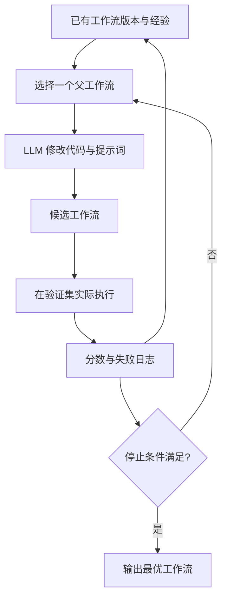

[[00-Agent-Memory-Experience-Reuse|← 论文主页]] · 对照阅读：[[G-Memory-2025-Hierarchical-Memory|G-Memory]]

# AFlow：用执行反馈搜索可执行工作流

> [!abstract] 一句话抓住工作
> **作者让一个 LLM 反复修改“如何调用其他 LLM 和工具”的 Python 程序，实际运行验证题，根据得分与失败日志继续修改，最后得到解决一类任务的工作流。**
> 改进对象是提示词与外层执行流程；基础模型权重不变。

## 1. 论文信息与出发点

**原题**：AFlow: Automating Agentic Workflow Generation。**发表**：ICLR 2025 主会。

**作者**：Jiayi Zhang、Jinyu Xiang、Zhaoyang Yu、Fengwei Teng、Xiong-Hui Chen、Jiaqi Chen、Mingchen Zhuge、Xin Cheng、Sirui Hong、Jinlin Wang、Bingnan Zheng、Bang Liu、Yuyu Luo、Chenglin Wu。

机构包括 DeepWisdom、香港科技大学（广州）、中国人民大学、南京大学、复旦大学、KAUST、Université de Montréal & Mila、香港科技大学。以正式论文首页为准。[1]

假设我们要搭建数学解题系统，可以让模型直接回答，也可以让它先解五次再挑答案，还可以让它写程序检查计算。**难点不是不知道这些组件，而是不知道哪种组合对当前模型和任务最好。** 手工调流程耗费大量实验；只优化提示词又无法改变“先做什么、失败后做什么”的结构。

最接近的已有工作之一 ADAS 也让 LLM 生成代码形式的 agent。AFlow 并非首次提出“LLM 写工作流代码”；其重点是把候选工作流的修改历史组织成树，结合实际得分、局部修改经验与可复用算子，提高搜索效率。[1, §2–4]

## 2. 输入、输出与两个执行层次

| 层次 | 输入 | 做什么 | 输出 |
| --- | --- | --- | --- |
| 外层：工作流优化 | 任务数据、评分函数、代码模板、算子接口、历史实验 | 选择旧版本，修改代码与提示词，运行验证题，记录反馈 | 最终工作流程序及其提示词 |
| 内层：任务执行 | 一道新题与选定工作流 | 按 Python 控制流调用模型与工具 | 本题答案、程序或其他结果 |

> [!important] 三种“节点”不要混淆
> 1. **工作流节点**：一次 LLM 调用等基本步骤。
> 2. **算子**：封装一个或多个步骤的可调用组件。
> 3. **搜索树节点**：一个完整工作流版本，可能内部有很多 LLM 调用。
>
> 搜索树边表示“从父工作流修改出子工作流”；工作流内部的信息流表示“哪个步骤的输出交给谁”。它们不是同一张图。

模型在外层充当程序设计者，在内层充当执行者。论文使用 Claude-3.5-Sonnet 做优化器，主实验以 GPT-4o-mini 执行；二者不是一个概念。新测试题到来时通常执行选好的流程，不重新进行完整搜索。[1, §5.1]

## 3. 架构与方法：一轮到底发生什么



### 3.1 用 Python 表达流程

工作流中的“边”落实为普通编程语言结构：函数调用、参数传递、`if/else`、`for/while`、返回值与异步操作。因此它可以表达“检查通过就返回，否则修复后再检查”，不需要把所有逻辑硬塞进一张静态 DAG。

论文的一般定义允许节点具有模型、温度、提示词、输出格式等参数；**实际搜索为控制规模固定模型、温度和格式，主要调整提示词与代码表达的连接关系**。不要把一般搜索空间定义当作所有参数都在实验中联合优化。[1, §3]

### 3.2 选择：从哪个已有版本继续？

保留表现较好的若干工作流，并保留初始模板。选择概率混合均匀探索与基于分数的偏好：高分版本更可能继续优化，但低概率探索仍能从不同起点出发。论文称之为软混合概率选择（soft mixed-probability selection）。

保留初始模板的意义是：一条分支越改越复杂后，可以重新探索另一类结构，而不是只能在最后一个版本上追加修改。这里是 MCTS 风格的特化搜索，不宜直接当成标准 UCT 算法，更不涉及策略网络梯度训练。

### 3.3 扩展：优化器看什么、改什么？

优化器收到父工作流代码、相关提示词、算子接口说明、此前对这个工作流的修改及效果，以及部分失败题的预测与预期输出日志。然后提出局部修改，输出完整的新工作流和需要的自定义提示词。

局部修改可以是增加审核步骤、删除无效调用、修改候选数量、调整上下文传递、加分支或改提示词。公开优化提示词要求一次聚焦一个修改点，并限制代码改动行数；**“一个修改点”不等于只能改一行**。这是一种让实验更可解释、搜索更稳定的提示约束，不是编程语言层面的硬性定理。[3]

### 3.4 评测与经验回传

把候选工作流真的跑在验证集上，用任务评测器评分。论文描述每个候选在验证集运行 5 次，统计均值和标准差，减小随机波动。记录新版本分数、相对父版本改了什么、效果变好还是变差，再更新供下一轮选择和修改使用的经验。[1, §4]

**这里的“反向传播”是把实验信息回传给搜索过程，不是神经网络反向传播。** 模型权重不更新，新的经验通过后续输入上下文影响优化器。

停止条件是达到搜索轮数上限，或高分工作流的平均表现连续若干轮没有改善。主要实验设置 AFlow 为 20 轮，ADAS 为 30 轮；相同轮数也不代表相同 token 成本。[1, §4–5]

## 4. 作者预先提供了哪些基础能力？

**论文算子族**包括 Generate、Format、Review & Revise、Ensemble、Test、Programmer、Custom。具体代码类名随任务模板有变化。下面结合当前官方仓库 `scripts/operators.py` 说明。[1, §3.2；2]

| 能力 | 输入 → 输出 | 作者已经实现的内容 |
| --- | --- | --- |
| Custom | 输入文本 + 自定义指令 → 模型响应 | 拼接指令并调用 LLM，是自由构造步骤的基本入口 |
| AnswerGenerate | 问题 → 结构化回答 | 内置生成提示词与输出解析 |
| CustomCodeGenerate | 问题、函数入口、指令 → 代码 | 代码生成与代码格式处理 |
| Format | 问题、已有解答 → 格式化结果 | 使用内置提示词整理输出 |
| Review | 问题、解答 → 审查意见 | 内置检查提示词与结构化返回 |
| Revise | 问题、解答、反馈 → 修改后的解答 | 内置基于反馈修订逻辑 |
| ScEnsemble | 多个候选、问题 → 选中的候选 | 编号候选，让 LLM 判断选择，再映射回原答案；不是简单数字多数票 |
| MdEnsemble | 多个候选、问题 → 多轮投票选出的答案 | 打乱候选、多次评判、统计选择 |
| Test | 题目、候选代码、入口 → 测试结果与修复代码 | 读取测试、执行断言、收集错误、调用 LLM 修复并重试 |
| Programmer | 问题、已有分析 → 生成的程序与运行输出 | 生成 `solve()` 程序、执行、将报错反馈给模型重试 |

> [!warning] “测试的细节都是 AFlow 重新写的吗？”
> **不全是。** `Test` 的执行测试、收集异常、组织修复提示词等机制是作者已经写好的。AFlow 可以决定是否调用它、何时调用、把什么传给它、结果如何影响后续步骤。
> 使用 `Custom` 时也可以通过提示词组织新的检查或生成测试方案，但不能因此断言作者的底层测试执行器每轮都由优化器重写。

还应区分三类 Python 代码：

1. **工作流代码**：外层优化器生成，规定模型和工具如何协作。
2. **题目答案代码**：内层执行模型生成，例如 HumanEval 要求的函数。
3. **运行基础设施代码**：作者实现的 API 调用、测试器、输出解析和评测器。

工作流内部的一次 `test(...)` 调用可能只占一行，但它背后已经封装了多次测试、修复与模型调用。因此不能用工作流源码行数衡量推理成本。

## 5. 贯穿例子：怎样从直接解题走到更好的流程

> [!example] 教学例子，不是论文原始测试题
> 题目：“每箱 12 个物品，买 5 箱后取走 7 个，还剩多少？”正确结果为 53。

最初只有一次模型解答。单次输出可能漏掉“取走 7 个”，但多一个检查步骤也可能把正确结果改错，因此不能只靠直觉决定流程。

外层先尝试“生成多个候选，再选择一个”，在整批验证题上评测；再尝试“把候选分析交给 Programmer，用程序计算”；还可以修改最终输出格式，避免答案正确但格式不符合评测器。

以下是**解释用伪代码，不是仓库可直接运行片段**：

```python
async def solve_problem(problem):
    candidates = [await generate(problem) for _ in range(5)]
    selected = await ensemble(problem, candidates)
    verification = await programmer(problem, selected)
    if verification.has_valid_output:
        return verification.output
    return selected
```

优化器不是看这一题答对就宣布成功，而是看修改后对一组验证题是否更有效。论文 GSM8K 案例确实展示了候选集成、Programmer 检查以及提示词/格式调整；也展示了某些审核或改写操作使分数下降。[1, Fig.5–6]

**为什么要存失败修改？** 如果在某个父工作流上，“无额外推理直接改答案”已导致退化，下一次扩展同一个父版本就可以避开这一模式。保存的是“修改操作 → 性能后果”的设计经验。

## 6. Benchmark：到底在测什么？

| Benchmark | 测评任务与典型输入 | 工作流要交付什么 | 本文指标 |
| --- | --- | --- | --- |
| GSM8K | 自然语言小学数学应用题，多步算术 | 最终数值答案 | Solve Rate，解题正确率 |
| MATH 子集 | 竞赛数学；本文选四类 level-5 题共 617 道 | 最终数学答案 | Solve Rate |
| HumanEval | Python 函数签名、文档描述等 | 满足测试的函数实现 | pass@1 |
| MBPP | 简短自然语言编程需求 | 满足测试的 Python 程序 | pass@1 |
| HotpotQA | 需组合多处信息的多跳问答 | 答案文本 | F1 |
| DROP | 对文章进行计数、比较、加减等离散推理 | 文本或数字答案 | F1 |

**pass@1** 看最终提交的一个程序是否通过测试，不意味着整个工作流只调用一次 LLM；内部可以先生成多个候选。**F1** 衡量预测答案与参考答案的词项重合，不等同于整题完全匹配率。

论文把所用数据按验证/测试 1:4 划分；HotpotQA 与 DROP 各抽取 1,000 条，MATH 使用上述子集。初始化还在验证数据上多次运行模板，选择结果波动较大的题以提高搜索反馈的信息量。因此表中结果不是直接使用每个数据集原始完整标准测试划分得到的官方排行榜分数。[1, §4–5]

### 6.1 主要结果如何读

主表所有方法使用 GPT-4o-mini 执行，在划分后的测试集运行 3 次取平均：[1, Table 1]

| 方法 | HotpotQA F1 | DROP F1 | HumanEval pass@1 | MBPP pass@1 | GSM8K | MATH |
| --- | ---: | ---: | ---: | ---: | ---: | ---: |
| 直接调用 IO | 68.1 | 68.3 | 87.0 | 71.8 | 92.7 | 48.6 |
| CoT + 自一致性 | 68.9 | 78.8 | 91.6 | 73.6 | 92.7 | 50.4 |
| ADAS | 64.5 | 76.6 | 82.4 | 53.4 | 90.8 | 35.4 |
| **AFlow** | **73.5** | **80.6** | **94.7** | **83.4** | **93.5** | **56.2** |

最值得看的是 MBPP：相对直接调用提高 11.6 个百分点；GSM8K 只提高 0.8 个百分点。说明工作流优化收益依赖任务，不能说每个领域都有巨大提升。

论文平均分 80.3 对比 CoT 自一致性 76.0，约为 **5.7% 相对提升**，不是 5.7 个百分点。跨 F1 和正确率取平均只是论文的汇总方式，不能当作一个新的统一能力指标。

### 6.2 消融、迁移与边界

- **去掉复合算子**：GSM8K 上仍能取得 93.1，说明 Custom 加代码控制流也能构建有效策略；预置算子的主要价值之一是提高搜索效率。不能理解为完全没有人工提供的运行基础设施。
- **跨模型迁移**：搜索出的流程可迁移到其他执行模型，但本模型上搜索的流程不一定被别的模型搜索结果超越，说明流程与模型能力存在适配关系。
- **成本分析**：需要分开看一次性的搜索成本和部署后的推理成本。论文推理成本 Pareto 图不能独自证明总体生命周期成本最低。
- **证据范围**：这些实验主要证明若干推理 benchmark 上自动工作流设计有效；没有证明长期开放环境中的持续自我改进，也没有单独证明多 agent 身份比同一模型多次调用更重要。
- **有效性风险**：重复使用小验证集可能过拟合；旧公开 benchmark 可能存在基础模型预训练污染。这里是需要控制的风险，不是本文已被证实发生泄漏。

## 7. 研究逻辑重建：这个 idea 为什么自然出现？

> [!note] 以下是依据论文问题与设计整理的研究路线，不是作者未公开的内心思维记录。

1. 同一个 LLM，流程不同，结果就不同 → 把流程本身当优化变量。
2. 只调提示词不能增加检查、循环或分支 → 需要更有表达力的程序表示。
3. 任意程序空间过大，随机生成效率低 → 以已有好版本做局部修改。
4. 只保留最后版本容易走进死路 → 保存不同修改分支和父子关系。
5. 修改是否有效不能靠优化器自评 → 接入客观评测与错误日志。
6. 从零实现每个常见模式成本高 → 提供复合算子，同时保留 Custom 的自由度。

真正可迁移的设计原则是：**让候选改动、执行证据和版本关系一起成为下一轮优化的输入。**

## 8. 与研究方向的关系及复现重点

对“经验优化 Harness”直接相关：它展示了从反馈到流程修改的闭环。但 AFlow 的历史经验主要给**工作流优化器**使用，并不是像 G-Memory 一样每道新题都检索长期任务记忆。两者可以组合，论文并未实际完成该组合。

不涉及 RL 或参数蒸馏。未来若把高分轨迹蒸馏进模型，需要额外设计训练数据、损失与独立测试，不能将本文搜索阶段称作参数后训练。

复现时先固定一个 benchmark、执行模型和评分器，分别记录搜索 token、单题执行 token、延迟与得分。官方代码和数据准备脚本开放；原实验走 API，不需要训练 GPU。完整复现的当前美元成本与耗时依赖 API 价格、并发和所用版本，不能直接套用论文历史报价。

## 9. 阅读路线与自测问题

**先读** Figure 3 与 §3.2 → §4 搜索闭环 → Figure 5–6 具体工作流 → Table 1 与 §5.1 → Appendix A 的模板和算子。

- 为什么搜索树节点必须代表完整工作流，而不是只代表一次模型调用？
- 同样提高 5 个百分点，来自更多采样还是更好的连接关系，怎样区分？
- 如果评测器只能给稀疏的成败信号，局部修改经验还能否可靠指导下一步？

## 来源与代码导航

1. [ICLR 官方页面](https://proceedings.iclr.cc/paper_files/paper/2025/hash/5492ecbce4439401798dcd2c90be94cd-Abstract-Conference.html) · [正式论文全文](https://proceedings.iclr.cc/paper_files/paper/2025/file/5492ecbce4439401798dcd2c90be94cd-Paper-Conference.pdf)
2. [官方仓库](https://github.com/FoundationAgents/AFlow) · [算子实现](https://github.com/FoundationAgents/AFlow/blob/main/scripts/operators.py)
3. [优化提示词](https://github.com/FoundationAgents/AFlow/blob/main/scripts/prompts/optimize_prompt.py)
4. [优化主循环](https://github.com/FoundationAgents/AFlow/blob/main/scripts/optimizer.py) · [经验处理](https://github.com/FoundationAgents/AFlow/blob/main/scripts/optimizer_utils/experience_utils.py)
5. [Benchmark 实现目录](https://github.com/FoundationAgents/AFlow/tree/main/benchmarks)

代码核对日期：2026-10-15；当前仓库与论文时期版本可能存在差异。本文表格数值来自正式论文，不以当前仓库新增 benchmark 反推原文实验范围。
