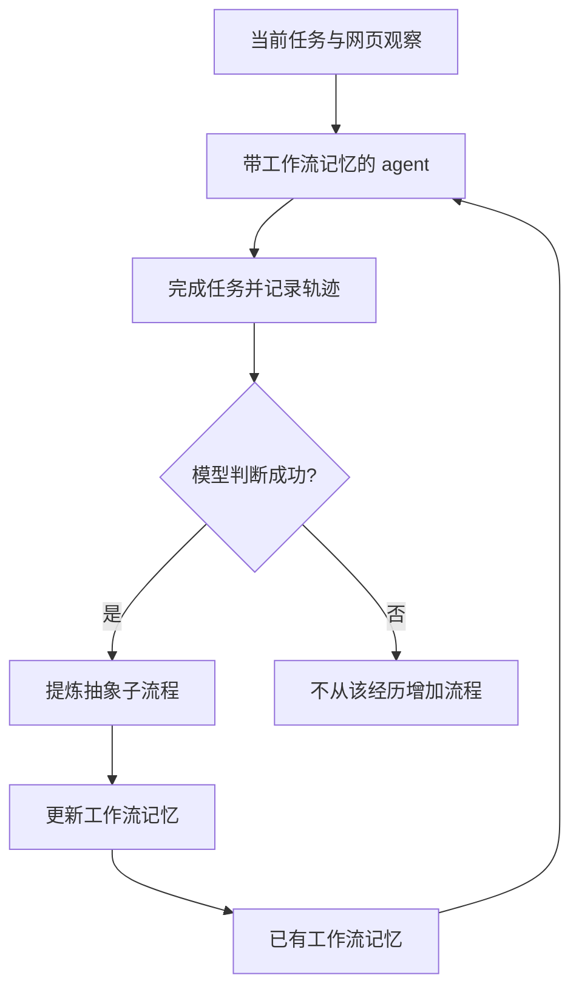

[[00-Agent-Memory-Experience-Reuse|← 论文索引]] · [[README|仓库主页]]

# AWM：从任务轨迹提炼可复用工作流记忆

> [!abstract] 作者到底做了什么？
> **让网页智能体把做过的任务拆出常用子流程，把具体商品、地点等换成变量，保存为工作流记忆，再将这些步骤放进后续任务的提示上下文，指导模型逐步操作网页。**
> 它学习的是外部的程序性经验；没有微调模型，也没有用强化学习更新参数。主方法中，工作流是供模型参考的操作指南，不是默认一键执行的宏命令。

## 1. 论文信息与原有阅读线索

| 项目 | 信息 |
| --- | --- |
| 原题 | Agent Workflow Memory |
| 作者 | Zora Zhiruo Wang、Jiayuan Mao、Daniel Fried、Graham Neubig |
| 机构 | Carnegie Mellon University、Massachusetts Institute of Technology |
| 发表 | **ICML 2025 主会**，PMLR 267: 63897–63911 |
| 早期版本 | arXiv:2409.07429，2024 年发布；不要把预印本年份或曾经的投稿页面当作正式会议身份 |
| 原文 | [官方论文页面](https://proceedings.mlr.press/v267/wang25bx.html) · [正式 PDF 在线链接](https://raw.githubusercontent.com/mlresearch/v267/main/assets/wang25bx/wang25bx.pdf) |
| 代码 | [zorazrw/agent-workflow-memory](https://github.com/zorazrw/agent-workflow-memory) |

> [!quote] 原有笔记的核心观察（整理保留）
> 现有 agent 从示例或上下文中学习行动序列，但对任务上下文、环境变化缺乏鲁棒性；解决复杂任务需要抽取和学习可复用的任务经验。

这条观察正好对应本文问题：完整案例里，真正有用的操作套路和某一次任务的具体细节混在一起。如何把前者提取出来，而不是让智能体模仿旧任务的商品名、城市名或固定页面内容？

## 2. 出发点：为什么完整轨迹还不够？

假设历史任务是“在购物网站搜索猫粮并按价格排序”，新任务是“搜索咖啡并按评分排序”。直接给完整旧案例，模型可能过度照搬“猫粮”和“价格”。但两个任务都需要“找到搜索框 → 输入查询 → 提交 → 选择排序条件”。

作者提取的不是旧任务最终答案，而是中间可反复出现的**子任务操作套路（workflow / sub-routine）**。其中商品名变成 `{search-term}`，排序方式变成 `{sort-option}`。这个变化使“经历过一次具体任务”转化为“知道如何处理一类子任务”。

这里同时做两种抽象：

1. **任务粒度抽象**：从完整任务中拆出更小、更常用的子流程。
2. **实例内容抽象**：把特定输入替换为有意义的变量。

相比 Synapse 等使用完整轨迹示例的方式，AWM 更强调抽象子流程；相比 SteP 的人工编写工作流，AWM 用模型从经历中归纳。它不是第一个“给 agent 加记忆”的方法，重点是**记忆的单位和形成机制**。[1, §1–2、§3]

## 3. 输入、输出与记忆结构

### 3.1 一个任务经历是什么？

一次经历包含任务指令，以及按顺序排列的观察—动作记录：

$$
e=(q,[(o_1,a_1),\ldots,(o_T,a_T)])
$$

$q$ 是用户目标，$o_t$ 是当时页面观察，$a_t$ 是模型在该步选择的动作。比如点击按钮、输入文字或选择选项。主实验是网页 agent 的任务轨迹，不是多 agent 通信图。

### 3.2 一个工作流是什么？

工作流有一个目标描述，以及实现它的一串步骤。每一步可包含简化的环境状态、动作理由和动作表达。下面是**根据论文示例改写的教学展示**，不是可直接运行的浏览器程序：

```text
工作流：搜索商品并排序
适用情境：购物网站的搜索界面

1. 在搜索框输入 {search-term}
2. 点击搜索按钮
3. 找到排序菜单
4. 选择 {sort-option}
```

其主要作用是指导模型：新任务到来时，模型依然要识别当前页面的具体元素 ID，判断现在应执行哪一步。占位变量不是自动绑定到真实网页节点的完整运行系统。

| 模块 | 输入 | 输出 | 职责 |
| --- | --- | --- | --- |
| 执行 agent | 任务、当前网页、历史上下文、工作流记忆 | 下一步网页动作 | 实际解决任务 |
| 轨迹评价器 | 已完成的任务与预测轨迹 | 成功/失败判断 | 在线模式中筛选可归纳的经历 |
| 工作流归纳器 | 一条或多条经历 | 抽象子流程文本 | 找重复套路、抽象实例信息 |
| 记忆注入 | 当前网站的工作流文本 | 扩展后的模型上下文 | 让之后的动作生成能参考流程 |

**没有必要把它想成一张显式知识图。** 主方法可以用网站对应的文本文件保存工作流；“更复杂工作流建立在旧流程之上”首先是一种功能上的复用，不等于已经实现图数据库或多智能体拓扑学习。

## 4. 方法闭环：生成、筛选、保存和使用

### 4.1 如何归纳工作流？

归纳器收到任务指令与操作轨迹，提示它寻找跨任务重复出现的动作子序列，生成至少两步的常用流程，避免高度重复的流程，并用描述性变量替代非固定内容。附录 A 给出了实际提示词。

这不是严格的频繁子序列挖掘算法；主要由 LLM 判断什么步骤值得复用。即使只提供一条经历，也可以由模型判断其中可能可泛化的子任务。论文另有规则式归纳消融，见第 8 节。

### 4.2 工作流怎么帮助执行？

将归纳出的工作流加入原有动作说明和提示上下文。模型每一步结合新任务与新观察产生动作：

$$
a_t=L(q,M\cup W,o_t)
$$

$L$ 是动作生成模型，$M$ 是原来的上下文或基础记忆，$W$ 是工作流文本。这个式子表达上下文增强，**不是优化模型参数的损失函数**。当前任务历史等输入在该概括式中省略。

论文按网站分组处理任务，让每组记忆规模较小且与当前网站有关。不要仅凭摘要中的“selectively providing”就补出一个复杂的向量检索、多跳图检索或精细路由模块。

### 4.3 在线反馈是什么？

在线主设计先让模型完成当前任务，再用 LLM 评价器判断是否成功；评价为成功的经历才用于提炼工作流，供后续任务使用。**用于选择记忆的模型判断，与用于报告最终成绩的 benchmark 评测不是同一个概念。** 模型评价器可能误判，记忆也可能被错误经验污染。



## 5. 离线与在线：到底差在哪？

| 维度 | AWM offline | AWM online |
| --- | --- | --- |
| 初始经验来源 | 已有训练示例、标注轨迹或可用高质量经历 | 自己此前处理过的测试任务经历 |
| 何时归纳 | 测试前 | 按任务流不断执行并更新 |
| 测试时记忆是否改变 | 主设置中固定 | 随已完成任务而改变 |
| 是否需要训练模型权重 | 不需要 | 不需要 |
| 主要优点 | 高质量示例可提供可靠操作套路 | 不依赖预先收集同分布示例，可适应当前任务流 |
| 主要风险 | 训练任务与目标网站/任务分布不匹配 | 评价错误、冷启动、顺序和历史状态影响 |

**离线的“training time”是预先生成记忆，不是 SFT。在线的“learning”是测试期间积累记忆，不是 RL 更新策略参数。**

### 一个贯穿例子

先完成“在地图上找到地点 A”，从成功经历提炼“按名称搜索地点”；之后完成“查询地点 B 的邮编”，可以沿用搜索步骤，再提炼包含查看地址信息的新流程。更晚的任务可能组合这些流程处理路线查询。

这是“旧经验帮助新经历，新经历再产生新经验”的外部记忆闭环。没有保证每轮一定变好，也没有证明它会无限扩展为通用技能体系。

**在线评测不能当作所有题相互独立的静态测试。** 第 20 道题可能使用前 19 道题产生的记忆，但不能使用未来任务信息。复现必须固定任务顺序、初始记忆和回写时机。

## 6. 公开实现核对：不要把示意图当完整工程事实

本节依据官方仓库代码；核对日期 2026-10-16。[2–7]

### WebArena 路径

`webarena/pipeline.py` 按网站选择任务，按 task ID 排序，对每题依次调用执行、自动评价、工作流归纳三个脚本。

`induce_prompt.py` 默认以 `autoeval` 结果筛选经历，也支持 `--criteria gt` 使用真实奖励。它收集历史结果，按任务模板去重抽样，调用模型归纳，再**覆盖写入当前工作流文件**。因此纸面上的“往记忆里添加”在这份实现里并不等于只在文件尾部 append；可能重新总结已收集的经历。

`agents/legacy/agent.py` 的已核对路径读取 `workflow_path`，将整个工作流文件附到系统提示词，再结合当前观察生成动作。这说明该路径的使用方式确实是上下文指导；文件名里的 `legacy` 也提醒我们这是具体版本路径，不应泛化为所有 BrowserGym 版本的接口。

复现注意：归纳脚本默认扫描指定结果目录；批量运行多站点时应隔离结果，确保只收集当前站点与已经完成的任务。仓库自带工作流文件，做从零在线实验时要检查是否应清空，避免把预先积累的记忆当成冷启动结果。

### Mind2Web 路径

`memory.py::get_exemplars()` 读取工作流文本，并且还可能加入具体示例；具体示例按网站/子领域筛选后随机抽样。因此不能笼统写成“公开实现绝对没有任何具体示例”。

`eval_sample()` 对保存的每个网页步骤预测动作，历史上下文加入的是数据集目标动作，而不是通过执行上一步模型动作得到下一个真实网页。**这进一步确认其评测形态偏向逐步预测，不是 WebArena 式自由交互闭环。**

`online_induction.py` 从结果读取预测轨迹再归纳；已查看脚本未呈现与 WebArena 相同的完整 AutoEval 成功过滤过程。应分别复现两条 benchmark 路径，而非假设一个统一筛选器无差别用于两者。

仓库虽有 `workflow/retrieve.py` 的随机/语义检索脚本，但标准 memory 路径直接读给定的工作流文件。**有检索工具文件，不代表每一步动作生成都动态调用它。**

## 7. Benchmark 与主结果：两种完全不同的成功率

### 7.1 WebArena：真的操作网页，检查目标有没有完成

WebArena 有 812 个任务，涉及购物、商城管理、Reddit、GitLab、地图等网站环境。例子包括查找商品、处理后台信息、操作项目或查询路线。智能体读取页面可访问性树（accessibility tree），实际执行动作，环境发生变化，再观察下一步。

**Task Success Rate** 按 benchmark 的功能性评测判断最终目标是否完成；不是要求模型每一步和某个唯一标准轨迹逐字相同。合法不同路径也可能完成同一目标。

本文 WebArena 主实验只做在线模式；正文报告执行模型 GPT-4o-2024-05-13、temperature 0。Table 1 标题笼统写 gpt-4，各基线模型与实现应结合正文辨读，不宜声称所有历史对照完全同配置。[1, §3.1]

| 方法 | 任务成功率 | 表中平均步骤数 |
| --- | ---: | ---: |
| BrowserGym | 23.5% | 未列 |
| BrowserGym，仅可访问性树 | 15.0% | 7.9 |
| SteP，人工编写工作流 | 33.0% | 未列 |
| **AWM，LLM 归纳** | **35.5%** | **5.9** |

35.5 相对 23.5 提高 **12.0 个百分点，约 51.1% 相对提升**。同为仅可访问性树的对照从 15.0 到 35.5，但与标准 BrowserGym 的 23.5 不是同一对照，不能混用。

作者进一步每个模板只抽一个任务构建跨模板子集，AWM 为 33.2，BrowserGym ax-tree 为 20.5（Table 2），用于检验收益是否只来自重复同模板任务。

> [!warning] 版本数字不要混用
> 仓库 README 写 35.6%；正式论文 Table 1 的 LM 主方法是 **35.5%**，Table 5 的规则归纳变体是 **35.6%**。本笔记以正式主表为主，并明确方法差异。

### 7.2 Mind2Web：给定网页状态，预测下一步

Mind2Web 保存任务、网页状态和人工动作。模型预测点击哪个元素、执行何种操作、填写什么内容。它更适合评测多网站泛化和动作选择，不能把分数当成真实浏览器端到端成功率。

| 指标 | 实际检查什么 |
| --- | --- |
| Element Accuracy | 页面元素是否选对，例如是否点中目标搜索框 |
| Action F1 | 操作类型与输入值等动作内容和参考答案的匹配程度 |
| Step Success Rate | 同一步的元素和操作都正确 |
| Task Success Rate | 该任务所有给定步骤均正确，要求更严格 |

数据划分包括：**跨任务**（同类网站上新任务）、**跨网站**（新网站）、**跨领域**（新领域）。本文将工作流按网站组织，测试归纳出的操作套路能否迁移。

GPT-4 的跨任务结果（Table 3）：

| 方法 | 元素准确率 | 动作 F1 | 步骤成功率 | 全任务成功率 |
| --- | ---: | ---: | ---: | ---: |
| MindAct | 41.6 | 60.6 | 36.2 | 2.0 |
| **AWM offline** | **50.6** | 57.3 | **45.1** | **4.8** |

45.1 相比 36.2 是 **+8.9 个百分点，约 +24.6% 相对提升**。这个 24.6% 是步骤级收益，不能说整任务成功率变成 45.1%。全任务仍为 4.8%，长轨迹上一步出错就会影响结果。

元素选择变好，但动作 F1 下降，说明“多了流程就各方面都更好”不成立。论文指出 agent 可能过度跟随流程，在应该偏离旧流程时缺少灵活性。

### 7.3 在线是否总比离线好？

不总是。Table 4 中 AWM 的步骤成功率为：

| 模式 | 跨任务 | 跨网站 | 跨领域 |
| --- | ---: | ---: | ---: |
| offline | 45.1 | 33.7 | 32.6 |
| online | 43.6 | 33.9 | 35.5 |

匹配的高质量训练数据能让离线方式更可靠；分布变化扩大后，在线经验更贴近当前环境。但在线会受预测轨迹与评价错误影响。

> [!warning] 原文数值存在不一致，保留证据边界
> 正式论文 Table 4 的 MindAct 跨领域 Step SR 为 26.4，而附录 Table 10 为 18.6，正文部分提升描述也不能与所有表格统一对齐。因此本笔记不据此给出一个无歧义的“跨领域相对基线提高多少”；上表只比较两个表中一致的 AWM offline / online 行。

## 8. 消融实验：哪些设计真的有证据？

### 抽象子流程 vs 规则筛选完整经历

规则式归纳按 CLICK / TYPE 等动作类型序列去重，过滤不能执行的动作，保留较完整的具体经历。LM 归纳则进一步抽象变量并拆分子流程。

WebArena 两者为 35.6 vs 35.5，几乎相同；LM 归纳平均步骤 5.9，规则式 6.3。Mind2Web 的步骤成功率从规则式 43.4 到 LM 式 45.1，全任务成功率从 2.0 到 4.8。[1, Table 5–6]

**证据支持**：抽象子流程在部分设置中有用；**证据不支持**：所有场景都必须用 LLM 抽象才能获得收益。

### 程序格式 vs 自然语言格式

把动作代码改写成自然语言，Mind2Web 步骤成功率 45.1 → 45.4，但整任务 4.8 → 3.6（Table 7）。两种表示都可用，不能凭某一个指标宣布代码表达绝对优越。

### 离线 + 在线为何不一定更强？

附录 C 将离线记忆用于热启动，再加入在线流程，结果没有形成简单叠加收益。例如跨任务步骤成功率 44.5，介于离线 45.1 和在线 43.6 之间。经验可能重复、冲突或干扰后续归纳，记忆质量与适用条件比数量更重要。

### 工作流能不能直接变成工具？

附录 F 试了 AWM-AS：把工作流封装为高层动作，一次调用执行一连串原子动作。Table 13 的步骤成功率 45.1 → 46.4，但任务成功率 4.8 → 3.6；该节文字对整体成功率的叙述与表格不一致，本笔记采用表格并注明冲突。

作者举的典型问题是订机票：输入城市后弹出的机场选项取决于实时页面。固定宏连续执行下一步而不读取中间状态，可能选错机场。**将经验写进上下文和将经验变成可执行技能是两种不同机制。**

## 9. 成本、可信度与复现难点

附录 D 的 Table 11 按每任务统计 token：动作生成 33,718.5、轨迹评价 2,298.6、工作流归纳 1,344.6。后两项合计约占动作生成的 **10.8%**。正文把两项 4.0% / 6.8% 的对应关系写反；这里依据表格重算，评价约 6.8%、归纳约 4.0%。

这些是特定设置下的 token 统计，不等于通用美元增幅、GPU 成本或延迟增幅。输入输出单价不同，且与一个不注入工作流的基线做完整成本对比还应统计上下文增长。

复现不需要训练模型；主要成本是模型 API、网页环境服务器、浏览器进程与轨迹处理。正式论文没有在已核对部分给出足以统一复算的服务器硬件和完整美元账单，资源标为未知，不编造 GPU 配置。

**较轻的学习入口**：先做 Mind2Web 单网站离线归纳，观察原轨迹如何转成工作流、怎么被拼进 prompt，再做在线更新。**更真实但更重的入口**：搭建 WebArena 网站服务、BrowserGym、Playwright，完成真实执行闭环。仓库 README 中的命令还需要补齐数据、路径、API 和网站配置，不能当作无配置一键运行。

对可信度最关键的控制项：

- 初始记忆是否为空、是否使用仓库预置工作流。
- 归纳是否只使用过去任务，是否混入其他实验的结果目录。
- 记忆筛选用模型评价还是 ground-truth reward，两者应分组报告。
- 模型、页面表示、候选元素过滤和上下文预算是否与基线一致。
- 逐步预测分数、整任务分数与真实环境成功率分别报告。

## 10. 研究逻辑重建与三篇工作的关系

> [!note] 依据论文重建的设计逻辑，不代表作者未公开的心理过程
> 完整示例对新任务不够鲁棒 → 找共同子流程 → 把实例字段变量化 → 用自然语言/程序式步骤存入记忆 → 每步参考但继续观察环境 → 在缺少训练数据时从自己的成功经历积累。

| 工作 | 主要学习的东西 | 谁在使用经验 | 最终产物 |
| --- | --- | --- | --- |
| [[AFlow-2025-Workflow-Optimization|AFlow]] | 哪种工作流改动在验证题上更有效 | 工作流优化器 | 可执行工作流代码 |
| **AWM** | 网页任务里可重复使用的操作子流程 | 执行 agent | 参数化的操作指南记忆 |
| [[G-Memory-2025-Hierarchical-Memory|G-Memory]] | 历史任务与跨任务经验 | 多智能体系统 | 分层组织的案例与经验 |

对“记忆/技能统一管理”尤其值得借鉴的是：**同一份程序性经验可以先作为上下文提示，进一步再尝试变为高层工具，但后者需要解决实时状态、前置条件和失败恢复。** 本文没有完成多 agent 角色分配、通信图优化、RL 或参数蒸馏；这些是可迁移研究方向，而非论文结论。

## 11. 阅读路线与三个问题

**阅读顺序**：Figure 2–3 → §2.2–2.3 → Appendix A 的真实工作流 → §3.1 与 §3.2 的评测差别 → §4 消融 → Appendix C、D、F → 官方 pipeline 和 memory 代码。

1. 什么情况下应该严格执行旧流程，什么情况下必须偏离？如何显式记录适用条件？
2. 自动评价器误把失败经历当成功时，后续系统如何发现、修正和撤回错误流程？
3. 同样的 token 预算下，抽象子流程比完整案例强在哪里？收益来自压缩、变量抽象还是任务拆分？

## 原始来源与代码入口

1. [ICML / PMLR 官方页面](https://proceedings.mlr.press/v267/wang25bx.html) · [正式论文全文](https://raw.githubusercontent.com/mlresearch/v267/main/assets/wang25bx/wang25bx.pdf) · [预印本](https://arxiv.org/abs/2409.07429)
2. [官方仓库及总说明](https://github.com/zorazrw/agent-workflow-memory)
3. [WebArena pipeline](https://github.com/zorazrw/agent-workflow-memory/blob/main/webarena/pipeline.py) · [归纳与筛选](https://github.com/zorazrw/agent-workflow-memory/blob/main/webarena/induce_prompt.py)
4. [WebArena 记忆注入路径](https://github.com/zorazrw/agent-workflow-memory/blob/main/webarena/agents/legacy/agent.py)
5. [Mind2Web memory 与评测](https://github.com/zorazrw/agent-workflow-memory/blob/main/mind2web/memory.py)
6. [Mind2Web pipeline](https://github.com/zorazrw/agent-workflow-memory/blob/main/mind2web/pipeline.py) · [在线归纳](https://github.com/zorazrw/agent-workflow-memory/blob/main/mind2web/online_induction.py) · [独立检索脚本](https://github.com/zorazrw/agent-workflow-memory/blob/main/mind2web/workflow/retrieve.py)
7. [WebArena 安装说明](https://github.com/zorazrw/agent-workflow-memory/blob/main/webarena/README.md) · [Mind2Web 安装说明](https://github.com/zorazrw/agent-workflow-memory/blob/main/mind2web/README.md)

本次阅读覆盖正式论文正文及附录 A–F；数字冲突保留说明，未通过猜测统一。原有本地 PDF 链接已改为官方在线来源，笔记文件名保持不变以兼容已有双向链接。
