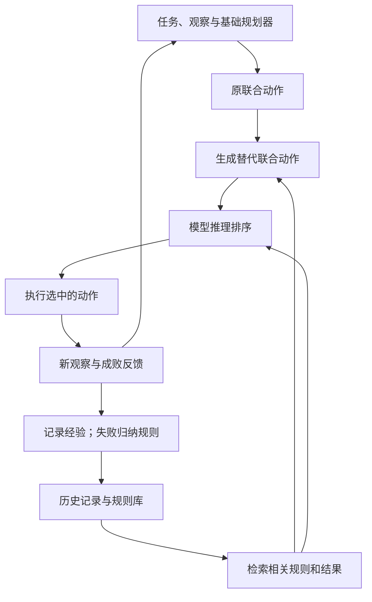

[[00-Agent-Memory-Experience-Reuse|← 论文索引]] · [[G-Memory-2025-Hierarchical-Memory|对照 G-Memory]] · [[GPTSwarm-2024-Optimizable-Agent-Graphs|对照 GPTSwarm]] · [[EvolveR-2026-Experience-Principles-Policy-RL|对照 EvolveR]]

# EvoCF：失败规则如何指导多智能体下一步行动

> [!abstract] 作者到底做了什么？
> 在多机器人每一步行动前，根据历史失败总结出的规则，修改原定的联合动作，生成多个替代方案，再用检索到的规则和过去结果指导模型选一个执行。
> **输入**：任务、各机器人当前观察、原定动作、历史经验。**即时输出**：每个机器人当前这一步做什么。**长期更新**：经验记录和规则库。没有训练 LLM 参数，也没有重写 Harness 源码或学习通信拓扑。

> [!info] 阅读与证据范围
> 本笔记依据 ICML 2026 正式版全文 14 页：正文 §1–5、全部实验表与附录 A/B。2026-10-22 检查官方会议页面、作者主页并联网检索，未定位到作者发布的 EvoCF 代码链接；不能逐项确认论文机制的实现。
> 另核对了其底层 LLaMAR/MAP-THOR 的公开 checker，只用于解释基准评测，不能把底层仓库当作 EvoCF 的开源实现。教学例子、原文案例、作者解释和本笔记判断分开标明。

## 1. 论文信息与为什么选它

| 项目 | 信息 |
| --- | --- |
| 正式题目 | EvoCF: Multi-Agent Collaboration via Agentic Memory-Driven Evolutionary Counterfactual Planning |
| 作者 | Haotian Chi、Zeyu Feng、Xingrui Yu、Linbo Luo、Yew-Soon Ong、Ivor Tsang、Hechang Chen、Yi Chang、Haiyan Yin |
| 机构 | 吉林大学及其知识驱动人机智能研究中心；新加坡 A*STAR 的 CFAR/IHPC；南洋理工大学；西安电子科技大学 |
| 正式发表 | **ICML 2026 主会**，PMLR 306:19424–19437 |
| 官方记录 | [PMLR 页面](https://proceedings.mlr.press/v306/chi26b.html) |
| 原文 | [正式版 PDF 在线访问](https://raw.githubusercontent.com/mlresearch/v306/main/assets/chi26b/chi26b.pdf) |
| 作者入口 | [Haiyan Yin 主页](https://haiyanyin.github.io/)，列为 ICML 2026，目前该条目只有 Paper 链接 |
| 代码 | 本次未定位到官方 EvoCF 实现，不填猜测的 GitHub 地址 |
| 基础设施 | [LLaMAR / MAP-THOR 官方仓库](https://github.com/nsidn98/LLaMAR)，是依赖基准和基础框架，不是本文实现 |

论文另有旧标题“Multi-agent Collaboration with Memory-guided Evolutionary Counterfactual Planning”及 ICLR 投稿/Workshop 页面；本笔记按正式 ICML 记录认定身份，旧页面不构成第二篇独立工作。

选它的理由：此前的 G-Memory 讲“检索什么经验”，GPTSwarm 讲“优化信息连边”，EvolveR 讲“经验加参数 RL”。EvoCF 把经验直接用于**产生候选行动和选择行动**，正好帮助检查“经验总结与实际决策是否连接紧密”。它的实验属于具身模拟环境；阅读重点是可迁移的规划机制，不表示必须转向机器人领域。

## 2. 出发点：已经能纠错，为什么还需要它？

基础框架 LLaMAR 已有四个角色：

1. Planner：把大目标拆成子任务。
2. Actor：根据观察给各机器人选动作。
3. Corrector：执行失败后提出纠正建议。
4. Verifier：检查子任务是否完成，维护进度。

EvoCF 并非首次提出“执行后反思”。它针对的问题是：原规划器当前给出了一个方案，即使会事后纠错，也可能反复遇到相同的物理前提错误或相互阻挡。能否**在执行之前**利用历史经验，明确考虑几种不同分工或动作，再决定执行哪种？

> [!example] 贯穿全文的教学例子，并非论文实测轨迹
> 目标：Alice 和 Bob 把食品放进冰箱。
> 当前 Alice 拿着面包；Bob 站在冰箱门边，门还关着。原计划是：
> Alice 放入面包；Bob 向冰箱前移动。
> 问题：Alice 缺少“门已打开”这一前提；Bob 的移动还可能占住通道。
> 一个更合适的当前动作是：Alice 暂时等待，Bob 打开冰箱。下一轮再依据新观察决定如何放面包。

关键不是背下这两句动作。系统要从过去的失败提取出可以迁移的条件，例如“放入封闭容器前先打开容器”，并据此修订当前计划。

## 3. “一个计划”究竟多大？两个 agent 指什么？

论文 §3.3 Eq.3 的核心优化单元是：

$$
P_t=\langle a_t^1,\ldots,a_t^N\rangle
$$

- t：当前高层决策时刻。
- N：环境中机器人的数量。
- a_t^i：第 i 个机器人当前这一步的动作。
- P_t：当前一步的联合动作元组。

两个机器人时，它可能是“放面包，移动到冰箱前”。**不是把整道任务从开始到结束的完整程序作为一个候选。** 完整执行轨迹由连续多轮这样的决策形成。

“两个 embodied agents”是两个环境机器人；Planner、Generator、Evaluator 是规划管线里的模型调用角色。不能把“2-agent 实验”理解成“只调用两个 LLM 模块”，也不能默认每个机器人有独立训练的模型。

模型输出的动作属于预定义接口：导航、转向、拿取、放置、开关物体、移动、清洁、等待等。底层执行器与模拟器负责执行和返回反馈；本文没有让模型从零编写这些物理能力。

### 执行闭环与学习闭环

- **执行**：选动作 → 环境执行 → 观察更新。
- **跨轮经验更新**：保存记录 → 失败提炼规则 → 后续检索。
- **模型参数训练**：本文未做。
- **Harness 代码搜索**：本文未做。

图展示的是机制信息流，不是论文用图数据库保存的结构。本文没有给出可学习的通信拓扑或显式经验图遍历算法。

## 4. 记忆怎么形成和检索？

### 4.1 保存的单位是带解释的联合转移

§3.2 将记录写作 m=(o_t,a_t,{ψ_t^k})：

- o_t：各 agent 的局部观察集合。
- a_t：实际联合动作。
- ψ：不同类型的结构注释，包括子目标与角色、观测效果、前提、失败代码与规则片段。

文字中还描述检索可取历史后继结果 o_(t+1)。因此应理解为带结果解释的联合转移经验，而不是只有一句任务总结。Eq.1 的简写没有完整列出所有数据字段，不能据此虚构固定数据库 schema。

经验记录可带 confidence、support 等元数据；但论文未充分交代置信度如何校准、支持次数怎样更新，不能说它有已核验的概率估计程序。

### 4.2 失败 → 规则：模型在做什么？

附录 A 的归纳器接收：

- 当前子任务；
- 观察；
- 实际动作；
- 失败原因。

输出包括逻辑式规则、自然语言说明和类型。教学例子可提炼：

$$
\operatorname{PutInto}(a,x,c)\Rightarrow
\operatorname{Holding}(a,x)\land\operatorname{Open}(c)
$$

这是说明性写法：放入物品需要拿着物品，容器需已打开；不声称这条公式原样出自论文。

原文把规则分成六类：

| 大类 | 三个维度 | 在决策中的意义 |
| --- | --- | --- |
| 单体可执行性 / 任务依赖 | 动作有效性、物体可达性、空间可行性 | 当前机器人是否具备执行条件 |
| 团队协调 | 时序一致性、负载均衡、目标一致性 | 多机器人是否相互干扰、等待合理、分工相容 |

两类存在实际重叠，例如先开门再放物既是动作前提，也可成为团队时序条件；不要把它们误解为互斥、经过形式证明的逻辑分类。

规则库用下式概括更新：

$$
\mathcal R\leftarrow
\operatorname{Dedup}\bigl(\mathcal R\cup C_{\rm gen}(m)\bigr)
$$

C_gen 是模型归纳器，Dedup 是去重。论文没有给出足够细的去重阈值、冲突消解、过期淘汰与错误规则撤回算法，不能补写成完整生命周期系统。短期是当前任务上下文，长期是跨 trial 的记录与规则库；未给出独立的短期记忆管理策略。

### 4.3 查询组成丰富，但检索核心仍是向量 top-k

查询可以组合当前观察、子目标、动作和语义标识。§3.3 Eq.2 的邻域选择为：

$$
\mathcal N(q)=\operatorname{TopK}_{m\in\mathcal M}
\frac{e(q)^\top e(m)}{\|e(q)\|\|e(m)\|}
$$

e 是嵌入函数，q 是当前查询，M 是经验集合。召回记录后取出关联规则与过去结果，供生成器和评估器使用。论文分析默认 K=5。

**组合检索**指查询可包含多个情境字段，不是已展示的组合优化检索器、关系图遍历或新的学习式召回算法。embedding 模型、索引实现和精确查询模板未充分公开。

经验由规划管线集中使用，可服务全部环境机器人；论文没有研究各机器人私有记忆如何同步、冲突合并或分布式传播。

## 5. 从原动作到候选：四种“变异”具体怎么改？

模型接收当前子任务、观察、原计划和检索约束，然后输出多个联合动作候选。附录提示词明确每个候选是**每个机器人各一个动作**。

| 算子 | 实际含义 | 教学示意 |
| --- | --- | --- |
| SwapAgent | 交换动作所属机器人 | 让靠近门且空手的 Bob 接管开门动作 |
| InsertAction | 附录写为替换动作动词、保留对象 | 把“放入冰箱”改成“打开冰箱” |
| DeleteAction | 当前步改为等待 | Alice 等 Bob 开门 |
| ReplaceObject | 保留动作类型，替换目标对象 | 改去另一个可访问的目标 |

> [!warning] InsertAction 的名字有歧义
> 附录定义是“replace the action verb, keeping the object the same”，并不是必然在一条长序列中增加一个时间槽。它可以让当前先执行一个修正动作，从而在完整轨迹里增加必要步骤。
> 附录把第四项称为 ReplaceObjective，正文 Eq.4 称为 ReplaceObject；两者描述都是替换动作的对象参数。

回到教学例子，可以提出：

- 原计划：Alice 放面包，Bob 移动。
- 候选 A：Alice 等待，Bob 开门。
- 候选 B：Alice 开门，Bob 等待。
- 候选 C：Alice 继续放面包，Bob 继续移动。

这些仅是教学候选。当前观察若显示 Alice 双手受限、Bob 正好能开门，则 A 更合理。模型需要结合动作接口与实际条件判断，不能由这几条规则保证 A 一定成功。

### 为什么称为反事实和进化？

- **反事实**：假设当前换一种动作或分配，会不会更好。
- **进化**：把联合动作当作一个个体，每个机器人的动作当作“基因”，通过离散编辑生成变体。
- **证据边界**：正式版没有给出完整种群大小、代数、繁殖/淘汰调度等算法参数。不能扩写成已实现的多代遗传算法。
- **没有 MCTS/UCT**：本文没有树节点访问次数、根到叶选择、回传价值等机制。
- **没有因果效应估计**：未对所有候选做真实环境回滚试验，也未用反事实基线计算各 agent 的因果贡献；与 COMA 的反事实优势不是一回事。

## 6. 评估器怎么选？谁真正验证成功？

### 6.1 选动作之前：模型根据证据排序

附录 A 的 Evaluator 接收：

1. 当前子任务与观察；
2. 候选联合动作；
3. 检索到的约束；
4. 相似经验的结果。

提示词明确要求**不赋数值分数、不模拟环境**，而是说明哪些候选符合规则、避开旧失败、可能推进任务，然后输出排序和理由。正文 Eq.6 的 Rank ∝ f_eval 是抽象排序关系，不是训练出来的 reward model、已知奖励公式或可执行物理验证器。

在例子中，它可能因候选 A 满足“先开门”的前提而把 A 排前。规则在两个位置起作用：

- 生成阶段：避免只生成重复旧错的候选。
- 选择阶段：即使候选看起来合理，也要再对照规则和历史结果比较。

**这种耦合是本文最值得学习的设计。** 但生成器和评估器可能共享错误规则，形成共同偏差，不能把有理由的排序当作正确性证明。

### 6.2 执行动作之后：环境反馈；最终成绩由基准检查

选中的联合动作交给模拟器执行，返回新观察和执行反馈；基础 Corrector/Verifier 继续参与任务进度管理。失败进入归纳器，增加后续规则与经验。

评估器预判、任务中 Verifier、benchmark checker 是三种不同职责：
- 预判哪个动作好；
- 运行时判断子任务进展；
- 根据基准协议记分。

本文不是“模型写一段理由，评委模型觉得不错就算任务成功”。

### 6.3 原文真实案例及冲突

Figure 3 展示“Turn on all stove knobs”：Alice 导航受阻，Bob 与目标未对齐；从失败提炼避碰和朝向规则，再选择 Rotate(30)、Move(left) 等修正动作。

不过 §4.2 正文又称 Step 10、Open All Drawers，图是 Step 5/6、炉灶任务；CF Plan B 在正文列表与图的动作也不同。它说明设计意图，但不是一致、可复放的完整日志。本笔记以无冲突的教学例子解释流程，明确不把它伪装成论文实测轨迹。

## 7. 创新到底在哪里？哪些部分只是常规组件？

| 对照 | 已有能力 | EvoCF 的具体增量 |
| --- | --- | --- |
| LLaMAR | 分解、执行、纠错、验证 | 执行前显式生成并比较替代联合动作，加入跨 trial 失败规则 |
| Reflexion 类方法 | 保存反思，影响下次行为 | 组织成带类型的约束，同时指导候选生成和排序 |
| ToT 等搜索 | 产生多个备选并选择 | 候选聚焦联合动作编辑，利用环境失败提炼的规则 |
| [[G-Memory-2025-Hierarchical-Memory|G-Memory]] | 图组织案例和经验并检索 | 本文把检索结果接入行动候选生成/选择；不以新记忆图结构为核心 |
| [[GPTSwarm-2024-Optimizable-Agent-Graphs|GPTSwarm]] | 通过奖励更新连边策略 | 本文修订环境联合动作，没有学习通信边 |
| [[EvolveR-2026-Experience-Principles-Policy-RL|EvolveR]] | 原则记忆加 GRPO | 本文不做参数 RL；强调推理时的经验条件规划 |

**判断**：主要是规划管线与经验使用方式的系统方法创新，构成“失败 → 规则 → 有针对性的候选 → 证据排序 → 执行”的闭环。没有新 RL 算法，向量检索本身也不是主要原创点；“符号”和“反事实”不等于形式验证或因果识别。

作者主张其是首个统一相关组件的框架；本笔记不将优先权主张当作已经独立完成的全面文献查新结论。

## 8. Benchmark：究竟测什么？

**正式版实际报告一个环境体系：MAP-THOR。** 不要因摘要/结论使用 benchmarks 复数，就增写多个独立基准。LLaMAR 原论文还有 Search & Rescue，不代表 EvoCF 本篇也做了该实验。

| 维度 | 论文报告 |
| --- | --- |
| 环境 | AI2-THOR 构建的家庭三维模拟环境；实验使用单房间 floor plan |
| 输入 | 自然语言家务目标、各机器人的局部视觉观察及运行上下文 |
| 输出 | 多轮联合高层动作，改变环境状态 |
| 任务 | 放食品进冰箱、打开抽屉、摆放物体、操作炉灶等 |
| 规模 | §4 写 45 个任务，各在五种布局实例化；不能据此直接当作 225 个语义独立任务或多种子统计 |
| 默认机器人 | 2 个，另测 3/4 个 |
| 步数上限 | 30 个高层决策步；不等于固定 token 或美元预算 |
| 模型 | 主实验 GPT-4V；另有 Claude 3.5 Sonnet、GPT-4o mini |
| baseline | Act、ReAct、CoT、SmartLLM、CoELA、LLaMAR |
| 数据隔离 | 未充分说明主表 memory 初始化、跨 episode 清理/保留、任务顺序和经验构建/测试划分 |
| 未充分报告 | 候选数、搜索轮数、embedding 模型、检索库规模、随机种子及主要结果置信区间 |

### 五个指标分别衡量什么？

- SR：整次 episode 的全部规定子任务完成比例。
- TR：episode 内已完成子任务的比例；部分完成可得分。
- C：论文称目标对象的成功交互覆盖。
- B：机器人成功高层动作数的最小值/最大值，衡量参与均衡。
- L：结束或超时前使用的高层步数。

**SR 和 TR 不一样**：搬好两样食品但漏了一样，可有部分子任务分，但整任务不成功。B 高不必然表示更优任务分配，因为能力和工作量本来就可能不对称。

### 底层代码核对：可验证不等于毫无评测假设

核对 [LLaMAR 版本 d2b74ca](https://github.com/nsidn98/LLaMAR/tree/d2b74cac79a0f070d87a150712f8e2ae174920be)，不是 EvoCF 代码：

- BaseChecker 根据结构化动作、执行 success 和 inventory 判断子任务。
- get_transport_rate 为已完成带编号子任务数/总子任务数。
- check_success 比较两者数量是否相等。
- 冰箱任务的 checker 列出拿取、携物导航、开门、放入和关门等目标动作。

因此最终成绩可以自动检查，不是仅依据自由文本表述相似度。它同时包含动作历史与任务定义的假设，不应描述为对最终世界状态的无限完备验证。

**C 的实现差异**：该基础版本的 check_coverage 看到动作字符串提到目标对象就记录，不显式检查 success；所以论文“成功交互覆盖”与可访问底层代码口径不完全一致。没有 EvoCF 实现，无法确定作者是否另行修改，不能断言 0.99 就是 99% 的动作执行成功率。

## 9. 少量关键结果与证据边界

### 9.1 主表：成功率提升，步数下降

正式版 Table 1：

| 方法 | SR | TR | C | B | L |
| --- | ---: | ---: | ---: | ---: | ---: |
| ReAct | 0.34 | 0.72 | 0.92 | 0.67 | 24.08 |
| LLaMAR | 0.72 | 0.93 | 0.97 | 0.85 | 20.63 |
| EvoCF | **0.84** | **0.95** | **0.99** | **0.89** | **18.69** |

0.72→0.84 是 **+12 个百分点**，相对约 +16.7%。引言“18%”、正文“16%”不是同一个精确数；不要用宣传句代替表格核算。L 相对下降约 9.4%。

这支持报告设置下增加候选生成与经验筛选有效，不足以排除额外计算预算带来的作用。缺少对齐总 token 的多采样/自一致性强对照。

### 9.2 消融：三模块均有增量，但不能因此证明独占机制

Table 5：

| 配置 | SR |
| --- | ---: |
| 随机 CF 生成器 | 0.68 |
| 启发式评估器 | 0.72 |
| 移除规则归纳器 | 0.75 |
| 完整系统 | 0.84 |

经验引导的候选、记忆评估和规则归纳都有作用证据。但正文说随机变异“相比 LLaMAR 小幅改善”，与主表 0.72、此处 0.68 冲突；本笔记以表值为准，不复述为提升。

### 9.3 检索数量和机器人数量

Table 4：K=1/3/5/10 的 SR 是 0.77/0.81/0.84/0.82。经验并非越多越好，K=5 仅是该设置中的最优，不是普适检索定律。

Table 2：2/3/4 个机器人 SR=0.84/0.87/0.82，B=0.89/0.81/0.74。更多机器人并非单调改善；拥挤和协调负担是作者解释，实验没有单独隔离所有原因。

Table 3 报告原计划仍被采用约 57%，替代方案约 43%；这不是 43% 的失败被治愈，也不是 43% 的候选都成功。

### 9.4 跨任务迁移证据很小，仍值得看

Table 6 从“食品入冰箱”提炼规则，冻结后注入另外两个任务，不用生成器/评估器、不再归纳新规则：

- 锅具放到炉灶：SR 0.60→0.80。
- 打开全部抽屉：SR 0.40→0.60。

这比只看完整系统更接近隔离规则迁移收益。但仅两个目标任务，无充分大规模独立测试，不能证明广泛跨领域泛化。

Table 7 在同模型 baseline 上比较：Claude 3.5 Sonnet 0.70→0.81；GPT-4o mini 0.61→0.74。支持不只单一骨干，仍未覆盖模型版本漂移与相等成本评测。

## 10. 成本与复现：更少步数不等于更快

附录 B.1：

| 整次 episode 的报告值 | LLaMAR | EvoCF |
| --- | ---: | ---: |
| 总耗时 | 166.43 秒 | 269.76 秒 |
| 总 token | 35.65K | 47.82K |

据此换算：总耗时约 **+62.1%**，总 token 约 **+34.1%**。附录声称“总体更快”，与表中数值方向相反；最多能说环境决策步更少，不可说端到端延迟更低。

另外：
- 附录用 21.87→18.69 描述步数，主表 LLaMAR 是 20.63，口径不明。
- Table 8 各模块单步耗时合计 13.55 秒，与报告整次耗时不是简单一致的乘积。
- Table 9 EvoCF 单步模块 token 合计 13.42K，与整次 47.82K 不构成清楚的直接累计口径。
- 模块是否条件触发、采样范围及累计口径未交代清楚，不能按这些数自行预测整个复现费用。
- GPU/CPU、显存、完整评测耗时和美元费用未报告；无参数训练不等于无需图形模拟和模型服务资源。
- 基础 LLaMAR README 提示旧 GPT-4V 接口已弃用，换模型可能不能复现原数；这是底层仓库提示，不是 EvoCF 重新实测结论。
- 基础框架报告过自己的历史 API 费用，不能转写成 EvoCF 的费用。

### 可获得与缺失的材料

可获得：正式全文、模块提示词、MAP-THOR/LLaMAR 公开环境与 checker。缺失：本次未定位到作者 EvoCF 实现、精确检索配置、候选预算、规则维护细则、memory 隔离协议。

据附录重写模块可以做概念复现，但不能声称已达到作者原实现或已经复现 0.84。最难的是重建实验状态和预算，而不只是编写三个 prompt。

## 11. 研究逻辑重建与个人选题关系

### 有依据的设计逻辑重建

执行后纠错仍可能反复犯错 → 保存失败条件 → 归纳可复用规则 → 用规则生成有针对性的替代动作 → 用过去结果再次比较候选 → 只执行一个 → 新失败继续增补规则。

这是本笔记依据公开设计重建的逻辑，不宣称知道作者未公开的真实思维过程。

| 研究设想 | 对应 |
| --- | --- |
| 经验优化 Harness | 可迁移：改善固定规划管线中的决策，没有源码自进化 |
| 长短期记忆与检索 | 直接相关：当前上下文与跨 trial 规则/经验；维护协议仍不完整 |
| 单 agent 执行 | 可迁移：动作前提和局部修复适用，但主实验为多机器人 |
| 多 agent 运行图协作 | 部分直接：联合动作和分工调整；未优化通信拓扑或运行图结构 |
| RL 强化 / 参数蒸馏 | 未覆盖 |
| 递归自我改进 | 有限外部经验闭环；未展示归纳器/优化器递归改写自身 |

**小实验建议，属于提案**：固定同一模型与总 token 预算，在一个可执行工具任务中比较“仅检索规则”“无规则多候选”“规则同时指导生成与选择”。用独立测试计任务成功率、错误规则复用率和调用成本；再撤掉或污染规则，检查所谓耦合是否真的影响动作，而不只是生成看起来更好的解释。不必先引入 RL。

## 12. 阅读路线与三个研究问题

建议次序：

1. 先读附录 A 的三个提示词，确认输入输出及每候选“每 agent 一个动作”。
2. 再读 §3.2、Eq.2–6，明确记录、规则、候选和排序各指什么。
3. 看 Figure 1 建立调用关系；Figure 3 只用于理解设计，留意日志叙述冲突。
4. 看 Tables 1/5/6，区分主结果、组件消融和规则迁移。
5. 最后看附录 B.1 成本，再审视“高效”和“进化”的含义。

值得继续问：

1. 规则同时进入生成器和评估器，收益来自哪一处？在相同预算下是否存在超出两者简单叠加的交互收益？
2. 生成错误或环境变化时，规则何时失效？怎样用少量真实执行证据撤回错误约束，避免两个模块共同受骗？
3. 一步联合动作修订，能否扩展到跨步骤的依赖子图编辑？怎样证明提升来自结构调整，而不是增加模型采样？

## 原始来源

1. [ICML 2026 正式会议记录](https://proceedings.mlr.press/v306/chi26b.html)。
2. [正式全文及全部附录](https://raw.githubusercontent.com/mlresearch/v306/main/assets/chi26b/chi26b.pdf)：§3.2–3.3 方法，Tables 1–7 实验，附录 A 提示词，B.1 成本，B.2 规则实例。
3. [官方记录关联的 OpenReview](https://openreview.net/forum?id=FsSirPJy9U)；本次页面出现浏览验证，全文以 PMLR 正式 PDF 为准。
4. [作者主页](https://haiyanyin.github.io/)；2026-10-22 核对条目及代码链接状态。
5. [基础框架与基准官方仓库](https://github.com/nsidn98/LLaMAR)，[基础论文正式记录](https://proceedings.neurips.cc/paper_files/paper/2024/hash/7d6e85e88495104442af94c98e899659-Abstract-Conference.html)；仅为依赖来源。
6. [所核对的 BaseChecker](https://github.com/nsidn98/LLaMAR/blob/d2b74cac79a0f070d87a150712f8e2ae174920be/AI2Thor/baselines/utils/checker.py)。
7. [冰箱任务 Checker](https://github.com/nsidn98/LLaMAR/blob/d2b74cac79a0f070d87a150712f8e2ae174920be/AI2Thor/Tasks/1_put_bread_lettuce_tomato_fridge/checker.py)。
