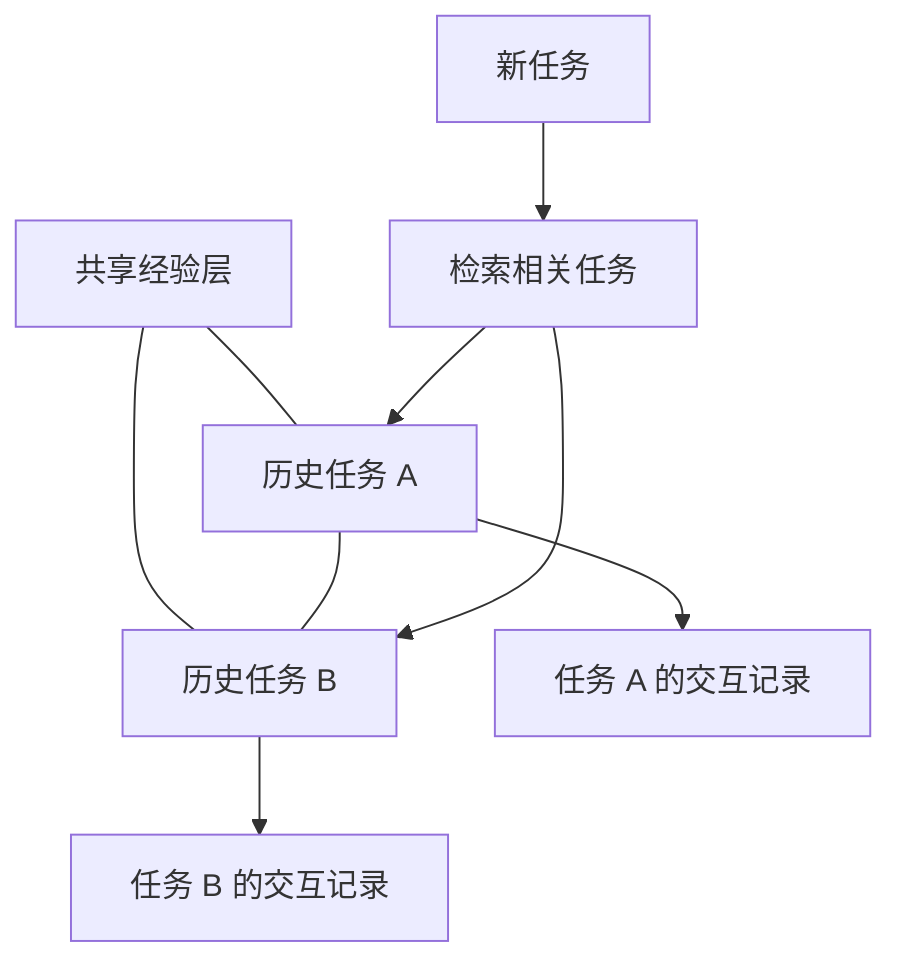

[[00-Agent-Memory-Experience-Reuse|← 论文主页]] · 对照阅读：[[AFlow-2025-Workflow-Optimization|AFlow]]

# G-Memory：让多智能体复用历史任务与抽象经验

> [!abstract] 一句话抓住工作
> **作者给已有多智能体系统增加一个跨任务记忆模块：保存做过的任务与过程，总结可复用经验，在新任务开始时找出相关案例和经验，写进智能体的输入上下文。**
> 核心产物是外部记忆，不是新的模型参数，也不是自动生成的新工作流程序。

## 1. 论文信息与出发点

**原题**：G-Memory: Tracing Hierarchical Memory for Multi-Agent Systems。**发表**：NeurIPS 2025 主会。

正式 PDF 作者为 Guibin Zhang、Muxin Fu、Kun Wang、Guancheng Wan、Miao Yu、Shuicheng Yan；会议网页第四位显示 Frank Wan，引用时留意元数据差异。正式 PDF 机构为 NUS、Tongji University、NTU、WHU、A*STAR。[1]

多智能体可能有规划者、执行者、检查者。一道题做完以后，系统通常只留下最终答案，或者留下一大串消息。两种方式都有问题：最终答案丢掉“怎么做出来”的信息，原始消息又过长，下一次直接全部塞进去既贵也难用。

作者的出发点是组织记忆（organizational memory）：团队既需要保留具体事件，也需要积累跨事件的通用经验。一个 agent 能记住自己的对话，并不自动意味着团队能复用过去的协作经验。[1, §1–2]

**最重要的问题**：历史记录应该以什么层次组织，才能同时找到相似案例、提取一般规律，又不让上下文淹没新任务？

## 2. 输入、输出和运行边界

| 阶段 | 输入 | 输出 |
| --- | --- | --- |
| 新任务开始前 | 新任务描述、历史任务库、经验库、agent 角色 | 相关历史案例与经验文本，必要时角色化 |
| 执行中 | 当前任务、检索记忆、当前上下文 | 动作、消息、观察、任务结果 |
| 任务结束后 | 执行记录、成功或失败等反馈 | 新的任务记录、经验更新、关联与分数变化 |

这里的“学习”主要是**新增、总结、筛选和更新外部记忆**。原有 AutoGen、DyLAN 或 MacNet 继续负责执行。记忆可以影响其决策，但不能直接等同于改写框架源码或自动重连 agent 拓扑。

> [!important] 三张记忆图 ≠ 三张执行图
> G-Memory 的图描述“过去发生了什么、哪些任务相关、哪些经验由哪些任务支撑”。多智能体运行图则描述“这次由谁调用谁、谁给谁发消息”。两者关联，但职责不同。

## 3. 三层图到底存什么

| 层次 | 一个节点是什么 | 边或关联是什么 | 核心作用 |
| --- | --- | --- | --- |
| 交互图 Interaction / Utterance Graph | 某个 agent 的一条原子消息：发言者 + 文本 | 较早消息传给后续消息并对其产生影响 | 保留单次任务的交互细节 |
| 任务图 Query Graph | 一次历史任务：任务内容、成败状态、对应交互图 | 历史任务之间的语义相关关系 | 跨任务索引与邻居扩展 |
| 经验图 Insight Graph | 一条抽象经验及支持它的任务集合 | 经验之间经由某个任务产生的联系；另有经验—支持任务关联 | 跨任务经验归纳与溯源 |

任务图不是只有一句总结而没有轨迹：**它在逻辑上关联该任务的交互图**。实际存储可以把图索引和完整任务记录分开保存，不要求把所有消息直接塞在图节点属性里。[1, §3]

交互图通常每个任务一份；不同任务的消息节点并不自然直接连在一起。跨任务组织主要由任务图和共享经验层完成。

经验可以由多个任务共同支撑：例如两个不同物品的清洗任务，都支持“先确认携带物品，再操作清洗设施”。支持任务集合让通用规则保留证据来源。论文还定义经验—经验—任务的三元关联，表示某条旧经验经由某个任务为另一条经验提供上下文。[1, Eq.3]

> [!warning] 术语纠正
> 对话中“消息图”“实际轨迹”“抽象经验图”容易被说成三张并列图。论文正式三层是**交互图、任务图、经验图**。动作—观察轨迹是任务执行内容；它可以与交互消息共同记录，不必另算一张论文定义的第四图。

上图只表示层次与关联，不表示底层 agent 的实时通信拓扑。

## 4. 用一个例子理解论文流程

> [!example] 教学例子，不是论文逐字案例
> 新任务是“把清洗过的杯子放到指定桌面”。历史库里有成功的“清洗盘子并放好”，也有失败的“没有拿到物品就尝试清洗”。

### 4.1 先找任务，再取两种粒度的信息

先将新任务编码为向量，按余弦相似度找最相关的历史任务，再沿任务图扩展一跳邻居。理由是：文本最相近的任务未必包含最有帮助的操作经验，相关邻居可能补充另一类案例。

找到历史任务后，**向上**找支持任务集合与这些任务有交集的经验；**向下**找具体交互过程，用 LLM 判断相关性并保留关键内容。论文将向下压缩描述为 LLM 辅助的图稀疏化，目的是保留对当前任务有用的关键对话，而不是把整段历史塞进 prompt。[1, §4.1–4.2]

上行关联可概括为：

$$
I_{\mathrm{selected}}=\{i\mid \Omega_i\cap Q_{\mathrm{retrieved}}\neq\varnothing\}
$$

这里 $\Omega_i$ 是经验 $i$ 的支持任务集合，$Q_{\mathrm{retrieved}}$ 是本次找到的任务集合。含义是“先找到相关事件，再找到这些事件支持过的经验”，不是必须直接对经验文本做向量搜索。

### 4.2 分给 agent，再执行任务

论文设计进一步按角色调整记忆。例如规划者收到“先拿取、再清洗、再放置”的阶段规则；检查者收到“确认清洗条件和最终位置”的检查依据。历史轨迹提供具体操作参考，抽象规则提供可迁移原则。

执行器仍要依据**当前环境观察**选动作。旧任务的“盘子位于某个柜子”不能直接当成当前杯子的位置，否则经验检索就变成了错误状态复用。

实现通常在任务开始时调用一次记忆模块。按每轮对话或某个 agent 的需要反复检索，是论文允许的扩展配置，不是应该默认假定已做的实验流程。[1, §4.2]

### 4.3 任务结束后回写

保存新任务及其过程和结果；把它与相关历史任务连接；结合成功/失败案例提炼经验，或更新既有规则。于是“下一次任务”的可用记忆发生变化。

注意，任务失败只说明这次整体没有完成。把失败归因到某条记忆是否合理，还需要额外证据；不能因为检索了三条规则，就认定三条都导致失败。

## 5. 公开代码实际怎么做：必须和论文架构分开

> [!info] 核对范围
> 以下来自官方 `GMemory.py`，以及本次对话此前核对的 `common.py`、AutoGen 调用路径、格式化函数与 `tasks/run.py`。这些是特定公开实现路径的事实，不能不加检查地推广到所有框架分支。[3–6]

### 5.1 任务和轨迹如何保存

`main_memory` 使用 Chroma。文档正文为 `task_main`，元数据序列化 `MASMessage`，保存任务描述、轨迹、结果、状态链和附加字段。`TaskLayer` 使用 NetworkX 的无向图，以 `task_main` 作为节点标识。

新增任务时搜索 10 个近邻，用实现中的 `1 - distance` 与 0.7 阈值决定是否建边。**这个值是否严格等于余弦相似度，要看 Chroma 的距离配置，不能仅因变量叫 similarity 就作保证。**

`StateChain` 按环境步骤保存状态，每个状态可含 agent 消息图，并在图属性存动作、观察和 reward。因此一个任务记录可以覆盖团队执行过程；它不是把每个 agent 完全隔离成互不关联的私有日志。

但 `_extract_mas_message()` 的主要压缩路径是：

1. 复制记录，移除 reward 小于 0 的状态。
2. 将剩余状态的 **action + observation** 拼成轨迹文本。
3. 对成功任务，用此文本覆盖 `task_trajectory`。
4. 去掉数字形成 `clean_traj`，让 LLM 抽取 `key_steps`。
5. 失败任务额外总结 `fail_reason`。

这段逻辑不等同于“依据当前新任务，在消息依赖图上进行精细子图检索”。删除数字也可能损失计数或物体标识信息；这是复现时值得检查的实现选择。

### 5.2 检索案例：代码调用顺序

假设最终希望获得 $S$ 个成功案例、$F$ 个失败案例、$I$ 条经验：

1. `retrieve_memory()` 先向内部请求较宽候选，数量分别为 $2S,2F,2I$。
2. `TaskLayer.retrieve_related_task()` 向量检索任务，再做默认 1-hop 邻域扩展。
3. 通过任务文本查回 Chroma 记录，拆成成功和失败两组。
4. 按与新任务的余弦相似度过滤、排序和截断。
5. 成功案例再让 LLM 根据任务描述和轨迹判断对新任务的相关程度，重排后保留 $S$ 个。
6. 失败案例直接截取前 $F$ 个，不走同样的 LLM 重排。

**代码细节**：当成功或失败候选不足时，代码会用一次带 label 过滤的向量搜索结果替换该组列表；随后试图追加的循环存在自包含判断，因此不是稳健地把旧图扩展结果与新候选合并。不要在复现说明中写成“必然保留全部图邻居并补齐”。

### 5.3 检索经验：代码是另一条分支

`InsightsManager.query_insights_with_score()` 另行检索 4 个成功任务、2 个失败任务，把它们的 `task_main` 与当前任务文本组成集合。然后检查每条规则的 `positive_correlation_tasks` 是否包含这些任务，根据命中次数排序。

因此，当前公开实现不是简单复用刚才那批“图扩展 + LLM 重排”后的案例来找规则；它有独立的任务召回。也不是直接用 LLM 给所有规则打相关分。

**两种 score 不能混淆**：规则长期保存的 `score` 用来维护规则质量；本次检索的命中次数用来排序经验。两者承担不同职责。

### 5.4 记忆如何真正进入 AutoGen 执行

已核对的路径在任务开始调用检索，接收成功案例和经验；失败案例返回值被忽略。成功案例的任务描述、轨迹与关键步骤被格式化成文本，与规则和新任务描述一起放进执行 prompt。

`use_projector` 控制是否将经验按角色进一步投影，命令行默认没有开启。当前任务动作循环持续加入新的上下文，但检索到的旧案例和经验通常来自任务开始的那次检索。

> [!warning] 消息交互图究竟有何实际用途？
> **论文设计**赋予它细粒度协作记录与压缩复用的作用；**已核对的 AutoGen 路径**主要把动作—观察轨迹、关键步骤和经验文本送入新任务。
> 该路径记录 agent 消息时，部分调用传入空的 `upstream_agent_ids`；没有证据说明这些消息依赖边在这里参与了检索排序或决策。
> 所以应写“结构具备保存能力，但这一路径中边的实际贡献未被确认”，不能写“消息图一定是性能提升的关键”。

### 5.5 经验如何更新、合并和淘汰

经验以含 `rule`、`score`、正相关任务、负相关任务的记录保存。LLM 比较成功与失败案例，或对多条成功案例归纳，输出 ADD、EDIT、AGREE、REMOVE 操作。

默认达到 5 条记忆后，每 5 条触发经验整理，每 20 条触发合并；合并涉及任务聚类与 LLM 处理。函数名 `finetune_insights` 指**修改文本规则**，不是微调基础模型。

被检索的经验暂存于 `insights_cache`；完成任务后 `backward` 按成功加 1、失败减 2 更新这些规则。规则清理删除分数不大于 0 的项。此处的反馈分配较粗，并没有精确测量每条经验的独立因果贡献。

公开实现以规则列表及任务关联为主，不能把论文经验图中的每一条超边都视为已经有独立超图数据结构和遍历算法。

## 6. Benchmark：环境、任务和指标

论文采用 5 个 benchmark，覆盖知识推理、具身动作和规划/游戏三类。[1, §5.1 与 Appendix A.1]

| Benchmark | 给智能体什么 | 要完成什么 | 本文指标 |
| --- | --- | --- | --- |
| ALFWorld | 家庭环境的文字观察、任务目标、可用动作 | 找到、拿取、清洗/加热/冷却、移动与放置物品等 | Success Rate，整任务成功率 |
| ScienceWorld / SciWorld | 文字科学实验环境、物品状态、操作反馈 | 导航、操作设备、执行实验、完成科学目标 | Progress Rate，任务进度 |
| AgentBoard 的 PDDL 任务 | 符号状态、动作条件、目标 | 在状态和动作约束下规划并完成目标；论文归为游戏领域 | Progress Rate |
| HotpotQA | 需要组合不同事实的问题与检索能力 | 找证据并进行多跳推理，返回答案 | Exact Match Accuracy |
| FEVER | 待核查陈述与证据检索能力 | 判断陈述是否被支持、反驳或证据不足 | Exact Match Accuracy |

**ALFWorld** 像在文字版房间里操作物体，不是使用真实机器人。**ScienceWorld** 要跟环境交互做实验，不是单纯科学选择题。**PDDL** 是规划描述语言，本文用的是 AgentBoard 中对应的任务集合，不是一个通用问答数据集。

**进度与成功不同**：完成了一部分子目标可能有进度分，却还没完成全任务。**FEVER 的标签准确率**也不能自动等同于完整证据检索质量。本文 HotpotQA 用完全匹配率，而 [[AFlow-2025-Workflow-Optimization|AFlow]] 用 F1，因此两篇的 HotpotQA 分数不能直接比较。

> [!example] 任务形态示例，仅供理解
> ALFWorld：“把清洗过的物品放到指定位置”；ScienceWorld：“操作装置并观察某物质状态变化”；规划：“当前状态下依次执行合法动作以满足多个目标”；HotpotQA：“先查出人物，再通过该人物查另一个事实”；FEVER：“找到证据判定一个事实陈述的真假或证据不足”。

## 7. 主要实验告诉我们什么

### 7.1 配置与对照

三个框架为 AutoGen、DyLAN、MacNet；三个模型为 GPT-4o-mini、Qwen2.5-7B、Qwen2.5-14B。Qwen 通过 Ollama 本地部署，GPT 通过 API。向量编码器为 all-MiniLM-L6-v2。[1, §5.1]

对照包括无记忆、Voyager、MemoryBank、Generative Agents，以及 MetaGPT-M、ChatDev-M、MacNet-M。后几者是移植或改造的**记忆机制**，不是把完整原始系统直接拿来做一场总能力比赛。

### 7.2 挑一组同框架同模型的结果

下面是正式论文 GPT-4o-mini + AutoGen 对应的结果：[1, Table 1]

| Benchmark | 无记忆 | G-Memory | 绝对变化 |
| --- | ---: | ---: | ---: |
| ALFWorld | 77.61 | 88.81 | +11.20 个百分点 |
| SciWorld | 54.49 | 67.40 | +12.91 个百分点 |
| PDDL | 23.53 | 27.77 | +4.24 个百分点 |
| HotpotQA | 28.57 | 35.67 | +7.10 个百分点 |
| FEVER | 57.13 | 66.24 | +9.11 个百分点 |

这组结果支持“加入该记忆系统能提高这些设置下的任务表现”。PDDL 仍只有 27.77，说明记忆并没有消除复杂规划的困难；其他数据集的改善也不应被表述成所有任务都能持续无限进步。

论文还比较记忆组件、检索数量和成本。组合轨迹与抽象经验的结果通常优于只保留一种，支持多粒度内容互补。但这并不自动证明**消息图边、经验超边、角色化**每一项都有独立贡献；要证明它们，需要控制文本内容、token 和调用次数的针对性消融。

### 7.3 这些实验没有直接测什么

- 主要评分对象是最终任务结果或进度，不是 agent 消息传递质量本身。
- 不直接证明一个失败来自哪个 agent、哪条消息或哪条记忆。
- 不证明长期加入经验后性能永不下降，也不证明跨领域迁移稳定。
- 论文报告 token 与运行时间分析，但“更省”依赖任务、框架和比较对象，不能断言任意设置都省成本。
- 在线累积记忆时，任务顺序、初始库、重跑是否清空、历史是否含当前测试实例都影响结果。公开实现会持久化记忆，因此复现必须明确重置策略；这不是已有泄漏的结论。

## 8. 研究逻辑重建与创新判断

> [!note] 这是依据论文组织的研究逻辑，不代表作者未公开的真实思考过程。

1. 仅留最终答案无法复用过程 → 保存任务执行细节。
2. 多 agent 消息太长 → 为细节建立压缩和选择机制。
3. 仅检索字面相似任务不够 → 用任务相关图扩大候选范围。
4. 个例有用但难泛化 → 将多个任务总结成抽象经验。
5. 抽象经验容易脱离依据 → 保存经验支持的任务集合。
6. 不同角色需要不同信息 → 设计角色相关的记忆投影。
7. 环境持续变化、规则可能错误 → 用新任务反馈更新经验。

**创新定位**不是“第一次给 agent 加记忆”，也不是“第一次总结规则”；其特点在于为 MAS 提出任务、交互、经验的层次组织和双向检索框架。当前公开代码中某些图机制被简化，阅读时应分别评价概念贡献、实现贡献和实验支持。

## 9. 与研究设想的关系与复现重点

它直接对应“任务轨迹 → 长期经验 → 检索辅助新任务”。对单 agent 也可迁移；对多 agent 的价值主要在共享记忆及潜在角色化。它没有直接学习拓扑、路由策略或参数化协作策略，也没有完成 RL / 参数蒸馏。

复现从“无记忆、仅轨迹、仅经验、两者组合”四组开始，保持同一执行框架和模型，记录任务成功率/进度、token、延迟、检索内容与错误经验比例。若要研究图结构价值，再增加“相同文本 + 不使用图边”的预算对齐对照。

代码与主要环境公开；完整运行涉及环境安装、嵌入模型、Chroma、NetworkX、模型服务和记忆持久化。论文当前查阅部分不足以给出完整统一 GPU 型号、显存和总训练/推理账单，标记为**未核定**，不补造资源数字。本文无参数训练，因此不能把本地 Qwen 推理资源写成训练资源。

## 10. 阅读路线与自测问题

**先读** Figure 2 → §3 三层定义 → §4.1–4.3 检索与更新 → Appendix A.1 的任务/指标 → 选定一个模型框架的主表 → 代码调用路径。

- 如果保持检索文本完全相同，消息依赖边是否还能带来额外收益？
- 一条抽象经验在什么条件下适用，如何保存例外与反例？
- 多条经验共同被检索但任务失败，如何避免把所有经验一起错误降权？

## 来源与代码导航

1. [NeurIPS 官方主会页面](https://proceedings.neurips.cc/paper_files/paper/2025/hash/136a45cd9b841bf785625709a19c6508-Abstract-Conference.html) · [正式论文 PDF](https://proceedings.neurips.cc/paper_files/paper/2025/file/136a45cd9b841bf785625709a19c6508-Paper-Conference.pdf)
2. [预印本 HTML](https://arxiv.org/html/2506.07398v2)；版本与正式论文元数据可能不同，实验表以正式 PDF 为准。
3. [记忆核心 GMemory.py](https://github.com/bingreeky/GMemory/blob/main/mas/memory/mas_memory/GMemory.py)
4. [记录结构 common.py](https://github.com/bingreeky/GMemory/blob/main/mas/memory/common.py)
5. [AutoGen 调用路径](https://github.com/bingreeky/GMemory/blob/main/tasks/mas_workflow/autogen/autogen.py) · [文本格式化](https://github.com/bingreeky/GMemory/blob/main/tasks/mas_workflow/format.py)
6. [运行配置](https://github.com/bingreeky/GMemory/blob/main/tasks/run.py) · [记忆提示词](https://github.com/bingreeky/GMemory/blob/main/mas/memory/mas_memory/prompt.py)

代码核对日期：2026-10-15。源码里的默认值不保证等于论文每组实验的实际参数；未追踪的框架分支不作统一断言。
