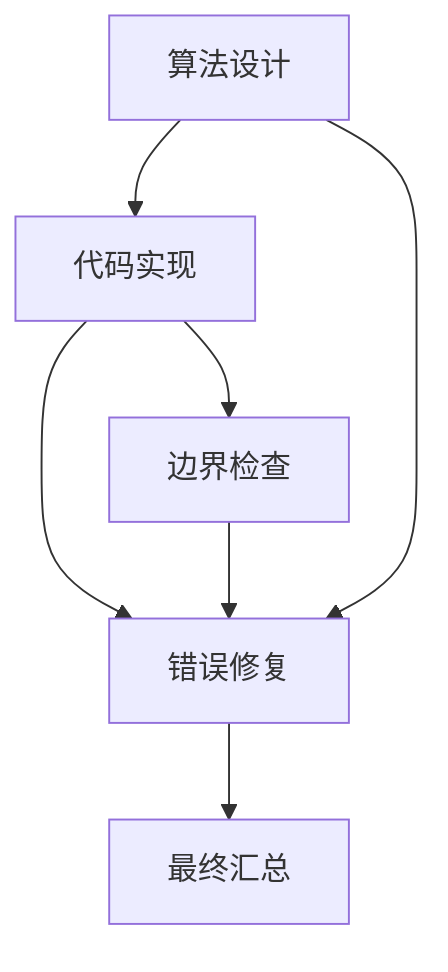

[[00-Agent-Memory-Experience-Reuse|← 论文索引]] · 对照 [[GPTSwarm-2024-Optimizable-Agent-Graphs|GPTSwarm]]、[[MaAS-2025-Cost-Aware-Agentic-Supernet|MaAS]]

# G-Designer：根据当前题目生成多智能体通信图

> [!abstract] 一句话说明作者做了什么
> 作者训练外部图生成器，根据题目和各agent的角色描述，生成“谁应该读取谁的输出”的通信图，再按图执行任务；设计意图是在简单题少通信，在复杂题增加有用协作。
> **输入**：题目、预置agent/角色与工具描述、参考图；训练还需要带可评测答案的任务。**输出**：当前题目的通信拓扑及团队答案。**改变对象**：图生成器参数和执行信息流；基础LLM权重固定，没有轨迹文本经验检索库。

> [!info] 阅读与核对范围
> 2026-11-05读取PMLR正式版全部15页，包括正文、附录A算法、B数据、C案例、D资源/扩展实验；对照arXiv v3（2025-02-06）及官方代码 `a6efcfa3b40bb4d9cbf46f883a95d62020bd8251`。对训练、图生成、消息调度、数据划分及评分做静态核对；未调用付费模型、未完整复现。
> 本文是未读的关键基础补读，补充运行图这一维度；不是按发布日期挑选的最新工作。去重范围为仓库当前索引和可访问会话记录。

## 1. 论文信息

- **题目**：G-Designer: Architecting Multi-agent Communication Topologies via Graph Neural Networks。
- **作者**：Guibin Zhang、Yanwei Yue、Xiangguo Sun、Guancheng Wan、Miao Yu、Junfeng Fang、Kun Wang、Tianlong Chen、Dawei Cheng；前三位共同贡献。
- **机构（正式版首页）**：同济大学、新加坡国立大学、香港中文大学、UCLA、中国科学技术大学、南洋理工大学、UNC-Chapel Hill。arXiv旧版部分署名机构不同，以正式版为准。
- **发表身份**：**ICML 2025主会**，PMLR267:76678–76692；不是Workshop。
- [PMLR官方页](https://proceedings.mlr.press/v267/zhang25cu.html) · [正式PDF及附录](https://raw.githubusercontent.com/mlresearch/v267/main/assets/zhang25cu/zhang25cu.pdf) · [arXiv版本信息](https://arxiv.org/abs/2410.11782) · [官方代码](https://github.com/yanweiyue/GDesigner)。

选择理由：它把“先找到一张通用图”改成“学习一个根据新题生成图的函数”。这与记忆文本拼接有实质区别，也与每题重新多轮搜索不同。不过公开实现和正式数学描述差距明显，读它应同时学习出发点与检查证据的方式。

## 2. 出发点：同一张协作图为什么不总是合适？

### 2.1 作者从什么现象出发？

引言图2比较不同通信方式：较简单的高中生物题中，链式结构与复杂GPTSwarm表现接近，而作者报告token为0.5k对7.8k；大学数学中复杂结构表现更好。这里的难易是作者对所选例子的解释，不是全数据集经独立校准的难度标注。

问题因此变成：

> 当团队成员已准备好时，能不能针对当前题目决定哪些信息交换值得发生，而不是给所有题套同一张图？

依据引言与§4，可重建其公开设计逻辑：

1. 多agent可能有用，但密集交流会重复信息，放大无关或错误意见。
2. 简单题未必需要完整团队讨论；复杂题可能需要算法、实现、测试和修复之间的信息传递。
3. 对每道题从头做完整结构搜索又很昂贵。
4. 因而把图设计变成一个**可复用的、以题目为条件的预测函数**。
5. 图的输入既有角色差异，也有关系信息，因此采用图网络；题目要影响所有成员，因此引入任务虚拟节点。
6. 为避免生成图过密或完全失去原有协作先验，再引入参考图与结构正则。
7. 图执行后的答案好坏，通过策略梯度训练外部生成器。

这是公开材料支持的研究逻辑重建，不宣称知道作者私下的思维过程，也不将“最先提出MACP”当作已验证的历史优先权。

### 2.2 贯穿例子：同样的成员，不同的信息流

论文图6含一个真实案例：实现`strlen(string)`，展示的图只保留“算法设计者→编程专家”；另有带运算符优先级的`do_algebra`案例，图更复杂。

下面使用一个**教学变体（不是论文运行记录）**贯穿方法：

> 实现`second_distinct_max(xs)`，返回列表中第二大的不同整数；不足两个不同值时返回`None`。

若只生成一次，可能误把排序后倒数第二个元素当答案，在`[4,4]`上返回4。这里测试者指出重复值问题，可能有用；但让所有成员反复阅读所有人长篇输出，也可能不划算。

预置团队有项目经理、算法设计者、编程专家、测试分析者、错误修复者。G-Designer希望学会按任务需求设计传信关系。下面只是可能的教学图：



A→B表示B的提示上下文会包含A的输出。它不表示“两个历史案例相似”，也不是一段永久技能程序。是否真的生成上述图，要由学习到的生成器和采样决定。

## 3. 图、输入输出与两个执行层次

### 3.1 任务执行层

给定当前题目Q和一张通信图：

1. 按依赖顺序调度agent。
2. 每个agent读取自己的角色提示、原始问题及前驱成员的输出。
3. 执行模型调用；编程路径也可以参考题面示例的测试反馈。
4. 多轮执行时使用前轮信息；最后由汇总者给出答案或代码。

论文§3用有向无环依赖解释轮内执行顺序；公开代码在采样轮内边时检查环，另有跨轮时序边。不能把轮内环和多轮讨论混为一谈。

### 3.2 系统优化层

训练输入是少量可评分任务：题目→生成图→依图运行LLM团队→评分→更新生成器。论文说在每个benchmark取40或80题优化，再冻结参数测试剩余题。

**新题推理**：输入新题直接生成图，再执行；无需为了生成这张图，对当前题重复进行完整外层优化。但图采样和多轮LLM执行仍花计算，训练也没有免费消失。

学习产物是外部图网络的数值参数。它没有自然语言轨迹总结、长时经验检索或可执行技能入库，也没有继续进化自己的优化器。

## 4. 方法：如何从题目走到一张通信图？

以下先讲**论文设计**；公开代码差异见第8节。

### 4.1 描述成员：角色与工具成为节点特征

论文将agent描述为基础模型、角色、状态和工具四部分。构图时，将模型/角色/工具的文本描述编码成向量，主实验使用`all-MiniLM-L6-v2`，维度384。

对教学例子，测试分析者的描述告诉设计器“这个成员会寻找边界条件”，而不是让设计器先执行它，再用本题测试成绩作为输入。

角色/工具是已提供的材料；本文没有从任意任务自动发明新工具或训练新角色能力。

### 4.2 提供参考图：先验，不是标准答案

准备锚点图（anchor topology），主实验说使用简单链。它提供起点与结构先验，例如经理→算法→编程→测试→修复。

它不是每题经过专家验证的最优通信图。作者希望生成图可以调整，但不完全偏离有意义的协作安排。

### 4.3 加入任务虚拟节点

题目也被编码成一个向量，成为额外的任务节点；在图编码阶段，它与所有agent节点双向连接。

**虚拟节点不是一个真正的manager agent**，没有单独调用LLM，也不负责回答问题。它让编码器在更新角色表示时读取当前题目的信息。

在教学变体中，题目包含“different”和“少于两个不同值”等条件，可能使生成器增加测试/修复相关边。这里描述的是条件化机制，不是证明编码器理解了这一语义。

### 4.4 编码：角色如何在当前题目下表示？

论文使用变分图自编码器（variational graph auto-encoder，VGAE）式架构。图编码器为节点预测高斯分布的均值和方差，再得到潜在表示。

直觉：初始输入告诉系统“成员是谁”；结合参考关系和题目后，潜在表示用于表达“这些成员在这道题上可能怎样协作”。论文采用两层图卷积网络（GCN）。

不要把“VGAE”自动补充成完整标准VAE训练：本文展示的总损失主要是任务效用、锚点与结构正则，没有清晰给出标准ELBO/KL项的完整训练协议。

### 4.5 解码：为每对成员预测连接倾向

第一阶段解码器读取发送者、接收者和任务的潜在向量，给出连接分数。可用教学记号表示：

$$
p_{ij}=\sigma\big(f_\theta(h_i,h_j,h_Q)\big)
$$

- $h_i,h_j$：两个成员的潜在表示。
- $h_Q$：题目的表示。
- $f_\theta$：可训练的小网络；$\sigma$是sigmoid。
- $p_{ij}$：选择i→j的倾向，不是该边带来成功的校准概率。

论文式13还加入随机噪声与温度，形成接近离散边选择的连续松弛；主实验温度为0.01。上式仅帮助理解条件化打分，不冒充完整复现。

### 4.6 细化：为什么加结构正则？

粗图仍可能太复杂。第二阶段按论文描述用$ZWZ^\top$表示细化图，并考虑：

- 与粗图接近：别把已预测的结构完全丢掉。
- 与参考图接近：保留协作先验。
- 惩罚$W$的核范数：作者希望压缩图结构。

**数学边界**：核范数是奇异值之和，主要鼓励低秩；低秩不自动等于邻接矩阵含许多零边。论文将其解释为稀疏化，但没有给出从低秩到按边稀疏的充分保证，正式式14又写成最大化正误差与惩罚，和正文的压缩/拟合意图相反。不能直接把印刷式当成可靠可执行目标。第6节与第8节继续说明。

### 4.7 再按生成图运行成员

图完成后才进行任务交流。教学变体中，算法设计者可能建议去重，编程者写实现，测试者检查重复值与不足两个元素，再由修复者改代码。

后续哪次输出进入谁的提示，由图边决定。图网络计算并不等于已经执行LLM推理；虚拟任务节点的连接也不直接等于LLM间消息。

## 5. 一轮学习：反馈究竟怎样改变下次的图？

### 5.1 奖励来自答案评测

选择题/数学题可根据标准答案给0/1；编程题使用测试成败。不是让另一个LLM凭印象评价通信图好看不好看。

论文先提出MACP：兼顾效用、复杂度及攻击下输出稳定性。它是研究目标，不是一个工程通信标准，也不是已经独立验证的泛化/安全定理。实际训练描述主要为效用与结构正则，没有一个清楚的逐题总token硬约束或独立对抗min-max求解器。

### 5.2 解释性策略梯度

用规范记号解释训练意图：

$$
J(\theta)=\mathbb E_{Q,\,G\sim p_\theta(\cdot\mid Q)}[R(Q,G)]
$$

$$
\widehat{\nabla_\theta J}=\frac1M\sum_{m=1}^{M}R_m\nabla_\theta\log p_\theta(G_m\mid Q_m)
$$

$\theta$是外部图生成器参数；$G_m$是采样通信图；$R_m$是执行后成绩；$M$是样本数。通过提高高奖励采样选择的对数概率，学习今后遇到类似输入时倾向什么结构。

公开MMLU训练代码的任务项确实是：

```python
single_loss = -log_prob * utility
total_loss = torch.mean(torch.stack(loss_list))
```

这里`log_prob`属于**图边选择**，不是LLM每个token的概率。不能将它理解成GRPO或PPO训练解题模型。

> [!example] 假设数字
> 某条候选边当前概率0.5，本次选中它，最终答对。在其他因素不变的单边Bernoulli直觉下，成功样本会推动其logit增大。但本题奖励给整张图，不能证明这条边单独导致成功；多边贡献存在信用分配问题。一次失败奖励0时，公开无基线任务项梯度为0，并非主动逐边惩罚错误。

### 5.3 正式数学表达与可用公式分开

正式式16写成最小化正效用，解释却是最大化；式17使用概率梯度而非标准score-function的对数概率形式，并将图概率写为所有细化邻接元素的简单乘积。这未包含未选边的补概率，也未解决防环采样的条件化。

因此本节规范公式是**对学习意图和公开任务loss的教学解释**，不是断言正式式16/17原样正确。完整正则、连续松弛与离散防环如何一致衔接，公开材料不足以无歧义复原。

## 6. 独特贡献：相对已读工作新增什么？

| 比较对象 | 已有主要做法 | G-Designer试图新增 | 证据边界 |
| --- | --- | --- | --- |
| 固定Chain/Star/完整图 | 每题沿用同一通信模板 | 根据题目和角色生成结构 | 图6有案例，表3有去任务节点消融；不等于学会了通用难度函数 |
| [[GPTSwarm-2024-Optimizable-Agent-Graphs|GPTSwarm]] | 学候选操作之间的连边分布，典型配置不按题目语义生成分布 | 共享条件生成器$Q\mapsto G$ | 不能将两篇所有表示/优化功能简化为仅有这一个差别 |
| [[MaAS-2025-Cost-Aware-Agentic-Supernet|MaAS]] | 题目条件化选择算子与深度，显式API成本目标 | 基于角色关系图生成通信边 | 两者都摊销结构选择计算；本文结构正则不是MaAS式实际费用项 |
| [[ReasoningBank-2026-Reasoning-Memory-Experience-Scaling|ReasoningBank]] | 轨迹提炼成文字策略，检索进prompt | 执行反馈更新外部数值生成器 | 本文没有自然语言记忆库、经验召回与成败总结 |

MACP的三项愿望有助于组织问题，但较实质的贡献是“**以任务与角色语义为条件，学习通信图生成器**”。VGAE、GCN、策略梯度、核范数都已有基础，不能分别包装成本文首创；组合有效性需用实验支撑，公开实现差距又限制复现结论。

## 7. Benchmark、关键结果与成本

### 7.1 实际评测什么？

| 基准 | 任务输入→输出 | 评测与论文表4规模 |
| --- | --- | --- |
| MMLU | 跨学科问题及选项→答案字母 | 准确率；本文列153，不是标准完整测试集规模 |
| GSM8K | 小学数学应用题→数值答案 | 准确率；1319 |
| MultiArith | 多步骤算术题→数值答案 | 准确率；600 |
| SVAMP | 算术应用题及变体→数值答案 | 准确率；1000 |
| AQuA | 代数文字选择题→选项 | 准确率；254 |
| HumanEval | 函数签名/描述/示例→Python函数 | 测试通过的pass@1；164 |

这些主要是问答和短程序生成，不是长期网页执行、跨任务记忆累积或复杂开放世界协作评测。

**论文配置**：主要模型`gpt-4-1106-preview`，另有`gpt-3.5-turbo-0125`；表1除单agent外使用5名GPT-4成员，另有汇总调用；通信轮数K=3，采样M=10；单执行/单agent温度0，多agent温度1。用40或80题优化，再冻结测试剩余题。并非逐题总token匹配，温度也不完全对齐。

**划分边界**：表4给出的是数据统计，和“扣除优化题后的实际计分分母”须区分。公开HumanEval/GSM脚本先取前10批训练再计后续题，MMLU则从dev训练、val前153题评估；不能将所有表格成绩无条件称为完整官方测试集成绩。

### 7.2 主表成绩支持什么？

正式表1选少量关键对照（百分数）：

| 方法 | MMLU | GSM8K | HumanEval |
| --- | ---: | ---: | ---: |
| Chain | 82.35 | 85.57 | 80.88 |
| GPTSwarm | 83.98 | 89.74 | 88.49 |
| DyLAN | 80.16 | 88.16 | 89.70 |
| G-Designer | **84.50** | **95.07** | **89.90** |

- MMLU相对GPTSwarm仅+0.52个百分点，HumanEval相对DyLAN仅+0.20个百分点，缺少足够重复运行/误差条，不能确信这些小差异稳定。
- GSM8K相对GPTSwarm+5.33个百分点，但低于PHP的95.50，论文不是每个基准第一。
- 整体支持“条件化图设计可能有效”，不能单凭总成绩识别究竟是条件化、角色提示、正则或其他配置贡献了多少。

### 7.3 哪个消融最能回应动机？

表3：去任务节点后，MMLU84.5→81.3、GSM8K95.0→90.3；去NodeEncoder分别83.2、92.8；去参考图84.0、94.7；去结构正则84.1、94.4。

任务条件项下降最明显，与“让题目信息影响结构”的设计理由一致。但还缺少更直接的同参数量query-concatenation等条件化基线；公开代码本身恰是query拼接，无法直接用当前主路径复原虚拟节点消融。

### 7.4 效率必须说明比较对象

表2，GSM8K：

| 方法 | 训练token | 推理token | 总token（原表约数） | 训练/推理时间 |
| --- | ---: | ---: | ---: | --- |
| 完整图 | — | 9.8M | 9.8M | — / 2.4h |
| GPTSwarm | 5.5M | 8.4M | 14M | 2.1h / 2.8h |
| G-Designer | 0.27M | 8.2M | 8.5M | 0.3h / 2.3h |

相对GPTSwarm总token按约数下降约39.3%，**推理token只下降约2.4%**，主要差距来自训练。不能拿摘要“最高95.33%”概括所有任务或完整生命周期。

表6另报MMLU、GPT-3.5、20成员：GPTSwarm准确率75.38、prompt token30,317,341；G-Designer77.82、1,852,538，后者约为前者6.11%。这里是特定规模和**prompt token**指标，不能套到单题、不同模型或输出token上。

训练token可能在长期部署中摊薄，论文没有给出各种部署长度下的收支曲线。也缺少充分的同完整预算普通agent对照、图生成开销及所有成本口径明细。表5给图生成器5/50/100/1000成员显存2.7/2.9/3.0/3.8GB，不包括把基础LLM权重放在本地；GPU型号未明确。

### 7.5 攻击鲁棒性证据

图5/表3将5成员中的一名进行系统提示攻击，MMLU84.5→84.2（降0.3个百分点），GSM8K95.0→92.5（降2.5个百分点）。支持所设攻击条件下较稳健，不能概括为所有攻击只降0.3。角色/题目条件化也没有自动成为读取当前对话、检测任意新攻击的安全监控器。

## 8. 代码核对：论文设计不能直接当成当前实现

固定快照：[a6efcfa3b40bb4d9cbf46f883a95d62020bd8251](https://github.com/yanweiyue/GDesigner/tree/a6efcfa3b40bb4d9cbf46f883a95d62020bd8251)。以下是静态源码行为，未完整重跑，不据此断言论文表格虚假。

### 8.1 当前主路径实际怎样生成图？

[`graph.py`](https://github.com/yanweiyue/GDesigner/blob/a6efcfa3b40bb4d9cbf46f883a95d62020bd8251/GDesigner/graph/graph.py)的`arun`：

```python
new_features = self.construct_new_features(input['task'])
logits = self.gcn(new_features, self.role_adj_matrix)
logits = self.mlp(logits)
self.spatial_logits = logits @ logits.t()
self.spatial_logits = min_max_norm(torch.flatten(self.spatial_logits))
```

- 角色向量与重复到每个节点的query向量拼接，没有新建N+1个虚拟节点。
- GCN→MLP→内积，不是独立均值/方差分支的变分采样，也不是明确读取$(h_i,h_j,h_Q)$的有向解码器。
- 未定位到式14的SVD、W核范数、粗图/参考图拟合损失；不要把它称为论文全部VGAE精化的实现。
- 内积原始分数对称，最终通信有方向主要还受候选mask和防环顺序影响。
- 归一化logit在[-1,1]，默认采样温度1时sigmoid概率约[0.269,0.731]。如果无额外硬剪枝，单靠此分数很难产生“几乎确定关闭”的边；所有分数相同还会出现除零路径。

代码保留`update_masks`硬剪枝方法，但所查训练入口没有调用；有CLI剪枝参数不代表实际执行了剪枝。

### 8.2 训练参数和实际loss

[`train_mmlu.py`](https://github.com/yanweiyue/GDesigner/blob/a6efcfa3b40bb4d9cbf46f883a95d62020bd8251/experiments/train_mmlu.py)只把`graph.gcn.parameters()`交给Adam，任务loss为`-log_prob*utility`，未加论文三项完整正则。MLP虽参与前向且共享，但不在该优化器中。时序logit也未交给此Adam。

因此“公开代码有外部策略梯度”是事实；“公开训练器联合更新完整编码器、解码器并实现总损失”不成立。基础LLM仍不训练。

### 8.3 删边不自动等于少调用成员

`arun`对所有节点算入度，把全部零入度节点加入队列，并执行可达的拓扑调度；最后`connect_decision_node`把所有成员连到汇总者。未见按题关闭成员的同等主路径。

因此论文图6“只用算法设计者与编程者”的调用节省，不宜仅凭删边代码就声称已实现。删边可以减提示长度，但如果成员仍全部执行，模型调用与输出成本仍存在。

`node.py`里的`last_memory`保存前轮输入/输出，用于时序消息；它不是跨任务语义经验库。每题深拷贝图运行，也没有长期经验检索入库闭环。

### 8.4 数据、评测和版本边界

- [`run_mmlu.py`](https://github.com/yanweiyue/GDesigner/blob/a6efcfa3b40bb4d9cbf46f883a95d62020bd8251/experiments/run_mmlu.py)：dev训练、val前153题评测；默认GPT-4o、1轮，与论文主要GPT-4-1106、3轮不同。`evaluate_mmlu.py`设GCN eval，但MLP仍可能处于原训练状态（其本体无dropout），不能据此虚构同一配置复现。
- [`run_humaneval.py`](https://github.com/yanweiyue/GDesigner/blob/a6efcfa3b40bb4d9cbf46f883a95d62020bd8251/experiments/run_humaneval.py)：默认先10批×4题更新，再关闭更新、重置计分，评估后续批；当前JSONL实际161条而非表4的164，且只遍历完整批，默认后续为120题。训练题反馈来自数据记录的测试串，不能称为独立外部训练集；源题与目标题应明确隔离。
- HumanEval记录的`test`包含`test_check()`调用，`PyExecutor.execute`会实际运行这些测试，不能误判为只定义测试而未执行。成员内部测试另从题面doctest提取，不能与完整评分测试混为一谈。
- [`run_gsm8k.py`](https://github.com/yanweiyue/GDesigner/blob/a6efcfa3b40bb4d9cbf46f883a95d62020bd8251/experiments/run_gsm8k.py)：类似前10批优化、后续评估，不等于把1319题全作为未见测试。切换`args.optimized_*`停止优化器更新，但图对象本身的采样标志未同步关闭，推理仍可随机采样；固定参数不等于固定图。
- 公开角色图并非单纯链；如HumanEval配置含反向关系，且有`Promgramming Expert`拼写异常。入口、图先验、角色和mask均需核对。

这些差异使论文得分、分母、默认命令和公开快照不能自动对齐。它们是复现风险，不应被省略或偷偷修复后仍称原样复现。

### 8.5 复现资源与难点

- 官方源码可读，MMLU/GSM8K/HumanEval等基准公开；仓库直接提供部分数据与三个主要入口，未看到其他三套基准的完整独立入口。
- 本次根目录未发现LICENSE文件，**代码可访问不等于授权条款明确**。
- README建议Python3.10与安装requirements；该文件实际UTF-16，并混有Windows/CUDA环境锁定依赖，Linux直接安装未必适用。
- 主要LLM调用走API。表5显存是设计器资源，不是本地部署多份GPT-4；GPU型号、完整费用及云API现时版本可用性未确认。
- 真正复现正式方法需补齐任务节点/变分编码/精化目标，澄清公式方向和采样概率，固定数据划分并核对成员停用机制。仅复现当前GCN条件采样器是较小工程，但不等于复现全部论文。

## 9. 与研究设想的关系及可检验空白

| 方向 | 对应关系 |
| --- | --- |
| 执行经验优化Harness | 直接相关：答案反馈更新图生成器，改变执行通信；不修改Harness源码 |
| 长短期记忆与检索 | 未覆盖长期经验；仅有轮间消息状态，可与经验库结合但未经本文验证 |
| 单agent执行 | 基础成员仍用LLM按角色执行，本文重点是团队信息流 |
| 多agent运行图 | 直接相关：题目条件化生成通信边；不自动发现任意新角色或工具 |
| RL/参数蒸馏 | 外部控制器有策略梯度；基础模型无RL后训练和知识蒸馏 |

最可借鉴的是**把结构优化结果摊销成一个条件生成器，新题不用重新做完整外层搜索**。它没有证明跨任务机制迁移，也没有对每条经验/边给出可靠性保证；泛化主要通过所测任务平均成绩体现。

小规模研究建议（非论文结论）：固定模型、五个角色、训练/未见任务，比较固定稀疏图、全局可学习图、题目条件化图和带实际token成本的条件化图；单独记录成员调用数、传入消息token、输出token、设计器开销及准确率。增加“随机打乱题目向量”的负对照，检查收益是否真来自题目信息。保持总预算一致，再测试结构变化的新任务族，避免只在同分布上验证条件化。

## 10. 阅读路线与三个问题

**先读**：图2及引言（为什么一图不适合所有题）→图6（图的差别究竟是什么）→§4.1/图3（任务如何进入生成器）→§4.2–4.3（结构与反馈）→表3（动机消融）→表2/6（完整成本口径）→附录A/B与公开源码（公式、划分和机制差距）。

1. 图结构变化真的来自任务需求，还是角色先验、随机采样或节点顺序？什么对照能区分？
2. 应优化边数、消息长度、成员调用次数，还是总token和延迟？这些目标什么时候不一致？
3. 一个新任务超出训练分布时，如何低成本判断条件生成图仍然适用，并在不确定时退回可靠结构？

## 原始来源

1. [PMLR正式页面](https://proceedings.mlr.press/v267/zhang25cu.html)与[正式全文15页](https://raw.githubusercontent.com/mlresearch/v267/main/assets/zhang25cu/zhang25cu.pdf)。
2. [arXiv版本信息](https://arxiv.org/abs/2410.11782)与[v3 HTML](https://arxiv.org/html/2410.11782v3)；部分机构署名与正式版不同。
3. [官方代码固定快照](https://github.com/yanweiyue/GDesigner/tree/a6efcfa3b40bb4d9cbf46f883a95d62020bd8251)。
4. 方法对应正式§3–4、算法1；主结果表1、成本表2/5/6、消融表3、数据表4、案例图6。
