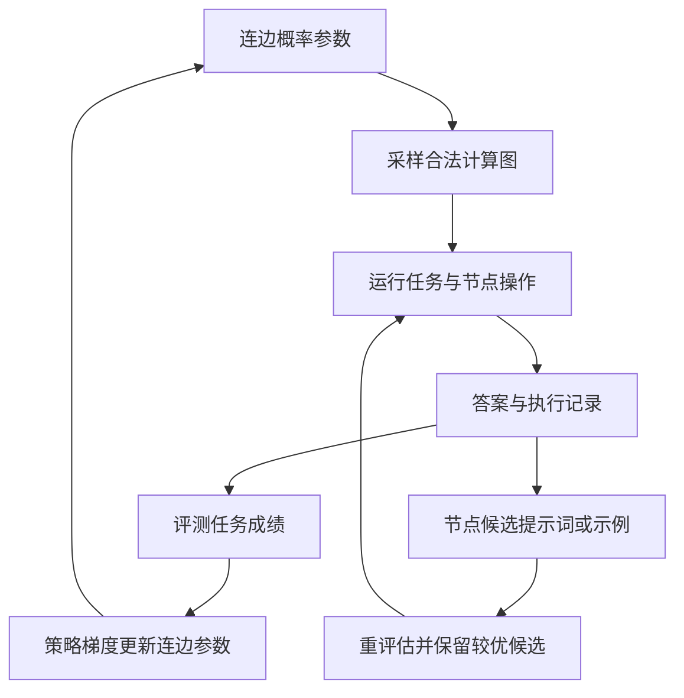

[[00-Agent-Memory-Experience-Reuse|← 论文索引]] · [[AFlow-2025-Workflow-Optimization|对照 AFlow]] · [[G-Memory-2025-Hierarchical-Memory|对照 G-Memory]] · [[Agent Workflow Memory|对照 AWM]]

# GPTSwarm：把语言智能体及其协作建模为可优化计算图

> [!abstract] 作者到底做了什么？
> 作者把一个智能体拆成若干操作节点，把多个智能体连接成计算图，然后用任务成绩学习**哪些操作之间应该传信息**，并用历史执行结果选择**节点提示词中的示例**。
> 任务执行输出答案；系统优化输出连边概率和改进后的提示词。LLM 权重不更新，但外部连边参数确实通过强化学习更新。

## 1. 论文信息与选择理由

- **题目**：GPTSwarm: Language Agents as Optimizable Graphs。
- **作者**：Mingchen Zhuge、Wenyi Wang、Louis Kirsch、Francesco Faccio、Dmitrii Khizbullin、Jürgen Schmidhuber。
- **机构**：KAUST AI Initiative；Swiss AI Lab IDSIA（USI、SUPSI）。
- **发表**：ICML 2024 主会，PMLR 235:62743–62767；不是 Workshop，也不只是预印本。
- **原始来源**：[官方会议页](https://proceedings.mlr.press/v235/zhuge24a.html) · [正式全文与附录](https://raw.githubusercontent.com/mlresearch/v235/main/assets/zhuge24a/zhuge24a.pdf) · [作者项目](https://gptswarm.org/) · [官方代码](https://github.com/metauto-ai/GPTSwarm)。
- **为什么今天读它**：它并非最新论文，但为已有 AFlow、G-Memory、AWM 补上一个关键基础：直接用策略梯度优化多智能体的信息流。先弄懂这个外部策略，再讨论模型参数后训练，会更容易分清学习对象。
- **核对范围**：全文主文，实验附录 D/E/F，图构建、边参数化与优化、MMLU 评测、HumanEval 节点优化路径。代码核对版本为 `c23a827f561c934ce21dd950408f7606aa4a8821`，日期 2026-10-16；本次未实际重跑实验。

## 2. 出发点：有了多个 agent，为什么还要学连边？

传统做法常由人规定：谁先回答、谁批评、谁修改，以及最终谁投票。问题是，加入更多回答不一定更好：一个错误答案可能影响原本正确的回答者；全互联还会传入大量无关上下文。

论文先统一表示，再优化：把链式思考、反思、工具调用等表示为计算图；让不同方法的操作可以连接；最后让任务分数决定什么连接值得保留。

> [!example] 贯穿例子：纯教学构造，不是论文中的具体题目
> 题目是一道四选一常识题。A、B 正常回答，C 被故意要求误导其他成员。若 C 的文本进入 B 的上下文，B 可能跟着答错；若 C 的结果进入最终投票，也可能干扰汇总。
> 问题是：能否经过若干有标准答案的练习题，学会降低这些有害连接的概率？论文的 MMLU 对抗实验正是这种问题设定，但这里的题目、角色名称和单次结果仅用于解释。

需要区分三个单位：

| 单位 | 在本文中指什么 | 不应误认为什么 |
| --- | --- | --- |
| 操作节点 | 一次 LLM 操作、工具或数据处理函数 | 一定是一个完整 agent |
| 智能体 | 若干操作及其内部依赖形成的子图；简单 IO agent 也可只有很少节点 | 必须有长期人格或独立模型 |
| Swarm | 多个 agent 子图及它们之间的信息连接 | 一份历史任务记忆图 |

因此，GPTSwarm 的边主要表达“当前任务中，谁的输出会成为谁的输入”。G-Memory 中的记忆关系边与此含义不同。

## 3. 架构：把执行层和优化层拆开看

### 3.1 执行层：给定图，把一道题做完

输入为任务 x 和一张已经确定的图 G。节点拿到原任务及前驱节点的输出，执行自己的函数；图按依赖顺序运行，最终由输出节点或汇总操作给出答案。

图要求是**有向无环图（DAG）**：不能出现 A 等 B、B 又等 A 的循环依赖。一个有限次数的“生成—检查—修改”可以展开成不同节点组成的 DAG，不等于允许无限往返通信。

沿用例子：若抽到 A→B、B→汇总，而没有 C→B，那么 B 可参考 A，不能参考 C。B 并不是读取“这条边以前为何有效”的自然语言经验，而只是按照当前图收到 A 的输出。

### 3.2 优化层：反复执行任务，改变下一次怎样连

优化器输入包括已有 agent 子图、候选跨 agent 边、带评测方式的任务，以及初始连边参数。输出是图的概率分布；节点优化另行产生提示词或示例集合。

两个优化分支可以组合，但论文没有在每个 benchmark 上都同时使用。尤其 GAIA 的结果不包含边优化或节点优化。

## 4. 方法一：任务成绩怎样改变连边？

### 4.1 先规定哪些东西能改

作者先提供操作函数、已有 agent 子图和汇总方式。边优化器在候选连接中选择连或不连；它不从零发明工具代码，也不自动把某个节点的 Python 实现重写为新算法。

论文主要优化 agent 之间的连接，保留已有内部结构。公开 `Swarm.organize` 还把节点通向最终汇总节点的连接做成可配置项：可以固定输出节点的汇总连接，也可以让部分汇总连接进入候选集合。因此不能笼统说“所有通向最终答案的边永远固定”。具体实验要看配置。

### 4.2 一轮学习的完整过程

1. **维护概率**。每条可选边有一个参数，表示倾向于保留该边的程度。代码存储可训练 logit，再经过 sigmoid 得到概率。
2. **采样图**。对候选边尝试采样；若加入该边会造成环，则不能加入。内部固定连接保留。
3. **执行练习任务**。节点依图运行，得到最终答案。
4. **评测**。MMLU 可以用答案是否正确给出 0/1；填字任务使用特定的词正确率。反馈来自 benchmark 评测器，不是另一个 LLM 随意赞扬这个图。
5. **计算更新**。记录这次图的采样概率，把它与任务成绩相乘形成策略梯度估计。
6. **进入下一轮**。好成绩的图所包含的选择，整体上更容易再次出现；差成绩的选择在相对奖励更新中受到抑制。多个样本共同决定更新，单次成功不能证明某条边必然有用。

由于采样过程中要防环，候选边的处理顺序会影响可行性。不能把最终图分布无条件地当作所有边完全独立的 Bernoulli 乘积。

### 4.3 强化学习到底训练什么？

用统一记号解释论文的 REINFORCE，而非照搬印刷符号：

$$
J(\phi)=\mathbb{E}_{q,\,G\sim D_\phi}[R(q,G)]
$$

- q：一道优化任务。
- G：采样出的完整计算图。
- Dφ：由参数 φ 控制的图分布。
- R(q,G)：按图执行 q 后得到的任务成绩。
- J：希望提高的平均成绩。

采样 M 个任务与图组合后，梯度可以估计为：

$$
\widehat{\nabla_\phi J}=\frac{1}{M}\sum_{i=1}^{M}(R_i-b)\nabla_\phi\log P_\phi(G_i)
$$

b 是可选的奖励基线，帮助降低方差；不同实验与代码路径处理不同。MMLU 的专用评测优化循环没有减基线；通用优化器有移动平均基线；附录对填字实验说明减去常数 0.4。不要把三种实现描述混在一起。

> [!example] 一条边的更新直觉：全部数字是假设
> 假设 C→B 的概率 p=0.5，本次没有选择它，最后答对，奖励为 1，且 b=0。对于允许采样的这一条 Bernoulli 边，logit 的对数概率梯度是 e−p，其中 e=0 表示未连。
> 此时梯度为 −0.5，梯度上升会降低 C→B 的 logit，使“不连这条边”以后更常见。
> 但这不是证明 C→B 有害：本次可能恰好题目容易，也可能其他边发挥作用。需要多次采样消除偶然性，而且整图奖励依然存在归因不精确的问题。

**被冻结的是 LLM 权重；被训练的是外部路由/连边策略。** 不需要对 LLM 本身反向传播，也不需要拿语言输出 token 的概率做 PPO。代码使用 PyTorch 参数和 Adam 优化边分布，属于真正的策略梯度优化。

### 4.4 学完后，新题怎么做？

用学到的图分布构造图再执行。论文的一些实验对分布进行采样评测；MMLU 公开评测代码也包含按 0.5 阈值确定连接的路径。因此不能说所有部署任务都必须重新随机抽图。

这里没有“先按新题语义检索历史相似图”的模块。主要学到的是一组共享连边偏好，不是每个任务都由另一个模型重新设计一张图。

## 5. 方法二：节点怎样利用执行经验？

边决定谁看谁，节点提示词决定收到信息后怎样处理。论文给出通用的节点改进接口，但 HumanEval 的核心实例很具体：**从历史输入输出中选择少量示范，加入后续提示词**。

假设一个代码生成节点经常漏掉空列表分支：

1. 收到函数签名、说明和题面示例，生成 Python 代码。
2. 运行可见示例测试；若失败，下游修改节点收到代码与测试反馈并重写。
3. 保存节点输入、输出、反馈，以及任务成败标签。
4. 每处理四道新题，触发一次节点优化。
5. 保留当前示例集作为候选一；把近期成功任务的节点输入输出加入示例池，最多随机选四个，形成候选二。
6. 用节点最近十个输入重新评估两组示例，选择分数较高的一组。
7. 新题执行时，示例作为 user/assistant 对话示范进入上下文，随后才放入当前题目。

空列表例子只是帮助理解；论文没有保证学到这条特定规则。示例也不是编译后的工具，不会直接被当成宏调用。

### 5.1 这算什么记忆？

| 环节 | 论文实例/代码中的实际做法 |
| --- | --- |
| 生成 | 节点执行产生输入、输出和测试反馈 |
| 存储 | 运行记忆按节点 ID / 任务记录查询 |
| 筛选 | 近期成功任务记录进入候选示例池；候选通过重评估选择 |
| 检索 | 取最近四条/十条记录，不是向量相似性召回 |
| 更新 | 替换节点的提示词示例集合，最多四个 |
| 新任务复用 | 示例被插入对应节点的 LLM 上下文 |
| 跨 agent 共享 | 当前任务消息通过边流动；没有专门实现跨任务抽象经验图的共享机制 |

框架支持记忆接口，不等于实验已经实现完整的长短期记忆管理、经验去重、语义检索和跨任务知识传播。这里最明确的持续积累产物是边概率和有限提示词示例。

### 5.2 论文与当前公开代码的反馈边界

> [!warning] HumanEval 的两个测试层要分开
> `CodeWriting` 从题面抽取 `>>>` 示例作为内部测试；候选提示词重评估也使用这些示例。可是 `run_humaneval.py` 在任务完成后执行数据记录的完整 `item['test']`，把结果写进 `memory.add(task, is_solved)`；节点优化器再利用这个任务标签筛选正例。
> 因而当前公开在线脚本的示例筛选确实使用了完整测试的成败反馈。它不是把隐藏测试文本直接塞给生成模型，但也不能概括成“完全只看题面示例”。论文报告值是否对应这一精确代码版本，不能仅据当前仓库反推。

公开实现还可通过开关根据失败记录让 LLM 改写提示词；HumanEval 论文的明确方法和主要解释是示例选择。代码支持的选项，不应全部当作论文表中已验证的贡献。

## 6. 四个 benchmark 分别验证什么？

### 6.1 MMLU：能否减少错误成员的干扰？

任务是四选一知识问答，指标是答案准确率。对抗设置含 k 个正常 IO agent 和 k 个被提示故意误导的 agent；最后多数投票。

边优化用 dev 题，评测使用 validation 前 10%，公开脚本为 153 题。GPT-4-Turbo、温度 0.2；200 轮，每轮四个图/题样本。对照包含直接回答、完全连接和随机连接。

主结论是：学习连边能够把受干扰系统的表现恢复到单个正常 agent 基线附近；这个对抗设置没有证明优于单 agent。另一个七种角色协作设置报告比基线提高约 2.1%±1.1%（原文写法，五个训练种子），不要与对抗实验混为一谈。

附录 D 的特定 3T3A 比较：GPTSwarm 准确率 0.8301，DyLAN 0.8366，Multiagent Debate 0.5751。GPTSwarm 不是这张表中准确率最高者。成本另见第 8 节；DyLAN 配置选择及不同机制让比较不等于严格相同预算的纯算法对照。

### 6.2 Mini Crosswords：学连边是否优于简单组合现有解题器？

输入为 5×5 小填字游戏的提示和棋盘，输出为填词结果。组合三个已有方法的 agent：ToT、Reflexion、CoT。

**指标是 best-state word accuracy**：系统可能返回多个候选棋盘，依据真实答案选择其中词正确率最高的状态。它既不是所有棋盘的平均质量，也不是整题完全解出的比例，更不代表部署时模型自行选出的唯一答案质量。

优化与评测均使用同一组 20 题。GPT-3.5-Turbo，温度 0；初始可选边概率 0.1，学习率 0.4，10 轮，每轮 20 个图/题样本。主结果为三次实验的均值±标准误。

| 条件 | 词正确率 | 能支持什么 |
| --- | --- | --- |
| 三个 agent 结果取最好 | 0.320 ± 0.0415 | 简单合并已有求解器的参照 |
| 初始随机图分布 | 0.465 ± 0.0509 | 尚未学习连接时的组合效果 |
| 学习连边后 | 0.575 ± 0.0275 | 比初始分布高 11.0 个百分点 |
| 调高均匀边概率至 0.125 | 0.510 ± 0.0552 | 仅增加连接密度也有收益，但未达到学习分布 |
| 学边后再优化节点 | 0.668 ± 0.0060 | 附录 D.3 的进一步组合收益 |

密度对照的平均边数约 32.80，学习分布约 32.76。它支持“不是只靠多加边”的判断；但边数相近不代表 token、上下文长度和实际运行成本严格相等。

附录节点优化使用 UCB1 在示例/无示例选择中优化，不要直接套用 HumanEval 的每四题二选一流程。

作者还把一个优化后的图分布迁移到 GPT-4-Turbo，得到 0.800±0.0616；重新运行的 ToT GPT-4-Turbo 为 0.668。这说明该设置下结构有跨模型复用潜力，但使用更强模型及同一小题集，不能据此宣称广泛跨任务泛化。

### 6.3 HumanEval：执行结果能否改进节点提示词？

输入是 Python 函数签名、文档和示例，输出可执行实现；以测试通过情况评估。执行器采用 ReAct 式生成、测试反馈、修改流程；本节重点是节点示例优化，不是通信边优化。

主文 §3.3 报告在线持续优化设置从 0.76 提高到 0.88±0.007，后者为均值±标准误。另一组迭代曲线在每轮后评估整个数据集。两者不要混读成同一条严格独立测试协议。

这支持提示词示例能改善该程序生成系统，但不是基础模型通过 SFT 或 RL 学会了新编程能力。评价时还应结合前述完整测试成败标签参与在线正例筛选的实现事实，以及没有清晰独立训练/测试划分的限制。

### 6.4 GAIA：图框架能否组织现实工具任务？

GAIA 是真实助手问题：可能需要检索网页、读取文件、多模态理解和多步推理。输出最终答案，统计准确率。

Table 1 中 GPTSwarm 总体准确率 18.45%，GPT-4-Turbo 基线 9.70%。GPTSwarm 使用七个 ToT agent 和基于提示词的自一致性汇总；Level 1 为 30.56%±3.25%（五次运行的标准差）。

**论文明确说这些 GAIA 实验没有边优化，也没有节点优化。** 它验证模块化工具框架和集成策略，而不是 REINFORCE 产生上述提升。增加 agent、工具和调用量也是比较差异。

框架支持多类文件读取和 Google 搜索，但当时的网页能力主要是下载指定 URL 内容及搜索，不是完整的交互式网页导航。Level 1 的七 ToT 配置平均约 414.89 秒，单 ToT 约 71.31 秒；更高成绩伴随更大执行开销。

## 7. 创新与证据：哪些是作者做到了，哪些还没证明？

| 比较对象 | GPTSwarm 的增量 | 证据边界 |
| --- | --- | --- |
| 人工角色协作/固定通信框架 | 将节点和信息边显式化，自动优化跨 agent 连接 | 不代表所有节点函数也由系统自动发明 |
| 固定 CoT、ToT、Reflexion 等方法 | 在共同图表示中组合其操作，让跨方法信息流可学习 | 填字主要证据来自小题集与 best-state 指标 |
| 只改提示词的方法 | 除节点示例外，还优化通信结构 | 两类优化并未在所有任务上共同验证 |
| 靠自然语言总结经验的系统 | 可把任务成绩压缩进外部连边参数 | 参数缺少自然语言解释，整体奖励的归因有限 |

最稳妥的结论是：统一图表示让多种 agent 可组合；在若干受控实验中，优化连边或节点提示词有效。没有证明开放环境中不断自我重写的递归智能，也没有证明学到的图在任意新任务、模型或工具上都可靠。

## 8. 代码实现、成本与复现

以下路径均对应 [核对版本 c23a827](https://github.com/metauto-ai/GPTSwarm/tree/c23a827f561c934ce21dd950408f7606aa4a8821)。

| 文件 | 需要看懂的实际行为 |
| --- | --- |
| `swarm/graph/swarm.py` | 合并 agent 图，建立候选跨图边，配置最终汇总连接 |
| `swarm/optimizer/edge_optimizer/parameterization.py` | `EdgeWiseDistribution` 保存边 logits；sigmoid、采样、无环检查、累计 log probability |
| `swarm/optimizer/edge_optimizer/optimization.py` | 通用 REINFORCE 与移动平均基线；Adam 更新外部参数 |
| `experiments/run_mmlu.py` | dev/val 任务、agent 数量、迭代预算等设置 |
| `experiments/evaluator/evaluator.py` | MMLU 专用优化与评测路径，不直接等同通用优化器 |
| `experiments/run_humaneval.py` | 每四题触发优化；完整测试结果写入任务记忆 |
| `swarm/environment/operations/humaneval/code_writing.py` | 题面示例测试、反馈改写、示例上下文、最近十条候选评测 |
| `swarm/optimizer/node_optimizer/node_optimization.py` | 最近四条记录、正负例筛选、候选选择 |

> [!info] 实现边界
> 这里的“代码”确实是 Python：框架、节点、测试执行器和优化器由作者实现。边学习改变的是这些现成模块怎样连接；节点优化改变提示文本/示例。它不像 AFlow 的优化器那样以生成并修改可执行工作流源码作为主要搜索动作。

代码公开，仓库含实验脚本与部分数据目录；各 benchmark 的原始数据、工具服务和 API 仍应按 README 与数据源准备。不能把代码开放等同于无外部服务、可一键复现。

论文附录 F Table 11 的历史账单如下，**不是今天 API 的报价或我的复现实测**：

| 实验条目 | 报告费用（美元） | 报告时间 |
| --- | --- | --- |
| Mini Crosswords 边优化，GPT-3.5-Turbo | 77.42 | 2.82 小时 |
| Mini Crosswords 节点优化，GPT-3.5-Turbo | 11.22 | 0.83 小时 |
| Mini Crosswords 优化后图评测，GPT-4-Turbo | 377.54 | 5.56 小时 |
| HumanEval 无优化 / 有优化 | 1.61 / 28.46 | 0.68 / 1.49 小时 |
| MMLU 3T3A 优化 / 推理 | 5.32 / 1.82 | 0.90 / 0.31 小时 |

论文主要使用历史 API 型号 `gpt-3.5-turbo-1106`、`gpt-4-1106-preview`。当前可用性、价格和等价替代模型表现需要另行核查，不能假设一致。运行主机与 GPU 规格未在本次核对到的成本表中报告，标为未知；不需要训练基础 LLM 权重，但大量图采样会带来 API 成本。

实现难点是：保留采样 log probability 的正确梯度；避免图中成环；统一节点输入输出格式；控制采样方差；严格隔离优化反馈与最终测试；把节点数/边数进一步换算成真实 token 与延迟成本。

## 9. 设计逻辑重建与研究选题关系

以下是基于问题和方法的重建，不是作者未公开的心理思维过程：固定协作不适合所有任务 → 需要显式表示信息流 → 图让不同方法可以组合 → 离散选边不能直接对任务评分求导 → 用采样与 REINFORCE 学边 → 单有好连接仍可能有差节点 → 再用历史示例改善节点提示词。

| 研究方向 | 关系 |
| --- | --- |
| 经验优化 Harness | **直接相关**：任务成绩调整外部协作策略 |
| 长短期记忆与检索 | **局部可迁移**：节点历史/示例筛选；未覆盖完整语义记忆体系 |
| 单 agent 执行 | **直接相关**：节点示例优化和有限反馈修改 |
| 多 agent 运行图 | **直接相关**：学习跨 agent 信息流，图本身就是执行结构 |
| RL 强化 | **直接相关但对象有限**：强化外部连边策略，不强化 LLM 权重 |
| 参数蒸馏 | **未覆盖**：没有把经验蒸馏进基础模型 |

与 [[AFlow-2025-Workflow-Optimization|AFlow]] 相比，它的搜索空间更受约束、更新更数值化；与 [[G-Memory-2025-Hierarchical-Memory|G-Memory]] 相比，它的图会直接决定调用依赖；与 [[Agent Workflow Memory|AWM]] 相比，它不以跨网页任务的抽象子流程记忆为中心。

**一个小实验建议（研究提议，非论文结论）**：固定同一模型与三个角色，在独立训练/验证/测试题集上比较单 agent、人工固定图、边数相近的随机图、REINFORCE 学图。控制总 token 预算，记录准确率、每题费用、延迟及跨题型成绩，运行多个种子。先验证“学到结构”能否在新题上超过“多调用几次”，再加入由任务记忆预测连边概率的扩展。

## 10. 阅读路线与三个研究问题

**建议阅读顺序**：先看 Figure 1 和 §2.1–2.3，确认节点与边；再读 §3.1 MMLU 理解奖励如何评价图；接着读 §3.2 与 Figure 4，看清填字指标和密度对照；最后读 §2.4、§3.3、附录 E.3.1，以及上面的 HumanEval 代码路径。附录 F 用于估算实验预算；GAIA 留到最后，避免将框架能力与优化效果混淆。

1. **固定连边偏好够不够？** 新任务能否通过检索到的经验调整连边概率，而不是所有题共享同一分布？
2. **整体奖励怎样归因到边？** 是否能用移除单边的反事实评估减少 REINFORCE 的方差，同时控制额外调用成本？
3. **结构收益能否经得住独立测试与预算对齐？** 在新题型、相同 token 预算下，学习图是否依然优于随机集成和人工结构？

## 原始来源

1. [PMLR 官方发表记录](https://proceedings.mlr.press/v235/zhuge24a.html)：作者、会议、年份和正式论文入口。
2. [正式论文及附录](https://raw.githubusercontent.com/mlresearch/v235/main/assets/zhuge24a/zhuge24a.pdf)：§2 方法；§3 四项评测；附录 D 对比、E 实现细节、F 成本。
3. [作者项目页](https://gptswarm.org/)与[官方代码仓库](https://github.com/metauto-ai/GPTSwarm)。
4. [边参数化实现](https://github.com/metauto-ai/GPTSwarm/blob/c23a827f561c934ce21dd950408f7606aa4a8821/swarm/optimizer/edge_optimizer/parameterization.py)。
5. [节点候选选择](https://github.com/metauto-ai/GPTSwarm/blob/c23a827f561c934ce21dd950408f7606aa4a8821/swarm/optimizer/node_optimizer/node_optimization.py)。
6. [HumanEval 在线脚本](https://github.com/metauto-ai/GPTSwarm/blob/c23a827f561c934ce21dd950408f7606aa4a8821/experiments/run_humaneval.py)与[代码生成节点](https://github.com/metauto-ai/GPTSwarm/blob/c23a827f561c934ce21dd950408f7606aa4a8821/swarm/environment/operations/humaneval/code_writing.py)：测试反馈来源的核对依据。
