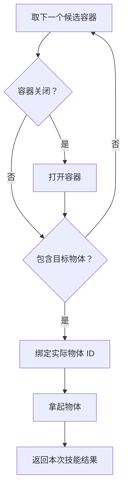

[[00-Agent-Memory-Experience-Reuse|← 论文索引]] · [[AWM-2025-Workflow-Memory|对照 AWM]] · [[AFlow-2025-Workflow-Optimization|对照 AFlow]] · [[EvoCF-2026-Memory-Guided-Counterfactual-Planning|对照 EvoCF]]

# NSI：把执行轨迹归纳为能分支、循环和修复的技能程序

> [!abstract] 作者到底做了什么？
> 从少量成功示范中生成带状态条件、变量绑定和循环的技能图，用解释器执行；遇到失败后，让模型尝试恢复，再把成功恢复路径接回技能图。
> **输入**：任务领域的动作接口与谓词、示范轨迹、当前任务和观察。**离线输出**：可执行技能库。**在线输出**：选定技能执行产生的多步环境动作。**更新对象**：图结构、逻辑表达式、调用条件与指导文本；没有模型参数训练或 RL。

> [!info] 证据范围
> 依据 ICML 2026 正式版 24 页全文：正文 §1–7、Table 1、附录 A 的语言与节点定义、附录 B 的状态抽取/归纳/路由提示词；参考文献作为定位资料。
> 另核对官方仓库版本 51e1639dad6374b93e0948eb51340b6a342e69bc（2026-10-24）的 ALFWorld 归纳、历史回放、动作路由、解释器接入和在线嫁接路径，以及 TextCraft 入口与评测信号。未实际运行模型或重跑主表；没有逐行审计全部 DSL 依赖。
> 论文描述、代码行为、教学例子与评价分别标识；正式版与公开实现不完全一致。

## 1. 论文信息与选择理由

| 项目 | 信息 |
| --- | --- |
| 正式题目 | Lifting Traces to Logic: Programmatic Skill Induction with Neuro-Symbolic Learning for Long-Horizon Agentic Tasks |
| 方法 | Neuro-Symbolic Skill Induction，NSI |
| 作者 | Jie-Jing Shao、Haiyan Yin、Yueming Lyu、Xingrui Yu、Lan-Zhe Guo、Ivor Tsang、James Kwok、Yu-Feng Li |
| 机构 | 南京大学 LAMDA/相关学院；新加坡 A*STAR CFAR/IHPC；香港科技大学 |
| 发表 | **ICML 2026 主会**，PMLR 306:110314–110337 |
| 官方记录 | [会议页面](https://proceedings.mlr.press/v306/shao26i.html) |
| 正式全文 | [PDF 在线链接](https://raw.githubusercontent.com/mlresearch/v306/main/assets/shao26i/shao26i.pdf) |
| 项目 | [NSI 项目页](https://sh-jj.github.io/NSI/) |
| 代码 | [官方仓库](https://github.com/sh-jj/Lifting-Traces-to-Logic-NSI) |
| 预印本 | [arXiv:2605.01293](https://arxiv.org/abs/2605.01293)，正式版章节和参考文献有扩充，引用章节以正式版为准 |

**选中理由**：此前质疑若干记忆论文只是“总结—检索—拼入 prompt”。NSI 提供一个可以检查的区别：技能的内部步骤由解释器执行，分支条件参与真实控制流；不是只让 LLM 阅读一段流程指南再逐步模仿。它也与用户近期的 skill 调用和第二阶段 RL 设想相关，但本文没有做 RL。

去重范围：当前 README、主题索引、模板、相关笔记与可访问会话；主题已有 AFlow/AWM/G-Memory/GPTSwarm/MemEvolve/EvolveR/EvoCF，未收录本篇。Agentic RL 目录的 VOYAGER 与本文是不同工作，不重复建笔记。

## 2. 出发点：同样是复用轨迹，为什么固定脚本会失效？

固定脚本可以把“成功时做过的动作”保存下来，却可能漏掉“每个动作成立需要什么”。

> [!example] 贯穿教学例子，并非论文真实评测轨迹
> 子目标：找到某类物体并拿起。
> 示范：走到冰箱 → 打开冰箱 → 拿起 apple_1。
> 新任务：仍找苹果，但冰箱已经打开，里面有两个物体，而苹果可能在另一个容器里。
> 只把 apple_1 改成参数还不够：系统需要判断门的状态、确认物体存在、绑定实际对象 ID，并在没找到时转向其他候选位置。

更可靠的技能需要表达：

1. 遍历候选容器。
2. 没到达就导航。
3. 门关闭才打开。
4. 检查是否有目标类型物体。
5. 从当前观察中选出实际对象，再拿取。
6. 找不到时继续搜索或明确返回失败。

**这不是“Python 原理上不能写 if/for”**。作者针对的是所比较方法的表示与归纳方式，是否把这些条件显式抽取、执行并验证；不能泛化为所有已有程序技能都不含条件。

## 3. 技能表示：参数、状态抽取器、执行图

正式版 §4 把技能写成：

$$
\pi_\omega=(\theta_\omega,\phi_\omega,G_\omega)
$$

- ω：技能要完成的子目标，如 find_and_pick。
- θ：调用参数，如目标类型、候选容器；**不是神经网络权重**。
- φ：用 LLM 把环境观察转成符号事实的状态抽取器。
- G：真正控制执行的技能图。

运行时维护：

$$
\xi_t=(v_t,\mathcal C_t,\mathcal Z_t)
$$

v 是当前图节点，C 是参数和中间变量所在的作用域，Z 是当前世界事实。

### 3.1 谁负责“看”，谁负责“执行”？

- LLM 根据文本观察更新事实，例如 is_closed(fridge_1)、contains(fridge_1,apple_2)。
- 解释器根据事实计算条件，决定走哪条边。
- 动作节点把 C 中的值填入既定环境动作，例如 take apple_2 from fridge_1。
- 环境返回新观察，再由 LLM 更新事实。

因此“无须每一步重新规划”不等于“技能执行时完全不调用 LLM”。神经状态抽取仍可能产生调用与错误。

### 3.2 什么是预先提供的，什么是归纳出来的？

预先提供：动作接口、对象/数值类型、逻辑语法、领域谓词及相关实现。

归纳：如何组合谓词形成条件、如何选择和绑定变量、怎样连接节点、何处循环、哪里返回失败。

公开 symbolic_world.py 还包含可执行的动作前提/派生函数。不能把它宣传成从原始观察中无先验发现一切逻辑。

## 4. 图里的节点与边：它们直接参与计算

| 节点 | 输入与操作 | 输出 |
| --- | --- | --- |
| DataOp | 查询当前符号状态，绑定/计算中间变量 | 更新作用域 C |
| CheckOp | 计算一个布尔表达式 | 沿 Yes/No 选边 |
| LoopOp | 遍历列表等结构 | 进入 body 或退出 done |
| PrimitiveOp | 读取已绑定的参数，调用环境动作 | 新观察与执行结果 |
| TerminalOp | 结束本次技能 | 成功信号或失败诊断 |

论文把 Check/Loop 合并为控制操作大类，合计四大类；上表为教学拆分。

**动态绑定**的关键是：不是照抄示范中的 apple_1，而是当前 Z 中选择一个满足 is_type(x,apple) 且 contains(container,x) 的实体，保存为 target，再执行 take(target)。

下面是教学简图，不是仓库中的原始技能文件：

完整程序还需要导航、列表耗尽分支、执行异常和失败终点等。此图仅突出状态分支和动态绑定。

### Mermaid 只是画图吗？

这里不是。公开实现以 Mermaid 风格文件保存节点、变量接口、表达式和控制边，Python 解析器读取成 Graph，再由解释器遍历。

- 生成物不是一段任意 Python 源码，而是受约束的 Mermaid＋DSL 技能程序。
- Python 负责解析、检查、谓词求值和环境调用。
- 表达式、节点及连边具有执行语义，不能把任意 Mermaid 示意图直接当作可运行程序。

代码 infoflow2graph.py 定义 Node、Edge、Graph 及解析和遍历；还可将强连通分量压缩用于检查，所以原技能图允许循环，不是必须 DAG。

控制边决定执行顺序、条件分支和循环；本次公开示例主要通过节点 local in 与共享 GLOBAL 传值。解析器也支持边载荷，但不要据此说所有生成技能都采用边传参。

## 5. 离线归纳：怎样从少量示范造出这种图？

### 5.1 先把观察变成事实，再切分子目标

对成功示范逐步抽取谓词增删，保存观察、事实和动作。LLM 从中识别可复用的子目标与子轨迹，并归纳：

- 技能名称与参数；
- 起始条件；
- 成功条件；
- 操作步骤；
- 适用任务和调用证据。

这一步与 AWM 等有共性。新增辨识度主要在后面：这些信息被编成可执行控制图，并接受回放检查。

### 5.2 为什么不每次都重置环境验证？

历史环境可能难以精确还原。作者改为检验：

> 把候选技能放在示范记录的状态中执行，它产生的外部动作能否与示范后续动作对应？

内部 Check/DataOp 不改变环境，可在两个外部动作之间运行；一旦输出 PrimitiveOp，就需要匹配参考动作，再沿参考记录进入下一状态。

这叫**经验程序一致性**。它是在历史记录上做解释执行，不是另训练一个世界模型，也不是为每个候选真实环境 rollout。

### 5.3 用教学例子理解“从一条轨迹发现分支”

在示范开头，门是关闭的，需要执行 open。
在同一示范稍后，门已打开，不应再 open。

如果一个技能无论从哪种历史状态调用都先 open，它对后一个起点不一致。于是合成器可以加入：

> if is_closed(container): open(container)

这让同一技能覆盖更多记录状态。但有限示范通常不能唯一决定真实规则；先验谓词和 LLM 知识参与了归纳，不能说一条轨迹就足以识别所有因果前提。

### 5.4 正式目标：多覆盖经验、少制造复杂程序

§5.1 Eq.2 可用教学记号整理为：

$$
\max_\pi\left[
\sum_{\tau\in\mathcal D_\omega}
|\widehat{\mathcal R}^{\,\tau}_\pi|
-\lambda|\pi|
\right]
$$

- D：同一子目标的示范集合。
- R-hat：某条示范中，从哪些历史状态开始执行 π，能与之后专家动作一致。
- |π|：程序复杂度。
- λ：复杂度惩罚权重。

这表达“覆盖更多经验，同时保持程序简洁”的最小描述长度思想。**不是用于反向传播的 RL loss**；搜索空间是离散程序，LLM 负责产生候选，回放提供评价。

λ 的具体数值、复杂度精确计量及其与公开代码的对应没有充分报告，不能自行补写训练配置。

### 5.5 先局部专家，再跨轨迹合并

论文两阶段：

1. 每条示范先产生一个局部技能；找到不一致状态，反馈给合成器修改。
2. 选一个全局技能，再找当前覆盖不足的示范，将它的局部逻辑合并进去。
3. 只有候选扩展经验覆盖且保留旧覆盖时，按论文 Eq.4 接受。

可采用四种结构操作：

| 操作 | 做什么 |
| --- | --- |
| Branching | 为不同情况增加条件分支 |
| Crossover | 复用另一个技能的子图，重新绑定输入 |
| Lifting | 将常量提升为参数或按状态选择的变量 |
| LoopFold | 把重复动作结构折叠为循环 |

它们是提供给 LLM 的结构修改方式，不是新提出的 if/for 语言特性，也没有证明找到全局最短或最优程序。

### 5.6 公开 ALFWorld 路径和论文公式的差异

核对 skill_ILP、_ilp_score_program：

- 代码额外先用全部轨迹生成 warm-start 候选，再加入逐轨迹局部候选。
- 评分是成功回放的 skill-calling 样本比例，不是逐个状态精确计算 Eq.2 的区域大小。
- “困难样本”实际选择一个尚未覆盖的调用样本，并非完整求解最难样本优化。
- 合并候选只需覆盖比例不下降，允许相等；论文 Eq.4 是旧覆盖集合的严格包含。
- 比例不下降也不能保证保留每一个旧成功样本，可能出现成功集合交换。
- 所检查接受路径没有显式减去 λ×程序长度的数值项；复杂度偏好主要通过合成指令体现。
- max_global_iters 默认为 5；验证修复循环有最多 11 次尝试。均为公开代码默认，不等于已经证明主表使用同一配置。

因此，“覆盖严格单调增长”“MDL 被精确优化”应作为论文目标或设计思想描述，不能直接当已核验实现保证。

## 6. 新任务运行：选择技能与执行技能是两件事

### 6.1 高层：LLM 路由和参数选择

当前任务到来，LLM 读取任务历史、事实、技能签名/说明和指导文本，决定：

- 调用哪一个技能，参数是什么；或
- 暂时执行一个原始动作。

公开 ALFWorld act() 先进行 router 调用，再进行执行选择调用；有逻辑前提检查，不满足会把错误反馈给模型重选。附录提示词明确“优先技能”，这是一种提示偏好，不能说模型通过 RL 学会了更高 skill 调用概率。

技能选择仍会用 prompt，但**技能内部的每一步不再都由高层 LLM自由决定**，这才是与纯文字工作流记忆的关键差异。

### 6.2 低层：解释器执行，LLM 更新状态

解释器遍历图，计算 Data/Check/Loop，实际动作调用 env.step，读取反馈后更新事实，再继续。

当前 C/Z 是单次执行状态；轨迹和技能库是跨任务保存的信息。没有外部百科/文献事实检索器，本篇的符号状态也不是 EvolveR 那种事实知识库。

## 7. 失败如何成为一个新分支？

论文 §5.3：

1. 技能在某个失败节点停止，返回诊断。
2. 高层模型根据诊断，用其他技能或原始动作尝试恢复到原子目标。
3. 恢复成功：清理恢复轨迹，归纳为子图，嫁接到失败位置。
4. 新子图先标为 tentative，后续有效再固化。
5. 恢复不成功：修改调用说明/适用条件，避免继续在相同情况误用。

贯穿例子的教学延伸：某技能到目标容器后直接放物，发现容器关闭 → 模型尝试开门再放物且成功 → 将“检查关闭状态—必要时开门—继续放物”接入技能。

注意：一次恢复失败只说明当前恢复策略没成功，**不能证明子目标在该状态下根本不可达**。论文采用它更新适用范围，属于启发式，可能过度收缩可用区域。

### 实际代码里的嫁接

ALFWorld _process_recovery_pattern：

- 从 episode 中提取失败技能与后续恢复片段；
- 清理轨迹；
- 生成 Mermaid 子图；
- 接到原图指定边；
- 做解析与结构检查；
- 保存 evolution ledger、原图和新子图。

同技能＋同 pattern_type 已有有效嫁接时跳过，属于粗粒度去重；不等于所有语义等价恢复都能正确合并。

**生命周期阈值**：所核对 ALFWorld execute_skill_online 中，tentative 子图被访问后，本次技能成功一次即可 solidify；失败一次即可 discard。不是高置信度统计检验，也不要求重复多次成功。固化后的长期回归检查不能仅由这条 tentative 路径推定。

结构检查只能说明程序能被解析、具备某些继续路径；不能证明恢复在未知环境中正确。代码还包含针对常见技能的变量映射与默认嫁接点，不能把所有行为都归功于完全通用的自动结构发现。

## 8. 记忆、检索与图：分别是什么？

| 对象 | 保存内容 | 主要用途 |
| --- | --- | --- |
| 轨迹记忆 | 每步观察、事实、动作、事实增删，及前后节点链接 | 示范归纳、经验回放、恢复分析 |
| 技能调用记忆 | 子目标、参数、原轨迹片段、起止条件证据 | 对同技能样本分组和回放验证 |
| 技能执行图 | Data/Check/Loop/Action/Terminal 节点及控制边 | 真正产生环境动作 |
| 指导与元数据 | 调用说明、任务级指导、路由规则、进化记录 | 高层选技能及维护 |

轨迹/调用记忆在代码中有 Graph 类，但它们不是学习出的多 agent 通信图。调用记忆按问题和子目标建索引；不要把这些名字理解成每次推理都进行了复杂图搜索。

当前检查的主要 ALFWorld 选技能路径使用任务分组的技能与调用指导，不是“每次向量 top-k 找几条策略再模仿”。记忆模块有 embedding 辅助函数，不代表所有执行入口都以语义 RAG 为核心。

JSON、Mermaid 和本地状态文件负责持久化；没有展示多 agent 私有记忆同步、通信路由或团队角色学习。

## 9. Benchmark 与评测

| 基准 | 任务 | 离线示范与评测 | 指标与信号 |
| --- | --- | --- | --- |
| ALFWorld | 文本交互的家庭任务：拿放、清洁、加热、冷却、检查、放两个物体 | 6 类，各2条标准示范；134个测试实例。公开 runner 默认 OOD split | 环境任务成功率；代码读取环境 won/reward，而非 LLM 对最终文本打分 |
| WebShop | 搜索商品、选择属性、购买以满足需求 | 单条成功购物示范；本次正文/附录未找到评测实例数的完整说明 | Reward Score 与整任务成功率；当前公开仓库无对应 runner，不能核验本文的完整打分接入 |
| TextCraft | 文本化 Minecraft 配方合成，需递归准备材料 | 200个测试任务，深度2–4；论文称3条简单专家轨迹、depth=1 | 环境奖励/完成信号，公开 runner 使用 test split |

**示范描述小差异**：公开 TextCraft 文件名是一个 depth_0 fetch、两个 depth_1 craft，并非字面上三条都是 depth_1。总数同为3；复现按实际文件内容和版本记录，不能混淆“浅层示范”与精确深度。

模型：所有方法按论文使用 GPT-4o，temperature=0；技能归纳方法报告三次运行均值±标准差。温度0不等于 API 行为严格确定。

基线：ReAct、Reflexion、ADaPT、StateAct、AWM离线/在线、ASI，以及 NSI 去掉 online honing。

### 验证信号必须分开

1. 静态/数据流检查：输入变量、控制边、循环标签等是否合法。
2. 历史一致性：动作是否匹配已记录专家轨迹。
3. 运行时技能终点：解释器是否返回技能成功。
4. benchmark 成功：环境任务是否真正完成。

到达 SUCCESS_END 不自动证明任意语义子目标正确，更不能代替整个任务的环境判定。

历史回放也有两种局限：可能拒绝“另一种同样正确的解法”；对未出现状态和未走分支没有完备验证。有限数据上的一致性不是形式化正确性定理。

### 预算与在线协议

公开 ALFWorld evaluator 默认100轮高层选择，TextCraft 默认40轮；一次技能内部可执行多个原始动作，因此这些不是相同数量的环境动作预算。不能把内部步骤和高层选择步混为一谈。

online 模式跨 episode 保存嫁接技能，是持续适应设置。完整成绩不应当作整个测试集上始终冻结策略的一次性评测；任务顺序、复制的初始状态、重复运行是否重新归纳/清空都需要固定。

## 10. 关键结果：哪些结论得到支持？

正式版 Table 1，单位 %：

| 方法 | ALFWorld SR | WebShop Score | WebShop SR | TextCraft SR |
| --- | ---: | ---: | ---: | ---: |
| ReAct | 85.8 | 44.0 | 20.0 | 62.0 |
| AWM offline | 88.6±1.1 | 51.8±1.7 | 32.2±1.3 | 66.3±2.0 |
| AWM | 91.3±0.8 | 49.2±1.9 | 30.0±2.0 | 92.5±3.6 |
| ASI | 70.6±1.9 | 7.7±1.7 | 7.50±3.0 | 77.8±1.8 |
| NSI 无在线修复 | 93.5±1.9 | 58.8±1.8 | 30.5±1.5 | 78.5±2.5 |
| NSI 完整版 | **98.0±1.2** | **76.5±1.2** | **44.5±1.5** | **95.2±0.8** |

### 10.1 在线修复贡献很大

完整 NSI 相比无 honing，SR：
- ALFWorld：+4.5个百分点。
- WebShop：+14.0个百分点。
- TextCraft：+16.7个百分点。

这支持在线修复在本配置中重要。不能把全部收益归因于离线符号表示。

尤其 TextCraft，离线 NSI 78.5 低于 AWM 92.5；WebShop 离线 NSI SR30.5，也低于 AWM offline32.2。**更结构化的离线表示并未在所有指标上独立取胜。**

### 10.2 完整系统相对强基线

- ALFWorld 完整版98.0 vs AWM91.3：+6.7个百分点。
- WebShop 完整版SR44.5 vs AWM offline32.2：+12.3个百分点。
- TextCraft 完整版95.2 vs AWM92.5：+2.7个百分点，需同时看标准差，不据此宣称统计显著。

同领域 baseline 是作者统一设置下的实现，不应据此否定其原论文的其他任务表现。

### 10.3 不能从表格直接推出的结论

主表没有充分拆开“分支”“变量绑定”“循环”“谓词抽取”“额外路由”“在线改图”的独立收益，也缺少完整总调用预算对齐。

所以证据支持**完整系统有效，在线 honing 重要**；尚不足以证明每种结构操作都不可替代，或逻辑图一定优于同预算 Python 程序合成。

Figure4 报告 NSI 单次技能能包裹更多原始动作，解释了高层规划跨度压缩；它不是端到端时延或 API 费用降低的直接测量。正文关于 linear agent “数学上不可解”等表述也未给出相应理论证明，不作为结论复述。

## 11. 代码与复现

### 11.1 公开范围

代码版本：[51e1639](https://github.com/sh-jj/Lifting-Traces-to-Logic-NSI/tree/51e1639dad6374b93e0948eb51340b6a342e69bc)。

| 文件/目录 | 核对重点 |
| --- | --- |
| README.md、run_alfworld.py、run_textcraft.py | 从示范归纳、保存状态、离线评测与在线开关 |
| alfworld_runs/agent/nesy_memory_skill/nsms.py | 技能合成、回放评分、路由、前提检查、执行与嫁接 |
| 同目录 infoflow2graph.py | Mermaid图解析、静态验证、循环遍历 |
| 同目录 symbolic_world.py | 领域谓词与求值接口 |
| 同目录 memory.py | 轨迹和调用记忆索引、持久化 |
| alfworld_runs/alfworld_test.py | 环境成功信号与高层步数 |
| textcraft_runs/textcraft_test.py | 测试集、环境奖励与 episode 结束 |
| skill_examples/ | 两个格式示例，不是 runner 默认加载的预制结果 |

公开 release 有 ALFWorld/TextCraft 的适配器、少量示范、必要 Concepts DSL 子集；没有同等的 WebShop 入口。两类环境的实现也不是逐行相同，不应把 ALFWorld 阈值和选择细节自动推广到 TextCraft。

### 11.2 运行顺序

README 建议 Python3.10、安装依赖、配置模型接口；ALFWorld 需要另下数据并设置数据路径，TextCraft 来自依赖包。

首次运行从示范生成轨迹/调用记忆和技能图，再评测；不是直接加载 skill_examples。

在线运行应从离线生成的状态复制必要文件到独立目录，再启用 online 开关。ALFWorld 用 online_mode，TextCraft 用 online；第一次 TextCraft 调用不能直接假定已有技能状态。

### 11.3 资源与实现难点

没有基础模型训练，主要成本来自示范状态抽取、反复程序生成、验证修复、路由、在线状态感知与反思调用。

论文未给出完整 GPU/CPU、显存、总 token、归纳与在线成本拆账、端到端时延和美元总费用，标为**未知**。代码默认 API 模型可调用，不等于端到端零GPU需求或已证实低成本。

实现难点：
- 将领域观察可靠地转成谓词，避免符号状态漂移。
- 生成合法的数据绑定和循环控制。
- 在历史记录回放与真实环境执行之间保持一致接口。
- 记录在线规则和图的版本，隔离不同实验状态。
- 评测时同时统计原始动作、模型调用、token和高层技能次数。

本次未实际跑 API 或基准，不能声称主表可直接复现。

## 12. 核心创新与相关论文对照

**最有辨识度的改变**：把可复用经验编译成有明确状态读取和执行语义的技能图，再通过历史一致性与在线恢复进行图修订。

不是 if/for 本身的新发明，不是新 RL 算法，也不是对所有条件程序的首次提出。贡献主要是**表示、归纳流程和失败修复机制的结合**，需要依赖各部分对照验证。

| 已读工作 | 对照 |
| --- | --- |
| [[AWM-2025-Workflow-Memory|AWM]] | AWM主方法是上下文操作指南；NSI图的内部节点由解释器执行 |
| [[AFlow-2025-Workflow-Optimization|AFlow]] | 都生成可执行结构；NSI聚焦子目标技能的状态条件和历史回放，不以整工作流验证集分数搜索为主 |
| [[G-Memory-2025-Hierarchical-Memory|G-Memory]] | G-Memory图主要组织记忆；NSI技能图直接控制动作 |
| [[GPTSwarm-2024-Optimizable-Agent-Graphs|GPTSwarm]] | 不学习多agent通信连边；此处节点是技能内部操作 |
| [[MemEvolve-2026-Memory-System-Meta-Evolution|MemEvolve]] | 不改整个记忆provider机制，主要生成和维护具体技能程序 |
| [[EvolveR-2026-Experience-Principles-Policy-RL|EvolveR]] | 无原则条件GRPO和模型参数更新 |
| [[EvoCF-2026-Memory-Guided-Counterfactual-Planning|EvoCF]] | EvoCF由模型依据规则排序一步动作；NSI由解释器执行多步状态分支 |
| [[VOYAGER-2024-Executable-Skill-Lifelong-Agent|VOYAGER]] | 同属可执行技能积累；区别需落在状态抽象、表达语言、一致性回放和局部修复，不能说以前程序技能都无条件逻辑 |

### 有依据的设计逻辑重建

文字经验仍要重推理 → 固定动作序列对状态变化脆弱 → 显式抽取状态并生成条件程序 → 历史动作回放提供有限检查 → 新失败暴露缺失分支 → 将恢复轨迹编入图。

这是依据公开方法整理的设计逻辑，不是作者未公开的真实思维过程。

## 13. 与研究设想的关系及小实验

| 关注点 | 对应 |
| --- | --- |
| 经验优化 Harness | 直接相关：扩展技能工具集、修改其内部程序；核心解释器不是递归自改 |
| 长短期记忆与检索 | 部分直接：当前符号状态、持久轨迹和技能库；非事实/经验双检索框架 |
| 单agent任务执行 | 直接相关，三个基准均为主要单agent任务 |
| 多agent运行图协作 | 未覆盖；图式技能可以迁移为团队操作模块，但只是研究提案 |
| RL强化/参数蒸馏 | 未覆盖，调用偏好来自提示和检查；未来可训练路由但本文没做 |
| RSI | 外部技能持续修订，未证明元合成器/解释器自身递归进化 |

**小实验提案，非论文结果**：在同一可执行工具任务上比较文字技能、线性宏、带状态分支技能三组；对每组都保持相同模型、示范、恢复机会和总调用预算。另开/关局部嫁接，报告成功率、未知状态失败率、误触发率、回归率和总成本。验证收益究竟来自控制语义，还是更多恢复尝试。

## 14. 阅读路线与三个问题

先读 Figure1，理解“动作序列”和“条件程序”；再读 §4 和附录A，搞清四类节点及状态来源；然后读 §5.1 的一致性定义，明确它不是正确性证明；接着读 §5.2/5.3 与 ALFWorld 代码的覆盖接受和嫁接生命周期；最后读 Table1，先对比无在线修复与完整版，再看跨方法成绩。

1. 怎样在不重置环境的条件下验证新分支，同时允许与示范不同但同样正确的行为？
2. 神经状态抽取有错误时，如何避免解释器“严格执行了错误事实”？是否需要未知值、观测核验或不确定性机制？
3. 在预算和在线恢复机会对齐后，显式技能图还比文字工作流、普通Python技能更好吗？哪些部分适合进一步RL训练？

## 原始来源

1. [ICML 2026 正式记录](https://proceedings.mlr.press/v306/shao26i.html)。
2. [正式版全文与附录](https://raw.githubusercontent.com/mlresearch/v306/main/assets/shao26i/shao26i.pdf)：§4执行图、§5归纳与修复、Table1结果、附录A/B。
3. [官方项目页](https://sh-jj.github.io/NSI/)。
4. [官方代码快照](https://github.com/sh-jj/Lifting-Traces-to-Logic-NSI/tree/51e1639dad6374b93e0948eb51340b6a342e69bc)。
5. [ALFWorld核心实现](https://github.com/sh-jj/Lifting-Traces-to-Logic-NSI/blob/51e1639dad6374b93e0948eb51340b6a342e69bc/alfworld_runs/agent/nesy_memory_skill/nsms.py)：skill_ILP、static_verify_with_calling、act、execute_skill_online、_process_recovery_pattern。
6. [图解释器](https://github.com/sh-jj/Lifting-Traces-to-Logic-NSI/blob/51e1639dad6374b93e0948eb51340b6a342e69bc/alfworld_runs/agent/nesy_memory_skill/infoflow2graph.py)。
7. [符号世界与领域函数](https://github.com/sh-jj/Lifting-Traces-to-Logic-NSI/blob/51e1639dad6374b93e0948eb51340b6a342e69bc/alfworld_runs/agent/nesy_memory_skill/symbolic_world.py)。
8. [公开复现说明](https://github.com/sh-jj/Lifting-Traces-to-Logic-NSI/blob/51e1639dad6374b93e0948eb51340b6a342e69bc/README.md)。
