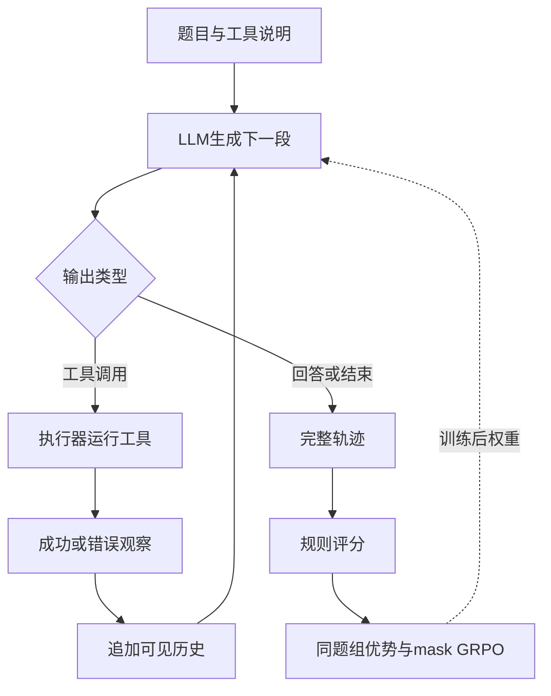

[[00-Agentic-RL|← Agentic RL 索引]] · [[ToolRL-2025-Structured-Tool-Reward-GRPO|对照 ToolRL]]

# ARTIST：在真实工具反馈中用GRPO学习多步决策

> [!abstract] 一句话说明作者做了什么
> 作者让Qwen在训练采样中真正执行Python或环境函数，把返回结果接回上下文继续生成，再用整条交互的规则得分和GRPO更新LLM；工具返回文本不作为策略动作计算loss。
> 输入是题目/用户需求、工具说明和当前历史；输出是数学答案，或完成请求的函数调用与环境状态。主要被改进的是LLM权重，不是MCTS树、外部记忆库或工具程序。

## 1. 论文信息、版本和证据范围

- **题目**：Agentic Reasoning and Tool Integration for LLMs via Reinforcement Learning。
- **缩写**：Agentic Reasoning and Tool Integration in Self-improving Transformers（ARTIST）。
- **实读版本作者**：Joykirat Singh、Raghav Magazine、Yash Pandya、Akshay Nambi；Microsoft Research（微软研究院）。
- **原文**：[arXiv:2505.01441v1](https://arxiv.org/abs/2505.01441v1)，提交日期2025-04-28，40页；[PDF](https://arxiv.org/pdf/2505.01441v1) · [HTML](https://arxiv.org/html/2505.01441v1)。当前arXiv条目仅列v1。
- **已核验发表身份**：NeurIPS 2025 Foundations of Reasoning in Language Models（FoRLM）**Workshop Poster**，不是NeurIPS主会。依据[Workshop主页](https://reasoning-workshop.github.io/)、[录用列表第17项](https://reasoning-workshop.github.io/accepted/)及[第一作者论文页](https://joykirat18.github.io/publications/)。列表页面开头残留“ICML 2025 Workshop”字样，与本站主页不符；作者页与主页相互支持FoRLM @ NeurIPS 2025，不忽略此网页模板冲突。
- **Workshop版本**：[OpenReview](https://openreview.net/forum?id=0BgYVrmz0F) · [PDF](https://openreview.net/pdf?id=0BgYVrmz0F)。录用条目作者为Joykirat Singh、Yash Pandya、Pranav Vajreshwari、Raghav Magazine、Akshay Nambi，摘要称最多20个百分点；arXiv四作者稿摘要为22个百分点。OpenReview直接访问403/验证页，本次未取得完整Workshop稿，因此**下面公式、配置、表格和案例全部以已取得的arXiv v1为准**，不把两个版本混成“终稿”。
- **作者官方入口**：[微软论文页](https://www.microsoft.com/en-us/research/publication/agentic-reasoning-and-tool-integration-for-llms-via-reinforcement-learning/) · [作者讲解页](https://www.microsoft.com/en-us/research/people/akshayn/unlocking-agentic-reasoning-in-llms/)。作者介绍中的效果宣传仍应回原表核对。
- **专用代码/权重**：截至2026-11-06，本次检查原文、微软入口、作者论文页及GitHub检索，未定位到可确认的ARTIST专用官方训练仓库或模型发布。原文§4.3脚注和附录C仍称将发布。依赖verl/verifiers不等于专用实现已开放；同名ART或第三方教学项目不能替代作者代码。
- **本次阅读**：取得40页全文，重点阅读正文§1–7、附录A提示、B潜在应用、C配置、D两个数学案例和E函数调用关键轨迹；视觉核对第4页式(1)、第14页表2，并核对表1数字。未GPU训练、未调用付费模型、未复现论文分数。
- **去重**：核对最新README、Agentic RL索引、模板、ToolRL/Planner-R1及记忆主题索引和当前可见会话。优先队列5/5完成，本篇恢复原队列第6项；读后原队列7/19，下篇ToRL。未声称查遍不可访问的历史。

> [!warning] 三个最容易误解的地方
> 1. 多步工具交互是真的，但函数调用训练把**用户回合设为1**；不要说训练时完整模拟了任意长用户对话。
> 2. 没有逐步思维示范/SFT冷启动，不等于无监督：最终答案、目标状态和参考函数调用都提供监督。
> 3. 最终loss是带工具输出mask的GRPO目标；不是给“工具标签”做交叉熵，也没有新发明一个GRPO算法。

## 2. 出发点：允许调用工具，为什么还不够？

纯文字模型可以在脑中把题拆开，但计算会错；给它Python后，又可能写错代码、读错结果，或假设上一次执行的变量会一直存在。单次代码生成再执行，不能自动学会“遇到错误后再修复”。固定示范能教调用样式，却未必覆盖模型自己产生的错误历史。

ARTIST把这些行为放进**训练时的真实闭环**：模型输出调用→执行器真的运行→实际成功/错误写回→模型继续决定。整条轨迹优劣成为参数更新信号。这里的“真实”指基准/解释器实际执行，不是现实车辆或真实商店上线。

### 贯穿案例：人数题与独立Python作用域

> [!example] 原文真实案例与教学分析的边界
> 下面18、26、2、8和答案50，以及变量作用域错误，来自附录D.2；不是本笔记编造的实验。为便于阅读简化了代码和自然语言，完整原轨迹还重复确认一次50。后文比较轨迹的奖励数值是教学重建，不是作者日志。

题目：18人参加合唱，26人参加乐队，2人都参加，8人都不参加，班里多少人？

逻辑上是18+26−2+8=50。原轨迹先写Python算出至少参加一项的42；第二次只写`total = students_at_least_one_course + 8`，返回变量未定义。附录A明确每段Python独立执行：**对话保存结果，不代表Python进程保留变量**。

模型读到错误后重新定义所有变量，输出50，然后再确认一次。问题不在于语言模型不知道加减法，而在于它是否能把工具接口的状态约束纳入下一步决定。普通一次性文本输出没有这个执行反馈循环；提示式工具agent也能实现循环，但ARTIST进一步用这样的轨迹更新权重。

这也揭示一个限制：这个简单算式本可以直接一次算完。案例显示“能恢复”，并不证明“调用次数最优”或“恢复能力全由RL新产生”。

## 3. 哪个组件做什么？谁调用谁？

| 组件 | 输入 | 输出与职责 | 是否训练 |
| --- | --- | --- | --- |
| LLM策略 | 问题、工具说明、可见交互历史 | 思考、代码/函数名与参数、结束/回答 | GRPO更新策略权重 |
| rollout驱动器/解析器 | 模型文本和标签 | 停在调用处、分派执行、拼回观察、继续生成 | 固定系统逻辑 |
| Python或函数环境 | 可执行调用及环境状态 | 输出、异常、状态变化 | 本文不训练工具 |
| 规则评分器 | 完整轨迹、答案/参考状态/调用 | 每条轨迹的数值奖励 | 不训练神经奖励模型 |
| GRPO优化器 | 同题多条轨迹、分数、生成位置mask | 组内优势、裁剪目标、梯度 | 更新LLM，无独立critic |
| 参考策略/旧策略 | 相同历史下的生成token | 分别约束偏移、提供采样概率分母 | 用于比较，不随当前反传更新 |

最后一行是策略优化的角色区分：旧策略是本批采样的快照，参考策略用于KL锚定；论文未明确参考快照刷新规则，不能代填成某个库的默认值。

实线循环是**执行一条任务**，底部回到策略的虚线是**跨轨迹参数训练**。部署保留训练后的LLM、提示、解析器和工具环境；通常不需要评分真值、组内采样优化器、旧策略或参考策略。本文没有部署时MCTS，也没有自动把反思写入跨任务长期经验库。

### 状态、动作和回合粒度

- 环境的真实状态可以是Python执行上下文或数据库/车辆API状态；模型观察到的只是题目、历史调用与返回，不能把观察当全知状态。
- **学习动作是模型生成token**；组成完整代码或JSON后才触发一次工具执行事件。工具返回token属于观察，不是策略刚做的动作。
- 数学轨迹结束于最终答案/预算终止；函数提示要求继续调用直到当前需求尽力完成，无更多调用则结束当前用户回合。具体解析器、超时、stop-token与失败重试实现未公开。
- 函数训练一次用户回合内可有多个执行步骤；测试τ-bench则有多次用户发言。这两个“多轮”不可互换。
- 本文没有记忆生成/检索/共享模块、运行图优化、参数蒸馏或多智能体通信学习。交互历史是本题上下文，不自动成为长期记忆。

## 4. 一条轨迹实际怎样产生？

数学模板用`<think>`、`<python>`、`<output>`、`<answer>`。模型负责思考、调用代码与回答；系统负责执行代码并插入`<output>`，不会由模型自己编一个工具结果当成功。

对人数例子，一次rollout的顺序是：

1. 输入题目和Python接口规则；模型考虑容斥公式。
2. 输出第一段代码，执行器返回42。
3. 模型生成第二段代码引用前一段变量；执行器返回NameError。
4. 模型看到错误，解释需要重新定义变量，生成完整代码；执行器返回50。
5. 原轨迹又执行一次确认50，再生成最终回答。
6. 轨迹终止后评分，等待与同题其他rollout比较；不是在第3步就立刻梯度下降一次。

函数调用模板改用`<reasoning>`、`<tool>`、`<tool_result>`。附录E.1原案例依次锁门→启动引擎失败（刹车未踩）→调用刹车→再次启动成功。这是同一个LLM根据环境错误改计划，**不是另一个“反思agent”修复第一个agent**。

训练每题采样多条独立交互。某条可能一次算对50，另一条可能算成54，另一条可能失败后恢复。rollout中的上下文不同，后续动作分布也不同，因此不是只给固定正确历史预测下一条标注。

## 5. 奖励到底在奖励什么？

### 5.1 数学：答案、可解析格式、代码可执行性

原文§3.1按三项组合；按其等权相加的叙述可写：

$$
R_i=R_{\mathrm{answer},i}+R_{\mathrm{format},i}+R_{\mathrm{tool},i}.
$$

- 答案与ground truth一致得2，否则0；原文称exact match，但未公开具体提取/归一化与符号等价判定程序，不能默认所有等价公式都会通过。
- 宽松格式：四类标签对每类0.125，最高0.5；严格顺序/闭合再给0.5，格式总分最高1。
- 工具执行：成功调用数除总调用数，最高1；无Python调用或全失败时0。

$$
R_{\mathrm{tool},i}=\begin{cases}
N_{\mathrm{success},i}/N_{\mathrm{calls},i},&N_{\mathrm{calls},i}>0,\\
0,&N_{\mathrm{calls},i}=0.
\end{cases}
$$

所以“执行成功”不是数学正确。可执行的错误代码仍能拿工具分；最终算对却完全不用工具也得不到工具分。严格格式还要求Python相关结构，因此这不是完全中性的“想用就用、不用也不受影响”奖励。

> [!example] 教学重建：不是作者实际记录的四条轨迹分数
> 假设格式全合规：一次正确调用并答对得4；D.2那种4次调用3次成功且答对得3.75；一次可执行但算错答案得2；不用工具直接答对至少拿答案2，格式分取决于实际标签。工具成功比例会使“无需恢复的一次成功”优于“失败再修正”，但没有直接按token或调用总数付费的成本惩罚。

输出42、NameError和50首先是**下一次生成可见的反馈**；它们不是自动逐步优势。工具成功率在整轨迹上汇总；正文没有训练逐步骤价值模型或过程奖励模型。

### 5.2 函数：参考状态与参考调用，外加格式

§3.2列状态分、函数分和格式分，尽管段落引言写“two components”。状态与函数正确性部分：

$$
R_{\mathrm{correct},i}=0.5\frac{S_{\mathrm{matched},i}}{S_{\mathrm{total},i}}
+0.5\frac{F_{\mathrm{matched},i}}{F_{\mathrm{total},i}}.
$$

S表示相关状态变量，F表示与参考匹配的函数调用，函数名和参数均参与判断。两个分母分别是本任务相关状态量与所需函数数，不是生成token数。正文没给空参考集合的除零处理、最优匹配/贪心算法、额外调用惩罚或等效调用归并源码，均未知。

格式部分写两种标签对各0.025，却又说宽松最高0.1；若只对两类各计一次，应为0.05。严格再给0.1。**原文算术与计数口径不一致**，可能涉及开闭标签计数，但没有代码不能擅自替作者修正为0.05或0.1。因此不声称函数总奖励唯一确切上界是1.2。

函数标注用于**计算规则奖励**，不意味着执行token逐个被正确答案teacher forcing监督。训练真值不传给策略当工具观察；测试应只给用户需求/工具反馈，不给目标状态。本文未公布完整适配器，实际信息隔离无法逐行核验。

### 5.3 奖励有偏差吗？

可能的设计偏好是：数学鼓励可执行调用、函数匹配偏好参考步骤；等效路径未必获得同样分数。这是从奖励定义推导的风险，**本文没有测出具体reward hacking比例**，不能当已发生作弊。状态正确与调用匹配结合可提供部分分，但仍不构成每步的因果贡献测量。

## 6. 最终loss：把公式和实际代码边界分清

### 6.1 先把同题多条轨迹比较出优劣

GRPO是组相对策略优化（Group Relative Policy Optimization），不另训练价值网络critic。论文式(1)只说优势来自组内相对奖励，未单列标准差公式。为理解常见GRPO，可用下式**教学重建**：

$$
\bar R_q=\frac1G\sum_{j=1}^{G}R_j,\qquad
\hat A_i=\operatorname{sg}\left(\frac{R_i-\bar R_q}{s_q+\delta}\right).
$$

G是同题轨迹数；s是组内奖励标准差；δ是除零稳定项；sg表示在这一步视为固定数、不反传奖励/优势。**标准差用G还是G−1、δ多少、零方差组如何处理，本文没有代码可核验**。不要把教学公式冒充作者逐行实现。

假设某题四轨迹分数4、3.75、2、2，则组均值2.9375；前两条优势为正，后两条为负。它们高低比较的是完整策略，不是每一步单独与标准调用标签比较。只有终局得分时，同一轨迹优势通常广播给生成位置；本文没有给每个调用独立的反事实贡献算法。

### 6.2 旧策略与参考策略不是一个角色

在可见历史h下，策略比率为：

$$
\rho_{it}(\theta)=\frac{\pi_\theta(y_{it}\mid h_{it})}{\pi_{\mathrm{old}}(y_{it}\mid h_{it})}.
$$

当前策略πθ参与求导；旧策略πold给本批rollout采样并提供固定分母。h包含此前的工具观察，**环境生成它们的概率不需要塞进这个模型token比率**。参考策略πref出现在KL项，用来限制长期偏离；不能把old/ref混写。

裁剪代理项：

$$
g_{it}=\min\left(\rho_{it}\hat A_{it},\operatorname{clip}(\rho_{it},1-\epsilon,1+\epsilon)\hat A_{it}\right).
$$

ε是比率裁剪范围，不是优势标准差的δ。正优势时不鼓励无限抬高概率；负优势时也限制一次更新幅度。它不是把所有概率严格投影到区间内。

### 6.3 工具输出mask决定哪些token算作动作

令m_it=1表示有效的模型生成位置，工具输出位置为0；N_i=Σ_t m_it。按原式(1)策略部分及紧随其后的mask说明，可重排成更清晰的训练目标：

$$
\widehat J(\theta)=\frac1B\sum_{q=1}^{B}
\left[
\frac1G\sum_{i=1}^{G}\frac1{N_i}\sum_{t=1}^{|y_i|}m_{it}g_{it}
-\beta K_q(\theta)
\right],
\qquad \mathcal L(\theta)=-\widehat J(\theta).
$$

B是采样任务批数，G是每题轨迹数，|y_i|含交互序列位置，N_i只计参与更新的生成位置；K_q保留论文的KL正则抽象写法。最大化J等于最小化−J，因此**策略代理项前为负，KL惩罚在最小化loss中为正**。原式按每轨迹有效长度平均，再组平均，不是所有token直接统一平均。

视觉核对：第4页式(1)的内层求和下标出现`(y_{i,t}=1)`，而分母使用指示函数I(y_it)，记号不严谨；结合算法第17行与正文，意图是只取模型生成位置。本笔记用m明确其意图，未声称原版公式本来如此严整。

论文KL写在策略token平均外侧，但没有给采样估计、逐token mask、聚合层级、β数值或实现默认；不能擅自选某个verl版本的k1/k3估计。ε数值、熵系数、梯度裁剪、确切优化epochs也未完整报告。上式是**原文目标的可读重排，非已验证作者源码最终loss**。

工具输出虽然不作为预测目标，依旧进入后续模型的条件上下文。mask不意味着模型不能读结果，也不意味着后续位置的梯度完全绕过表示工具文本的计算；它只是不为“环境给出的那一个输出token”单独计算策略动作loss。

### 6.4 谁被更新？没有什么训练？

更新LLM策略权重；本文没有报告另一个小型决策网络、价值模型、神经奖励模型、SFT冷启动或蒸馏阶段。以Qwen2.5-Instruct起步，已经有指令后训练能力；“cold start RL”不代表从随机初始化学语言。全参/LoRA、冻结模块细节未提供专用配置，不能确定。

## 7. 一轮完整训练与部署的区别

1. 抽一批题，固定本批旧策略；每题采G条轨迹。
2. 每条独立执行“生成—工具—观察—继续”，直到结束/预算。
3. 评分器用答案、参考状态或调用得到R；同时保留模型/环境来源标记。
4. 组内比较出优势；在同一实际历史上计算新旧策略概率。
5. 只在生成token上计算裁剪代理项，加入论文KL约束，梯度下降最小化loss。
6. 同步后续采样所用策略，再采新轨迹；具体同步/minibatch/轨迹重放实现未知。

论文没有描述长期经验回放池、成功轨迹库或跨任务反思检索。训练产生的能力主要跨题保存在参数。部署时一个任务也可多次调用工具，但没有必要为每题再采6/8条并训练；Pass@1不是best-of-6。

## 8. Benchmark究竟在考什么？

### 8.1 数学

训练为主要来自NuminaMath的20,000道题，带最终答案；正文没有发布本项目所选20k的精确清单、过滤/去重与训练测试交叉检查。测试MATH-500有500题；AIME/AMC/Olympiad确切年份、子集大小与各项重复采样次数未充分说明。小数分数不能反推唯一分母。

输入数学题，输出最终答案；Python执行只验证程序能否运行，最终是否数学正确由答案评测器按论文所谓exact match判。本文没有说明LLM裁判，也没有完整符号等价处理。自然语言、分数和等价公式是否归一化，应等作者实现。

Pass@1指单条完整尝试的正确率；同一尝试可含很多执行调用。不是“只允许调用一次”，也不是训练G条任取成功就算通过。

### 8.2 BFCL v3

训练取base multi-turn类100任务，另100验证；训练用户回合数设1。测试Missing Function（无可用函数应不乱编）、Missing Parameters（缺参数应澄清）、Long Context（从长历史保持依赖）。车辆原案例输入需求/函数说明/初态，输出一串使车门与引擎达到目标的调用；回答“已启动”而没有改变状态不算完成。

本次额外静态检查官方gorilla代码固定提交`6ea57973c7a6097fd7c5915698c54c17c5b1b6c8`的`bfcl_eval/eval_checker/multi_turn_eval/multi_turn_checker.py`：执行预测与参考调用，按回合比较对象公开状态，并检查参考执行结果是否在累计模型结果中出现；无关工具回合另查不得产生有效调用。响应匹配容许无序覆盖，调用顺序检查函数在主流程中被注释，并不意味着所有依赖可乱序——执行效果仍受前置条件影响。

这说明基准按可执行结果/状态评价，并非必须整段自然语言逐字相同；也不等于自动接受一切语义等价路径。**这是当前基准源码，不是ARTIST历史适配器或它的训练reward源码**，不倒推原实验必用相同版本。

### 8.3 τ-bench

航空50题、零售115题，用户由模型模拟，agent与用户对话并调用领域API。目标是数据库最终状态及任务要求，而不是生成一份看似合理的客服解释。

本次核对官方tau-bench固定提交`59a200c6d575d595120f1cb70fea53cef0632f6b`的`tau_bench/envs/base.py`：`step`执行调用/用户模拟器，终止后`calculate_reward`将实际数据库哈希与参考动作执行后的数据库哈希比较；若任务有指定outputs，另作回复内的大小写归一化子串检查。因此**LLM扮演用户，不等于最终成功分由LLM主观裁判**。这种规则不能保证全面识别政策合规或全部语义正确性。

ARTIST未公布完整用户模拟器模型、评测种子和所有脚本，故不将上述当前实现当作其历史协议已完全复现。正文写50/115题，但表内部分小数不对应一次全量整数成功数，可能涉及平均/取样；原文未解释，不能把26%硬换成“13/50必然成功”，更不能把零售24%换成27.6个成功任务。

## 9. 配置、预算与成本

| 项目 | 数学，附录C.1 | 函数调用，§4.2与附录C.2 |
| --- | --- | --- |
| 起点 | Qwen2.5-7B/14B-Instruct | Qwen2.5-7B-Instruct |
| 每题rollout | 6 | 8 |
| 温度 | 1.0 | 正文1.0，附录0.9，保留冲突 |
| 响应预算 | 8000 token | 2048 token，窗口16384 |
| 批量 | 8，未说明是否全局查询批 | 每GPU 8、3GPU训练，4步梯度累积；与4卡总硬件描述需区分 |
| 优化器 | Adam，lr=1e−6，β1=.9、β2=.99、weight decay=.01 | 同左；常数学习率、warmup20步 |
| 训练步 | 7B/14B至100步 | 图7曲线约900步；非正式完整训练配置文件 |
| 硬件/时间 | 4×A100 80GB，报告20小时 | 4×A100 80GB，报告34小时 |

数学20小时究竟每模型各一次还是两规模合计，附录未拆清。函数“3卡训练”和“共4卡”可能涉及角色分工，但未说明第四张做什么，不能编成专用推理卡。以4卡全程占用估计，20/34小时相当于80/136 GPU小时；这是**占卡假设下换算**，不是作者分别报告的GPU-hours，更不是可移植云费用。

函数超长rollout的loss会被mask（§4.2），区别于只去掉工具输出。究竟整条丢弃、仅截断后mask及KL如何处理，源码未知。长轨迹过滤可能改变实际训练分布，这是需要审计的问题，不能说已有实验证明造成偏差。

数学预算8k和更多调用会影响成本；baseline的全部解码、token、工具调用预算没有逐项对齐说明。τ-bench作者报告总步数1520→1284，但同时每调用推理190.5→253 token，所以**步骤减少不等于总token、延迟或美元成本更低**。没有完整费用、利用率、峰值显存和每种seed训练时长。

## 10. 关键结果：逐项看表，不跟随宣传句

### 10.1 数学表1：同底座、同工具的对照更有解释力

下列均是arXiv v1表1的Pass@1百分数：

| 测项 | Base | Base+Python提示 | ARTIST | 相对Base增益 | 相对工具提示增益 |
| --- | ---: | ---: | ---: | ---: | ---: |
| 14B AMC | 33.0 | 41.0 | 55.0 | +22.0个百分点 | +14.0个百分点 |
| 7B AIME | 4.0 | 12.2 | 15.6 | +11.6个百分点 | +3.4个百分点 |
| 7B Olympiad | 21.0 | 36.6 | 37.9 | +16.9个百分点 | +1.3个百分点 |
| 14B MATH-500 | 70.0 | 67.1 | 72.6 | +2.6个百分点 | +5.5个百分点 |

14B AMC的22个百分点是55−33，不是相对提高22%；相对基线约66.7%。7B Olympiad大部分Base→ARTIST增益在给Python后已出现，RL相对工具提示只有1.3个百分点。由此支持“工具接入和训练均可能有作用”，不能把全部16.9点归因于GRPO。

原文“consistently outperforms all baselines”与表1不符：DeepSeek-R1的MATH-500/AIME/AMC/Olympiad为85/30/81/46%，均高于14B ARTIST的72.6/12.2/55/42%。不能称超过所有强推理模型。论文正文也存在把超越部分基线扩大到全部的概括。

### 10.2 函数表2：改善真实，但绝对成功率仍低

| 测项，7B | Base | 只加推理提示 | ARTIST | ARTIST相对提示 |
| --- | ---: | ---: | ---: | ---: |
| τ Airline | 12.0 | 12.0 | 26.0 | +14.0个百分点 |
| τ Retail | 18.0 | 20.0 | 24.0 | +4.0个百分点 |
| BFCL Missing Function | 8.5 | 10.5 | 10.5 | 0 |
| BFCL Missing Parameters | 6.0 | 5.5 | 6.5 | +1.0个百分点 |
| BFCL Long Context | 4.0 | 5.5 | 13.0 | +7.5个百分点 |

只有Airline相对Base超过2倍；Retail18→24是1.33倍，对提示20→24是1.2倍。原文将二者一起说翻倍不准确。

GPT-4o五列46.0/60.4/41.0/35.5/54.5%，全部高于ARTIST。正文称在Missing Function/Parameters达到或超过Qwen2.5-72B，也与表2的24.5/20.0%对10.5/6.5%不符。这些冲突必须保留，不替作者重新解释成别的未给指标。

最稳妥结论是：**本设置的7B相对自身提示基线在航空和长上下文函数任务上改善明显，但未达到普遍可靠工具agent，也不是全面领先**。

### 10.3 行为分析与消融边界

图5：AIME调用次数从约0.3到超过3；有些数学任务响应变长。图7验证reward约0.58→0.72是部分正确性分，不是最终整任务成功率72%。图8称正确调用517→676，总步数1520→1284，而坐标又标“平均每任务”，与正文总数口径不一致，因此仅按作者正文报告总数，不自行当作平均。

这些结果和附录成功案例说明模型有工具恢复与依赖处理行为；**更长思考不直接证明更深推理，更多正确调用不直接等于更高效率**。未见独立奖励项移除、输出mask移除、等token预算的无工具RL、等预算SFT、不同信用分配的完整控制消融。原文虽称详细ablations，主体以基线和行为曲线为主，不能补造不存在的消融表。

缺少完整多种子误差条/显著性、训练数据去重清单与历史适配器；不据此指控发生泄漏，而是限制泛化和因果结论。不能从两类实验直接推广到网页/OS通用自治：附录B称potential examples，WebArena和web search示例不是已报告成绩。

## 11. 创新与近邻比较：真正新增的是什么？

| 近邻机制 | 已有能力 | 本文实质重点与边界 |
| --- | --- | --- |
| 工具提示agent/PAL | 提示生成代码或按反馈继续 | 将实际交互接进参数RL；不是首次发明工具调用或反馈循环 |
| ToRA等工具SFT | 模仿交错的推理/调用轨迹 | 不要求本任务逐步示范，用完整轨迹规则奖励学习；非零监督 |
| 纯文字GRPO | 同题多回答、组优势、裁剪 | rollout插入环境反馈，并mask掉非策略输出；不是新GRPO |
| [[ToolRL-2025-Structured-Tool-Reward-GRPO|ToolRL]] | 工具结构分解奖励，主训练单步历史条件化 | 本文训练rollout实际多次执行工具；函数reward偏状态/调用匹配，未提供同预算直接头对头实验 |
| [[Planner-R1-2025-Reward-Shaping-Agentic-RL|Planner-R1]] | 多次查旅行工具，计划终局约束分 | 同属多步参数RL；本文更一般化两领域接口，不能说只有本文会真实工具rollout |
| R1-Searcher/ReSearch、ReTool | 检索或代码交互RL | 正文列为同期工作；本文横跨数学与函数环境，不据此认定全球首创或算法等价 |

作者主张统一框架、广泛工具兼容和泛化。本笔记支持的贡献是：把“生成—真实执行—观察—继续”的轨迹接入GRPO、明确工具输出mask，给出数学及函数两类规则奖励与同底座实验。最关键的理解价值在于**LLM可学习交互策略，而非仅学调用标签**。全新优化算法、因果信用分配、全面SOTA和任意工具泛化均不是这些实验足以证明的贡献。

**基于公开设计重建的逻辑**：静态文本不能暴露工具错误→采样时执行；执行返回不是策略动作→mask；没有逐步示范→用结果和规则部分分；只看算术不知是否会改状态→再测函数环境。此为分析，不冒充作者未公开的思考过程。

## 12. 复现边界与一个小实验

### 可用入口与实际缺口

原文、提示、概念伪代码、部分超参数和基准开放；数学所选20k、作者训练源码/权重/数据切分、精确loss与reward适配器未定位。不能提供虚假的`train_artist.py`调用路径。论文依赖[verl](https://github.com/volcengine/verl)和[verifiers](https://github.com/willccbb/verifiers)，当前上游不是历史版本的替代证据。

本次基准静态核对入口：

- [τ-bench base.py，固定59a200c](https://github.com/sierra-research/tau-bench/blob/59a200c6d575d595120f1cb70fea53cef0632f6b/tau_bench/envs/base.py)：`step → calculate_reward → database hash / output substring`。
- [BFCL checker，固定6ea5797](https://github.com/ShishirPatil/gorilla/blob/6ea57973c7a6097fd7c5915698c54c17c5b1b6c8/berkeley-function-call-leaderboard/bfcl_eval/eval_checker/multi_turn_eval/multi_turn_checker.py)：`multi_turn_checker → execute_multi_turn_func_call → state_checker / response_checker`，另有`multi_turn_irrelevance_checker`。

本次只做了公式/奖励手算与本地独立Python作用域的教学检查，未运行作者训练。数学解释器必须固定独立exec语义、错误返回、标签与终止处理；改成持久kernel会改变D.2这种任务反馈，不能忽略。

> [!tip] 建议实验，尚未执行训练
> 用确定性本地文件/计算器沙盒，训练/测试分别20个独立任务，部分含接口前置条件和错误恢复；固定同一小模型、4轨迹/题、相同总生成token预算。比较提示闭环、单步参考历史GRPO、真实多步GRPO，后两者共享可比分数。记录整任务成功率、遇错后的恢复率、无效调用率、token/调用/延迟，以及等效不同调用路径的接受率；至少3个种子。先回答收益来自访问错误状态还是额外计算，而不是直接照抄基准大数字。

与记忆/经验复用直接相关的只是可迁移训练机制：反馈可训练何时及如何调用工具；本篇不维护长期记忆或多agent运行图，也无蒸馏。self-improving指迭代采样训练权重，不是运行时自主递归改写训练算法。

## 13. 阅读路线与三个可检验问题

**先读**附录D.2人数轨迹→§2.3与算法1分清执行和训练→§3.1/3.2手算奖励→§2.2式(1)核对mask、比率、负号→§4与附录C看真实采样范围→表1/2逐列算增益→附录E.1锁门/刹车例→当前基准checker。别先从宏大“新范式”叙述推断实现。

1. 在相同token与工具预算下，真实多步rollout相对单步正确历史训练，是否特别提高了模型自己犯错后的恢复率？
2. 拿掉可执行比例奖励、保留答案奖励与相同格式约束，会不会减少无意义调用而保持数学正确率？恢复轨迹是否因一次失败被过度扣分？
3. 状态正确但调用路径不同的解法，会被函数匹配奖励低估多少？改用可执行终态分后，未见函数组合上的成功率和奖励投机风险如何变化？

## 原始来源

1. [arXiv v1条目](https://arxiv.org/abs/2505.01441v1) · [40页PDF](https://arxiv.org/pdf/2505.01441v1) · [HTML](https://arxiv.org/html/2505.01441v1)：方法§2、奖励§3、协议§4、结果表1/2、提示/配置/案例附录A–E。
2. [FoRLM Workshop主页](https://reasoning-workshop.github.io/) · [录用列表](https://reasoning-workshop.github.io/accepted/) · [OpenReview条目](https://openreview.net/forum?id=0BgYVrmz0F)：身份核验；Workshop全文本次未取得。
3. [第一作者论文页](https://joykirat18.github.io/publications/) · [微软研究院论文页](https://www.microsoft.com/en-us/research/publication/agentic-reasoning-and-tool-integration-for-llms-via-reinforcement-learning/) · [作者方法介绍](https://www.microsoft.com/en-us/research/people/akshayn/unlocking-agentic-reasoning-in-llms/)：作者入口，不替代原表。
4. [BFCL官方仓库](https://github.com/ShishirPatil/gorilla/tree/6ea57973c7a6097fd7c5915698c54c17c5b1b6c8/berkeley-function-call-leaderboard) · [τ-bench官方仓库](https://github.com/sierra-research/tau-bench/tree/59a200c6d575d595120f1cb70fea53cef0632f6b)：本次基准源码核对，非ARTIST专用实现。
