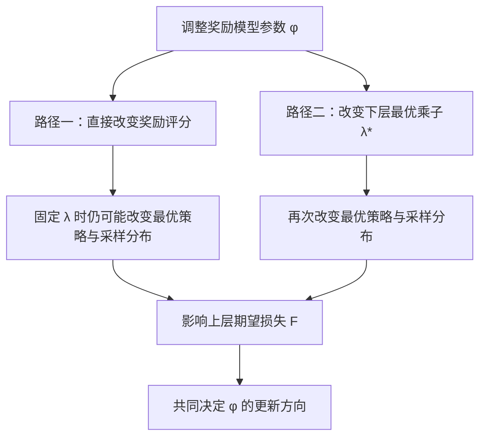
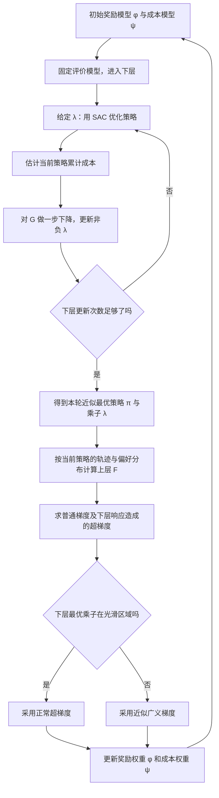

[[00-Agentic-RL|← Agentic RL 索引]] · [[RAP-2023-Reasoning-via-Planning|对照 RAP]] · [[LATS-2024-Language-Agent-Tree-Search|对照 LATS]]

# CB-PbRL / CB-RLHF：约束偏好学习的双层优化精读

> [!abstract] 一句话说明作者做了什么
> **让奖励模型、成本模型和策略一起进步：上层根据偏好修正“什么是好行为／什么是违规”，下层根据当前评价标准训练尽可能高收益且满足约束的策略；上层更新时，还要考虑它所训练出的策略会怎样改变。**
>
> **核心区别**：普通交替式 RLHF 也会“采样 → 训练奖励模型 → 训练策略 → 再采样”；本文进一步用**双层优化与超梯度**考虑下层最优响应，同时加入安全成本和拉格朗日约束。它不是一种新的 PPO／GRPO 损失，实验策略优化器是 **SAC**，场景是 **MuJoCo 连续控制**，而不是 LLM 训练。

> [!info] 版本、阅读依据与符号说明
> - NeurIPS 2026 录用标题为 *A Constrained Bi-level Optimization Framework for Constrained Preference-Based Reinforcement Learning*（简称 CB-PbRL）；本笔记方法与数据沿用此前上传的 ICLR 2026 匿名投稿稿，标题为 *…Constrained Reinforcement Learning from Human Feedback*，算法名称 CB-RLHF。**未逐页比对 NeurIPS 终稿，不把投稿稿中的细节自动认定为终稿结论。**
> - 本次改写以原笔记保存的正文、附录核对记录为主要依据，融合后续关于 BT、成本损失、对偶、SAC、上层梯度的讨论。对用于帮助理解的例子标注为“教学例子”；对投稿稿可能存在的笔误或理论限制在 §11 单列。
> - 为便于阅读：$\phi$ 是**奖励模型网络权重**，$\psi$ 是**成本模型网络权重**，$\theta$ 是**策略网络权重**，$\lambda$ 是**安全成本惩罚系数**。这四个符号不要混淆。
> - 延续原库做法：保留文件命名和 Obsidian 内部链接，不附加论文 PDF，也不声称获得了作者源码。

> [!tip] 五分钟阅读路线
> 先读 **§2 动机 → §3 三种反馈 → §4 如何从偏好训练奖励/成本模型 → §5 下层 SAC 与 $\lambda$ 怎么交替更新 → §6 上层如何利用下层解更新 $\phi,\psi$ → §7 完整算法**。实验与论文可信度看 §9–11。

> [!tip] 队列外补充
> 此文是用户单独指定的论文，不计入19篇固定阅读队列。2026-10-22核对仓库索引：已完成3/19，下一篇Planner-R1；当前进度以[[00-Agentic-RL|主题索引]]为准。

## 1. 论文信息、来源与定位

| 项目 | 信息 |
| --- | --- |
| NeurIPS 录用题目 | A Constrained Bi-level Optimization Framework for Constrained Preference-Based Reinforcement Learning |
| 本笔记精读版本题目 | A Constrained Bi-level Optimization Framework for Constrained Reinforcement Learning from Human Feedback |
| 作者 | Yue Mao、Siyuan Xu、Shicheng Liu、Minghui Zhu（据原笔记所核验的官方录用信息） |
| 会议与版本 | NeurIPS 2026 录用；技术细节依据此前 ICLR 2026 投稿稿 |
| 研究领域 | Preference-based RL、Constrained RL、Bi-level Optimization、RLHF |
| 学习的模型 | 奖励函数 $r_\phi$、成本函数 $c_\psi$、策略 $\pi_\theta$ |
| 策略训练算法 | SAC（Soft Actor-Critic）；论文未确认使用 verl |
| 测试环境 | Walker2d、HalfCheetah、Hopper、Swimmer（MuJoCo） |

- **录用入口**：[NeurIPS Poster](https://neurips.cc/virtual/2026/poster/152347) · [NeurIPS 2026 列表](https://neurips.cc/Downloads/2026) · [录用条目 OpenReview](https://openreview.net/forum?id=TjhQ07qEGv)。
- **精读投稿稿**：[OpenReview](https://openreview.net/forum?id=QOPlh31RTZ) · [投稿稿 PDF](https://openreview.net/pdf?id=QOPlh31RTZ)。
- **作者信息**：[研究组网站](https://sites.psu.edu/multiagent/) · [发表列表](https://sites.psu.edu/multiagent/publication/)。
- **原笔记保存的上传稿指纹**：SHA-256 `4c71d5250b6b5ad41bafcd499fb97cf0f7ca80e43649965fb10876905cd0385c`。本次已重新计算并确认与原记录一致。
- **源码状态**：投稿稿 §10 称源码包含于补充材料；原笔记没有取得补充源码，因此不能确认完整训练框架是哪个现成库，也不称已核对源码。

### 1.1 摘要意译（基于此前投稿稿摘要）

本文研究如何从人类反馈中**联合学习奖励函数、成本函数和策略**。作者将其表示为带约束的双层优化：上层从反馈中推断奖励和成本，下层在这些函数定义的约束条件下寻找最优策略。为此，作者提出双循环算法 CB-RLHF：内循环近似求解下层对偶问题，外循环更新上层模型，并处理约束导致的不可微性。作者给出在其假设下 $\mathcal O(1/\sqrt K)$ 的收敛分析，并在多个仿真环境中进行实验验证。

> [!note] 研究定位
> 这不是“第一次让奖励模型与策略交替训练”：早期人类偏好 RL、PEBBLE 已有这一循环；PARL（ICLR 2024）已经研究双层策略响应。本文更明确的增量是**联合学习奖励与成本 + 受约束下层对偶 + 最优乘子的超梯度/非光滑处理**。不能把所有模块都算成首次提出。

## 2. 方法动机：为什么不能只训练一个奖励模型，再做 RL？

### 2.1 痛点一：任务做得好，不代表行为合规

考虑论文的 Hopper（单腿机器人）任务。机器人想向前跳得更快，但其关节力矩不允许超过设定阈值。**教学例子**：

| 轨迹 | 任务效果 | 安全情况 | 我们希望模型学到什么 |
| --- | --- | --- | --- |
| A | 跑得更快 | 有关节力矩超限 | 奖励高，但成本也高 |
| B | 稍慢 | 力矩始终合规 | 奖励略低，但成本低 |

如果只问“总体喜欢哪条轨迹”，可能无法区分“速度偏好”和“安全边界”。作者因此希望分别训练：

$$
\underbrace{r_\phi(s,a)}_{\text{动作对完成任务的贡献}},\qquad
\underbrace{c_\psi(s,a)}_{\text{动作的约束成本}}.
$$

奖励和成本不是同一个数值的正负两面。**奖励高、成本高可以同时成立**。

### 2.2 痛点二：奖励模型会被后来训练出的策略“反过来考验”

假设开始只见过慢速机器人，奖励模型误以为“越快越好”；SAC 按这个分数不断优化，最后可能学出奖励模型未见过的危险动作。

普通交替方法可以通过收集新轨迹、重新训练奖励模型缓解这一问题。但仅仅“拿到新数据再训练”还不能表达：**如果我稍微改动奖励模型的参数，按照它训练出的最优策略会怎样随之改变？**

论文考虑两条影响路径：

1. 改变 $\phi,\psi$，直接改变模型的评分；即使 $\lambda$ 固定，最优策略也可能改变。
2. 改变 $\phi,\psi$，还会改变下层最优乘子 $\lambda^*$，继而改变最优策略、轨迹分布与上层反馈损失。

第二条是双层超梯度最醒目的部分，但**第一条也不能漏掉**。

### 2.3 作者的假设/直觉

> [!important] 核心直觉
> **评价标准不能脱离使用它的最优策略来学习。** 与其先永久训练好奖励/成本模型再做策略 RL，不如把“评价模型 → 最优策略 → 反馈损失”的依赖写成一个统一的双层优化问题。

## 3. 问题定义：模型到底接收什么反馈？

### 3.1 三种模型输出与一个重要的记号区别

状态 $s$ 是物理观测，动作 $a$ 是连续控制信号。策略给出动作分布：

$$
\pi_\theta(a\mid s).
$$

奖励网络、成本网络给每个状态—动作对打分：

$$
r_\phi(s,a),\qquad c_\psi(s,a).
$$

一条长度为 $H$ 的轨迹为：

$$
\tau=(s_0,a_0,s_1,a_1,\ldots,s_{H-1},a_{H-1}).
$$

**单条轨迹的累计评分**（不是概率）：

$$
R_\phi(\tau)=\sum_{t=0}^{H-1}\gamma^t r_\phi(s_t,a_t),\qquad
C_\psi(\tau)=\sum_{t=0}^{H-1}\gamma^t c_\psi(s_t,a_t).
$$

**一个策略的预期累计评分**（对其所有可能轨迹取期望）：

$$
J_{r_\phi}(\pi)=\mathbb E_{\tau\sim\rho_\pi}[R_\phi(\tau)],\qquad
J_{c_\psi}(\pi)=\mathbb E_{\tau\sim\rho_\pi}[C_\psi(\tau)].
$$

下文用 $R_0,R_1,C_0,C_1$ 表示**两个具体轨迹**的总评分，用 $J_r(\pi),J_c(\pi)$ 表示**整个策略**的期望评分。不要把两者混为一谈。

### 3.2 每两条轨迹需要三个维度的反馈

轨迹对 $\tau_0,\tau_1$ 对应四个标签值，但属于**三种反馈**：

| 反馈类型 | 原稿标签 | 编码含义 | Hopper 例子：$\tau_0=A,\tau_1=B$ |
| --- | --- | --- | --- |
| 任务质量偏好 | $y_r\in\{0,1\}$ | $0$：更喜欢 $\tau_0$；$1$：更喜欢 $\tau_1$ | A 更快，$y_r=0$ |
| 安全程度偏好 | $y_c\in\{0,1\}$ | **$1$：$\tau_0$ 更安全；$0$：$\tau_1$ 更安全** | B 更安全，$y_c=0$ |
| 是否违规 | $z_i\in\{+1,-1\}$ | $+1$：违规；$-1$：合规 | $z_0=+1,z_1=-1$ |

> [!warning] 标签编码陷阱
> 原投稿稿的 $y_r$ 和 $y_c$ **方向相反**。尤其是 $y_c=1$ 表示轨迹 0 更安全，而不是轨迹 1 更安全。下面的损失公式按投稿稿式 (3)(4) 的编码展开；复现时首先要写单元测试核对符号。

### 3.3 实验里这些反馈从哪来？

作者的连续控制实验并非真的找人逐条标注，而是用环境真实奖励、真实成本自动合成标签：谁的真实总奖励大，任务偏好谁；谁的真实总成本小，安全偏好谁；真实总成本 $>0$ 就标记违规。

这是**模拟人类反馈的可控实验**。后续 §9–10 的结果不等于已经在真人偏好或 LLM 工具调用中验证成功。

## 4. 上层所学的评价模型：BT 奖励损失与双重成本损失

> [!question] 先记住这一句
> **BT 模型不是策略 $\pi_\theta$，也不是奖励网络 $r_\phi$。它只负责把两条轨迹的奖励（或成本）分数，转换成一个可与人工偏好标签比较的概率。**

### 4.1 奖励模型如何从“选 A 还是选 B”学到数值分数？

人类一般能说“轨迹 A 更好”，但很难给出 $R(A)=8.3$、$R(B)=6.7$ 这样的精确奖励。奖励网络只负责输出分数：

$$
R_0=R_\phi(\tau_0),\qquad R_1=R_\phi(\tau_1).
$$

Bradley–Terry（BT）概率模型假设：分数越高，越容易在人类比较中获胜。

$$
\boxed{
P_\phi(\tau_0\succ\tau_1)
=\frac{e^{R_0}}{e^{R_0}+e^{R_1}}
=\sigma(R_0-R_1)
}
$$

这里 $\sigma(x)=1/(1+e^{-x})$。**教学例子**：$R_0=3,R_1=1$ 时，偏好轨迹 0 的预测概率约为 $88.1\%$。

#### 为什么这不是“模型生成轨迹的概率”？

必须区分两种概率：

| 概率 | 问的是什么？ | 由什么决定？ |
| --- | --- | --- |
| $P_\theta(\tau)$ 或 $\rho_{\pi_\theta}(\tau)$ | 当前策略**会生成**这条轨迹的概率 | 策略 $\pi_\theta$ 和环境转移 |
| $P_\phi(\tau_0\succ\tau_1)$ | **给定这两条轨迹**，人类会选择哪一条 | 奖励评分 $R_\phi$ 和 BT 假设 |

一个尚未训练好的机器人可能有很高概率“原地不动”，但人类并不因此更喜欢原地不动。**常出现不等于更好**。BT 是用来训练奖励模型的，而不是用来代替策略采样概率。

### 4.2 奖励交叉熵 Loss 为什么是这个形式？

设：

$$
p=\sigma(R_0-R_1),\quad
y_r=\begin{cases}0,&\tau_0\text{更好},\\1,&\tau_1\text{更好}.
\end{cases}
$$

模型给真实标签分配的概率可以合写成：

$$
P(y_r)=p^{1-y_r}(1-p)^{y_r}.
$$

取负对数，就是常见的 Bernoulli 负对数似然/交叉熵：

$$
-\log P(y_r)=-(1-y_r)\log p-y_r\log(1-p).
$$

把 BT 概率代进去，得到投稿稿式 (3)：

$$
\boxed{
\mathcal L_r
=-\mathbb E_D\!\left[
(1-y_r)\log\sigma(R_0-R_1)
+y_r\log\sigma(R_1-R_0)
\right].
}
$$

读这个式子只需代入两个标签：

- $y_r=0$：只剩 $-\log\sigma(R_0-R_1)$，要求 $R_0$ 比 $R_1$ 大。
- $y_r=1$：只剩 $-\log\sigma(R_1-R_0)$，要求 $R_1$ 比 $R_0$ 大。

**例子**：人类选轨迹 0，却有 $R_0=1,R_1=3$，模型预测选轨迹 0 的概率仅 $0.119$，Loss 约 $2.127$；梯度下降就会推动 $R_0-R_1$ 变大。

> [!important] BT 在哪里用、在哪里不用？
> **训练奖励模型 $r_\phi$**：用 BT 概率与标签算交叉熵。**训练 SAC 策略**：使用奖励网络输出的 $r_\phi(s,a)$ 作为奖励的一部分，而不是把 BT 的比较概率直接当作 SAC 奖励。

### 4.3 成本模型为什么需要两个损失，而不是两个成本网络？

全篇只有一个学习到的成本网络 $c_\psi$，但它同时接受两种监督。

**损失 A：成本偏好排序。** 要学会谁更安全，即谁的**成本更小**。按原稿标签 $y_c=1$ 表示轨迹 0 更安全，有：

$$
\boxed{
\mathcal L_{c,\mathrm{pair}}
=-\mathbb E_D\!\left[
(1-y_c)\log\sigma(C_0-C_1)
+y_c\log\sigma(C_1-C_0)
\right].
}
$$

- $y_c=0$：偏好轨迹 1，推动 $C_0>C_1$。
- $y_c=1$：偏好轨迹 0，推动 $C_1>C_0$。

如果 A 的成本是 5，B 的成本是 2，排序损失会倾向于认为 B 更安全。**但这并不告诉我们 B 的成本 2 是否已经违规。**

**损失 B：是否违规的二分类。** 定义 $z_i=+1$ 为违规、$z_i=-1$ 为合规：

$$
\boxed{
\mathcal L_{c,\mathrm{binary}}
=-\mathbb E_D\!\left[
\log\sigma(z_0C_0)+\log\sigma(z_1C_1)
\right].
}
$$

把标签代入就懂了：

- 违规 $z_i=+1$：损失是 $-\log\sigma(C_i)$，推动 $C_i>0$。
- 合规 $z_i=-1$：损失是 $-\log\sigma(-C_i)$，推动 $C_i<0$。

它尝试把 $C=0$ 变成一个**有意义的绝对边界**。为什么必要？仅靠排序，只知道 $C(A)-C(B)$；把所有成本统一加 100，排序概率完全不变，但“成本是否 $\le0$”会彻底改变！

所以两个监督各司其职：

| 损失 | 让模型学到什么 | 只靠它还缺什么 |
| --- | --- | --- |
| 安全排序 Loss | 哪条轨迹相对更安全，成本高低顺序 | 绝对违规边界 |
| 违规分类 Loss | 成本应落在 0 的哪一侧 | 不同违规轨迹的相对严重程度 |
| 两者相加 | 同时建立**相对次序**和**零点边界** | 仍依赖反馈准确性及函数表达能力 |

投稿稿式 (4) 的完整成本目标为：

$$
\boxed{
\mathcal L_c=\mathcal L_{c,\mathrm{pair}}+\mathcal L_{c,\mathrm{binary}}.
}
$$

**Hopper 教学例子**：A 更快但违规，B 略慢且合规。三个损失共同希望：

$$
R_A>R_B,\qquad C_A>C_B,\qquad C_A>0,\ C_B<0.
$$

它们不矛盾，因为奖励与成本表达的是两种不同标准。

> [!warning] 分类边界不等于真实世界安全保证
> 分类损失会推动学习的轨迹成本以 0 为界，但不会保证模型每次判断都正确；论文约束的是**预期累计成本**，不是任何一条轨迹、任何一步都绝不违规。

## 5. 下层如何训练：有约束的 RL、拉格朗日对偶和 SAC

这是全文第一个最重要的优化问题：**在奖励/成本模型给定后，让策略收益尽量高，同时要求预期成本不超过 0。**

### 5.1 先写原问题：奖励最大化 + 成本约束

在某一轮外层迭代中，暂时固定 $\phi,\psi$：

$$
\boxed{
\max_\pi\ \big[J_{r_\phi}(\pi)+\mathcal H(\pi)\big]
\quad\mathrm{s.t.}\quad J_{c_\psi}(\pi)\le 0.
}
\tag{1}
$$

其中 $\mathcal H(\pi)=\mathbb E_\pi[-\sum_t\gamma^t\log\pi(a_t\mid s_t)]$ 为策略熵，用于鼓励探索。理论式中熵系数按原稿规范化为 1；实验 SAC 另列温度初值 0.2，不能简单视为同一个固定参数。

**别忘了这是“期望约束”**：它要求 $J_c(\pi)\le0$，不是说每条采样轨迹都必须 $C(\tau)\le0$。

### 5.2 引入 λ：把“不能违规”放进优化目标

对于最大化问题 $\max_x f(x)$、约束 $g(x)\le0$，可以引入非负乘子 $\lambda\ge0$：

$$
\mathcal L(x,\lambda)=f(x)-\lambda g(x).
$$

对应到本文：

$$
\boxed{
\mathcal L(\pi,\lambda;\phi,\psi)
=J_{r_\phi}(\pi)+\mathcal H(\pi)-\lambda J_{c_\psi}(\pi).
}
$$

含义很简单：如果策略成本过高（$J_c>0$），$-\lambda J_c$ 就会降低该策略的得分；如果当前策略成本低于边界，就没有必要一直强化处罚。

### 5.3 为什么最初是 max–min？违规策略会被直接排除吗？

原问题可以**在数学上等价写成**：

$$
\max_\pi\min_{\lambda\ge0}\mathcal L(\pi,\lambda).
$$

这里内侧 $\min_\lambda$ 是对**一个固定的候选策略**判断是否可行：

$$
\min_{\lambda\ge0}\mathcal L(\pi,\lambda)
=\begin{cases}
J_r(\pi)+\mathcal H(\pi),&J_c(\pi)\le0,\\
-\infty,&J_c(\pi)>0.
\end{cases}
$$

所以**是的：如果真的先把 $\lambda$ 精确最小化，任意违规策略都会得到 $-\infty$**。但这是一种描述可行集合的数学写法，**不是实际训练时逐个删除采样到的违规策略**；否则成本 0.01 和成本 100 都是 $-\infty$，无法直接得到有用的连续优化信号。

还要注意：虽然这里暂时“固定策略求 $\lambda$”，外面仍有 $\max_\pi$，负责寻找**所有可行策略中最优的那一个**。固定单个策略绝不能单独保证其最优性。

### 5.4 对偶转换：为什么 G 要先对策略 max，再对 λ min？

作者定义对偶函数：

$$
\boxed{
G(\lambda;\phi,\psi)
=\max_\pi\left[
J_{r_\phi}(\pi)+\mathcal H(\pi)-\lambda J_{c_\psi}(\pi)
\right].
}
$$

下层最终求：

$$
\boxed{
\lambda^*(\phi,\psi)\in
\arg\min_{\lambda\ge0}G(\lambda;\phi,\psi).
}
\tag{2}
$$

这就是：

$$
\boxed{
\underbrace{\min_{\lambda\ge0}}_{\text{外侧：调整惩罚强度}}
\ \underbrace{\max_{\pi}}_{\text{内侧：给定惩罚后找最佳策略}}
\big(J_r+\mathcal H-\lambda J_c\big).
}
$$

两个优化方向没有冲突：**策略需要把调整后的收益做高；乘子需要把对偶上界压低。**

#### 为什么 G 是上界，即使 max 选到不合规策略也不会变成下界？

记原问题的最优值为 $J^*$，最优合规策略为 $\pi^*$。任意 $\lambda\ge0$ 都有：

$$
\begin{aligned}
G(\lambda)
&=\max_{\pi\in\Pi}\mathcal L(\pi,\lambda)\\
&\ge\mathcal L(\pi^*,\lambda)\\
&=J_r(\pi^*)+\mathcal H(\pi^*)-\lambda J_c(\pi^*)\\
&\ge J_r(\pi^*)+\mathcal H(\pi^*)=J^*.
\end{aligned}
$$

**关键不是“每个策略的拉格朗日函数都高于 $J^*$”**；不合规策略的 $\mathcal L$ 当然可能更低。关键是 $G$ 对**全部策略取最大值**，其中始终包含那个合规的最优策略 $\pi^*$。

所以 $G$ 对任意 $\lambda$ 都是上界，**最小化它是在寻找尽可能紧的上界**。在本文 Lemma 1 分析的熵正则约束 RL 设置及相应条件下，作者讨论强对偶；对任意非凸神经网络策略参数化，不能不加条件地保证最优值完全相同。

#### 一个看得见 max/min 的教学例子

忽略熵，设两种候选策略：

| 策略 | 奖励 $J_r$ | 成本 $J_c$ | 拉格朗日得分 |
| --- | ---: | ---: | --- |
| A（快但违规） | 10 | +3 | $10-3\lambda$ |
| B（慢但安全） | 6 | -1 | $6+\lambda$ |

$$
G(\lambda)=\max\{10-3\lambda,\ 6+\lambda\}.
$$

- $\lambda=0.5$：A 得分 8.5、B 得分 6.5，**内侧 max 选择 A**。
- $\lambda=2$：A 得分 4、B 得分 8，**内侧 max 选择 B**。
- 这个离散两策略例子里 $G(\lambda)$ 在 $\lambda=1$ 达最小值 7。若只允许纯策略，原始可行最优值是 6，因此存在对偶间隙；若允许随机混合且模型条件合适，可消除此例中的间隙。

这个例子还说明：**改变 $\lambda$，最优策略就可能改变。** 所谓 $\pi^*(\lambda)$，是“在当前 $\lambda$ 对应目标下”最优，而不是找到一次就永远不变。

### 5.5 内侧 max 如何用 SAC 更新策略参数？

固定 $\phi,\psi,\lambda$，把奖励与成本合成：

$$
\boxed{
\widetilde r(s,a)=r_\phi(s,a)-\lambda c_\psi(s,a).
}
$$

内侧问题随即变为：

$$
\max_\pi\big[J_{\widetilde r}(\pi)+\mathcal H(\pi)\big],
$$

这是最大熵 RL 的常见目标，实验使用 **SAC** 近似求解。注意：SAC 内部的 Actor、Critic 是策略优化模块；它们不是上层奖励/成本网络。

以常见的双 Critic SAC 为例（**教学展开，非作者源码逐行复刻**）：

**① 收集经验并计算当前的有效奖励**

$$
(s_t,a_t,s_{t+1},d_t),\quad
\widetilde r_t=r_\phi(s_t,a_t)-\lambda c_\psi(s_t,a_t).
$$

**② 更新 Critic**：让 Q 网络逼近以 $\widetilde r$ 为即时奖励的长期价值。常见软 TD 目标：

$$
y_t=\widetilde r_t+\gamma(1-d_t)
\left[\min_{j=1,2}Q_{\bar\omega_j}(s_{t+1},a')-
\alpha_{\mathrm{ent}}\log\pi_\theta(a'\mid s_{t+1})\right],
$$

其中 $a'\sim\pi_\theta(\cdot\mid s_{t+1})$，$\alpha_{\mathrm{ent}}$ 是**熵温度**，与安全乘子 $\lambda$ 不是同一个量。

$$
L_{Q_j}(\omega_j)=\mathbb E\left[
\big(Q_{\omega_j}(s_t,a_t)-y_t\big)^2
\right].
$$

**③ 更新 Actor**：让策略倾向于更高的 Q 值，同时保持一定熵：

$$
\boxed{
L_{\mathrm{actor}}(\theta)=
\mathbb E_{s,a\sim\pi_\theta}
\left[\alpha_{\mathrm{ent}}\log\pi_\theta(a\mid s)
-\min_jQ_{\omega_j}(s,a)\right].
}
$$

梯度下降更新 $\theta$；Critic 梯度下降更新 $\omega_j$。这里 Actor Loss 没有直接写 $-\lambda c_\psi$，**因为这个惩罚早已进入 TD 目标，随后由 Q 值传递给 Actor**。

**④ 更新 Target Critic**（常见软更新）：

$$
\bar\omega_j\leftarrow(1-\tau)\bar\omega_j+\tau\omega_j.
$$

经过多步 SAC 更新，得到给定乘子下的近似最优策略：

$$
\pi_{\phi,\psi,\lambda}
\approx\arg\max_\pi\mathcal L(\pi,\lambda;\phi,\psi).
$$

> [!note] 工程理解
> 奖励模型或 $\lambda$ 更新后，旧经验中缓存的“惩罚后奖励”可能过时。合理的复现方式是保存 $r_\phi,c_\psi$ 所需的原始轨迹信息并按当前参数重新计算；但**投稿稿未提供足够的源码证据**来断言其确切 Replay Buffer 重标注实现。

### 5.6 外侧 min 如何更新 λ？为什么最终公式里没有 min 符号？

原本要求：

$$
\min_{\lambda\ge0}G(\lambda).
$$

**最小化不是凭空消失，而是用“减去梯度”一步步实现：**

$$
\lambda^{t+1}=
\left[\lambda^t-\omega_k\nabla_\lambda G(\lambda^t;\phi,\psi)\right]_+,
\qquad[x]_+=\max(0,x).
$$

在给定 $\lambda$ 时内侧策略最优、满足包络定理的条件下：

$$
\boxed{
\nabla_\lambda G(\lambda)=-J_{c_\psi}(\pi_{\phi,\psi,\lambda}).
}
$$

所以代入梯度下降，就得到：

$$
\boxed{
\lambda^{t+1}=
\left[\lambda^t+\omega_kJ_{c_\psi}(\pi_{\phi,\psi,\lambda^t})\right]_+.
}
$$

这一步具体更新的只是**一个非负乘子**，不是梯度下降更新 Actor：

| 当前策略的预期成本 | 梯度 $\nabla_\lambda G$ | 对 $G$ 做梯度下降 | 下一轮策略受到的惩罚 |
| --- | --- | --- | --- |
| $J_c>0$（超限） | 负数 | $\lambda\uparrow$ | 增强 |
| $J_c<0$（低于边界） | 正数 | $\lambda\downarrow$ | 减弱 |
| $J_c=0$ | 0 | 暂不变 | 位于约束边界附近 |

例如 $\lambda=0.5,\omega_k=0.1,J_c=2$，下一步得到 $\lambda'=0.7$；如果之后 $J_c=-1$，则再变成 $0.6$。

**为什么更新 $\lambda$ 时不必再显式写 $d\pi^*/d\lambda$？** 在精确最优策略与相应正则条件下，包络定理告诉我们 $G$ 对 $\lambda$ 的梯度等于固定最优策略时拉格朗日函数对 $\lambda$ 的偏导。注意这仅适用于该层的 $G$ 梯度，并不意味着上层超梯度可以忽略策略分布响应。

### 5.7 λ 更新后，为什么必须再次训练策略？

一轮策略学习只得到：

$$
\pi_t\approx\pi^*(\phi,\psi,\lambda_t).
$$

乘子更新为 $\lambda_{t+1}$ 后，新的目标是 $r_\phi-\lambda_{t+1}c_\psi$，所以：

$$
\pi_t\text{ 一般不是 }\pi^*(\phi,\psi,\lambda_{t+1}).
$$

因此完整下层不是“**只训练一次 SAC，然后不停更新 $\lambda$**”，而是：

$$
\boxed{
\lambda_0\ \to\ \pi_0\ \to\ \lambda_1\ \to\ \pi_1\ \to\ \lambda_2\ \to\ \pi_2\ \to\cdots
}
$$

每次策略求解是**当前乘子下的近似最优**；每次乘子更新是**对 $G$ 下降一步**。论文 Algorithm 1 用有限步 $t_k$ 近似下层解，并不要求每一次 SAC 都达到全局最优。

> [!important] 下层结束时实际拿到了什么？
> 固定本轮 $\phi_k,\psi_k$，多次交替后得到近似最优 $\lambda_k\approx\lambda^*(\phi_k,\psi_k)$，以及对应策略 $\pi_k\approx\pi^*(\phi_k,\psi_k,\lambda_k)$。**它们并不是只供下一轮使用，而是立即参与当前轮上层损失和超梯度的计算。**

## 6. 上层到底更新什么？F、采样分布、超梯度

### 6.1 上下层训练参数不要混淆

| 层次 | 参数 | 来源/作用 | 如何更新 |
| --- | --- | --- | --- |
| 下层策略优化 | $\theta$（Actor）、$\omega$（Critic） | 用 SAC 优化 $r_\phi-\lambda c_\psi$ | SAC 梯度更新 |
| 下层对偶优化 | $\lambda\ge0$ | 自动调整违规成本权重 | 投影梯度下降 |
| **上层奖励学习** | **$\phi$** | 奖励模型 $r_\phi(s,a)$ 的网络权重 | **超梯度/广义梯度下降** |
| **上层成本学习** | **$\psi$** | 成本模型 $c_\psi(s,a)$ 的网络权重 | **超梯度/广义梯度下降** |

上层不直接更新 SAC 的 Actor、Critic，也不直接以 $F$ 优化 $\lambda$；$\lambda$ 来自下层求解。不过上层计算梯度时，**必须考虑下层 $\lambda^*$ 与策略对 $\phi,\psi$ 的依赖**。

### 6.2 F 是什么？不就是三个交叉熵损失之和吗？

是。上层目标（原稿式 (5)）为：

$$
\boxed{
F(\phi,\psi,\lambda)
=\mathcal L_r(\phi,\lambda)+\mathcal L_c(\psi,\lambda).
}
$$

其中 $\mathcal L_c=\mathcal L_{c,\mathrm{pair}}+\mathcal L_{c,\mathrm{binary}}$；三个具体 Loss 都已经在 §4 写出。

但有一个关键区别：

- **固定轨迹样本计算的交叉熵**，公式表面没有 $\lambda$；
- **对当前策略诱导的轨迹与反馈分布求期望**，$F$ 就会通过策略**间接依赖 $\lambda$**。

为了写清楚这层依赖，令 $\xi=(\tau_0,\tau_1,y_r,y_c,z_0,z_1)$，$\ell(\xi;\phi,\psi)$ 是一组样本的奖励损失与成本损失之和。轨迹/反馈联合分布可概念性写为：

$$
D_{\phi,\psi,\lambda}(\xi)=
\rho_{\pi^*(\phi,\psi,\lambda)}(\tau_0)
\rho_{\pi^*(\phi,\psi,\lambda)}(\tau_1)
\,h_l(y_r,y_c,z_0,z_1\mid\tau_0,\tau_1).
$$

于是：

$$
\boxed{
F(\phi,\psi,\lambda)
=\mathbb E_{\xi\sim D_{\phi,\psi,\lambda}}
\left[\ell(\xi;\phi,\psi)\right].
}
$$

这就说明了：

$$
\boxed{\lambda\ \longrightarrow\ \pi^*(\phi,\psi,\lambda)
\ \longrightarrow\ \text{轨迹分布}
\ \longrightarrow\ F.}
$$

这是你之前最关心的问题：**为什么 $F$ 里没显式写 $\lambda$，上层却还需要下层算出来的 $\lambda^*$？** 答案是 $\lambda$ 先改变最优策略，再改变产生反馈的轨迹分布，最后改变上层的期望损失。

### 6.3 真正的双层目标

由于下层不是任意给 $\lambda$，而是优化 $G$ 得到：

$$
\lambda^*(\phi,\psi)\in\arg\min_{\lambda\ge0}G(\lambda;\phi,\psi),
$$

上层要求：

$$
\boxed{
\min_{\phi,\psi}
F\big(\phi,\psi,\lambda^*(\phi,\psi)\big).
}
\tag{5--6}
$$

对奖励模型来说，这有两条不同的影响路径：



成本参数 $\psi$ 完全同理。**不能把第一条路径仅仅理解成“固定数据上的分类器反向传播”**：固定 $\lambda$ 时，最优策略本身仍依赖奖励与成本模型。

### 6.4 为什么普通梯度不够？超梯度从哪里来？

假设我们考虑奖励模型参数 $\phi$：

$$
F\big(\phi,\psi,\lambda^*(\phi,\psi)\big).
$$

对 $\phi$ 做全导数，根据链式法则：

$$
\boxed{
H_\phi=
\underbrace{\partial_\phi F}_{\text{固定 λ 时的变化}}
+\underbrace{(D_\phi\lambda^*)^\top\partial_\lambda F}_{\text{λ* 随 φ 改变的附加影响}}.
}
\tag{7}
$$

成本模型类似：

$$
\boxed{
H_\psi=
\partial_\psi F+(D_\psi\lambda^*)^\top\partial_\lambda F.
}
\tag{8}
$$

把第二项拆成三个“问句”会更直观：

1. **改 $\phi$ 会改变最佳惩罚权重吗？** $D_\phi\lambda^*$。
2. **改惩罚权重会改变训练出的策略及其轨迹吗？** 策略分布依赖 $\lambda$。
3. **新轨迹会怎样改变上层偏好损失？** $\partial_\lambda F$。

合起来就是“**我如果这样改奖励模型，下层重新做出最佳响应后，人类偏好损失最终会变多少**”。这才是超梯度比常规交替训练多做的事。

### 6.5 固定 λ 的 ∂F/∂φ，也需要考虑轨迹分布导数

由于 $F=\mathbb E_{\xi\sim D}[\ell(\xi)]$，对 $u\in\{\phi,\psi\}$ 求导可以使用似然比恒等式：

$$
\boxed{
\partial_u F
=\mathbb E_D\left[
\partial_u\ell(\xi)+
\ell(\xi)\,\partial_u\log D(\xi;u,\lambda)
\right].
}
$$

**两项含义不同：**

- $\partial_u\ell$：评价网络直接对当前轨迹的评分变化，类似常规交叉熵反传。
- $\ell\,\partial_u\log D$：即使 $\lambda$ 固定，评价网络变化后最优策略会变化，从而改变“哪些轨迹容易被采到”。

如果环境动力学、反馈规则本身不直接依赖 $u$，则轨迹分布的对数导数由策略项提供：

$$
\partial_u\log D
=\sum_{i=0}^{1}\sum_{t=0}^{H-1}
\partial_u\log\pi^*_{\phi,\psi,\lambda}(a_{it}\mid s_{it}).
$$

这一项看起来像你学过的策略梯度 Log-Derivative Trick，但这里的**求导参数不是策略权重 $\theta$，而是奖励/成本模型权重 $u$**；策略又通过下层最优解间接依赖于它。

> [!warning] “新轨迹更新奖励模型” ≠ “已经实现论文超梯度”
> 即使每轮都用新策略采样新数据，如果只对固定 batch 调用 BT Cross-Entropy 的 `backward()`，仍可能**遗漏轨迹分布响应和最优 $\lambda^*$ 响应**。这类算法还需要估计对下层最优策略/乘子的敏感度，不能直接从普通 SAC 或 PPO 的 Loss 自动得到。

### 6.6 Dφλ* 怎样算？为什么还需要二阶导数？

令 $u$ 表示 $\phi$ 或 $\psi$。先讨论最简单情形：下层最优乘子严格大于零，并且 $G$ 在局部光滑、二阶导数非零。

由于 $\lambda^*$ 最小化 $G$，内点满足：

$$
\partial_\lambda G(\lambda^*;u)=0.
$$

对上式再关于 $u$ 求导（注意 $\lambda^*$ 本身是 $u$ 的函数）：

$$
G_{\lambda u}+G_{\lambda\lambda}D_u\lambda^*=0.
$$

所以：

$$
\boxed{
D_u\lambda^*=-G_{\lambda\lambda}^{-1}G_{\lambda u}.
}
$$

它叫**隐式微分（Implicit Differentiation）**。之所以出现二阶导数，是因为我们是在对“下层一阶最优条件”再次求导。

这里 $\lambda$ 只有一个标量，所以 $G_{\lambda\lambda}$ 是标量曲率；但是 $G$ 内部还包含最优策略求解，**并不意味着算整个超梯度很廉价**。

### 6.7 λ*=0 时怎么办？为什么出现 Clarke 广义梯度？

约束 $\lambda\ge0$ 使下层最优解可能贴在边界。为处理它，作者还引入下层非负约束的 KKT 乘子 $\nu$：

$$
\mathscr L_{\mathrm{dual}}(\lambda,\nu)=G(\lambda;\phi,\psi)-\nu\lambda,
\qquad \lambda\ge0,\ \nu\ge0.
$$

KKT 条件为：

$$
G_\lambda-\nu=0,\qquad\lambda\nu=0,
\qquad\lambda\ge0,\nu\ge0.
$$

于是存在三个典型区域：

| 情况 | 说明 | $D_u\lambda^*$ |
| --- | --- | --- |
| $\lambda^*>0,\nu=0$ | 最优点在内部 | 可按隐式微分求解（需正则条件） |
| $\lambda^*=0,\nu>0$ | 最优点稳定贴在边界 | 局部通常为 0 |
| $\lambda^*=0,\nu=0$ | 可能是两个区域的切换点 | 可能不可微 |

**教学模型**：

$$
G(\lambda;u)=\tfrac12(\lambda-u)^2,\quad\lambda\ge0
\quad\Rightarrow\quad\lambda^*(u)=\max(0,u).
$$

在 $u=0$ 处，左侧导数是 0，右侧导数是 1，所以没有唯一的普通导数。

作者采用 **Clarke 次微分的近似**，在候选梯度之间构造一条线段：

$$
\boxed{
S_u=\left\{
\kappa H_u+(1-\kappa)\partial_uF:\ \kappa\in[0,1]
\right\}.
}
\tag{9}
$$

再选择该集合中范数最小的方向：

$$
\boxed{
g_u=\arg\min_{g\in S_u}\|g\|.
}
\tag{10}
$$

它的直观意义是：**当“最优乘子会响应参数变化”和“最优乘子稳定贴在 0”两个局部情况发生切换时，不强行选一个不成立的普通导数，而是从合理候选方向组成的集合中选择更新方向。**

论文还使用邻域半径 $\epsilon_k=1/k^2$，结合 $\lambda^*$、$\nu$ 及其敏感度判断是否远离切换区域；判断细节和原稿公式位置差异见 §11。

### 6.8 上层最后实际更新什么？

固定本轮求出的下层近似解后，上层分别计算奖励参数、成本参数的最终更新方向 $g_\phi^k,g_\psi^k$：

$$
\boxed{
\phi^{k+1}=\phi^k-\alpha_k g_\phi^k,
\qquad
\psi^{k+1}=\psi^k-\beta_k g_\psi^k.
}
$$

其中可微区域可用 $H_\phi,H_\psi$，可能不可微区域使用近似广义梯度。**上层只更新 $\phi,\psi$；下层 SAC 的 $\theta,\omega$ 和乘子 $\lambda$ 由各自的下层训练步骤更新。**

## 7. Algorithm 1：完整训练流程（把此前所有问题串起来）

### 7.1 一定先看这个总图



这里最容易误解的三个点是：

1. **“先求策略再更新 $\lambda$”不是一次性操作。** 新的 $\lambda$ 会改变 SAC 的最优策略，所以要在下层反复交替。
2. **“先训练奖励与成本模型，再固定它们”是每轮下层的临时固定。** 上层一更新 $\phi,\psi$，下一轮下层又会有不同的优化目标。
3. **最后一次下层的 $\lambda^*$ 不是只供下一轮下层使用。** 本轮上层立即用它所对应的策略计算轨迹分布，并利用它的敏感度构造超梯度。

### 7.2 用索引 k、t 写成精确执行顺序

外层轮次记为 $k$，下层乘子迭代次数记为 $t$。下面是**根据投稿稿 Algorithm 1 及 SAC 子问题整理的教学伪代码**，不是源码逐行复刻：

```python
# 初始化 reward_model(phi), cost_model(psi), actor(theta), critics(omega), lam >= 0
for k in range(K):
    # ===== 下层：phi, psi 暂时固定 =====
    for t in range(t_k):
        # 1) 用当前 lam 近似求内侧 max_pi
        # SAC 使用即时奖励 r_phi(s,a) - lam*c_psi(s,a)
        actor, critics = SAC_optimize(actor, critics, reward_model,
                                      cost_model, lam)

        # 2) 估计当前策略的折扣累计成本
        Jc_hat = estimate_expected_discounted_cost(actor, cost_model)

        # 3) 对 G 做投影梯度下降（包络梯度为 -Jc）
        lam = max(0.0, lam + lambda_lr * Jc_hat)

    # ===== 上层：当前下层解近似已得到 =====
    # 4) 当前策略产生的轨迹和偏好/违规反馈，定义上层期望损失 F
    feedback = collect_or_use_feedback(actor)

    # 5) 不只是固定 batch 上两个交叉熵的 backward：
    #    还要估计轨迹分布响应和 d(lam*)/d(phi,psi)
    g_phi, g_psi = estimate_hyper_or_generalized_gradients(
        phi, psi, lam, actor, feedback
    )

    # 6) 更新两个评价网络，进入下轮
    phi = phi - reward_lr * g_phi
    psi = psi - cost_lr * g_psi
```

> [!warning] 这段伪代码的边界
> 论文 Algorithm 1 的关键数学步骤是下层 $\lambda$ 投影下降、可微区域/非光滑区域梯度构造、外层 $\phi,\psi$ 更新；**并没有逐行给出 `SAC_optimize`、反馈标注管理、Replay Buffer 或 `estimate_hyper_or_generalized_gradients` 的可运行实现**。代码仅显示依赖和训练顺序，不代表作者实际调用的函数名、更新频率或程序框架。

### 7.3 四个公式记住就够了

**奖励与成本模型在上层学什么：**

$$
\boxed{F=\mathcal L_r+\mathcal L_c.}
$$

**策略在下层学什么：**

$$
\boxed{\pi_{\lambda}\approx\arg\max_\pi\,[J_r(\pi)+\mathcal H(\pi)-\lambda J_c(\pi)].}
$$

**乘子如何更新：**

$$
\boxed{\lambda\leftarrow[\lambda+\omega\widehat J_c(\pi)]_+.}
$$

**奖励/成本网络如何更新：**

$$
\boxed{\phi\leftarrow\phi-\alpha g_\phi,\qquad\psi\leftarrow\psi-\beta g_\psi.}
$$

### 7.4 复盘之前几个最容易卡住的问题

> [!question] “为什么最小化 $G$，不是最大化？”
> 因为 $G(\lambda)=\max_\pi\mathcal L(\pi,\lambda)$ 对原始可行最优值构成上界；$\min_\lambda$ 是寻找尽量紧的对偶上界。实际使用**减去 $\nabla_\lambda G$** 的梯度下降，而 $\nabla_\lambda G=-J_c$，代入后公式才出现加号。

> [!question] “如果一个违规策略被原始 max–min 排除，它还怎么逐步变好？”
> $\max_\pi\min_\lambda$ 的精确内层确实让违规策略的有效值为 $-\infty$；这是数学等价表示，不是实际训练循环。**对偶计算在有限 $\lambda$ 下仍给违规策略有限的 $r-\lambda c$ 信号**，可通过 SAC 逐步降低成本。

> [!question] “不是先求最优策略，再求 $\lambda$ 吗？为什么策略又会变？”
> 第一次求到的是 $\pi^*(\lambda_0)$，不是所有 $\lambda$ 通用的策略。更新为 $\lambda_1$ 后，优化目标从 $r-\lambda_0c$ 变为 $r-\lambda_1c$，必须继续更新策略。

> [!question] “上层损失里没有写 $\lambda$，下层 $\lambda^*$ 有什么用？”
> BT 的**固定样本公式**里没有显式 $\lambda$；但上层研究的是**由当前最优策略生成样本的期望损失**。$\lambda^*$ 通过改变策略和轨迹分布影响 $F$，其对 $\phi,\psi$ 的敏感度就是超梯度第二项的一部分。

> [!question] “直接换一批新轨迹再更新奖励/成本网络，不也一样吗？”
> **不一样。** 更换数据能改善训练覆盖，但并不等于在更新方向里计算 $\partial_u\log D$ 和 $D_u\lambda^*$。后者才属于数学意义上的双层超梯度。

## 8. 理论结果：论文证明了什么，没有证明什么？

### 8.1 下层的强对偶与理论最优响应

投稿稿 Lemma 1 讨论熵正则化受约束 RL 的对偶形式及最优策略等价性。附录 A.1 给出软 Bellman 相关表达，例如：

$$
Q^{\mathrm{soft}}_{\phi,\psi,\lambda}(s,a)
=r_\phi(s,a)-\lambda c_\psi(s,a)
+\gamma\mathbb E_{s'\mid s,a}V^{\mathrm{soft}}_{\phi,\psi,\lambda}(s'),
$$

$$
V^{\mathrm{soft}}(s)=\log\int_{\mathcal A}\exp Q^{\mathrm{soft}}(s,a)\,da,
\qquad
\pi_{\phi,\psi,\lambda}(a\mid s)
=\exp\big(Q^{\mathrm{soft}}(s,a)-V^{\mathrm{soft}}(s)\big).
$$

这些是**理论上最优熵正则策略的结构表达**。实际实验用 SAC 近似求解，不能说每次都直接计算了精确积分或精确最优策略。

### 8.2 上层的收敛速度到底指什么？

作者在有界性、平滑性/可实现性等假设下，分析近似广义梯度的收敛。报告的主要量级是：

$$
\boxed{\mathcal O(1/\sqrt K).}
$$

需要精确理解：这针对的是上层某种**近似驻点条件相关的梯度方向范数平方**，而不是“强化学习累计奖励以 $1/\sqrt K$ 的速度逼近全局最大值”。

证明还需考虑内层未完全收敛时的误差，以及 $\epsilon_k$ 控制的次微分近似误差；所以只看 $K$，并不能直接推断总环境交互次数或实际壁钟训练时间。

### 8.3 偏好样本量相关结论

投稿稿 Theorem 2 把奖励、成本的学习性能差距与偏好样本数 $n$、函数类覆盖数 $\mathcal N$ 联系起来，其核心阶可写成：

$$
\mathcal O\!\left(
\sqrt{\frac1n\log\frac{\mathcal N(\mathcal F,\|\cdot\|_\infty,1/n)}{\delta}}
\right).
$$

其中 $\delta$ 是置信参数。这类结果**不等价于“所有轨迹零违规”**，也不能在不检查证明条件的情况下推到任意真实人类偏好或 LLM 环境。

> [!warning] 理论边界
> 原稿附录 A.9 相比主文 Theorem 2 另用 BT 偏好建模假设；强对偶、Hessian 可逆、下层策略响应光滑等条件也需要分开核对。投稿稿的证明不能无条件保证任意神经网络 SAC 的全局最优、训练过程全程安全或超梯度估计无偏。

## 9. 实验设置：在什么环境里验证？

### 9.1 Benchmark、状态动作和真实安全约束

| 环境 | 观察维度 / 动作维度 | 任务目标 | 投稿稿定义的真实约束成本 |
| --- | --- | --- | --- |
| Walker2d | 17 / 6 | 双腿机器人稳定前进 | 7 项躯干/关节角度超出 $0.75$ rad 的超限量总和 |
| HalfCheetah | 17 / 6 | 多关节机器人向前运动 | 7 项铰链角速度超出 $12$ rad/s 的超限量总和 |
| Hopper | 11 / 3 | 单腿机器人跳跃前进 | 3 个关节力矩超出 $0.75$ Nm 的超限量总和 |
| Swimmer | 8 / 2 | 多关节机器人游动 | 文字称关节角速度超 $0.75$ rad/s；相邻公式的物理量写法有冲突，见 §11 |

例如 Hopper 的成本可概念性写成（按稿件的超限形式）：

$$
c_{\mathrm{true}}(s,a)=\sum_{i=1}^{3}\max\{0,|T_i|-0.75\}.
$$

**教学例子**：只有一个关节力矩 $0.90$ Nm 超限且其余正常，则这一时刻的真实成本贡献为 $0.15$。实验的真实成本用于模拟反馈与评测，**不是把真实成本在训练中直接交给所有比较算法的成本网络**。

### 9.2 具体怎样打标签和测指标？

训练反馈来自真实环境定义的奖励与成本：

- **任务偏好**：两条轨迹真实累计奖励谁高。
- **安全偏好**：两条轨迹真实累计成本谁低。
- **违规分类**：轨迹真实累计成本是否大于 0。

评测包含：

1. **累计回报**：原稿报告的是*真实累计奖励减真实累计成本*的复合值，不是纯环境奖励，也不是奖励网络预测分数。
2. **轨迹违规率**：按真实成本判断执行轨迹是否违规，越低越好。

原笔记记载每个评估点采样 100 条轨迹/试行。训练偏好是合成标签，并非真实人类受试者标注。

### 9.3 基线与比较目标

| 方法 | 在本文中承担的比较角色 | 不能从比较中直接推断什么 |
| --- | --- | --- |
| PEBBLE | 交替偏好奖励学习与 Off-policy RL | 不等于首次提出奖励/策略交替训练 |
| Safe RLHF | 奖励与成本分离、安全约束 RLHF | 不等于已经处理本文的双层超梯度 |
| PARL | 奖励学习—最优策略的双层优化 | 未以本文这种成本推断及 $\lambda\ge0$ 非光滑约束为主问题 |
| CB-RLHF | 组合奖励/成本学习、受约束对偶与双层超梯度 | 对单个创新部件的贡献仍需严格消融 |

这几种基线回答的是不同的问题：**只学奖励是否够？加入安全成本是否够？只做双层奖励对齐是否够？**

## 10. 实验结果：哪些地方真的提升了？

### 10.1 投稿稿 Table 1：保留原笔记全部数据

表中“累计回报”越大越好，“违规率”越低越好；$\pm$ 后具体统计含义（标准差/标准误等）原稿未清楚说明，这里不擅自指定。

| 环境 | 方法 | 累计回报（真实奖励－真实成本） | 轨迹违规率 |
| --- | --- | ---: | ---: |
| Walker2d | PEBBLE | 750.46 ± 101.82 | 0.99 ± 0.01 |
| Walker2d | Safe RLHF | 1069.51 ± 138.74 | 0.98 ± 0.01 |
| Walker2d | PARL | 1086.01 ± 210.05 | 0.91 ± 0.07 |
| **Walker2d** | **CB-RLHF** | **1157.41 ± 183.75** | **0.87 ± 0.07** |
| HalfCheetah | PEBBLE | 935.89 ± 90.71 | **0.06 ± 0.05** |
| HalfCheetah | Safe RLHF | 100.92 ± 163.55 | 0.13 ± 0.10 |
| HalfCheetah | PARL | **1933.58 ± 429.37** | 0.29 ± 0.07 |
| **HalfCheetah** | **CB-RLHF** | 1849.94 ± 36.59 | 0.13 ± 0.08 |
| Hopper | PEBBLE | 164.12 ± 117.90 | 0.69 ± 0.30 |
| Hopper | Safe RLHF | **329.08 ± 17.67** | 0.52 ± 0.23 |
| Hopper | PARL | 303.94 ± 22.30 | 0.60 ± 0.37 |
| **Hopper** | **CB-RLHF** | 292.45 ± 10.77 | **0.33 ± 0.21** |
| Swimmer | PEBBLE | −8.45 ± 14.17 | **0.02 ± 0.01** |
| Swimmer | Safe RLHF | 38.45 ± 6.87 | 0.17 ± 0.07 |
| Swimmer | PARL | 70.22 ± 14.37 | 0.29 ± 0.14 |
| **Swimmer** | **CB-RLHF** | **73.19 ± 10.65** | **0.02 ± 0.02** |

### 10.2 数据的真正含义：不要只说“全面超越”

- **Walker2d**：CB-RLHF 的复合回报均值最高，违规率均值也最低；但**违规率仍为 87%**。与其说“安全已解决”，更准确的是“相对减少违规，但绝对风险仍很高”。
- **HalfCheetah**：相对 PARL，违规率从 **29% 降到 13%**，但复合回报从 **1933.58 降为 1849.94**；并非所有指标都领先，而且 PEBBLE 的违规率更低（6%）。
- **Hopper**：相对 Safe RLHF，违规率 **52% → 33%**，复合回报却 **329.08 → 292.45**；主要体现安全/回报的折中。
- **Swimmer**：CB-RLHF 复合回报 **73.19** 高于 PARL 的 **70.22**，违规率从 PARL 的 **29% 降到 2%**；违规率和 PEBBLE 的 2% 在均值上相同。这是比较亮眼的一组结果。

总的来看，四环境说明此方法**可能得到更好的收益—风险折中**，但没有证明所有任务与所有指标都严格最优，也没有证明实现了实际零违规。

### 10.3 曲线、稳定性与消融的证据限制

原笔记对稿件附录曲线的核验：Walker2d 最终仍存在很高违规率，HalfCheetah 训练中出现过较差阶段，Hopper 后期的违规率有上升现象。**不能只拿最后一个评估点代表训练全程安全**。

此外，原稿没有提供能够充分隔离以下贡献的完整独立消融：

- 去掉超梯度，只用新数据普通交替拟合。
- 去掉成本二分类项，只保留安全排序。
- 去掉 $D_u\lambda^*$ 间接项。
- 去掉 Clarke 近似，只在光滑区域更新。

因此跨算法比较支持整套框架的经验效果，却**不能单独证明每个设计部件的增益大小**。

## 11. 投稿稿中的符号歧义与可信度边界

> [!warning] 阅读原则
> 本节记录的是**此前上传的 ICLR 匿名投稿稿及原笔记的核对意见**，不是对 NeurIPS 终稿的审查；不能据此断言录用终稿仍有同样问题，也不能把教学上的统一符号当成作者原文逐字写法。

1. **成本 BT 概率的文字描述和标签方向**：§4 一处把 $P_{c_\psi}(\tau_0\succ\tau_1)=\sigma(C_0-C_1)$ 直接称为偏好概率，但成本越高表示越不安全。为了不搞反实现，应以式 (4) 和标签定义为准：$y_c=1$ 期望 $C_0<C_1$，$y_c=0$ 期望 $C_1<C_0$。原稿邻近文字还有一次 $y_c/y_r$ 混用。
2. **反馈变量偶有混写**：原稿式 (3) 附近，违规标签 $z_0,z_1$ 与状态符号 $s_0,s_1$ 存在混用。笔记统一写 $z_i$。
3. **$F$ 与附录 $f$ 的正负号**：式 (3)–(5) 中是负对数似然 Loss，附录 A.4 的某些推导则用正对数似然记 $f$；本笔记采用一致的负对数似然定义重写分布导数，不能不加校对地将附录所有符号原样代进 PyTorch。
4. **熵符号**：主问题用 $+\mathcal H$，且 $\mathcal H$ 定义中含 $-\log\pi$；附录 A.3 某处写成 $+\log\pi$，需按主问题和 soft Bellman 定义核验。
5. **$G$ 的导数符号**：按 $G=\max_\pi(J_r+\mathcal H-\lambda J_c)$，包络定理给 $G_\lambda=-J_c$，后续二阶微分应以该符号为起点；投稿稿 p19 展开有符号不一致的记录。
6. **边界不是内点**：若最优 $\lambda^*=0$，不应直接使用“最小值的一阶导数等于零”代替 KKT 条件。应分析 $G_\lambda\ge0$、$\nu\ge0$ 与互补松弛。
7. **“严格凸”不自动推出“统一强凸”**：隐式微分需要对局部曲率非零、逆 Hessian 存在等进行检验，不能仅因为 $G$ 是凸的就默认 $G_{\lambda\lambda}^{-1}$ 一定存在。
8. **近似广义梯度的两个端点位置**：原稿正文式 (9)(10) 与附录 A.5 对一个端点在 $\lambda^*$ 还是 $0$ 处求值的记述并非完全一致。这里保留正文形式，实际复现时应校对全部分支。
9. **梯度集合近似的误差含义**：Lemma 2 使用集合间的特定距离定义；不能直接夸大成“每个近似梯度都等于真实 Clarke 梯度”。
10. **Algorithm 1 的下标细节**：原笔记记录内层终止下标和第 7 行使用的乘子下标可能存在偏一问题；需有源码或最终版核对，不能自行假定。
11. **Theorem 2 前提**：附录 A.9 明确使用额外的 BT 偏好假设，主文列条件并不完整；相应 SubOptC 的符号也不能擅自解释成实际违规率。
12. **Swimmer 成本定义不完全一致**：附录文字描述角速度限制，附近公式却采用似乎属于力矩的变量/解释；实现时必须先决定遵循哪一个明确定义。
13. **实验复现信息不全**：反馈更新语句有语义歧义，完整种子、全部数据预算、墙钟耗时、代码实现与统计量 $\pm$ 含义未全部澄清；不能自行补填。

这些问题影响的是**理论可验证性和复现细节**，不是说论文的“奖励/成本联合学习 + 受约束双层响应”的基本动机无效。

## 12. 实现与复现：先实现哪部分，哪些 Loss 能直接写代码？

### 12.1 投稿稿给出的 SAC 实验配置

| 项目 | 稿件报告值 |
| --- | --- |
| 操作系统 / Python | Windows 10 / Python 3 |
| CPU / 内存 | Intel Core i7-13700KF / 32 GB |
| GPU | 未报告（不能据此断言没有 GPU） |
| RL 求解器 | SAC |
| 初始熵温度 | 0.2 |
| 学习率 | 0.001 |
| 隐藏单元 | 256 / 层；层数未在该参数表明确给出 |
| Batch Size | 100 |
| 折扣因子 $\gamma$ | 0.99 |
| Target Critic 更新频率 | 10 |
| Critic EMA 系数 $\tau$ | 0.005 |
| Adam $(\beta_1,\beta_2)$ | $(0.9,0.999)$ |

这是**SAC 参数表**，不能默认奖励网络/成本网络/超梯度也全部使用同一学习率或网络结构。论文不涉及已报告的 LLM 推理服务或 verl 训练。

### 12.2 建议分三层实现，方便排错

**第一层：在固定的轨迹对上训练两个评价网络。**

实现奖励 BT 交叉熵、成本排序交叉熵和违规分类交叉熵；首先用手写的两条轨迹检查标签正负号：

- $y_r=0$，应推动 $R_0-R_1$ 增大。
- $y_c=0$，应推动 $C_0-C_1$ 增大。
- $z_i=+1$，应推动 $C_i>0$；$z_i=-1$，应推动 $C_i<0$。

用数值稳定的 `softplus` 可以把固定 batch 上的两个损失写成：

$$
\boxed{
\widehat{\mathcal L}_r
=\frac1N\sum_{i=1}^N
\left[(1-y_r^i)\operatorname{softplus}(-\Delta R_i)
+y_r^i\operatorname{softplus}(\Delta R_i)\right],
}
$$

$$
\boxed{
\begin{aligned}
\widehat{\mathcal L}_c
=\frac1N\sum_{i=1}^N\big[&
(1-y_c^i)\operatorname{softplus}(-\Delta C_i)
+y_c^i\operatorname{softplus}(\Delta C_i)\\
&+\operatorname{softplus}(-z_0^iC_0^i)
+\operatorname{softplus}(-z_1^iC_1^i)
\big].
\end{aligned}
}
$$

这里 $\Delta R_i=R_0^i-R_1^i$，$\Delta C_i=C_0^i-C_1^i$。它们是**原稿 Loss 的数值稳定等价写法**，不是已经从作者源码确认的实现。

**第二层：固定评价网络，做好受约束 SAC。**

1. 在 MuJoCo 中采样，使用 $\widetilde r=r_\phi-\lambda c_\psi$ 训练 SAC。
2. 使用多次 rollout 估计 $\widehat J_c$，与单步成本区分。
3. 通过 $\lambda\leftarrow[\lambda+\omega\widehat J_c]_+$ 更新乘子。
4. 改变 $\lambda$ 以后继续训练策略，而不是始终固定同一组 Actor 参数。
5. 同时记录真实奖励、真实成本、学得的成本、$\lambda$ 和实际违规率，验证符号、频率与稳定性。

**第三层：才加入真正的双层上层梯度。**

1. 在小型有限 MDP 中先做精确可解的 toy problem，验证 $\lambda^*(\phi,\psi)$ 的求导。
2. 用有限差分检查 $H_\phi,H_\psi$ 的方向；**不要把固定 batch 的 `backward()` 当成双层超梯度**。
3. 对比只用 $\partial_uF$ 与使用 $\partial_uF+(D_u\lambda^*)^\top\partial_\lambda F$ 的效果。
4. 额外测试 $\lambda^*>0$、稳定 $\lambda^*=0$ 和切换点附近三个区间。
5. 再扩展到 SAC 近似策略和真实轨迹采样，对照近似误差与总计算开销。

### 12.3 复现中最可能踩的坑

| 问题 | 现象 | 建议检查 |
| --- | --- | --- |
| 成本偏好标签反向 | 越违规的轨迹成本反而越低 | $y_c$ 的定义与 $\Delta C$ 符号 |
| 奖励模型改变、历史数据未更新 | Critic 学习基于过期奖励 | Replay Buffer 里保存了什么，是否重新计算 $r/c$ |
| 错把单步成本用于 $\lambda$ | 乘子波动或约束尺度不对 | 是否估计折扣累计成本 $J_c$ |
| $\lambda$ 更新太快 | 策略还没响应就不断改变惩罚 | SAC 更新数与乘子步长、频率 |
| $\lambda=0$ 时强行求二阶逆 | 梯度不稳定/NaN | KKT 活跃集、边界切换判断 |
| 只对固定样本 CE 反传 | 退化成普通交替学习 | 轨迹分布项与最优响应导数是否真正实现 |
| 真实成本与学习成本混淆 | 评测虚高/数据泄漏 | 真值只用于模拟反馈与独立评估的边界 |

> [!note] 开源与实现状态
> 原稿称代码随补充材料提供，但当前笔记没有取得并逐文件核验。**因此不能确认它具体使用 Stable-Baselines3、原生 PyTorch 或哪一个 SAC 库，更不能称它使用 verl。** 若目标是复现，优先寻找补充材料及最终版代码，再对上表补全细节。

## 13. 与相关经典方法的关系，以及能迁移到什么研究？

### 13.1 “奖励与策略互相改进”不是这篇首次提出

| 工作 | 代表会议 | 核心联系 | 与本文的本质区别 |
| --- | --- | --- | --- |
| [Deep RL from Human Preferences](https://papers.neurips.cc/paper_files/paper/2017/hash/d5e2c0adad503c91f91df240d0cd4e49-Abstract.html) | NeurIPS 2017 | 采样轨迹→获取成对偏好→学奖励→再训练策略 | 主要是交替在线反馈闭环，而非本文受约束超梯度 |
| [PEBBLE](https://proceedings.mlr.press/v139/lee21i.html) | ICML 2021 | 偏好模型随策略演化，重标记历史经验，适配 Off-policy RL | 主要优化反馈效率与重标注，没有本文成本对偶的数学设计 |
| [PARL](https://arxiv.org/abs/2308.02585) | ICLR 2024 | 显式建模奖励模型与下层最优策略之间的双层关系 | 不以单独成本模型和非负对偶乘子的非光滑响应为主要对象 |
| [Safe RLHF](https://github.com/PKU-Alignment/safe-rlhf) | ICLR 2024 | 分别训练奖励与成本，使用拉格朗日约束优化策略 | 主要解决 LLM 安全对齐，不以本文超梯度机制为核心 |
| **CB-RLHF / CB-PbRL** | **NeurIPS 2026** | **奖励 + 成本的偏好学习；受约束策略响应；边界广义梯度** | **重点是这些机制的组合与求解理论** |

学习过 PPO、GRPO、DPO 后容易误以为 RLHF 就只有“怎样构造 Actor Loss”。实际上那只是策略优化层：

- **PPO / GRPO**：在给定奖励或优势信号下，怎样更新策略。
- **DPO**：在偏好数据上直接更新策略，不显式求一个在线 RL 策略优化问题。
- **交互式偏好 RL**：奖励模型不是一次性训练，策略不断带来新的反馈数据。
- **双层 RLHF**：不仅轮流训练，还研究“最优策略如何随评价模型变化”，并把这种响应写进上层梯度。

**所以双层优化与 PPO/GRPO 不处于同一抽象层级**：理论上可以设计“上层学奖励，下面用 PPO/GRPO 优化策略”的系统，但需要重新解决如何计算下层响应的问题，不能直接照搬本文 SAC 推导。

### 13.2 对 Agentic RL / 多智能体系统的迁移设想

这部分是**可借鉴的研究思路，不是论文已经验证的结论**。

可以考虑将奖励与成本重新定义为：

$$
r_\phi(\tau)=\text{任务执行质量},\qquad
c_\psi(\tau)=\text{越权操作、预算超限、工具调用风险等}.
$$

然后：

1. 从工具调用轨迹、执行日志中构造任务质量偏好、安全偏好和违规标签。
2. 学习任务收益评价器与风险评价器。
3. 在成本约束下优化策略（例如 Agentic RL 的 LLM Policy，具体算法不再是连续动作 SAC）。
4. 利用新策略的执行轨迹修正评价器，并尝试估计策略响应对上层参数的影响。

但是这会引入很大的新难点：长轨迹成本归因、离散动作、延迟奖励、越权动作的明确标签、内层策略响应的高维隐式求导，以及多智能体交互引起的分布变化。

本文**没有研究外部记忆、技能复用、Agent Harness、工作流拓扑修改、MCTS 或多智能体经验共享**，不能把它直接写成这些方向的已有实验成果。

### 13.3 一个最值得做的最小消融

如果要明确评估作者核心创新是否真正有效，建议在小型可控 MDP 上采用**相同反馈预算**比较：

| 版本 | 保留哪些部分 | 想回答的问题 |
| --- | --- | --- |
| A：普通交替 | 三种反馈 + 两个评价模型 + 受约束 RL；上层只用固定 batch 梯度 | 交替学习的基本效果 |
| B：分布响应 | 在 A 上加入固定 $\lambda$ 的策略分布梯度 | 策略采样分布响应有没有价值？ |
| C：完整超梯度 | 在 B 上加入 $D_u\lambda^*$ 间接项 | 对偶乘子的响应贡献多少？ |
| D：完整算法 | 在 C 上加入非光滑区域的广义梯度处理 | 约束切换处是否更稳定？ |

再分别去掉成本二分类项与安全排序项，检查成本零点能否正确学到。**这些是推荐补充的对照，不是论文原有的完整消融结果。**

## 14. 最终总结：从问题出发，记住作者真正解决了什么

### 14.1 一句话概括（不超过 20 字）

**让收益与安全评价随最优策略共同改进。**

### 14.2 速记版 Pipeline（不依赖论文专业词汇）

1. **收集多次执行记录，分别比较任务质量和违规情况。**
2. **训练两个评分器：一个评任务表现，一个评违规成本。**
3. **暂时固定评分器，反复训练执行策略并调整违规惩罚强度。**
4. **用新策略的行为和反馈，计算两个评分器应该怎样调整。**
5. **更新评分器，重复训练，让行为与评价标准一起改善。**

### 14.3 三个最有研究价值的贡献

1. **反馈维度拆分**：任务奖励偏好、成本相对偏好、是否违规，既有相对顺序又有成本零点。
2. **将训练闭环建模为双层优化**：上层更新评价网络，下层寻找受约束的最优策略与乘子；奖励模型的梯度需要感知下层响应。
3. **约束带来的非光滑梯度处理**：最优 $\lambda^*$ 可能在 0 边界切换，作者借助隐式微分、KKT 与近似 Clarke 广义梯度构造更新方向。

### 14.4 最该牢记的四组变量

| 符号 | 在哪里更新？ | 一句话作用 |
| --- | --- | --- |
| $\phi$ | 上层 | 学“什么动作有助于完成任务” |
| $\psi$ | 上层 | 学“什么动作存在安全成本” |
| $\theta$、Critic 参数 | 下层 SAC | 学“在目前奖励与惩罚下怎样行动” |
| $\lambda$ | 下层对偶优化 | 调节违规成本在策略目标中的惩罚强度 |

### 14.5 如果过一周忘了，只复习这六问

1. **BT 为什么不是轨迹生成概率？** —— 因为它是人类对两条*已给定*轨迹的偏好概率，参数来自奖励/成本评分模型。
2. **成本为什么有两个 Loss？** —— 排序给相对大小，违规分类锚定 $C=0$ 的绝对边界。
3. **为什么 $G$ 对策略 max、对 $\lambda$ min？** —— 策略尽量做好，乘子寻找尽量紧的对偶上界。
4. **为什么 $\lambda$ 更新是加 $J_c$？** —— 原本是对 $G$ 梯度下降，而 $\nabla_\lambda G=-J_c$。
5. **为什么 $\lambda$ 一变就要重新训练策略？** —— 因为新目标是 $r-\lambda c$，最优策略依赖当前乘子。
6. **上层为什么不直接对 BT Loss `backward()` 就结束？** —— 因为评价参数改变后，最优策略及采样分布也会改变，还要考虑最优 $\lambda^*$ 的响应。

> [!success] 核心结论
> **这篇论文的核心不是“又设计了一个强化学习 Loss”，而是把两个评价模型与受约束策略训练之间的相互依赖，转变成可分析、可近似求梯度的双层优化问题。**

## 原始来源

- 原笔记依据的上传稿：`15686_A_Constrained_Bi_level_O.pdf`，ICLR 2026 匿名投稿稿，正文 §1–10、附录 A.1–A.11。本文保留其公式、算法、SAC 设置、实验数据和核验记录；未宣称已访问或对比 NeurIPS 终稿全文。
- [投稿稿 OpenReview](https://openreview.net/forum?id=QOPlh31RTZ) · [投稿稿在线 PDF](https://openreview.net/pdf?id=QOPlh31RTZ)：提供旧标题版本的访问入口。
- [NeurIPS 2026 官方录用列表](https://neurips.cc/Downloads/2026) · [官方 Poster](https://neurips.cc/virtual/2026/poster/152347) · [录用条目](https://openreview.net/forum?id=TjhQ07qEGv)：仅用于录用与标题版本区分。
- [作者研究组公告](https://sites.psu.edu/multiagent/) · [论文列表](https://sites.psu.edu/multiagent/publication/)：原笔记据此核对作者信息。
- 相关背景：[Christiano et al., NeurIPS 2017](https://papers.neurips.cc/paper_files/paper/2017/hash/d5e2c0adad503c91f91df240d0cd4e49-Abstract.html) · [PEBBLE, ICML 2021](https://proceedings.mlr.press/v139/lee21i.html) · [PARL, ICLR 2024](https://arxiv.org/abs/2308.02585) · [Safe RLHF](https://github.com/PKU-Alignment/safe-rlhf)。
