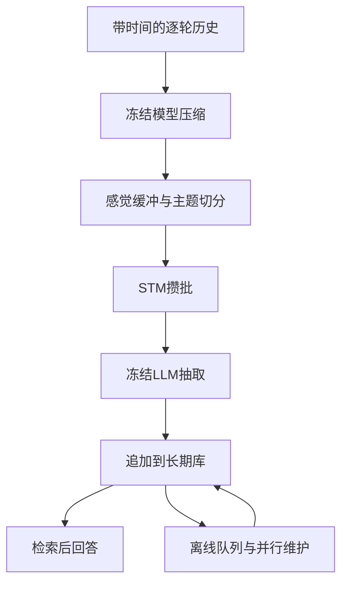

[[00-Agentic-RL|← Agentic RL索引]] · [[MemRL-2026-Utility-Learning-Episodic-Memory|对照MemRL]] · [[MemSkill-2026-Evolving-Memory-Skills-PPO|对照MemSkill]]

# LightMem：压缩、按主题攒批与离线维护的轻量记忆

> [!abstract] 一句话说明作者做了什么
> 用冻结的小模型先过滤对话冗余、识别主题，把相关内容攒成批次才交给大模型抽取记忆；在线阶段先追加记录，较重的冲突处理与合并留到离线并行执行，从而减少重复提示与维护开销。
> 输入是带时间的逐轮历史与后续问题；输出是持久记忆条目和基于检索内容的回答。改变的是外部内容、分段/攒批与维护时机，不训练LLM、控制器或Q值。所谓sleep-time不是模型睡眠训练，也不是离线RL。

> [!info] 实读与核验范围
> 2026-11-04阅读ICLR正式24页PDF正文与附录A–E；与arXiv v4全文文本比较，差异主要为首页排版/arXiv标记和一处符号排版，关键方法与结果相同。视觉核对第7页表2、第8页表3。固定官方代码`33c4d200652faae12d0577cd0cee897bc08a9e85`，检查压缩/分段、两种缓冲区、抽取与元数据、离线更新、检索、LongMemEval/LoCoMo脚本与judge。
> 提取作者原方法，用假分词器、固定向量和内存后端作CPU机制检查；没有下载模型权重、调用付费API或复现论文成绩。当前仓库还包含其他后续方法，不把它们算作本文贡献。

## 1. 论文信息、身份与去重

- **完整题目**：LightMem: Lightweight and Efficient Memory-Augmented Generation。
- **作者**：Jizhan Fang、Xinle Deng、Haoming Xu、Ziyan Jiang、Yuqi Tang、Ziwen Xu、Shumin Deng、Yunzhi Yao、Mengru Wang、Shuofei Qiao、Huajun Chen、Ningyu Zhang。
- **机构**：浙江大学、新加坡国立大学、南京大学计算机软件新技术国家重点实验室；具体对应见正式PDF首页。
- **身份**：ICLR 2026主会Poster。官方OpenReview记录`dyJ0GWpjJB`公开元数据为`venue=ICLR 2026 Poster`、`venueid=ICLR.cc/2026/Conference`；不是Workshop。2025是arXiv首发年份，正式发表用2026。
- **原始来源**：[ICLR论文页面](https://proceedings.iclr.cc/paper_files/paper/2026/hash/a05b72653ec5b473732129829ae04195-Abstract-Conference.html) · [正式PDF](https://proceedings.iclr.cc/paper_files/paper/2026/file/a05b72653ec5b473732129829ae04195-Paper-Conference.pdf) · [OpenReview](https://openreview.net/forum?id=dyJ0GWpjJB) · [元数据API](https://api2.openreview.net/notes?id=dyJ0GWpjJB)。论坛网页有浏览验证，但正式PDF已取得并实读。
- **版本**：[arXiv](https://arxiv.org/abs/2510.18866)首发2025-10-21，v4为2026-02-28；本次以正式PDF为主。会议网页摘要仍保留较早的“10.9%/117×”口径，完整正文已增加LoCoMo与GLM结果，具体数字以相应表格为准。
- **官方实现**：[zjunlp/LightMem](https://github.com/zjunlp/LightMem) · [固定版本](https://github.com/zjunlp/LightMem/tree/33c4d200652faae12d0577cd0cee897bc08a9e85)，MIT许可。
- **同名排除**：检索会命中另一篇LightMem: A Lightweight, Domain-Adaptive Memory System for LLM Agents及层次聚类树方法，不是用户指定2510.18866。本文没有将那篇的树遍历/非参数聚类加入本方法。
- **队列**：读取main最新`dbf5fd27ecd5b30907b0e88d3d914ab6b7c05bd6`的README、Agentic RL索引、模板、记忆主题索引、相关既有笔记与目录；确认AgeMem/Memory-R1/MemSkill/MemRL均已实质完成，任一主题未见LightMem独立笔记。去重限最新仓库与可访问会话。保存后优先5/5；原19篇仍6/19，下次ARTIST，不重置进度。保留其他主题ReasoningBank等最新内容。

## 2. 出发点：记忆系统可能比直接回答还贵

一种常见设计是每来一轮对话就调用大模型抽取事实，再检索旧记忆，调用大模型决定更新/删除/合并。这样同一提示模板不断重复，短句也要付完整调用开销；不同话题被不合适的窗口混在一起，还会让抽取遗漏关系。

LightMem试图同时处理三件事：让昂贵模型少看冗余字词、一次处理更多但主题清楚的内容、让用户不必等待每条旧记录都被深度维护完。人类感觉/短期/长期记忆是设计类比，论文没有验证生物机制，也不以此代替实验。

> [!example] 贯穿教学例子，人物/日期与缓冲数值均为构造
> 5月1日，小林说“6月去东京，订了A酒店”，中间穿插问候、重复确认和一段做饭聊天；5月3日又说“东京行程中想加一天京都”；5月5日说“酒店改成B，A已取消”。后来问：“现在东京住哪？京都是替代东京还是追加安排？”
> 每轮独立写库会多次处理问候；按固定大窗口总结，容易把做饭和旅行混起来；立即硬改旧记忆，还可能把“加京都”误写成“取消东京”。

目标是保留日期、东京/京都关系与酒店变更，同时减少处理次数。论文§5.6确有“先计划东京、后问京都交通”的例子；以上增加酒店及日期是教学扩展，不能当作原文逐题日志。

## 3. 架构与三种“记忆”分别是什么

| 层 | 暂存什么 | 什么触发下一步 | 是否更新参数 |
| --- | --- | --- | --- |
| 感觉记忆 Sensory Memory | 压缩后的消息，供低成本主题切分 | 小缓冲即将溢出或强制flush | 否 |
| 短期记忆 STM | 带主题边界的消息片段集合 | 攒批容量不足或强制抽取 | 否 |
| 长期记忆 LTM | 提炼事实、向量、时间/说话人/主题元数据 | 可立即检索；维护另设触发 | 否 |

注意这里STM是**形成长期记忆之前的处理缓冲区**，不是AgeMem所控制的整个LLM活动上下文窗口。模型在本次回答中看到的prompt、缓冲区和磁盘库也不是同一个东西。

这是一条固定处理管线，没有RL采样—奖励—策略参数更新的训练循环。后续benchmark的judge只评价结果，不把分数回传给压缩器、分段器或回答LLM。

## 4. 第一步：先压缩，但不为当前问题定制答案

### 4.1 冻结token分类器选择保留词

实验主用LLMLingua-2，一个已训练好的轻量token分类模型。对输入token $x_i$，保留分数为：

$$
p_i=\operatorname{softmax}(\ell_i)_1,
\qquad \hat x=[x_i:p_i>\tau].
$$

$\ell_i$是保留/丢弃两类logit，类别1为retain；保留原顺序，丢掉部分低分token。LightMem调用模型推理，不重新训练这个分类器。$\tau$由目标保留比例决定；论文的$r$在复杂度与实验中表示保留比例，r=0.7约留下七成，不是删掉七成。

原文把阈值写成“r-th percentile”又保留其上方分数，百分位方向与保留比例表述有歧义；理解应以所用压缩器rate语义为准，不能自行说r百分位以上正好留下r比例。边界重复分数也会影响精确保留量。

教学例子希望留下“6月/东京/A酒店”“加一天京都”“改B、取消A”，丢掉部分礼貌重复；这不保证否定、数字、人物关系绝不丢失。预压缩发生在后续问题提出之前，不能依靠未来答案挑token。

附录C.1：压缩变空时回退原文；过长时继续压缩以适配512-token模型，理论成本写$r^x$。当前压缩器源码反复使用配置rate，不必都是论文文字里的0.5。它原地替换message.content，因此要另留独立原始日志，不能把`original_memory`字段名字当作完整未压缩轨迹已保真的证据。

### 4.2 原文“交叉熵”式子不是RL loss

论文也描述用生成模型的token不确定性过滤。对实际token的one-hot分布，相关分数可理解为：

$$
H(q_i,p_i)=-\sum_{v\in\mathcal V}q_i(v)\log p_i(v)
=-\log p_i(x_i).
$$

这是负对数似然/交叉熵分数，不是归一化保留概率，也不是严格的预测熵$-\sum_v p_i(v)\log p_i(v)$。原文把它记作P(retain)并称entropy，记号不严谨。主实验实际采用LLMLingua-2，因此不把这条可选分数公式讲成LightMem训练了新模型或奖励函数。

## 5. 第二步：感觉缓冲做主题切分，STM再决定何时调用大模型

### 5.1 为什么不是每来一轮就总结？

感觉缓冲主要按user文本计token，容量512；assistant文本可随对应turn进入消息列表，但注意力边界从user句子计算。压缩器与分段器可共享同一LLMLingua-2权重，避免再放一个大模型。

内容多到需要切分时，用高层注意力（8–11层）构造句子间关系，再用相邻turn的向量相似度核验。附录还屏蔽序列首尾三token以减轻attention sink，并归一化先前句子的注意力。

直觉上，连续旅行话题放一起，做饭话题另放；不能把“相邻注意力大”简单解释为跨主题的普遍定律。本文用特定相邻注意力序列的局部峰提出候选，再做语义过滤，效果由实验验证。

### 5.2 论文公式与当前实现不是完全相同

正文写候选注意力边界$\mathcal B_1$与低相似边界$\mathcal B_2$取交集：

$$
\mathcal B=\mathcal B_1\cap\mathcal B_2.
$$

当前`SenMemBufferManager.cut_with_segmenter`更宽松：语义阈值从0.2逐步增至0.5寻找边界，保留距离注意力候选不超过3个位置的语义边界；若没有匹配，回退全部语义边界。不是严格集合交集。本次固定向量CPU检查：注意力候选为1、语义候选为2时，源码仍在2切开。

最后一段通常留在缓冲区头部与后续内容接起来，强制flush才一起吐出。它不是把所有同名话题跨无限历史自动合并为一个全局主题类。

### 5.3 两个阈值控制不同事情

感觉缓冲512控制小模型一次分析多少文本；STM阈值th控制给昂贵模型攒多少内容。STM中可以装多个主题段，调用时通过topic_id保留边界，模型批量抽取；不是每个主题必定独立打一通API。

教学设STM容量10个单位：两段分别5个单位，正好装满；下一段到来时才先把前两段送去抽取，再放新段。当前代码采用“加新段会超过阈值”触发，不是达到等号立即调用；`force_extract=True`清空尾部。单段比容量大时也不一定强拆，所以th不是硬性的每prompt最大长度。

源码在最后一轮有force_segment/force_extract入口。若长期不触发flush，最新消息可能仍在缓冲区，不能声称已可从持久库检索。当前`add_memory`在force_segment路径会覆盖先前`add_messages`得到的all_segments，若该次两条路径均产生输出，需检查是否漏掉前一批；本次未运行真实长流复现，不扩大成已观察到普遍丢数据。

### 5.4 抽取输出不只是自由摘要

固定LLM读取标了来源编号、说话人与时间的主题段，生成事实列表。实现转换成MemoryEntry，包含time_stamp、speaker_id/name、topic_id、memory以及源内容相关字段；建立embedding并入Qdrant等向量后端。

当前LongMemEval脚本`messages_use=user_only`，并非完整对称处理user与assistant事实。附录表7中LightMem对Single-Assistant问题较差（GPT32.14，Qwen31.25），与这种信息覆盖边界相符，但不能只凭相关性断言唯一原因。

## 6. 第三步：在线先追加，“睡眠”时再处理旧记忆

### 6.1 soft update是追加，不是soft prompt或梯度

新事实直接带时间入库，不立刻逐条决定删改全部旧记录。教学例子中，“东京旅行”和“加一天京都”都先保存，减少在线时把互补关系误当冲突的风险。

这是维护时机选择，不等于摘要之前丢掉的信息还能恢复，也不保证长期库在整理前已无冲突。立即回答“住哪家酒店”仍须结合时间区分A已取消、B是新安排。

### 6.2 离线候选队列允许较新记录影响旧记录

论文概念式为每个旧目标$e_i$找相似且不早于它的源记录：

$$
\mathcal Q(e_i)=\operatorname{TopN}^{sim}
\{e_j:j\ne i,\ t_j\ge t_i\}.
$$

$t$是记录时间；这里只筛出“可能需要处理”的候选，embedding相似不判断真实矛盾。之后仍需LLM决定update/delete/ignore。

源码队列存储方向看似相反，实际是反向索引：`construct_update_queue_all_entries`给**较新记录**检索不晚于自身的旧ID（lte），存为其queue；更新某旧目标时，遍历所有记录，反查谁的queue指向它，把这些较新记录当source。因此不能只看lte就说实现让旧信息覆盖新信息。本次提取两个作者方法，在旧t=1、新t=2的内存后端检查，最终确实是new作为source更新old。

### 6.3 并行维护到底做什么？

每个目标都针对同一批记录快照独立发LLM请求：互补细节可合并，直接冲突以新source为准删除旧目标，无关则忽略。实际update prompt只允许改目标，不改source。线程池并行请求，写库有锁；不是所有数据库写入都无锁并发。

各目标在本轮读同一快照，不会等另一个目标刚合并出的新内容再继续链式归纳。若跨条目语义相互依赖，独立处理不自动保证全局一致性。时间较新也不必然更可信；规则仍需任务语义和来源判断。

**当前代码的复现边界**：

- `online_update`为占位返回None，论文soft模式对应配置update=offline时的直接插入；不能想当然切到online就得到论文方案。
- `offline_update_all_entries`修改payload.memory后沿用旧vector，未重新embedding；文本与检索向量可能失配。CPU检查确认保留旧向量，不推断论文成绩已受多大影响。
- 高层`offline_update(...offline_update_trigger=True)`传入`update_sim_threshold`，方法实际参数名为`score_threshold`，该入口会报错；独立offline_update.py直接调用`score_threshold=0.8`，可绕开这一入口。
- 当前库加入FluxMem、StructMem、EM²Mem、图/事件模式、BoundMem标签等扩展，不把这些后续功能混入原论文实证。

### 6.4 问题到来时怎样用？

问题向量检索记忆，取固定数量记录，加日期/星期信息，拼到回答提示。LongMemEval脚本limit=20，LoCoMo有按说话人分别取或合并取的策略。没有学查询路由或价值重排，答案反馈不会改变下一轮的检索概率。尚在感觉/STM缓冲中的内容需先flush，持久库查询本身不会自动读取全部缓冲。

## 7. 成本为何下降，公式能说明多大范围？

每轮平均T token、共N轮，若每轮总结则约N次调用，还要重复N次提示模板。保留比例r、重复压缩x次后，进入STM约$Nr^xT$ token；容量th下，总结调用数近似：

$$
C_{sum}\approx\frac{Nr^xT}{th}.
$$

这忽略尾批、长段、主题边界、重试；不是所有输入都精确符合。若一次抽取产生M条记录，只有比例R需要维护，则维护调用还应另计约$C_{sum}MR$。不能把上式当总API调用数，排除offline更新、回答和judge后再声称整个系统只剩这么多调用。

并行主要减少墙钟等待，不自动减少token；压缩/攒批/减少需要更新的条目，才可能减少调用和token。论文写基线O(N)、LightMem O(Nr^xT/th)，若r/x/T/th固定，两者对N仍为线性量级，优势是因子、调用粒度与并发，不是凭该式证明严格不同的大O阶。

## 8. Benchmark与评测协议

### 8.1 历史、问题和正确性怎样定义？

| 基准 | 输入与任务 | 判分和范围 |
| --- | --- | --- |
| LongMemEval-S | 每题约115k token历史，事实、跨会话、更新、时间、偏好、拒答等QA | 主用GPT-4o-mini judge对照参考，含类型专用规则；不是LLM控制真实环境 |
| LoCoMo | 长期双人多会话历史，单跳、多跳、时间、开放域QA | 当前脚本排除category5，对1–4类进行语义judge；不等于EM/F1或所有类别 |

历史逐turn喂入，问题出现在库构建后；每个独立历史建立各自记忆，不把前一位用户的库泄漏到后一位。没有针对本次benchmark训练模型参数的训练/测试循环，但调r/th的选择仍可能受评测影响，论文未给完整独立调参集与置信区间，不能说完全无需调参。

LongMemEval原500题；附录说压缩失败的5条索引74/183/278/351/380丢弃处理、准确率按错计。部分LightMem ACC小数与基线0.2点步长不同，仅凭表格不能重建每个分母；应以逐题日志核对是否严格把这5题计错，不能自行认定实际分母为495或已核验500一致。

主模型GPT-4o-mini、Qwen3-30B-A3B-Instruct-2507，表2补GLM-4.6。建库和回答用相应同一backbone，embedding all-MiniLM-L6-v2，压缩/注意力LLMLingua-2。不将近似名称误写成Qwen2.5或Qwen3 dense30B。

### 8.2 LLM judge不是客观执行验证

LongMemEval按类别给judge问题、正确答案和回答：语义等价可判yes；时间题允许一定的off-by-one误差；知识更新题只要包含要求的新答案，即使同时带旧信息也可能判对；偏好题按rubric，拒答题检查是否说明无法判断。因此ACC是这些规则下二元判断均值，不是严格日期或全局无矛盾准确率。

LoCoMo当前judge采用较宽松的主题/答案覆盖提示，返回CORRECT/WRONG。评分器也会偏差；主文主要一个judge，仓库另有其他judge对照，不能当成论文报告了人类一致性实验。正确答案供评分，不应作为建库或生成输入；本次未发现主流程直接把gold答案用于抽取。

### 8.3 成本表的范围与单位

论文§5.1主要统计**记忆构建阶段**LLM输入+输出token、调用和耗时，按数据集样本平均，故Calls可为小数。图表的k是千token。压缩器的运行时据附录A计入Runtime，但它的本地计算不是API token；token减少倍数不等于相同倍数的GPU算力/电费减少。

检索与回答被作者视为相对一致的下游过程，主要成本表没有完整纳入QA与judge。FullText的105.07k等对应不同性质的长输入成本，不把它与纯建库Total直接当完全一致的生命周期成本。

表2每个LightMem配置两行：第一行是在线追加/抽取成本，OP-update行是额外离线维护成本；若报完整建库，应两行相加，并明确用维护前或后的ACC。表3已经合并线上与线下，ACC为线下维护后。不能只拿在线成本配离线后精度，也不能把表2第二行Total误当累计总成本。

## 9. 关键结果、消融与不应夸大的结论

### 9.1 用同配置比较质量与完整建库成本

正式表2 GPT-4o-mini：

| 方法/配置 | ACC | 建库token（k） | 建库Calls | 建库时间（s） |
| --- | ---: | ---: | ---: | ---: |
| A-MEM | 62.60 | 1605.81 | 986.55 | 5132.06 |
| LightMem r0.5/th256，仅在线 | 64.29 | 30.81 | 25.67 | 302.69 |
| 同配置离线后，在线+离线相加 | 64.69 | 77.83 | 95.90 | 645.32 |

第三行成本为本笔记依据两行相加：30.81+47.02、25.67+70.23、302.69+342.63。对A-MEM，ACC高2.09个百分点，建库token约20.63倍更省、调用约10.29倍更少、时间约7.95倍更短。若对成本更大的MemoryOS 2991.75k作分母可得约38.44倍，但不是同一个对照方法。摘要的最大倍数不应拼成某一配置同时达到的全部收益。

表3 LoCoMo GPT，LightMem r0.8/th768 ACC72.99，A-MEM64.16，FullText71.83；较A-MEM高8.83点，完整建库85.19k vs1149.43k，约13.49倍差距。Qwen LightMem72.60仍低于FullText74.87，因此不是所有设置同时压倒全文输入。

### 9.2 sleep-time并非一定提高准确率

表2GPT r0.6/th256：67.78→65.39；Qwen r0.6/th768：70.20→65.14。另有配置小幅提高，例如GPT r0.5/th256：64.29→64.69。支持把维护移出在线路径及成本收益，不支持每次合并都更正确。在线追加保护了暂时共存，离线仍可能误删/误合并。

### 9.3 主题分段与缓冲的消融

图3(c1)移除topic segmentation，GPT ACC约68.6→64.3，下降4.3个百分点，图中标-6.3%为相对变化；不是降6.3个百分点。Qwen图中73.2→69.2，下降4.0点，约相对-5.4%。更少切分略省调用但损质量，支持主题结构有用。

图3(b)将原始session边界当主题边界标签，分母为标签数，未完整报告precision/false-positive或F1，不把80%+解释为人工验证的所有话题边界都准确。更大STM通常省调用，但QA非单调，例如GPT r0.7：th512 ACC68.64，th1024为64.68。

### 9.4 数字/版本冲突保留

- Qwen r0.6/th768在表2为70.20、Calls19.97，表8/9与图3部分位置为73.20、Calls9.97；表2Qwen r0.4/th768 Calls16.54，表8/9为6.54。没有日志不能替作者决定哪组正确。
- GPT r0.6/th256表2 ACC67.78，附录表8/9为67.68。
- 仓库当前README的LoCoMo FullText GPT73.83与正式表3的71.83不同；新README还拆QA token和不同judge，不能把这些行无说明替换进正式表。
- 表2GLM多行摘要成本近似相同，不能由此推断所有压缩参数普遍等效。

没有多种子方差/完整人类评分一致性与全部历史配置，不能称每个微小差异统计显著。论文支持这两类历史QA上的质量—建库成本折中，不验证长期真实部署、技能经验复用或任意任务Agentic RL泛化。

## 10. 复现路径、资源与实际检查

### 关键源码入口

`experiments/longmemeval/run_lightmem_gpt.py`或qwen入口 → `LightMemory.add_memory` → compressor → `SenMemBufferManager` → `ShortMemBufferManager` → `manager.meta_text_extract` → MemoryEntry → `offline_update`直接插入。问题时`retrieve`→回答→judge；另运行`offline_update.py`建队列及维护，再重评。

- `src/lightmem/factory/pre_compressor/llmlingua_2.py`：冻结压缩器、过长重压缩与原地替换。
- `factory/topic_segmenter/llmlingua_2.py`、`factory/memory_buffer/sensory_memory.py`：注意力边界、语义核验、尾段保留。
- `factory/memory_buffer/short_term_memory.py`：按角色计数、溢出攒批与force flush。
- `memory/lightmem.py`：抽取、时间/来源转换、Qdrant插入、队列与检索；旧向量复用及高层参数名不一致见§6。
- `memory/prompts.py`、`factory/memory_manager/openai.py`：抽取与update/delete/ignore的实际文字规则/JSON解析。
- `experiments/locomo/search_locomo.py`、`llm_judge.py`：检索策略、类别5过滤、生成与语义评分。不要把图/事件新功能当作原论文默认。

论文报告整套实验机器4×RTX3090、双Xeon Gold6133（40核80线程）、256GB RAM；额外LLMLingua-2推理显存小于2GB。前者是作者机器，不是宣称每次必须四卡；后者是压缩器单组件，不是本地30B全系统显存。API版可外包主LLM计算，但本地小模型、向量库与数据仍需资源。最低卡型、全套GPU小时与美元费用未报告，不补编租卡方案。

本次CPU检查原类/方法：STM正好等阈值时等待、下一段溢出才吐批、force flush保留尾部；主题边界按距离匹配而非严格交集；新queue指旧目标但实际由新source更新旧；改文本沿用原向量。固定模型/数据库桩只核验局部控制流，不代表GPU模型或端到端复现通过。

## 11. 创新、近邻与可迁移方向

本文不是新RL算法，主要增量是把低成本预筛、主题组织、批量抽取和离线维护组成效率优先的记忆管线，并把在线/完整建库成本分别报告。LLMLingua-2、向量检索、人类多阶段记忆类比各自不是本文首创；设计组合和对应系统实验才是贡献。

| 工作 | 主要改变 |
| --- | --- |
| [[AgeMem-2026-Unified-LTM-STM-Policy-RL|AgeMem]] | RL训练LLM管理长期库与活动上下文 |
| [[Memory-R1-2026-RL-Memory-Management-Utilization|Memory-R1]] | RL训练库维护和回答证据筛选 |
| [[MemSkill-2026-Evolving-Memory-Skills-PPO|MemSkill]] | PPO训练小型技能选择器，设计者编辑记忆指南 |
| [[MemRL-2026-Utility-Learning-Episodic-Memory|MemRL]] | 环境反馈更新每条经验Q，影响复用排序 |
| LightMem | 固定管线调整处理粒度与维护时机，无参数RL/效用学习 |

**设计逻辑重建**：每轮昂贵抽取重复模板→先过滤、攒批；攒大批易混主题→保留分段与topic_id；即时删改既慢又可能错误→先追加、后独立维护。此为公开机制的解释，不冒充作者未公开的研究过程。

对用户的经验服务可迁移的是分离“写入可用”和“深度整合完成”，分别记录原始证据、摘要、版本、时间与引用。但本文主要是对话事实，不直接证明对任务策略经验同样有效；没有多agent运行图优化、主动MCP调用训练、参数蒸馏或无损压缩保证。

**小实验建议（未运行）**：20组含日期、否定、实体更新的对话，按历史隔离调参与测试。固定LLM、检索数量和总token预算，对比每轮抽取/即时维护、攒批不分主题、主题攒批仅追加、再加离线维护。分别报建库+维护+QA总token、在线p95延迟、QA准确率、错误合并/误删与最新事实召回；记录维护前后差值。检验收益究竟来自少调用、少冗余还是更好整合，不以单个最大倍数代替同配置折中。

## 12. 三个研究问题与阅读路线

1. 压缩与user-only抽取是否系统性丢掉否定、精确时间、assistant独有信息，怎样按风险保留？
2. 把哪部分维护延后，在什么数据到达速率与冲突频率下仍能保证足够新鲜的回答？
3. 预算匹配后，离线合并相对仅追加的净收益是否为正，能否用独立验证与可回滚版本降低误删？

先读图2与§3，手走“东京＋京都＋酒店变更”；再看表2两行成本怎样相加、表3已合并口径；读图3消融与C.1；随后对照两缓冲区和`construct_update_queue_all_entries/offline_update_all_entries`；最后读D/E的坏样本、硬件与judge容错。

## 原始来源

- [ICLR正式24页全文](https://proceedings.iclr.cc/paper_files/paper/2026/file/a05b72653ec5b473732129829ae04195-Paper-Conference.pdf)：§3三层机制，§4/表1复杂度，§5/表2–3评测，A成本范围，C方法/消融，D资源与坏样本，E评分提示。
- [OpenReview主会记录](https://openreview.net/forum?id=dyJ0GWpjJB) · [公开元数据](https://api2.openreview.net/notes?id=dyJ0GWpjJB) · [arXiv v4 HTML](https://arxiv.org/html/2510.18866v4)。
- [官方仓库固定版本](https://github.com/zjunlp/LightMem/tree/33c4d200652faae12d0577cd0cee897bc08a9e85)。
- [核心管线](https://github.com/zjunlp/LightMem/blob/33c4d200652faae12d0577cd0cee897bc08a9e85/src/lightmem/memory/lightmem.py) · [感觉缓冲](https://github.com/zjunlp/LightMem/blob/33c4d200652faae12d0577cd0cee897bc08a9e85/src/lightmem/factory/memory_buffer/sensory_memory.py) · [STM](https://github.com/zjunlp/LightMem/blob/33c4d200652faae12d0577cd0cee897bc08a9e85/src/lightmem/factory/memory_buffer/short_term_memory.py)。

[[00-Agentic-RL|返回Agentic RL索引]]
