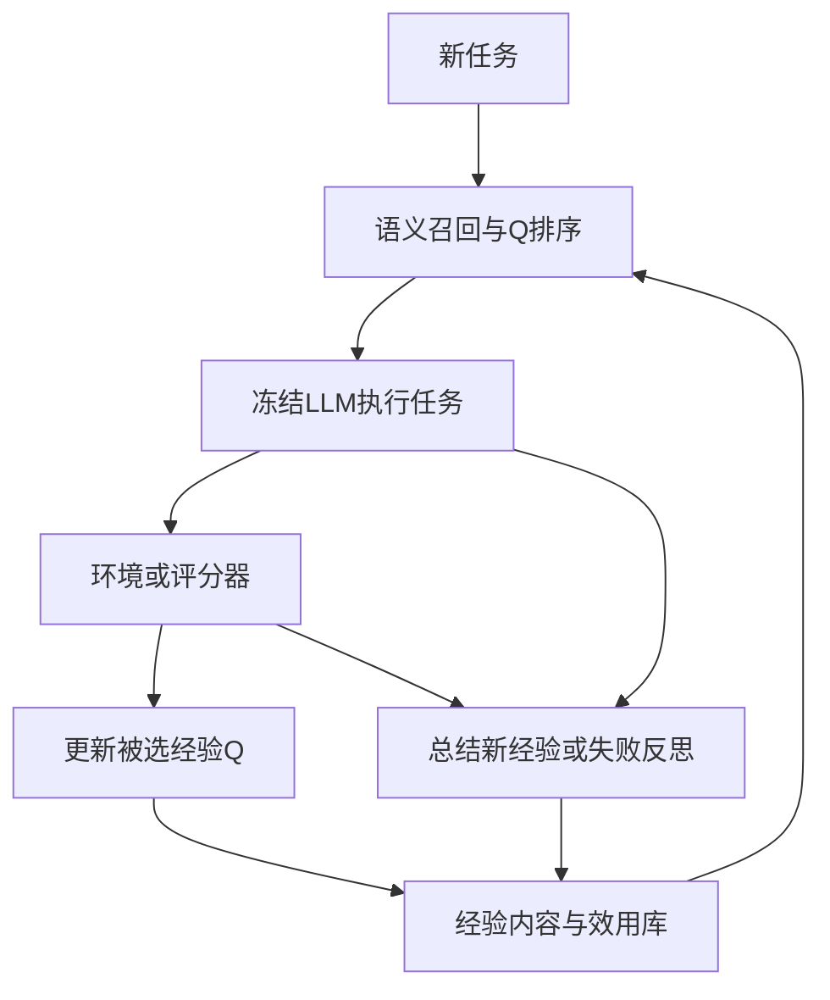

[[00-Agentic-RL|← Agentic RL索引]] · [[MemSkill-2026-Evolving-Memory-Skills-PPO|对照MemSkill]] · [[Memory-R1-2026-RL-Memory-Management-Utilization|对照Memory-R1]]

# MemRL：用任务反馈学习经验效用，改变下一次检索

> [!abstract] 作者到底做了什么
> 给外部经验记录一个可更新的效用分数Q；新任务先按语义召回候选，再结合Q选择参考经验，冻结LLM执行任务后，用成功/失败反馈更新这些经验的Q并存入新经验。后续任务因此参考不同内容，LLM与embedding权重不变，也不训练额外神经决策网络。
> 输入是任务、当前经验库、环境或评分器反馈；当前输出是答案/代码/环境动作，跨任务留下经验内容、引用关系和效用元数据。被改进的是记忆检索与复用行为。

> [!info] 实读与实现核验范围
> 2026-11-02阅读arXiv v2正文、附录A–I（完整PDF41页；正文至第9页上部，附录从13页开始），渲染核对第7页表1–3和第22页表7–8。静态检查官方代码`c1b322ca43de36ddf64c6712f89d0095bfc35ce0`的检索、Q更新、经验构建、四个runner、配置和划分。提取原实现方法，用内存数据库与固定向量作CPU检查，未调用付费API、启动Docker任务或复现论文成绩。
> 本次按明确可访问的arXiv v2解读。NeurIPS 2026 Downloads含题名，第三方有Poster标注，但未取得独立主会/Workshop录用记录；OpenReview公开搜索取得的是Archive记录。不能把PDF的ICML排版关键词、搜索摘要或名单中的题名当作已核验主会身份。

## 1. 论文信息、版本与队列

- **题目**：MemRL: Self-Evolving Agents via Runtime Reinforcement Learning on Episodic Memory。
- **作者**：Shengtao Zhang、Jiaqian Wang、Ruiwen Zhou、Junwei Liao、Yuchen Feng、Zhuo Li、Yujie Zheng、Weinan Zhang、Ying Wen、Zhiyu Li、Feiyu Xiong、Yutao Qi、Bo Tang、Muning Wen。
- **机构**：上海交通大学、西安电子科技大学、新加坡国立大学、上海创智学院、MemTensor（上海）、中国科学技术大学；详细作者对应见PDF首页。
- **年份/版本**：2026；arXiv首发2026-01-06，v2修订2026-02-12，PDF另印Preprint February 13。版本日期与排版日期不是两个发表年份。
- **原文**：[arXiv记录](https://arxiv.org/abs/2601.03192) · [v2 PDF](https://arxiv.org/pdf/2601.03192v2) · [v2 HTML](https://arxiv.org/html/2601.03192v2)。PDF只链接，不上传。
- **官方实现**：[MemTensor/MemRL](https://github.com/MemTensor/MemRL) · [本次固定提交](https://github.com/MemTensor/MemRL/tree/c1b322ca43de36ddf64c6712f89d0095bfc35ce0)。MIT许可。原文明确链接此仓库，未另找到必须依赖的独立项目页。
- **状态核验**：[NeurIPS题名列表](https://neurips.cc/Downloads/2026) · [OpenReview Archive记录](https://openreview.net/forum?id=3YDbTwejnh) · [公开元数据](https://api2.openreview.net/notes?id=3YDbTwejnh)。Archive不是会议录用，本文不据此补写会议track。
- **去重与进度**：读取最新main（`dffd9a746b3e696ee98000e6cc89989fb18131a2`）README、Agentic RL索引、模板、记忆主题索引、相关AgeMem/Memory-R1/MemSkill笔记及目录；未发现MemRL实质笔记。可访问会话与索引均确认前三篇已完成。本文优先第4篇，保存后4/5，下一篇LightMem；原19篇仍6/19，恢复ARTIST。保留其他主题最新PolySkill等内容，不改变既有进度或日程。

## 2. 出发点：相似的经验未必有用

常规语义检索按“任务文字与过去任务多像”取经验。然而两个配置编辑任务可能很像，其中一个经验漏处理注释、漏建依赖或漏验证结果；照着做，仍会失败。反过来，一次失败总结出的教训可能恰好能避免下一次错误。

MemRL的出发点是把“相关”与“用起来有效”分开：embedding负责相关性筛选，实际执行反馈负责效用估计。Q不等于源任务当时成功与否，也不等于某条记忆是否事实正确的证明。

> [!example] 贯穿教学例子；内容和后续数值均为构造
> 当前任务：修改一个带注释默认值的配置项，并创建备份。
> 经验A与任务文字更相似，但直接替换行，未考虑注释；经验B稍不相似，教训是先检查文件状态，明确处理注释与缺失项，再验证修改结果；经验C在完全不同的数据库任务中表现很好。
> 普通top-1相似检索可能只取A。MemRL希望先排除不相关的C，再利用A/B过去的使用结果，适当优先B。

论文附录H确有配置编辑、用户/组前置检查、静默命令后验证等失败反思案例。本节简化了这些类型，不把教学A/B和数值冒充真实日志。

## 3. 经验存什么，组件各自做什么？

论文式(5)把记忆写成：

$$
\mathcal M=\{(z_i,e_i,Q_i)\}_{i=1}^{|\mathcal M|}.
$$

- $z_i$为原任务意图/描述及其向量，用于找相似任务。
- $e_i$为经验：具体轨迹、抽象步骤或失败反思。公开默认成功经验包含高层SCRIPT与TRAJECTORY，失败经验包含反思及失败方法，不只是一个空标签。
- $Q_i$为复用效用估计。代码存于metadata的`q_value`，另记`q_visits`、更新时间和最近奖励。

经验库由MemOS后端保存。实现用`dict_memory`把意图文本映射到多个memory_id，`query_embeddings`缓存意图向量，完整内容放metadata的`full_content`，正文检索键与供LLM阅读的经验内容分开。

| 模块 | 输入→输出 | 是否学权重 |
| --- | --- | --- |
| 冻结embedding | 任务/意图→向量 | 否 |
| 固定检索程序 | 当前任务、向量、Q→参考经验集合 | 不训练网络；排序依赖可更新Q |
| 冻结任务LLM | 任务、环境历史、参考经验→答案/代码/动作 | 否 |
| 环境/评分器 | 执行或答案→成功/失败 | 不由本文RL训练 |
| 冻结经验总结LLM | 轨迹、失败标记/错误→经验文字 | 否；生成的库内容会变 |
| Q更新器 | 被选memory_id、奖励→新Q | 更新标量元数据 |

这里没有MemSkill那样的MLP选择器，没有Memory-R1那样对管理/回答LLM做PPO/GRPO，也没有SFT或参数蒸馏阶段。LLM可有不同提示职责，不等于联合训练多个agent。

图中Q更新和新经验写入是两个步骤：使用了旧经验会评价旧经验，新完成的轨迹可成为新记录。新记录初始Q与这次源轨迹结果也不是同一概念。

## 4. 一次任务如何执行，两阶段检索怎样决定参考什么？

### 4.1 第一次没有经验怎么办？

库为空、或者没有候选越过相似阈值，就不用经验，直接由冻结LLM尝试。环境返回结果后，总结本次经历并入库，后续才有可复用内容。初始能力过弱时，大量失败不一定产生有效学习，论文E.4明确讨论成功信号不足。

### 4.2 阶段A：先排除不相关，再取候选

论文式(6)为：

$$
\mathcal C(s)=\operatorname{TopK}_{k_1}^{sim}
\{i:\cos(E(s),E(z_i))>\delta\}.
$$

$s$是当前任务，$E$冻结嵌入模型，$\delta$是门槛，$k_1$为候选量。不是把全库中最高Q的经验无条件拿来用；例子C即使Q很高也先被排除。阈值按各基准意图相似分布设定，论文说取最高20%分位区域；不把这个统计预处理当成RL自己学出的阈值。

### 4.3 阶段B：在相关候选中平衡相似与历史效用

论文式(7)：

$$
\operatorname{score}_i=(1-\lambda)\widehat{sim}_i+\lambda\widehat Q_i,
\qquad
\mathcal M_{ctx}=\operatorname{TopK}_{k_2}^{score}(\mathcal C(s)).
$$

帽号表示标准化，让相似度与Q不因数值尺度不同而失衡；$\lambda$默认0.5，$k_2$是实际放入上下文的条目数。初始Q相同，选择主要由相似度决定；以后Q拉开，历史使用效果才影响排序。

**固定代码细节**：`MemoryService.retrieve_query`先对意图键计算cosine、阈值过滤并取k个，再展开这些键下全部经验，算混合分，最后取`rl_config.topk`。所以k1在代码是意图键数量，不严格等于经验条目数量；一意图多经验时第二阶段候选可大于k1。函数注释虽写“No two-stage”，实际执行仍有先召回后排序；以函数体为准。

相似度标准化用配置的预计算mean/std；Q标准化用本次候选mean/std，并把Q的z-score裁剪到[-3,3]。还可启用Q下限过滤、epsilon随机选择；ALF/HLE配置epsilon=0，BCB=0.1，并非全部使用同一种随机策略。LLB还支持按task_id去重，避免同源经验占满上下文。`ValueAwareSelector.select`另一条旧API只按Q排序，不能把它当作四个runner调用的混合检索主路径。

> [!example] CPU检查的构造输入，不是论文分数
> 当前向量为[0.8,0.6]；A意图[1,0]相似0.8、Q=-0.6，B意图[0,1]相似0.6、Q=0.8，C意图[-1,0]相似-0.8、Q=1。设阈值0.5，标准化均值/尺度取配置示例0.5/0.2，权重各0.5。
> 提取作者原方法、用内存对象替代后端后，A混合分0.25、B为0.75，最终选B；C因不相关被过滤。这同时演示相关性门控和效用排序。

### 4.4 记忆怎样被使用？

选中内容按成功经验/失败反思分别格式化，作为system上下文交给任务LLM。LLM仍须根据当前任务与观察产生答案或命令，没有强制执行记忆中的脚本。高层SCRIPT是提示，不是解释器必定执行的程序。

ALFWorld与OS/DB有多轮环境交互：本次参考经验辅助整个任务轨迹，模型逐轮看到观察再出命令。**多轮任务本身不代表每一步都重新训练检索器。**典型runner在任务开始检索，结束/批次结束后更新。HLE/BCB主要为一次生成后评判。

检索调用由系统runner固定触发；没有让LLM学习何时调用MCP、生成Retrieve标签或改写检索query。论文所谓优化retrieval policy，指Q改变固定程序的选择结果。

## 5. 奖励、信用分配与真正的“loss”

### 5.1 RL对象与动作粒度

论文式(1)分开检索策略$\mu$与冻结生成策略$p_{LLM}$，整体输出分布是不同检索结果下的生成分布混合。概念上状态是当前意图，检索动作是选一条记忆/一组上下文；真实环境动作则是LLM生成的答案、代码或命令。不能把二者混成“RL直接调整每个token”。

论文写$Q(s,m)$解释按状态使用经验的期望收益，落地存储的是每个memory_id一个$Q_i$，对类似意图的使用结果聚合；没有训练一个任意输入$(s,m)$都可预测Q的神经函数。这限制了细粒度任务依赖性。

### 5.2 核心更新是指数移动平均

正文式(3)先给一般TD形式，但主方法式(4)和默认gamma=0使用：

$$
Q_i^{new}=Q_i^{old}+\alpha(r-Q_i^{old})
=(1-\alpha)Q_i^{old}+\alpha r.
$$

$\alpha$是更新步长，主配置0.3；$r$来自使用该记忆后任务的最终表现。公开`update_values`将成功映射+1、失败映射-1，并把同一个终局奖励传给每条选中记忆。不是本次相对无记忆对照的增量，也不是对事实正确性的逐句验证。

教学从Q=0开始，连续成功、成功、失败：0→0.3→0.51→0.057。本次提取作者`QValueUpdater.update`执行，得到同样结果。失败会拉低估值，但一次失败不必让Q立即为负；它综合了历史且更重视近期。若成功概率稳定为p且奖励±1，则期望目标为$2p-1$，**Q不是直接的成功概率**，不能把Q=0.8解释为80%可靠。

### 5.3 如果一定要写损失函数，写什么？

附录A.4式(23)用平方误差解释标量更新：

$$
L_i(Q_i)=\tfrac12(r-Q_i)^2,
\quad \frac{\partial L_i}{\partial Q_i}=Q_i-r,
\quad Q_i\leftarrow Q_i-\alpha(Q_i-r).
$$

理论期望对当前检索策略采样出的任务/记忆/输出/反馈取平均；实现使用一次观察到的r直接更新对应记录。r是固定反馈，计算中没有对环境、LLM或embedding反传。代码直接做算术并写metadata，不调用autograd、backward、优化器。

若一个任务使用多条记忆，可用$\sum_{i\in\mathcal M_{ctx}}\tfrac12(r-Q_i)^2$表示各坐标独立更新；这是说明实现的等价表达，不是作者另有一个神经batch训练loss。一个ID若在批次中被多次引用，代码按队列顺序多次EMA，不等同先平均奖励再只更新一次。

没有PPO/GRPO优势、旧策略概率比率、裁剪、LM token mask或长度归一化，没有value network、参考LLM KL或熵bonus。附录A.4出现KL是对检索分布的理论正则解释，不是LLM后训练loss。

### 5.4 多条记忆共同被用，谁该得到奖励？

当前实现给被引用的多条记录相同r，没有做移除某条后的反事实对照、Shapley贡献或价值分解。一次成功也可能完全靠基础模型，一条好记忆也可能被别的坏记忆连累。附录G.2明确承认这种信用分配歧义；不能把高Q当成因果贡献证据。

长期任务的多步行动被折叠为这次“选择参考经验→整题执行→终局反馈”的一次评估。主实现不是把末端回报按每个动作/token贡献传播，也不靠TD bootstrap学习每步长期价值。部署若没有可靠成功反馈，这条更新链就缺少r，需要额外verifier，而不是系统自己知道是否正确。

## 6. 新经验怎样写入、筛选、关联与保存？

1. 任务完成后保存轨迹。BCB含提示、生成代码和执行状态/错误；ALFWorld为观察/行动历史；OS/DB为交互文本；HLE为问题与模型解答。
2. 成功轨迹用冻结LLM提炼3–5个高层步骤，默认`ProceduralizationBuilder`保存SCRIPT与原TRAJECTORY；失败走反思提示，保留错误分析与失败方法。
3. 新记录设置初始Q，并与当前意图关联。原文表8统一Qinit=0；新记录不会自动继承所有被检索旧记录的Q。
4. `related_memory_ids`记录本次引用的旧经验；成功/失败源标记可用于提示分组。它是引用溯源，不是经过验证的因果图。
5. 当前`add_memories`在相似意图达到add_similarity_threshold时可把新ID挂到已有意图键；这主要是索引聚合，不能说LLM已把多条经验语义合并成一个抽象策略。默认失败处理可append反思，也有inplace路径；不等于每次删除旧失败条目。
6. checkpoint保存库、意图索引与Q供下轮/评测恢复。库可不断增长；“全生命周期无界增长”与自动可靠去重/压缩并非本文已解决。

**代码边界**：HLE runner新成功记录显式设Q=1、失败设0，与表8统一0不同；ALF/BCB主要配置0。`retrieve_query`和`add_memories`的分组/初始化也不能只凭旧类注释理解。没有历史运行日志，本次不替作者断言所有表格由当前默认代码原样产生。

## 7. 理论能说明什么，不能保证什么？

附录A.1–A.3对固定状态—记忆对、冻结生成与评测、平稳反馈、无限次更新等条件，证明EMA期望趋近均值，常数步长下方差为：

$$
\limsup_t\operatorname{Var}(Q_t)
\leq\frac{\alpha}{2-\alpha}\sigma_r^2.
$$

它说明噪声可保持有界；不表示每次随机更新都提高实际成功率，也不表示常数步长估值几乎必然变为一个无波动常数。现实库增长、其他记忆共同变化、跨模型复用都可能改变同一记忆面对的反馈分布。

附录A.4再引入理想化目标：

$$
J(\mu,Q)=\mathbb E_{s\sim D}\left[
\sum_{m\in\mathcal S(s)}\mu(m\mid s)Q(s,m)
-\frac1\beta D_{KL}(\mu(\cdot\mid s)\Vert\pi_{sim}(\cdot\mid s))
\right].
$$

$\mu$为检索分布，$\pi_{sim}$是语义先验，$\beta>0$控制效用与先验的平衡，$\mathcal S(s)$限制相关候选。固定Q求该目标的最优分布得到$\mu^*(m\mid s)\propto\pi_{sim}(m\mid s)\exp(\beta Q(s,m))$。它解释为什么相关性与效用值得结合。

> [!warning] 作者主张与可据此接受的保证分开
> 作者据GEM叙述主张全局稳定、避免遗忘。该理想分布并不自动等于当前确定性Top-K、候选内Q标准化/裁剪、epsilon选择和动态库的实现。另一个数学边界是：J对Q为线性，降低Q的MSE不必提高同一个J，例如Q高估后被纠正下降，J的线性项也可能下降；因此不能仅凭“值拟合＝GEM M步”的文字就得出整个实用算法每轮单调改善。这里是对证明到实现映射的分析，不是论文提供的新定理。
> 冻结权重确保没有参数更新造成的遗忘，但检索内容变化仍会让以前答对的题答错。论文自己的非零遗忘率也说明行为并非永不退步。

## 8. Benchmark任务、评分与数据协议

### 8.1 每个任务是什么，谁判成功？

| 基准 | 输入→输出与环境 | 评分来源 |
| --- | --- | --- |
| BigCodeBench-Instruct Full | 自然语言功能需求→Python函数代码；涉及真实库 | vendored官方`untrusted_check`运行测试，PASS为成功，不是LLM看代码打分 |
| LifelongAgentBench OS | 容器中的文件、用户、进程等任务→多轮Bash | benchmark会话与状态检查；不是输出“完成”即成功 |
| LifelongAgentBench DB | 数据库任务→SQL操作/最终答案 | benchmark检查SQL结果/任务状态；允许语法不同但执行效果通过 |
| ALFWorld | 文字家庭环境目标→逐轮动作与环境观察 | `env.step`反馈，runner按最终正reward判成功，非法/缺失动作可退回look |
| HLE | 跨学科困难问题，可含图像→解答和最终答案 | GPT-4o类judge读取参考答案判断语义等价；非全部字符串EM或形式验证 |

HLE正确答案供judge，不直接注入生成提示或标准反思模板；判断器可能误判，其误差会进入Q与新经验质量。OS/DB/BCB/ALF也是特定测试覆盖范围内的正确，不是任意现实需求的证明。README称当前公开运行主要支持LLB的OS/DB；源码另有KG构建分支，本次未核验端到端KG适配和成绩，不将其补入本文实证。

### 8.2 必须区分Runtime与Transfer

**Runtime Learning**：重复同一批任务10个epoch；库和Q持续改变。可看新经验跨题复用，也允许同题经验在下一轮回来。HLE使用2500题重复，正文B.3明确将其高收益的重要来源解释为runtime memorization；不等于新HLE题泛化。

**Transfer Learning**：冻结学到的库和Q，在保留实例上评测，不用其反馈继续写库。表2题注为best validation results，不是独立最终测试上固定最后checkpoint的成绩。主表没提供HLE的held-out迁移；附录C跨模型转移HLE记忆不自动等于换到未见问题。

表9把OS/DB各500、BCB1140同时写在Runtime/Transfer列并标7:3，不能误读为训练500外加独立测试500。公开OS切分350/150；DB361/139；BCB full798/342，发布文件seed123，与原文统一seed42不同。ALF记忆构建3553训练任务，迁移用140个valid-seen新实例，是已见任务类型下换实例，不是unseen-type泛化。HLE默认配置train_valid_split=1.0；runner有类别分层切分选项，但不能把可选代码路径当成主表的held-out实验。

### 8.3 模型与预算

论文主表BCB GPT-4o、OS/DB GPT-4o-mini、ALF GPT-5-mini、HLE Gemini-3-pro。Embedding Text-Embedding-3-Large；常规温度0、HLE0.6。不能把跨基准的分数差全归于任务难度，模型也不同；附录另做GPT-4o-mini统一OS/DB/ALF对照。

表8：alpha0.3、lambda0.5、Qinit0；k1/k2 BCB与OS/DB=10/5，ALF与HLE=5/3；delta依次0.38/0.50/0.37/0.62/0.25。RAG/MemP等实际注入条数与k2对应，但库构建/反思/评测总调用仍应独立统计。公开BCB配置模型为GPT-4o-mini，与主表GPT-4o不同；验证默认关闭，需要显式打开。

### 8.4 指标的分母与含义

$$
SR_t=\frac{\sum_{j=1}^N\mathbf1[\text{第}t\text{轮任务}j\text{成功}]}{N},\quad
CSR_t=\frac{\sum_{j=1}^N\mathbf1[\exists u\leq t:\text{任务}j\text{成功}]}{N}.
$$

SR是这轮能力，CSR是多轮至少成功过一次，后者按定义不下降；CSR单调本身不是训练稳定的证明，也不等于部署只试一次的成功率。Pass@10无跨任务持久记忆，但十次采样可累计成功；MemRL还花总结与检索上下文，比较总预算不能仅数尝试次数。

论文遗忘率$FR=N_{lost}/N_{fail}$，分母是本轮失败数，不是以前成功数；不能与其他论文的标准遗忘率直接同名比较。报告0.041也并非“4.1%的全部任务被遗忘”。

## 9. 关键结果、消融与证据边界

### 9.1 重复任务上的改善

v2表1，10轮后的Last SR / CSR：

| 设置 | MemP | MemRL | 对照含义 |
| --- | --- | --- | --- |
| OS | 0.736 / 0.742 | 0.788 / 0.804 | 末轮+5.2、累计+6.2个百分点 |
| BCB | 0.578 / 0.602 | 0.595 / 0.627 | 末轮+1.7、累计+2.5点 |
| HLE | 0.522 / 0.570 | 0.570 / 0.606 | 末轮+4.8、累计+3.6点；重复原题 |
| 五列等权平均 | 0.736 / 0.760 | 0.772 / 0.798 | 平均末轮+3.6、累计+3.8点，非相对3.8% |

ALFWorld MemRL CSR0.981比MemP0.919高6.2点，但表中Mem0已0.969，距该更强单项基线只有1.2点。作者的“最强基线MemP”主要是跨基准平均定位，不代表每个单项都最强。DB末轮0.960与MemP持平。

### 9.2 新实例迁移与跨模型分享

表2冻结库：OS0.746 vs MemP0.720（+2.6点）；BCB0.508 vs0.494（+1.4点）；四列均值0.794 vs0.766（+2.8点）。ALF0.979 vs MemP0.921是+5.8点，但对RAG/Mem0的0.950为+2.9点。支持同分布保留实例迁移，不证明任意新域。

附录C表5把Gemini-3-pro所建HLE库给Qwen3-235B，0.150→0.531；这是模型间移交内容，无参数蒸馏。由于库来自重复HLE任务且无新题切分说明，不当作独立未见问题的零样本泛化。表6合并OS/DB库，OS0.788→0.784、DB0.960不变，是两个领域的有限干扰实验，不是大规模多agent共同更新实验。

### 9.3 什么机制有证据，什么还没有？

- 图4对RAG与MemP加入效用更新后比较，支持Q驱动选择有益；不能说发明了新的Q-learning。
- 图5在OS上lambda0.5优于所试两端；不是所有任务、所有模型的普遍最优常数。
- 表3跨任务对单题反思：OS CSR0.804 vs0.714（+9.0点），ALF0.981 vs0.930（+5.1点），但HLE0.606略低于单题0.610；与其低任务相似性、反复原题学习解释一致。
- 图6 HLE CS/AI子集k1/k2=5/3优于3/1和10/5，说明更多上下文不一定更好，不能扩展成全HLE完整数值。
- 图7报告Q分箱与成功率相关r=0.861，高Q箱仍有约12%源自失败的经验。支持失败反思可被复用，不证明每条反思导致成功或Q已校准为概率。
- 附录H若干案例源任务与目标任务相同，另一些不同；不要把整组案例都包装成跨题迁移。所谓trajectory verifier是作者对经验排序作用的解释，不是逐步形式验证器或训练出的独立verifier模型。

未报告完整多随机种子置信区间；best validation选择、划分/默认配置差异、动态库和反馈可得性都影响外推。论文没有实证证明所有部署都存在数据泄漏/奖励投机，本笔记也不这样指控；重复题与反馈访问是显式协议，应按在线适应解释。

## 10. 成本与复现：不训模型仍然需要计算

附录F报告HLE每题平均总token约32K，描述为覆盖10轮学习轨迹；文中未完整拆解每轮、输入/输出、judge/embedding及所有附加调用的统计口径，不据此自行乘成320K或计算精确美元。称与MemP相当，而不是与无记忆单次推理同价。图11为2500题每epoch墙钟时间，受API吞吐/网络影响；未报告完整GPU配置、API账单或确定的最低硬件。

Q更新本身为标量常数开销，算法可使用API模型和CPU服务；这不等于整套四基准无需环境依赖。LLB OS/DB需要Docker和数据库/操作系统环境，ALF需要TextWorld/ALFWorld数据，BCB需要库依赖和执行评测；HLE需要数据、可能的图像输入和语义judge。当前全库意图向量扫描也不等于无限库始终O(1)。

### 固定代码入口

- `run/run_bcb.py` → `memrl/run/bcb_runner.py`：检索、生成代码、官方执行测试、batch更新旧Q、写新经验；验证`update_memory=False`。
- `run/run_hle.py` → `hle_runner.py`：问题/图像组装、judge、成功/失败记忆；新Q显式1/0与表8不同。
- `run/run_alfworld.py` → `alfworld_rl_runner.py`：先检索参考，ReAct式多轮env.step，批次终局奖励更新；配置为GPT-5-mini。
- `run/run_llb.py` → `llb_rl_runner.py`：OS/DB执行、按任务去重/可选Q过滤及阶段评估；不要把另有的chain-MDP扩展当正文默认。
- `memrl/service/memory_service.py`：`retrieve_query`、`update_values`、`add_memories`、索引/Q缓存与checkpoint。
- `memrl/service/value_driven.py`：`QValueUpdater.update`的真实算术。
- `builders.py`、`updater.py`、`strategies.py`：SCRIPT/轨迹、成功写入/失败反思与关联。

**已完成的小检查**：提取原Q更新与检索方法，内存后端替代MemOS，验证+1/+1/-1产生0.3/0.51/0.057，以及高Q低相似候选胜出、无关高Q仍被门控。只验证逻辑局部行为，不声称环境复现成功。没有安装整套依赖或执行未审计生成代码。

## 11. 与近邻的区别、设计逻辑与简短研究联系

| 工作 | 学习对象 | 跨任务留下什么 |
| --- | --- | --- |
| [[AgeMem-2026-Unified-LTM-STM-Policy-RL|AgeMem]] | LLM选择/调用记忆与上下文工具的参数 | 记忆策略权重；库保留范围依具体rollout协议 |
| [[Memory-R1-2026-RL-Memory-Management-Utilization|Memory-R1]] | 管理/回答LLM策略 | 权重及外部内容，部署流程固定检索 |
| [[MemSkill-2026-Evolving-Memory-Skills-PPO|MemSkill]] | 小MLP选择“如何生成记忆”的技能 | 技能选择器参数、进化技能文字 |
| MemRL | 每条经验的Q标量与经验库 | 内容、使用效用与引用；不训练网络 |
| [[EvolveR-2026-Experience-Principles-Policy-RL|EvolveR]] | 任务执行LLM的GRPO策略 | 原则经验与模型权重 |

**核心贡献**是将语义检索与反馈效用接成可持续运行的经验复用闭环，并评测重复任务、新实例及有限跨模型/跨库迁移。EMA、相似召回、平方误差各自并非原创；本文辨识度在于它们如何协同决定下一次任务参考的内容。

**依据公开设计重建的理由**：相似不保证有效→先门控再Q重排；失败也能有可复用教训→保留失败反思、让后续使用评价它；不方便在线训练大模型→把可塑部分放在外部内容与标量；稀疏反馈导致估值噪声→EMA和相关性约束。此为机制解释，不宣称知道作者未公开的研究心理过程。

对用户的经验服务可直接迁移的是每条经验独立ID、引用溯源与使用反馈；原始轨迹和抽象经验可分别存，并记录生成关系。本文不是多智能体运行图优化，也未训练何时调用MCP；跨模型移交记忆与参数蒸馏是两件事。多agent并发共享Q、冲突处理和贡献归因主要还是后续方向。

**小规模可执行实验（建议，未运行）**：构造40条可规则验证的配置编辑任务，按模板分20条在线适应、20条新实例；统一冻结模型、注入长度、总token和尝试数。对比语义top-k、加入Q的MemRL、只存成功经验、只在同题反思；报末轮SR、CSR、新实例单次SR、使用记忆移除前后的差值、错误反思率与全调用token。检验Q是否超过“更多轨迹/反复原题”的收益，另把部分反馈翻转可测污染稳健性。后者是实验设想，不是论文已做。

## 12. 三个问题与阅读路线

1. 同一记忆对不同任务或不同基础模型的帮助不同，一个共享Q是否足够，何时应变成条件化效用？
2. 多条记忆共享终局奖励时，怎样以可接受成本区分真正帮助、无关伴随与负面干扰？
3. 总预算相同且禁止检索原题经验后，Q重排相对语义检索还保留多少新实例收益？

先读图3和§4.1–4.3，手算一次0→0.3→0.51→0.057；再读表1/2的Runtime/Transfer区别；接着读B.3与表3解释HLE；然后对照`retrieve_query/update_values/QValueUpdater.update`，最后读附录A的假设与理想目标、E/F的划分成本、H/I的经验实例及提示词。

## 原始来源

- [arXiv v2完整41页](https://arxiv.org/pdf/2601.03192v2) · [HTML](https://arxiv.org/html/2601.03192v2)：§3–4机制，表1–3结果，A理论，B/C分析迁移，D/E协议，F成本，G边界，H/I实例提示。
- [官方仓库固定提交](https://github.com/MemTensor/MemRL/tree/c1b322ca43de36ddf64c6712f89d0095bfc35ce0)。
- [检索、Q使用与内容写入](https://github.com/MemTensor/MemRL/blob/c1b322ca43de36ddf64c6712f89d0095bfc35ce0/memrl/service/memory_service.py) · [标量更新](https://github.com/MemTensor/MemRL/blob/c1b322ca43de36ddf64c6712f89d0095bfc35ce0/memrl/service/value_driven.py)。
- [BCB runner](https://github.com/MemTensor/MemRL/blob/c1b322ca43de36ddf64c6712f89d0095bfc35ce0/memrl/run/bcb_runner.py) · [HLE runner](https://github.com/MemTensor/MemRL/blob/c1b322ca43de36ddf64c6712f89d0095bfc35ce0/memrl/run/hle_runner.py) · [数据/配置](https://github.com/MemTensor/MemRL/tree/c1b322ca43de36ddf64c6712f89d0095bfc35ce0/configs)。

[[00-Agentic-RL|返回Agentic RL索引]]
