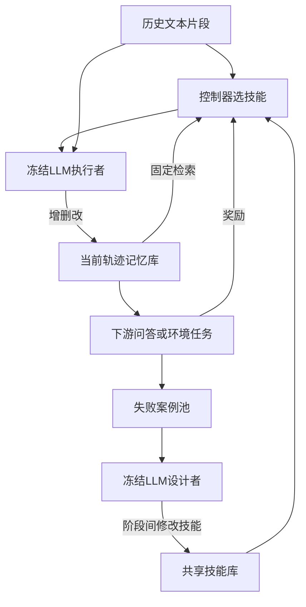

[[00-Agentic-RL|← Agentic RL 索引]] · [[Memory-R1-2026-RL-Memory-Management-Utilization|对照 Memory-R1]] · [[AgeMem-2026-Unified-LTM-STM-Policy-RL|对照 AgeMem]]

# MemSkill：训练技能选择器，并从失败中进化记忆构建方法

> [!abstract] 一句话说明作者到底做了什么
> 用PPO训练小型神经控制器，针对每段历史选择若干“如何记忆”的文字技能，交给冻结LLM生成记忆；再让冻结的设计者LLM分析失败，修改或新增技能，交替改善选择策略和技能库。
> 输入是交互历史/专家轨迹、当前已存内容及训练期下游任务反馈；输出是每条历史的记忆库、共享的记忆技能库与可部署控制器。RL不更新执行者或回答者的大模型权重，也不直接优化LLM输出token的概率。

> [!info] 阅读与代码证据范围
> 2026-10-31阅读arXiv v2全部33页（正文、参考文献、附录A–F），视觉核对表1/附录B.4目标；静态核对作者代码`f65b797338033f4f9c34822f1810f9c2747e6022`的状态、技能选择、PPO/GAE、奖励、执行、数据切分与进化路径。提取原PPOBuffer做CPU数值检查，另核对无放回概率归一化；未调用付费API、运行GPU训练或复现成绩。
> OpenReview可核验记录为NeurIPS 2026 TTCL Workshop Poster。作者主页/README另写NeurIPS'26录用，会议Downloads列表亦含题名，但本次未取得明确的独立主会条目，故不写成主会论文。Workshop PDF下载403，未与其终稿逐页对照；主读版本仍是明确标注的arXiv v2，不冒充正式终稿。

## 1. 论文信息、版本与去重

- **题目**：MemSkill: Learning and Evolving Memory Skills for Self-Evolving Agents。
- **作者**：Haozhen Zhang、Quanyu Long、Jianzhu Bao、Tao Feng、Weizhi Zhang、Haodong Yue、Wenya Wang。
- **机构**：Nanyang Technological University、University of Illinois Urbana-Champaign、University of Illinois Chicago、Tsinghua University。
- **年份与身份**：2026；[arXiv版本记录](https://arxiv.org/abs/2602.02474)显示首发2月2日，v2修订5月24日；原PDF首页是Preprint，ICML关键词/排版不代表ICML录用。已核验的会议层级见[OpenReview记录](https://openreview.net/forum?id=18Na2ppzIT)，其公开API元数据`venue=NeurIPS 2026 TTCL Workshop Poster`、`venueid=NeurIPS.cc/2026/Workshop/TTCL`。主会身份保留未核验，不把作者笼统标注强行解释为主会。
- **全文**：[arXiv v2 PDF](https://arxiv.org/pdf/2602.02474v2) · [HTML](https://arxiv.org/html/2602.02474v2)。仅在线链接，不上传PDF。
- **项目/代码**：[项目主页](https://viktoraxelsen.github.io/MemSkill/) · [官方仓库](https://github.com/ViktorAxelsen/MemSkill) · [固定提交](https://github.com/ViktorAxelsen/MemSkill/tree/f65b797338033f4f9c34822f1810f9c2747e6022)。
- **队列**：临时优先第3篇。读取最新README、Agentic RL索引、模板、记忆主题索引及AgeMem/Memory-R1相关笔记，并检查目录，未发现MemSkill已有实质笔记。去重范围限仓库及可访问会话。保存后优先3/5，下一篇MemRL；原19篇仍6/19，恢复位置ARTIST。保留其他任务新增的MaAS、BudgetWeb等内容。

## 2. 出发点：不只学“选UPDATE”，还学“UPDATE应该遵守什么方法”

Memory-R1让模型学会使用预先规定的ADD/UPDATE/DELETE/NOOP；但操作的语义、抽取要求和组织方式主要由人写提示词。仅有“更新”这个标签，并没有告诉系统：保留日期还是只记事件、遇到别名怎样关联、跨多段如何保留活动细节。

MemSkill将这一层指导提出来，作为可复用、可修改的记忆技能。例如“保留明确时间和先后顺序”“记录实体之间的关系”“记录动作前置条件”。控制器负责选择合适技能，LLM执行者根据这些指导抽取内容，设计者根据反复失败修改指导。

> [!example] 贯穿教学例子，人物、事实和后续预测均为构造
> 某段历史写：“4月12日小林搬到青岛；4月19日他参加了摄影展，同行的是同事阿宁。大家平时也叫阿宁‘小宁’。”
> 后面的问题是：“搬家一周后，小林和谁参加了什么活动？”
> 如果记忆只剩“小林参加摄影展”，人物关系与时间顺序丢了；如果只记“阿宁＝小宁”，也不足以答题。

本文希望选中“时间上下文”“活动细节”“实体关系”等技能，使执行者生成包含日期、参与者与活动的内容。注意：技能本身不是“小林4月19日参加摄影展”，而是指导保存这类信息的一般方法。

## 3. 两个库与三个组件

| 对象/组件 | 内容或职责 | 是否训练模型参数 |
| --- | --- | --- |
| 记忆库 Memory Bank | 当前这条对话/轨迹的事实或经验内容 | 库内容可增删改，不等于梯度训练 |
| 技能库 Skill Bank | 跨历史共享的文字抽取/维护指南 | 通过LLM编辑文字，不是梯度直接改文本 |
| Controller | 根据当前文本与已存记忆选择技能ID | PPO训练MLP、价值头及其共享表示 |
| Executor | 读取文本、旧记忆和选中技能，生成记忆操作 | LLM参数冻结 |
| Designer | 分析失败，修改/新增技能 | LLM参数冻结 |

后续回答问题或在ALFWorld中行动的LLM也不由该PPO loss训练。多个组件可能调用同一基础模型，只是职责与提示词不同，不能直接称三个模型联合MARL训练。

图中奖励到控制器表示采样评分后更新，不是对LLM调用和数据库做可微反传；设计者在阶段之间运行，不在每个片段都进化技能。

## 4. 执行一次记忆构建，逐步发生什么？

### 4.1 先按片段读取历史，系统固定检索

历史被拆成连续span/chunk并顺序处理；训练对话默认以session为单位，评测常用512 token片段。当前片段$x_t$进入时，系统先检索当前库相关内容$M_t$，空库则为空。

**检索由系统预设流程触发**；控制器不生成Retrieve工具调用，不自己决定query或是否搜索。这个边界与Memory-R1相似，与AgeMem主动检索动作不同。检索query在构建时来自片段，在回答时来自问题。

### 4.2 小控制器怎样认识文本与技能？

固定embedding模型分别编码片段、已召回记忆和技能的短描述。默认语义嵌入采用Qwen3-Embedding-0.6B；控制器将旧记忆向量平均，再与片段向量拼接：

$$
\bar m_t=\frac1{|M_t|}\sum_{m\in M_t}e(m),\quad
h_t=f_{\theta}^{ctx}([e(x_t);\bar m_t]),\quad
u_i=f_{\theta}^{skill}(e(desc(s_i))).
$$

$e$冻结；$f^{ctx}$、$f^{skill}$是可训练MLP。空记忆在代码中用零向量保留固定输入维度，不是除以零。当前片段与每个技能形成一对，经过共享评分器：

$$
z_{t,i}=f_{\theta}^{score}([h_t;u_i]),\qquad
p_{\theta}(i\mid h_t)=\frac{\exp z_{t,i}}{\sum_{j\in\mathcal S_t}\exp z_{t,j}}.
$$

关键设计是**给每个“状态—技能”对使用同一个打分器**，不为技能1、技能2分别固定一个输出头。新增技能只需编码描述并多算一对，就能参与选择；动作数量可变而网络输出参数不必随每次增技能扩张。

描述供选择，完整技能指南供执行，两者不可混淆。即使描述相近，完整指南也可能不同；语义编码并不自动保证选择正确。

### 4.3 控制器选择的不是LLM token，而是一组技能ID

训练时从分布无放回抽取有序Top-K技能，采用Gumbel-Top-K；推理通常按logit确定性取Top-K。训练K=3，对话评测常K=7，ALFWorld评测K=5；库不足K时源码取min(K,技能数)。

教学例子中，控制器可能输出[时间上下文、活动细节、实体关系]。它没有生成“小林/摄影展”这些记忆文本，更不是在训练输出`<tool_call>`标签。RL改善的是这个选择分布。

### 4.4 执行者读取技能，一次生成多个修改

执行者输入当前片段、召回旧条目、选中技能全文，在一次LLM调用中生成INSERT/UPDATE/DELETE块。技能可重复适用于同一片段的不同信息，也可以没有合适操作。

例如按三项教学技能，生成“4月12日小林搬到青岛”“4月19日小林与同事阿宁参加摄影展”“阿宁也称小宁”。这是说明性输出，不是论文逐题日志。

源码`executor.py`解析文本块，也有JSON兼容路径。UPDATE/DELETE使用**检索结果列表的0基索引**，映射到全库后执行。更新先执行、删除按实际索引倒序执行，避免删除造成后续索引偏移；INSERT/UPDATE重算检索向量和状态编码向量。`memory_bank.py`还记录内容历史与所选技能名称。

**技能演化没有消灭底层固定操作**：设计者新增的是更丰富的文字指南，执行器仍支持INSERT/UPDATE/DELETE/NOOP；新增技能默认只允许insert/update，不允许任意新工具。它不是自动发明新的数据库动作或可执行Python函数，也不是技能内部包含任意多步工具程序。

### 4.5 构建结束，再检索回答

对话全部片段处理完后，用训练问题检索最终库，冻结回答者生成短答案，计算奖励。教学题要求综合时间和人物；如果先前保存充分，才能回答“阿宁，摄影展”。标准答案不放入正常构建或回答输入；训练评分和设计者分析可以看答案。

保存的记忆不保证是抽象策略：对话场景主要为事实；ALFWorld从专家轨迹提炼时可以是动作条件、状态和程序性提示。跨任务共享的记忆技能始终是“如何提取”，不是把每一条事实混在一个永久共享库。

## 5. 系统怎样学习，哪些参数真的更新？

### 5.1 状态、动作、转移、回合

一个episode对应一条记忆构建历史：状态为当前片段与检索旧记忆；动作是K个技能ID；冻结执行者将它们变成库修改，影响下一片段的检索状态。历史结束后进行下游评价。

训练器记录每次动作的原始固定embedding、候选技能embedding、索引、有序动作log概率、旧价值和奖励。之后重算MLP概率做PPO。LLM权重、embedding模型、技能文字都不由这次backward更新。没有大模型SFT冷启动必经步骤；控制器是独立的小型actor-critic。

### 5.2 下游信号从哪里来？

对话默认以训练历史的问题平均F1为终局奖励，源码可选LLM judge。这是自然语言词重叠或语义评分，不是对技能逐项人工标注。

ALFWorld先收集训练集专家轨迹作为离线经验。Batch A构建记忆，另取同类型但不重叠的Batch B任务实际运行环境，按完成情况给任务奖励，再归因给A中的技能选择。类型包括放置、清洗、加热、冷却等。**RL控制的仍是如何从A提取记忆，不是直接更新B的语言行动模型。**它提供同模板实例间迁移反馈，不保证任意新任务泛化。

稀疏回报只能间接评价整段技能选择，不能精确指出哪个技能造成哪一个事实被保留。即使F1提高，也不能自动证明每个旧记忆都一致、没有误删。设计者接到答案级失败也可能把检索失败误诊为存储失败。

### 5.3 有序无放回动作的概率为什么不能直接相乘？

令$A_t=(a_{t,1},\ldots,a_{t,K})$，每次已经选中的技能不能再选：

$$
\pi_\theta(A_t\mid h_t)=\prod_{j=1}^{K}
\frac{p_\theta(a_{t,j}\mid h_t)}{1-\sum_{\ell<j}p_\theta(a_{t,\ell}\mid h_t)}.
$$

分母是剩余候选原概率的总质量，第1项分母为1。若三技能概率为0.5/0.3/0.2，按顺序选第1再第2，概率为$0.5\times0.3/(1-0.5)=0.3$，不是0.15。反顺序概率为$0.3\times0.5/(1-0.3)\approx0.2143$，有序动作不同。

源码`_compute_topk_log_prob`对这些条件概率取log后相加，分母与概率有1e-8稳定处理；本次纯Python枚举全部有序Top-2验证概率和为1。概率不是LLM一串token的概率，也没有生成长度归一化。

### 5.4 论文的信用分配与PPO

附录B.4默认仅末端给R，中间$r_t=0$，于是$G_t=\gamma^{T-t}R$。另学习价值函数并使用广义优势估计（Generalized Advantage Estimation，GAE）：根据奖励、下一状态估值和当前估值的差，平滑估计动作相对预期好坏。它不是GRPO同题多输出的组内标准化。

论文式(15)最大化裁剪代理，式(16)拟合回报，式(17)鼓励探索；源码真正最小化的默认微批次loss可写为：

$$
\begin{aligned}
L={}&-\frac1B\sum_{t\in\mathcal B}\min\left(
\rho_t\tilde A_t,\operatorname{clip}(\rho_t,0.8,1.2)\tilde A_t\right)\\
&+0.5\left[\frac1{2B}\sum_{t\in\mathcal B}(V_t-\hat G_t)^2\right]
-0.01\frac1B\sum_{t\in\mathcal B}H(p_t),\\
\rho_t={}&\exp\big(\log\pi_{current}(A_t\mid s_t)-\log\pi_{old}(A_t\mid s_t)\big).
\end{aligned}
$$

B是本微批次**控制器决策数**，不是题目数、技能数或token数。$\tilde A$在整轮rollout buffer上标准化一次，再切micro/minibatch；不是每个技能分别除长度。$\hat G$是源码GAE优势加旧value的lambda-return目标，不总等于论文写的纯Monte Carlo $G_t$。value_loss源码含1/2，value_coef默认0.5；论文式(16)没有1/2，系数含义要一并读。vf_clip默认0，可配置启用价值裁剪。

$H(p_t)$是**全部技能的基础categorical分布熵**，不是有序Top-K联合分布的熵。补齐不同技能数量时，padding候选logit置负无穷，不作为可选技能。默认gamma0.99、GAE lambda0.95，clip0.2，Adam lr1e-4、hidden256、梯度范数上限0.5。默认总训练脚本batch4、PPO重复2轮；不把构造函数默认4轮当脚本实际值。

梯度流：旧log概率/value、reward、归一化优势和回报目标都存为无梯度数据；当前状态MLP、技能MLP、共享打分器及value头参与反传，value分支也影响共享状态表示。执行者输出与存储转移只提供环境反馈，不直接对其反传。没有固定参考LLM的KL正则项；`approx_kl`是相对旧策略的采样监控，用于超过默认0.02时提前停止PPO轮次，不是loss里另加的KL罚项。

### 5.5 公开默认奖励与论文不完全相同

论文B.4说只给终局奖励；代码默认有两项变化：

1. **过程塑形**：选择技能允许的底层动作类型，与执行者实际产生类型比较；集合匹配或部分重叠给正分，无交集、解析/API失败给罚分。按episode长度摊分预算，默认process_budget0.10、failure_budget0.05；纯NOOP缩放0.2。它不验证记忆文本事实正确，也不是每个技能的独立因果分数。
2. **终局重分配**：默认60% R直接给最后一步，40%按向后0.9指数权重分配到所有步骤，再与过程奖励相加，随后做GAE。提取作者PPOBuffer构造3步、R=1、无过程分的CPU检查得到[0.11956,0.13284,0.74760]，总和1。该重分配不自动保持原折扣目标不变。

不能因此把论文终局公式和当前代码r'混用。没有历史运行日志，无法确定哪一组配置产生表中分数。检查只证实实现行为，不证明实际训练发生奖励投机。

## 6. 技能本身怎样进化？

### 6.1 失败池不是把全部历史无限塞给设计者

每次训练评价记录问题、参考答案、预测、召回内容、记忆快照、分数与重复失败次数；失败池按训练步年龄及容量过期，默认窗口100、容量2000。按语义聚类（KMeans），每组挑困难且反复失败的案例，默认5组、每组3个代表。

论文困难度$d(q)=(1-r(q))c(q)$；代码实际用$(1-r(q))\log(1+c(q))$，对重复失败次数增长更温和。不是公开证明了失败根因；聚类主要分散案例类型，减少被一种高频问题垄断。

### 6.2 先诊断，再修改文字指南

设计者先分析缺什么行为，再生成新增或精修技能的JSON。例子中，反复答不出“搬家一周后”活动参与者，可能建议强化日期和活动参与者的保留。后续控制器重新编码新技能描述，继续学习选择。

这是“LLM写新的技能文本”，不是设计者做PPO，也不是它修改LLM参数。初始化依旧是人写的Insert/Update/Delete/Skip四技能，技能模板、底层操作和评分规则也由人规定，因此“最少人类先验”是相对定位，不是完全无先验。

### 6.3 新技能探索、回滚与停止

新技能刚加入时，旧选择器可能不给它概率。论文给新技能组最低概率质量约束，前50步从0.3线性衰减，以logit偏置鼓励试用。训练脚本`new-action-bias-steps=25`，与论文50不同。

源码偏置近似为$\delta=\log(\tau/p_{new})$并clip/缩放，不是精确解。教学设$p_{new}=0.1,\tau=0.3$，完全加该偏置后质量为0.25，尚未达到0.3；本次数值核对确认，不能声称实现保证概率下界。

每100内层训练步评估一个阶段，以最后1/4步的平均奖励比较最好技能快照；退化时回滚技能库，连续无改善后早停。它是训练信号上的选择，不是对未见测试的正确性证明，也不是每个新增技能先独立通过形式验证。控制器与库版本必须一起追踪；不要仅保存文字就以为精确恢复了全部训练状态。

## 7. Benchmark长什么样，分数怎样来？

| 基准 | 输入、任务、判断 | 本文范围与边界 |
| --- | --- | --- |
| LoCoMo | 多会话历史→记忆→QA；F1及LLM语义评分 | 10条历史按样本6/2/2；排除对抗题，训练库与测试历史分开 |
| LongMemEval-S | 约100k token聊天历史；事实/时间/更新等QA | LoCoMo训练技能迁移；不是Memory-R1的oracle设置；验证集仍调配置 |
| HotpotQA | 将50/100/200篇文档拼成长输入，需跨证据回答 | 迁移测试，非开放互联网搜索；默认报judge |
| ALFWorld | 文字家居环境，按合法动作列表选择命令，环境转移/目标检测 | 专家轨迹构建经验，seen/unseen测试；50步上限；主表有ICL示范 |
| AppWorld（附录A.2） | 与应用API交互完成任务，报告PR及执行步数 | 扩展实验；公开仓库未见对应完整适配，不冒充已核验其评测实现 |

LoCoMo源码`main.split_data`按历史索引train[0..5]、val[6,7]、test[8,9]，不是Memory-R1的QA级152样本切分。README把训练时的问题称test queries，代码实际`_evaluate_qa`拿当前训练历史自身的QA；仅凭名字不能指控使用保留测试历史的答案。

LongMemEval论文去掉abstention后分层抽约100题，源码发布split文件却总计500索引（train297/val98/test105，集合不重叠）；已读load_dataset与filter_qa_list没有显式去掉_abs，需核对实际输入是否预清理。不能声称已确认测试105全部非拒答，也不把原基准500直接当作者所有结果的分母。

F1是词重叠；L-J为gpt-oss-120b按0/0.5/1评错误/部分正确/正确，取平均后×100。53.82不等于53.82%的题完全正确。正常构建不看正确答案，训练评分和设计者可看；须防止把训练答案写成实例化技能并在测试复用，不过本文没实证证明发生了这种泄漏。

ALFWorld公开runner让actor在admissible actions中选一句命令，调用`env.step`后读取观察、score和done；成功判据为最后done且reward=1。不是LLM说成功即成功。API无效输出还有解析/兜底，需固定runner版本；步数不是所有LLM调用数。

## 8. 关键结果与可信度

### 8.1 主结果：有效，但幅度依基准与指标不同

v2表1，LLaMA3.3-70B：

| 指标 | 有意义的强基线 | MemSkill | 差值 |
| --- | ---: | ---: | ---: |
| LoCoMo F1 | MemoryOS 41.39 | 44.21 | +2.82分 |
| LoCoMo L-J（主表） | A-MEM 49.71 | 53.82 | +4.11分 |
| LongMemEval-S L-J | CoN 56.44 | 60.89 | +4.45分 |
| ALFWorld Avg SR | Mem0 77.82 | 80.36 | +2.54个百分点 |

成本表另给LightMem LoCoMo L-J51.95，因此相对这个补充基线仅+1.87分，不能只讲相对主表大差值。Qwen迁移的LongMemEval F1，MemSkill25.29低于CoN29.19，虽然L-J更高；不是所有指标第一。

附录A.1声称LLaMA最强ALFWorld基线为LightMem74.83、提升5.53点，但主表Mem0为77.82；把各表合起来，最强已报基线应是77.82，差2.54点。没有替作者按方便的对照选分母。

### 8.2 消融说明选技能和改技能都有作用

表2，LoCoMo L-J：

| 变体 | LLaMA | Qwen迁移 |
| --- | ---: | ---: |
| 完整 | 53.82 | 54.14 |
| 随机选择技能 | 48.43 | 42.84 |
| 无设计者、固定四初始技能 | 46.50 | 36.15 |
| 只精修、不新增 | 47.45 | 48.88 |

支持学习选择、编辑技能与扩大库的组合有益，不证明是新的PPO理论。固定四技能与演化后更大库同时改变内容和容量，不能只将全部增益归因于“自主发现知识”。缺少多种子置信区间与严格同总预算对照，微小差异不称统计显著。

### 8.3 部署成本下降，不代表全生命周期更便宜

表3 LoCoMo，把记忆抽取与回答的全部**推理期LLM调用**计入，排除评测judge；前期控制器训练、设计者进化和准备成本不在该表内。表中聚合粒度未充分明确，不自行说每题/每用户费用。

| 设置 | L-J | 输入K token | 输出K token | 调用数 |
| --- | ---: | ---: | ---: | ---: |
| LightMem | 51.95 | 789 | 209 | 685 |
| MemSkill span512 | 53.82 | 249 | 18 | 215 |
| MemSkill span1024 | 48.11 | 188 | 11 | 187 |
| MemSkill span2048 | 50.46 | 178 | 10 | 185 |

512配置相对LightMem输入约少68.4%、输出少91.4%、调用少68.6%，但这些是该表比值，不是训练也减少这些比例。更大span省调用却可能丢信息，质量不单调。训练按session、评测按固定长度且K3→7，也说明部署配置是额外选择，不宜把所有收益都归因于RL本身。

### 8.4 更多环境结果需要读示范条件

主表ALFWorld有in-context示范；无示范时附录表5 LLaMA MemSkill Avg SR57.71，LightMem45.99。它说明记忆在更少提示指导下仍有收益，但主表80.36与57.71不可当作相同实验的冲突。

AppWorld有示范时LLaMA平均PR47.32，AWM47.11，只差0.21个百分点；无示范时26.71比AWM25.42高1.29点，且步数并非处处更少。不能照抄附录“最低步数/普遍改善”作为每格成立的结论。

跨Qwen/LongMemEval/HotpotQA是有限迁移证据，LongMemEval验证集调配置也不等于完全无需目标域信息。训练得到的是通用提取指南，不能从中推出所有历史事实都可靠或经验在任意任务下一致。

## 9. 创新与近邻对照

| 工作 | 主要RL对象 | 记忆方法是否变化 |
| --- | --- | --- |
| [[Memory-R1-2026-RL-Memory-Management-Utilization|Memory-R1]] | 管理/回答LLM策略 | 固定四类库操作，学习如何生成操作和答案 |
| [[AgeMem-2026-Unified-LTM-STM-Policy-RL|AgeMem]] | 统一记忆/上下文LLM策略 | 六工具选择；同时管理活动窗口 |
| MemSkill | 外部MLP技能选择器 | 设计者另行修改共享文字技能，不更新执行LLM |
| [[MemEvolve-2026-Memory-System-Meta-Evolution|MemEvolve]] | 主要搜索记忆模块代码 | 改变实现程序；本文主要改变技能指南和选择参数 |
| [[EvolveR-2026-Experience-Principles-Policy-RL|EvolveR]] | 任务执行LLM策略 | 轨迹原则帮助解题；本文技能主要规定怎样抽取/维护记忆 |

本文辨识度是把固定操作提升为可编辑的记忆方法，并把“选择技能”的数值学习和“改技能”的文本搜索接起来；共享打分器适应动态技能库，片段级一次组合执行降低逐轮调用。不是发明PPO，也不是首次使用外部记忆或自然语言技能。

**依据公开设计重建的逻辑**：固定CRUD语义不够细→把抽取要求写成可复用技能；技能太多全放prompt会冗长→用小控制器选择；技能会增长→用状态—技能共享打分；结果失败暴露未覆盖行为→让设计者补充指南；新技能初期不用/更新有时退化→探索偏置与快照回滚。此为设计理由重建，不宣称知道作者私人思维过程。

## 10. 代码复现入口、资源与研究联系

调用路径：`train_locomo.sh/main.py → BaseTrainer → process_session → controller.forward → executor.execute_operation/apply_to_memory_bank → _evaluate_qa → finish_episode/GAE → compute_ppo_loss → optimizer.step`；阶段间进入designer与snapshot机制。关键文件：

- `src/controller.py`：Top-K联合概率、state/op MLP、value、PPOBuffer、真正loss。
- `src/trainer.py`：状态组装、过程分、QA reward、批量优势归一化、PPO更新与进化节奏。
- `src/executor.py`、`src/memory_bank.py`：动作解析、索引映射、双embedding与内容历史。
- `src/operation_bank.py`、`src/designer.py`：技能描述/全文、失败池、聚类、技能编辑与回滚。
- `src/config.py`、`train_locomo.sh`、`eval_locomo.sh`：默认与脚本参数；注意训练retriever contriever，评测脚本qwen3-embedding；state/op encoder解析器默认Qwen3-Embedding。
- `src/eval/*`、`src/alfworld_env_runner.py`：指标与环境成功判定。

论文/代码其他差异：论文共享fixed embedding，当前trainer为避免线程争用载入state、op、memory三份encoder实例；论文新技能困难度/探索阈值与代码近似不同；固定4初始技能和底层action类型依旧存在。当前代码额外有过程分及奖励重分配，无历史日志不把它们冒认成表格配置。

作者仓库Apache-2.0；含运行入口、技能模板、数据split和checkpoint下载链接。模型经NV NIM/Together API提供，训练硬件只写NVIDIA A6000 GPUs，未完整报告卡数、GPU小时、全部API token、训练总费用/墙钟时间或最低显存。小MLP不等于全系统免费：长历史反复建库、许多训练问题评测、embedding实例与外部70B调用都花计算。未实际训练，不推荐无根据的最低租卡配置。

**小规模可执行对照（建议，未运行）**：按人物/历史隔离构造训练与测试各20条含时间、别名、活动关系的对话，在同一冻结模型和相同总API预算下，对比四原语＋随机选择、固定演化技能库＋学习选择、允许进化的完整系统。固定K与span做第一轮，再分别变化它们；统计QA F1/语义正确、关键事实遗漏、误删率、训练与部署总token。检验“进化技能内容”是否超出增加技能数/提示长度与更多预算的收益。

与用户方向直接相关的是把记忆机制的部分指导变成外部可改技能，并用任务反馈学习调用分布；没有多agent运行图优化、参数蒸馏或对未知任务的形式一致性保证。记忆技能不是你知识库中每条轨迹总结策略的同义词，二者需要独立schema与溯源。

## 11. 阅读路线与三个问题

先看图1/2和附录C技能实例→手走一段历史的选择/执行→§3.3共享评分器→B.4式10–18→`controller.py`与`trainer.py`对照实际奖励/loss→B.2失败进化→表2消融→表3成本→B.1切分/迁移条件。最后再读AppWorld扩展结果，避免先被大表淹没。

1. 固定技能数、span、提示长度与总预算后，设计者新增指南是否仍优于人工模板或随机语义变体？
2. 终局QA收益、过程类型匹配与误删/保真约束如何权衡，能否防止只为当前训练问题保存信息？
3. 新技能跨模型/任务迁移时，怎样建立可验证的适用范围与回滚条件，而不是只根据一个训练阶段平均分保留？

## 原始来源

- [arXiv v2完整33页](https://arxiv.org/pdf/2602.02474v2) · [HTML](https://arxiv.org/html/2602.02474v2)：§3方法，表1–3及附录A扩展，B实现与PPO，C技能，D提示词，E/F使用说明和局限。
- [作者项目](https://viktoraxelsen.github.io/MemSkill/) · [代码固定版本](https://github.com/ViktorAxelsen/MemSkill/tree/f65b797338033f4f9c34822f1810f9c2747e6022)。
- [OpenReview Workshop记录](https://openreview.net/forum?id=18Na2ppzIT) · [该记录公开API元数据](https://api2.openreview.net/notes?id=18Na2ppzIT) · [NeurIPS 2026 Downloads题名列表](https://neurips.cc/Downloads/2026)：题名出现不能独立消除track歧义。
- [PPO/联合概率源码](https://github.com/ViktorAxelsen/MemSkill/blob/f65b797338033f4f9c34822f1810f9c2747e6022/src/controller.py) · [奖励与训练](https://github.com/ViktorAxelsen/MemSkill/blob/f65b797338033f4f9c34822f1810f9c2747e6022/src/trainer.py) · [数据切分入口](https://github.com/ViktorAxelsen/MemSkill/blob/f65b797338033f4f9c34822f1810f9c2747e6022/main.py)。

[[00-Agentic-RL|返回 Agentic RL 索引]]
