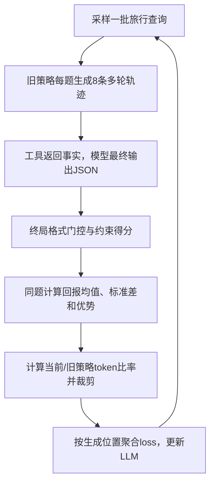

[[00-Agentic-RL|← Agentic RL 索引]] · [[VOYAGER-2024-Executable-Skill-Lifelong-Agent|上一篇 VOYAGER]] · [[CB-PbRL-2026-Constrained-Bilevel-Preference-RL|对照约束与奖励模型学习]]

# Planner-R1：用约束满足的部分得分训练旅行规划智能体

> [!abstract] 作者到底做了什么？
> 让Qwen3通过多轮旅行信息查询生成结构化行程，在行程结束后按格式、常识约束和用户要求打分，用GRPO提高相对较好轨迹中生成token的概率，并比较不同奖励粒度对8B/32B模型的作用。
> 输入是旅行需求、工具说明和逐轮工具结果；输出是按天组织的JSON行程。被改进的是LLM策略参数，不是提示模板、外部技能库或搜索树。

## 1. 论文信息、定位与证据范围

- **完整题目**：Planner-R1: Reward Shaping Enables Efficient Agentic RL with Smaller LLMs。
- **作者**：Siyu Zhu、Yanbin Jiang、Hejian Sang、Shao Tang、Qingquan Song、Biao He、Rohit Jain、Zhipeng Wang、Alborz Geramifard。
- **机构**：本次实读v2首页统一署名LinkedIn Corporation, CA, USA；不把其他版本脚注中的后续任职当作本文实验机构。
- **身份**：2025年arXiv预印本。2026-10-23核对时，[作者主页](https://fcbayernwzp.github.io/)仍列Preprint；[OpenReview条目](https://openreview.net/forum?id=CmOaD42eAT)全文访问受验证限制，未核验到正式录用，不写成ICLR主会论文。
- **本次实读版本**：[arXiv:2509.25779v2](https://arxiv.org/abs/2509.25779v2)，2025-10-01修订，32页；[固定版本PDF](https://arxiv.org/pdf/2509.25779v2)。读正文、附录A系统实现、B.1–B.6提示/Schema/配置/解码/成本，以及C的代表案例；视觉核对式(1)(2)、表1/2、图3和配置。在线HTML若链接v1，不替代v2的版本依据。
- **官方专用代码/项目/模型**：本次在论文、作者主页及GitHub仓库检索中未定位到可确认属于该旅行Planner-R1的专用训练仓库或权重；不将“用verl”写成“作者全部代码已开源”，也不据此断言永远未发布。
- **公共依赖**：[verl](https://github.com/volcengine/verl)、SGLang、[TravelPlanner官方环境与评测](https://github.com/OSU-NLP-Group/TravelPlanner)、[数据](https://huggingface.co/datasets/osunlp/TravelPlanner)。基准代码静态核对固定版本`e52c87f4ac348a3410c46dc3553c519db5ec5e23`，未执行训练、联网模型调用或复现分数。
- **去重**：读取最新README、Agentic RL索引、模板、VOYAGER笔记和目录树；前三篇RAP/LATS/VOYAGER已完成，暂无Planner-R1实质笔记；CB-PbRL为队列外补充。历史核对限可访问会话与仓库，不声称遍历全部历史。

> [!warning] 近名论文不混用
> 队列原简称是Planner-R1。本次按准确题名定位为上面的旅行规划/奖励塑形论文，arXiv编号2509.25779。OpenMOSS的**Embodied Planner-R1**（2506.23127，ALFWorld/ScienceWorld）和自动驾驶**Plan-R1**是其他论文；它们的代码、模型、成绩和录用身份不能借给本篇。

> [!info] 本笔记如何使用证据
> **论文事实**以v2为准；**基准代码核对**不等于Planner-R1实现核对；**教学例子/伪代码/推导**明确标记；**分析与建议实验**不冒充作者结论。专用代码缺失处不补写虚构行为。

## 2. 出发点：一份看起来合理的行程，为什么实际不合格？

旅行规划不止是回答景点名称。工具可能查回很多真实旅馆和餐厅，但计划仍可能重复餐馆、忘记返回出发城市、选错城市的酒店、少住于酒店最低晚数，或超预算。每一项局部选择看似合理，全局组合仍然失败。

若只给“所有条件都通过才得1，否则0”的奖励，初期生成的计划几乎全部0分。模型无法从这批同样失败的结果中判断哪条更值得模仿。Planner-R1的核心研究问题是：**把失败计划中已满足的条件转成部分得分，能否让小模型更有效地学会完整任务？**

> [!example] 贯穿教学例子：均为构造，不是论文任务或真实报价
> 两个人从A城出发，在指定日期进行5天旅行，访问B/C两城，总预算4400美元；不自驾，住宿允许访客，并需覆盖指定菜系，最后返回A城。
> 假设工具给出：B城旅馆H最低入住3晚；计划却只住2晚。另有旅馆K最低2晚，可以替换。文中城市代号、旅馆、价格、约束通过比例和小规模组内分数均为教学假设。

基线可能查到H之后直接写进两晚计划，格式完美，但最低住宿条件失败。普通二值奖励把它和“乱调工具，连JSON都没生成”一起记0。部分得分则可以区分：前者大部分要求已满足，后者没有有效交付。

真实论文附录图A.3有相似但不同的案例：Newark前往Ohio的5日行程。初始模型反复调用计算器直到上下文用尽；100步检查点能交付计划，却不满足旅馆最低晚数；500步的32B检查点在所示案例中全部通过。该个案说明行为变化，不代表所有任务都在500步稳定解决。

## 3. 环境、状态、动作和最终输出

### 3.1 工具是查数据库，不是实际订票

TravelPlanner提供沙盒数据库，规模约四百万条记录。Planner-R1将接口组织成7类：航班、住宿、餐厅、景点、地面交通、城市查询和计算器。前六类用于取事实，计算器帮助预算等数值计算。

工具调用通过`<tool_call>...</tool_call>`中的JSON发出，成功返回结构化记录，失败可返回error。模型读取结果后继续查询，直到输出`<answer>...</answer>`中的行程。主文列`search_*`等名字，案例图使用`get_*`、`basic_arithmetic_calculator`等名字；专用实现未取得，不将这些函数名差异自行统一成已确认API签名。

这些接口是沙盒查询，实验不代表真的购买机票或进行酒店付款。

### 3.2 token是学习动作，工具调用是执行事件

论文将环境建模为马尔可夫决策过程（MDP），折扣因子取1。初态是系统提示与用户需求；当前状态是此前完整对话历史，包括生成内容、工具调用与观察。

**形式上的动作是一枚模型生成token**。若若干token拼成完整工具调用，环境执行它并把观察追加到历史；环境返回的token不增加模型的动作时间索引。

这同时存在两个粒度：

| 粒度 | 表示什么 | 预算/优化中的作用 |
| --- | --- | --- |
| token步 | 模型生成一个token | 计算概率、重要性比率和策略损失 |
| assistant/工具轮次 | 拼成并执行一个调用，或交付答案 | 最大30轮/30次工具调用等执行上限 |
| episode/轨迹 | 一个查询到最终计划的完整交互 | 获得一次终局奖励，参与组内比较 |
| 训练step | 采样一批查询/轨迹并更新参数 | 表1的500步不是500枚token或500条任务 |

例如“查询H的最低晚数”的整个JSON会包含很多token。优化时这些生成位置各有概率项；游戏式/工作流式控制器看到的是一次完整工具事件。

### 3.3 JSON合规只保证结构，不保证旅行可行

每一天包含`days`、`city`、`transportation`、`attraction`、`accommodation`和三餐等字段。附录B.2实际允许：city是字符串或from/to对象；transportation为`-`或含mode/from/to/duration/distance/cost等字段的对象；attraction为列表或`-`。

主文将city/transportation概括为类型化对象，附录oneOf给出更具体例外，应优先看完整Schema。**合法JSON、Schema合法、真实约束全通过是三个不同层次**。

原基准有轻量语义记忆；本文关闭它，让工具结果直接留在按时间追加的上下文中。超出窗口会截断历史。这里有当前轨迹上下文，没有自动跨任务技能库、长期经验检索或多agent运行图优化。

## 4. 一条训练轨迹怎样产生？

1. 固定本批行为策略参数，记为旧策略`π_old`，抽取一个旅行查询。
2. 用同一个查询独立采样8条完整交互轨迹。训练温度1，允许不同工具次序、不同旅馆组合与不同行程。
3. 每条轨迹都真实调用沙盒工具；工具结果进入下一次生成的上下文。
4. 生成最终答案后解析JSON、验证Schema，检查常识与用户约束，计算一个终局分数。未有效交付的轨迹可能得到0。
5. 在同查询的8条轨迹之间计算相对优势，用这些已采样的token更新当前策略。
6. 新策略成为之后的采样策略，再执行下一批查询。

系统沿ReAct式交互生成计划，未启用Qwen3的显式`<think>`模式。没有开启thinking模式不等于不能在多轮行为中规划；只是没有依靠额外长思考块作为本文的主要手段。

训练起点是已有Qwen3模型，本文没有报告TravelPlanner专用SFT冷启动阶段、教师轨迹蒸馏或单独过程奖励模型训练。它不是从随机初始化学习语言和工具语法。

教学例子中，8条轨迹可能分别：未交付；选H却住不够；满足住宿但超预算；选择K且正确控制预算。接下来奖励塑形和组内比较把这些差异转成学习信号。

## 5. 奖励：所谓“密集”，密集在哪里？

### 5.1 先分清每条计划上的micro与macro

设一份计划有`N_cs`项常识约束，满足其中`S_cs`项；用户要求对应`N_hard`项，满足`S_hard`项：

$$
r_{\mathrm{cs}}^{\mathrm{micro}}=\frac{S_{\mathrm{cs}}}{N_{\mathrm{cs}}},
\qquad
r_{\mathrm{hard}}^{\mathrm{micro}}=\frac{S_{\mathrm{hard}}}{N_{\mathrm{hard}}}.
$$

这里分母是该计划要检查的约束项数；不是生成token数。micro给部分通过比例。macro则要求整类全部通过：

$$
r_{\mathrm{cs}}^{\mathrm{macro}}=\mathbb I[r_{\mathrm{cs}}^{\mathrm{micro}}=1],
\qquad
r_{\mathrm{hard}}^{\mathrm{macro}}=\mathbb I[r_{\mathrm{hard}}^{\mathrm{micro}}=1].
$$

最终通过指标为两类同时全部满足：

$$
r_{\mathrm{pass}}=
\mathbb I[r_{\mathrm{cs}}^{\mathrm{macro}}=1\ \land\ r_{\mathrm{hard}}^{\mathrm{macro}}=1].
$$

`I`是条件成立取1、否则取0的指示函数，和RL的重要性比率不是一个符号。Schema指示值另记`r_schema`。

### 5.2 总奖励是格式门控后的加权终局分数

论文式(1)：

$$
\begin{aligned}
r=r_{\mathrm{schema}}\big(&
\lambda_1r_{\mathrm{cs}}^{\mathrm{micro}}
+\lambda_2r_{\mathrm{hard}}^{\mathrm{micro}}\\
&+\lambda_3r_{\mathrm{cs}}^{\mathrm{macro}}
+\lambda_4r_{\mathrm{hard}}^{\mathrm{macro}}
+\lambda_5r_{\mathrm{pass}}\big).
\end{aligned}
$$

Schema不通过时整个分数为0。这不是额外加1分的格式奖励；它是乘在外面的门。先能产生有效结构，才获得内容方面的部分分数。

这里的λ是人工选择的**奖励项权重向量**，不是CB-PbRL中通过对偶下降学得的安全乘子。本文没有自动更新λ来保证成本约束的拉格朗日训练。

| 奖励设置 | λ向量 | 含义 | 全通过分数 |
| --- | --- | --- | --- |
| Stage 1 | [1,1,1,1,1] | 约束比例、整类通过与最终通过都计分 | 5 |
| Stage 2 | [0,0,1,1,1] | 只计整类与最终通过 | 3 |
| Stage 3 | [0,0,0,0,1] | 只计最终全通过 | 1 |

> [!example] 同一份计划，三个奖励下分数不同
> 假设Schema合法，8项常识满足6项，4项用户要求满足3项。两个micro均0.75，两个macro和final均0。
> Stage 1得1.5；Stage 2得0；Stage 3得0。
> 若常识全部通过、用户要求满足一半，则Stage 1得2.5，Stage 2得1，Stage 3得0。
> 若全部通过，三者分别为5、3、1。这里约束数与通过数均为教学假设。

### 5.3 它没有逐工具调用的过程奖励

虽然摘要/正文使用“dense process-level signals”等措辞，式(1)实际写的是**计划终止时**各约束的分数。本文没有展示在每次查旅馆、每次算预算之后训练一个过程评估器，也没有给每一步单独的奖励标签。

更准确地说，它把“完全失败/成功”之间的评分分辨率提高了，**没有把奖励在时间上铺到每个工具动作**。长程信用分配仍靠整轨迹优势影响其所有生成token。

### 5.4 三阶段奖励，不等于必须按三阶段训练

Stage 1/2/3各自可以单独固定训练500步。另有curriculum变体，才按预设步数从Stage 1切换到2再到3：8B用100/300/100步，32B用50/350/100步。

它改变的是奖励权重，不是每阶段更换任务难度；这与VOYAGER根据能力提出新任务的课程不同。

### 5.5 “保持同一最优策略”是带条件的作者主张

§2.2称这几种权重保持同一最优策略。有限确定性、可实现且每个查询都可完美通过时，全通过计划确实同时拿到三类设置的最高分。

但论文没有给出一般的势函数奖励塑形证明。在受限随机策略类里，最大化期望部分得分未必等同最大化全通过概率。**教学反例**：策略A以0.6概率全通过、其余0分，Stage 1期望3；策略B以0.5概率全通过、其余获得2.5部分分，期望3.75。塑形偏好B，但二值成功率偏好A。这不否定实验证据，只限定无条件“最优策略不变”的解读。

## 6. GRPO：一份最终分数怎样改变前面的token？

### 6.1 先在同题的多条轨迹间比较

组相对策略优化（Group Relative Policy Optimization, GRPO）不为每个状态训练独立价值模型，而是用同查询多条轨迹的相对得分作基线。

论文每题采样`G=8`条轨迹，终局回报为`r_1,...,r_G`：

$$
\widehat A_i=
\frac{r_i-\overline r}{\operatorname{std}(r_1,\ldots,r_G)},
\qquad
\overline r=\frac1G\sum_{j=1}^{G}r_j.
$$

G是组大小，不是标准差。`A_i`是整条轨迹共享的标量优势；相对本组更好为正，更差为负。这种比较是在同一个用户需求内部做，不把不同难度查询直接混成一组。

**教学缩小为G=4**：分数[0,1,2,5]，均值2；若采用总体标准差，则标准差约1.871，优势约[-1.069,-0.535,0,1.604]。总体/样本标准差及数值稳定epsilon的确切代码方式未取得；这里仅演示机制，不声称是作者精确数值。

若8条轨迹全部0，则没有组内优劣信号；即使加epsilon避免除零，分子仍全0。这解释了为什么部分分数可能帮助初期训练，尤其对8B重要。但Schema门控仍可令整组都0，塑形并不能自动解决任何初始化问题。

### 6.2 旧策略负责采样，当前策略负责被优化

轨迹由旧策略`π_old`产生，采样之后动作已固定。为了评价当前参数对这些动作的概率，重新计算当前策略log概率，并构造逐token比率：

$$
\rho_{it}(\theta)=
\exp\!\left[
\log\pi_\theta(a_{it}\mid h_{it})
-\log\pi_{\mathrm{old}}(a_{it}\mid h_{it})
\right].
$$

`h_it`为生成该token时包含工具观察的完整前缀；论文写`(s_t,a_<t)`，可视为强调历史依赖。比率分母是生成这批数据的旧策略，不是一个额外KL参考模型。

奖励、优势、旧策略概率在本次更新中作为常数，梯度通过当前`logπ_θ`进入模型。更新后再采样下一批；并非只用180条固定答案做监督学习。

### 6.3 为什么要裁剪？

论文使用PPO式裁剪，ε=0.2（附录B.3）：

$$
f_{it}(\theta)=\min\!\left(
\rho_{it}\widehat A_i,
\operatorname{clip}(\rho_{it},1-\epsilon,1+\epsilon)\widehat A_i
\right).
$$

对正优势token，适度提高概率会增加目标，但超过上界后目标在对应区域变平，抑制一次更新把概率推得过猛。负优势用同一个min式处理，不能简单改成不分正负地把概率压到底。

这不是整条序列概率之比，而是每个生成token各自取一个比率，因此属于**token级重要性比率、轨迹级优势广播**。和GSPO的序列比率不能混称。

### 6.4 正文目标：先逐轨迹平均，再组平均

论文式(2)，是要最大化的裁剪代理目标：

$$
J(\theta)=\mathbb E\left[
\frac1G\sum_{i=1}^{G}
\frac1{T_i}\sum_{t=0}^{T_i-1}f_{it}(\theta)
\right].
$$

外层期望覆盖查询分布与旧策略采样的轨迹组。`T_i`是该轨迹的模型生成动作数；系统/用户提示和工具返回token不属于这些动作。环境观察仍通过前缀影响动作概率。

这个目标给每条轨迹近似相等的总权重，而不是每枚token在整个batch等权。终局奖励没有指出“究竟哪个调用造成失败”，于是整条轨迹的生成位置共享同一个优势。这是粗粒度长程信用分配，不能解读为每个早期动作都已获得准确因果归因。

### 6.5 理论目标和代码最小化loss为什么有负号？

若按式(2)实现，最小化的采样loss为：

$$
\widehat L_{\mathrm{seq}}(\theta)=
-\frac1G\sum_i\frac1{L_i}\sum_t m_{it}f_{it}(\theta),
\qquad L_i=\sum_t m_{it}.
$$

`m_it`表示有效模型生成位置；提示、工具观察、padding应不作为模型所选动作计算策略loss。负号把最大化目标变成梯度下降。这里是**按照正文目标重建的教学实现**，不是已读到作者源码里的逐行loss。

为什么式子没有单独写`A logπ`也能学习？因为比率本身包含当前概率：

$$
\nabla_\theta\rho_{it}
=\rho_{it}\nabla_\theta\log\pi_\theta(a_{it}\mid h_{it}).
$$

在未裁剪区域，导数已经带出策略梯度所需的`logπ`导数；不能再未经推导把`ρ A`随意替换成另一个有log的目标。

### 6.6 实现边界：附录写token-mean，与正文不完全相同

附录B.3配置为`loss_agg_mode: token-mean`。按该选项通常含义，整个有效batch应聚合成：

$$
\widehat L_{\mathrm{tok}}(\theta)=
-\frac{\sum_{i,t}m_{it}f_{it}(\theta)}
{\sum_{i,t}m_{it}}.
$$

这与先每轨迹除长度再平均不同：若两条轨迹长100和1000token，前者各占约一半权重；全局token平均时长轨迹约占10/11的token权重。此例只说明聚合权重，不证明训练一定偏爱长或短答案。

**当前证据只能说“正文公式与已发表配置存在差异”**。没有作者固定版本训练源码、确切mask和分布式归一化代码，不能保证实际历史运行最终采用哪一个，也不能只凭当前上游verl默认值替作者补全。

## 7. 一轮参数更新的完整流程与教学伪代码



以下只展示依赖和梯度方向，不是作者公开源码：

```python
for batch_queries in loader:
    # 固定本批采样策略；不是永久冻结基础模型
    old_policy = snapshot(policy)
    groups = rollout_with_tools(old_policy, batch_queries, n=8)
    rewards = terminal_schema_gated_constraint_scores(groups)
    advantages = group_normalize(rewards).detach()
    old_logp = generated_token_logprobs(old_policy, groups).detach()

    for minibatch in split_minibatches(groups):
        logp = generated_token_logprobs(policy, minibatch)
        ratio = exp(logp - old_logp[minibatch])
        a = advantages[minibatch, None]
        gain = minimum(ratio * a, clip(ratio, 0.8, 1.2) * a)
        mask = generated_token_mask(minibatch)
        loss = -aggregate(gain, mask)  # seq-mean与token-mean见正文差异
        optimizer.zero_grad()
        loss.backward()
        clip_grad_norm_(policy.parameters(), 1.0)
        optimizer.step()
```

公开的附录配置：`adv_estimator=grpo`，组标准差归一化开启，`ppo_epochs=1`，学习率1e-6，weight_decay=0.01，gradient clip=1.0；没有训练价值模型。`ppo_epochs=1`不意味着一个batch只允许一次参数更新，仍可能分minibatch。

KL项在正文明确不用；配置`use_kl_loss=false`且`use_kl_in_reward=false`，`entropy_coeff=0`。其他未启用配置块中即使出现KL系数，也不能据此说实际加了KL正则或熵奖励。

最终部署保留训练后的LLM、提示与Schema、工具环境；不需要部署GRPO裁剪器或组内打分训练循环。测试仍多轮查工具，不靠导出一个无工具的语言模型就完成全部功能。

## 8. Benchmark与评测：谁来判正确？

### 8.1 数据划分和交互预算

原TravelPlanner共有1225个查询：45训练、180验证、1000测试。本文把前225个合并重划为180训练/45验证，保持难度比例；1000测试不加入训练。它不是沿用原45题训练split，复现需取得新划分和种子。

每查询训练采8条轨迹。`train_batch_size=16`、训练500步时，在每步均为16查询×8rollout且无过滤/补采的**假设**下，会产生约64000条采样轨迹；这只是根据配置估算，不是原文报告的有效轨迹数。**180是不同查询数，不是总交互数或总训练样本数**。

| 项目 | 论文/附录报告 |
| --- | --- |
| 主干 | Qwen3 8B与32B |
| 随机运行 | 5个固定种子运行，报告均值与95%置信区间 |
| 奖励比较 | 每配置500训练步 |
| 长训练 | 8B 3000步，32B 2000步，Stage 1设置 |
| 生成预算 | response最多30500token，单次工具返回最多8192token |
| 交互预算 | 最多30assistant轮、30工具轮、30调用 |
| 训练解码 | 温度1，top-p=1，n=8 |
| TravelPlanner验证/测试 | 不采样，温度0，n=1 |
| 训练框架 | verl + SGLang，FSDP，参数和优化器offload |

终止可能来自完整答案、EOS或执行预算；预算触发后的解析/失败细节需专用实现才能确认，不虚构特定timeout负奖励。

### 8.2 验证并不是“让LLM判断行程看起来合理”

本文先验证自己定义的JSON Schema，再转换成排行榜格式并提交官方测试评测。TravelPlanner公开评测以数据库查找和程序规则为主：检查住宿、餐厅和交通是否在沙盒中、是否属于当前城市，是否重复、满足最低住宿晚数，及总预算、房型、饮食、交通偏好等。

自然语言的任意同义表达并非都被当作等价。结构化字段和数据库名称降低歧义，但字符串/规则解析也可能拒绝某些人看来等价的写法。旧基准README提到先用GPT-4把自然语言行程转JSON；Planner-R1改为直接输出JSON，不能把这个后处理LLM误称为其主要语义裁判。

### 8.3 指标分母：训练的每计划得分与榜单micro要区分

- **Delivery**：有可交付计划的查询占全部查询的比例，不代表内容全正确。
- **Micro常识/硬约束**：按约束实例统计的通过比例；排行榜统计不是“成功计划内部的平均分”。
- **Macro常识/硬约束**：一个查询的该类适用条件都通过才计成功，再除以全部查询数。
- **Final**：两类都全部通过的查询数/全部查询数，测试分母1000。

核对官方`evaluation/eval.py`固定版本，代码中的测试分母为：常识micro 8000、硬约束micro 2290，macro/final均1000；验证则常识1440、硬约束420、查询180。部分硬约束不适用时返回None，不是每题固定5条全都计入。不要拿“训练每计划通过数/该计划约束数”直接替代整数据集的固定micro分母。

这里引用的是公开基准代码中的分支；该脚本前部仅加载train/validation，不能宣称直接运行`--set_type test`就能本地复现官方隐藏测试。论文B.3明确经排行榜提交评测。

### 8.4 域外评测测的是不同能力

- **NaturalPlan**：旅行、会议、日历规划；事实作为上下文提供，官方5-shot协议，本文报告Exact Match。
- **Multi-IF**：从IFEval衍生的多轮指令遵循，主要用可执行规则检查；分别看第1/2/3轮表现。
- **τ-bench retail**：函数调用、政策文档与模拟后台，报告pass@1。它不是旅行Schema检查，不能把所有域外指标都说成字符串EM。

附录表3里Multi-IF/τ-bench写`do_sample=false`，同时列非零温度/top-p；不应只凭温度非零认定实际随机采样。专用评测代码未取得，确切解码处理仍是复现边界。

## 9. 结果：奖励粒度、模型规模和泛化分别说明什么？

### 9.1 500步对照，先公平看同训练步数

表1，Final Pass Rate，单位%；±为5次运行的95%置信区间：

| 设置 | 8B | 32B |
| --- | ---: | ---: |
| 未经本文RL | 0.0 | 0.6 |
| Stage 1：部分分+整类+全通过 | 39.9±4.3 | 42.3±8.0 |
| Stage 2：整类+全通过 | 13.3±23.2 | 44.1±9.4 |
| Stage 3：只有全通过 | 0.0±0.0 | 44.3±14.1 |
| 预设三阶段课程 | 27.1±12.6 | 47.0±6.9 |

8B在Stage 2有3/5运行崩溃，Stage 3为5/5；Stage 1明显更稳定。这里“崩溃”是作者描述，表中Stage 3连Delivery都为0；不自行补成数值NaN或显存故障。

这支持“小模型在本设置中更依赖部分得分”，不是说大模型不受奖励影响，或任何稀疏奖励任务都会使8B失败。32B四类奖励都达42%+，但方差较大。

课程对8B甚至低于持续Stage 1，32B课程虽均值最高，作者说差异不显著。结论仅限这些预设切换点，不能推出所有课程学习无效。

### 9.2 56.9%是更长训练结果，不是500步成绩

图1/3：长训练32B 2000步达到56.9%，8B 3000步达到56.4%，差异作者认为不显著。GPT-5 high-effort基线为21.2%，GPT-o3 high为11.3%。

56.9−21.2=**35.7个百分点**，56.9/21.2≈**2.68倍**，相对提升约168%；不能说“提升2.7个百分点”。这是该论文实验设置下的历史比较，不代表今天最新模型排行榜，也不是成本、token或模型规模对齐的比较。

论文脚注也承认外部SAT/SMT求解器路线可达93.9%，因此“最强agentic”是作者限定范式下的主张，不等于该任务所有方法最高。

原Qwen3-8B Delivery为0，而RL有效，不构成矛盾：基线测试是确定性解码，训练温度1会探索其他轨迹。论文没有直接提供每轮“首次成功Schema”的统计，不能凭结果补出具体冷启动技巧。

### 9.3 域外结果：大体保持不等于从未退化

表2的代表结果：

| 模型/指标 | 原模型 | RL后 |
| --- | ---: | ---: |
| 8B，τ-bench pass@1（3000步） | 9.5±2.1 | 15.1±3.1 |
| 8B，NaturalPlan Trip（3000步） | 12.9±0.2 | 10.7±1.8 |
| 8B，NaturalPlan Calendar（3000步） | 22.7±0.3 | 20.1±2.0 |
| 32B，NaturalPlan Trip（2000步） | 11.3±0.0 | 19.5±1.2 |
| 32B，τ-bench pass@1（2000步） | 28.0±2.2 | 33.9±3.8 |

8B 3000步的Trip和Calendar在原表标红，为显著退化；其余若干指令/工具指标改善。因此可以说在这些测项上总体具有迁移潜力，不能说“证明完全没有过拟合/遗忘”。域外表现不等于训练集与TravelPlanner测试间的完整污染审计。

### 9.4 定性分析与因果边界

作者看到循环调用减少，错误从无法交付转向住宿/预算等语义问题；32B幻觉更少，但最低住宿条件仍难。图中一次32B运行通过率从44%降到26%再到51%，说明训练可不稳定。

这些是行为证据。本文未分别做去Schema门控、去计算器、换归一化、完全相同token预算等充分消融，因此不能把全部提升独立归因于某一个因素。基准/提示封装改变也参与了系统表现。

## 10. 创新与近邻比较：重点是实证设计，不是新GRPO公式

| 方法/路线 | 已有机制 | 本文新增或着重验证的部分 |
| --- | --- | --- |
| ReAct | 多轮推理、工具调用、观察 | 使用这种执行框架采样，并通过参数RL改进行为 |
| 原TravelPlanner | 数据库、约束、评测 | 改为7工具接口、直接JSON、关闭语义记忆，转成RL环境 |
| GRPO/PPO | 组相对优势、token比率、裁剪 | 沿用训练方法，实证比较奖励粒度与8B/32B |
| ToolRL等奖励设计工作 | 工具选择/参数的奖励信号 | 本篇聚焦长程旅行计划的全局组合约束 |
| VOYAGER | 冻结模型积累可执行技能 | 本文更新模型权重，未积累同类外部技能库 |
| SAT/SMT求解器规划 | 将问题显式交给形式求解器 | 本文保留端到端LLM工具规划，不使用外部SAT/SMT求解器 |

作者贡献主要是把旅行规划环境接成RL任务，并通过多种奖励设置、两种规模、多种子、长训练和域外评测研究学习稳定性与效率。新的参数优化公式不是核心；部分得分本身也不是首次发明。

**依据公开机制重建的设计逻辑**：全通过稀疏→增加约束粒度反馈；行程难解析→用Schema门控；小模型是否足够→和32B在多种子、训练计算量轴上比较。这是分析，不宣称知道作者未公开的思想过程。

## 11. 系统与成本：小模型高效，具体是哪种高效？

### 11.1 论文实际资源并不小

全部主要训练报告为2节点×8卡=**16张H200**。B.5报告8B约60GB/卡，32B至少90GB/卡；1.5倍是该分布式设置中的单卡占用比，不是证明8B单卡60GB可完整复现相同训练。

没有总GPU小时、美元费用或完整墙钟时间。不能凭180个查询推断项目很便宜。若改LoRA、短上下文、少rollout以降低成本，属于新配置，需重新验证收敛，不冒充论文最低算力。

### 11.2 3.5倍只统计参数更新FLOPs

附录B.6由verl记录的模型FLOPs利用率（MFU）、更新耗时与GPU峰值计算近似累计计算量。它明确**排除rollout生成与reference/log-prob pass**；参数更新计量用`update_policy_time`代理，作者称spot check误差约3%。

正文给达到图中约52.3%通过率时，32B需7.6×10^20、8B需2.1×10^20更新FLOPs，称约3.5倍效率；图3右轴标注32B约7.5，存在四舍五入/文字差异。图注称阈值为峰值90%，但0.9×56.9%=51.21%，和52.3%不完全一致，本笔记保留原标注，不反推精确曲线。

这个结果支持在作者计量范围下8B更高效，不等于端到端运行时、总能耗或云租卡费用都减少3.5倍。

### 11.3 Multi-Stage Awake解决的是训练/推理引擎共卡内存

附录A把恢复过程拆成：训练权重上GPU→恢复推理权重地址→同步权重→训练权重offload到CPU→恢复KV cache。避免训练/推理权重和大KV cache同时造成峰值过高。

作者报告峰值显存下降20–23%，并在8×H200的专项设置中让32B在更高KV比例下稳定运行；这是系统专项，不取代主实验16卡说明。附录配置却写`multi_stage_wake_up=false`，实际哪些运行启用该优化不明，不能一概说所有实验已启用。20%运行时/内存的摘要式说法也不能替代附录限定的测量范围。

## 12. 复现入口、实现边界与最小实验

### 12.1 哪些东西已取得，哪些仍缺失？

| 内容 | 本次核验状态 |
| --- | --- |
| 论文完整v2及配置 | 已取得，包含系统提示、Schema、超参数 |
| 基准数据/环境/评测 | 公开，已静态核对官方代码 |
| Planner-R1专用训练源码、权重 | 未定位到可确认的官方发布 |
| `rewards_v3.py:compute_score` | 仅在论文配置看到路径，未拿到文件 |
| 生成位置mask、std的epsilon/ddof、分布式loss分母 | 未据作者代码确认 |
| 180/45新划分、完整采样日志 | 本次未取得 |
| 最终推理结果格式转换器 | 论文描述，但未取得其专用代码 |

基准固定提交：[e52c87f](https://github.com/OSU-NLP-Group/TravelPlanner/tree/e52c87f4ac348a3410c46dc3553c519db5ec5e23)。关键路径：

1. `evaluation/eval.py`调用常识/硬约束评测并聚合指标。
2. `evaluation/commonsense_constraint.py`检查数据库存在性、城市、路线、重复和最低住宿等。
3. `evaluation/hard_constraint.py`按数据库价格算预算，检查房规、菜系、交通、房型。
4. 原基准`postprocess/`转换自然语言输出；本文直接JSON仍需转成排行榜要求的字段。

这些是**原基准**的路径。缺作者专用封装时不能直接把原评测器当`rewards_v3.py`，也不能把原TravelPlanner的SFT模型称作Planner-R1权重。

### 12.2 建议小实验，非论文已做

先用可本地确定性验证的简化旅行沙盒，准备20个训练查询、独立20个测试查询，每项明确数据库、预算和入住限制。固定同一小模型、4条rollout/题、同样生成token/轮次上限，比较：仅final；micro+macro+final；后者加序列平均或token平均的独立对照。

评测记录：全通过率、Schema成功率、全零优势组比例、平均工具调用/token、预算/最低入住错误率。核心问题是部分分数是否真的减少无信号组，以及归一化差异是否改变训练。采用至少3个种子，先报告成本再决定扩展；本笔记未运行此实验，不给未经测量的显存/收敛承诺。

## 13. 对研究的联系、阅读路线与三个问题

**直接相关**：本篇是真正的LLM参数Agentic RL，帮助分清轨迹级回报、组内优势和token级更新。**可迁移**：用可执行约束构建经验筛选/技能调用奖励。**未覆盖**：长期记忆、经验库维护、多agent协作图、参数蒸馏；不强行将其称为RSI框架。

**阅读顺序**：图2和§2.1理解token/工具/轨迹→§2.2式(1)手算三种奖励→§2.3式(2)与B.3的`loss_agg_mode`对照→表1先看500步消融→图3+B.5/B.6界定成本→表2看域外收益与退化→附录B.1/B.2读提示和Schema→图A.3/A.6看实际错误→再读基准评测函数。

三个可检验问题：

1. 同样交互预算下，部分约束奖励提升是否主要来自减少整组全零优势？记录非零优势组比例并做对照能否解释收益？
2. 逐轨迹平均与全局token平均，在相同生成预算下会怎样改变长轨迹、工具次数和最终通过率？
3. 若只在现有Schema/数据库规则上得分，换新Schema、改最低晚数/价格分布后还能泛化吗？独立生成测试环境能否区分规则迁移与模板适配？

## 原始来源

- [论文arXiv v2信息](https://arxiv.org/abs/2509.25779v2) · [v2 PDF](https://arxiv.org/pdf/2509.25779v2)：§2方法与式(1)(2)，§3表1/2与图3，§4案例，A系统，B.1–B.6实现/预算，C案例图。
- [作者Zhipeng Wang主页](https://fcbayernwzp.github.io/)：核验题名、作者和Preprint标注。
- [OpenReview条目](https://openreview.net/forum?id=CmOaD42eAT)：本次受访问验证限制，未据此断言录用。
- [TravelPlanner官方仓库固定版本](https://github.com/OSU-NLP-Group/TravelPlanner/tree/e52c87f4ac348a3410c46dc3553c519db5ec5e23) · [数据集](https://huggingface.co/datasets/osunlp/TravelPlanner) · [官方排行榜](https://huggingface.co/spaces/osunlp/TravelPlannerLeaderboard)。
- [verl公共框架](https://github.com/volcengine/verl)：不能替代未取得的Planner-R1专用实现。

[[00-Agentic-RL|返回 Agentic RL 索引]]
