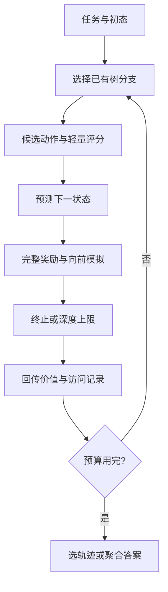

[[00-Agentic-RL|← Agentic RL 索引]] · [[GPTSwarm-2024-Optimizable-Agent-Graphs|对照 GPTSwarm]] · [[AFlow-2025-Workflow-Optimization|对照 AFlow]]

# RAP：用世界模型和树搜索规划推理过程

> [!abstract] 作者做了什么？
> 用同一个冻结的语言模型提出推理动作、预测动作后的状态，再用蒙特卡洛树搜索分配尝试次数、回溯分支，找到奖励较高的解题路径。
> 输入是任务、初始状态、目标、提示与搜索预算；输出是计划、数学答案或逻辑证明。每次搜索改变树中的价值与访问记录，LLM 权重保持不变。

## 1. 论文信息与核对范围

- **题目**：Reasoning with Language Model is Planning with World Model。
- **作者**：Shibo Hao、Yi Gu、Haodi Ma、Joshua Jiahua Hong、Zhen Wang、Daisy Zhe Wang、Zhiting Hu。ACL 元数据将部分中间名简写为 Joshua Hong、Daisy Wang；此处采用正式 PDF 署名。
- **机构**：UC San Diego、University of Florida、Mohamed bin Zayed University of Artificial Intelligence。
- **发表**：EMNLP 2023 主会，8154–8173 页，DOI 10.18653/v1/2023.emnlp-main.507。
- **来源**：[官方会议页](https://aclanthology.org/2023.emnlp-main.507/) · [正式全文及附录](https://aclanthology.org/2023.emnlp-main.507.pdf) · [arXiv 版本记录](https://arxiv.org/abs/2305.14992) · [官方代码](https://github.com/maitrix-org/llm-reasoners)。原论文脚注 Ber666/llm-reasoners 现重定向至该组织仓库。
- **选择理由**：用户队列第一篇。它提供学习轨迹奖励、信用分配与 Agentic RL 的规划基础；论文主体使用冻结模型，应与模型参数强化学习分开理解。
- **阅读范围**：正式主文及附录 A–F 中的算法、配置、提示词、相关工作和奖励消融；公开代码固定在 f94e5ac2cb9788c3d7d7dbf2173884ed4088e4b2，核对日期 2026-10-17。未实际运行模型或复现实验。
- **去重范围**：最新仓库 README、主题索引、模板、文件树、已有 GPTSwarm 笔记及当前聊天可访问历史；未发现 RAP 笔记，未声称检查不可访问历史。

> [!info] 证据标签
> 论文事实、固定版本代码行为、教学例子、研究逻辑重建与建议实验分别标识。后两类不代表作者未公开的思维过程或论文已证实结论。

## 2. 出发点：局部目标为什么会妨碍整体目标？

论文图 4 的目标是“红块在蓝块上、橙块在红块上”。初始橙块压在黄块上，红、蓝、黄位于桌面，手空着。普通 CoT 先卸下橙块、把橙块放到红块上，完成眼前一个目标，却挡住了红块。要移动红块，必须先拆掉刚搭好的结构。

> [!example] 贯穿例子：对应图 4 的布局，用字母重述
> 红 R、蓝 B、橙 O、黄 Y。目标 R 在 B 上、O 在 R 上。初始 O 在 Y 上，R、B、Y 在桌上。
> 正确的四步顺序：拿起 R → 放到 B 上 → 从 Y 上卸下 O → 把 O 放到 R 上。
> 先把 O 放到 R 上仍可拆开重做，但需要更多动作，有限深度内可能失败。后文假设的分数不来自论文实验。

链式思考（Chain-of-Thought, CoT）直接生成一串步骤；某一步偏离以后，后续文本容易沿错误前提继续展开。自一致性（Self-Consistency, SC）独立生成多条完整链后投票，各条链通常不能共享已发现的好前缀。RAP 把部分状态与分叉保存在树中，允许回到早期决策，再尝试另一条路。[论文 §2–3、图 4](https://aclanthology.org/2023.emnlp-main.507.pdf)

世界模型回答“当前情况是 s，做 a 后会怎样”。积木题预测位置、手持状态和哪些块顶部为空；数学题回答子问题、补充中间量；逻辑题应用规则推导新事实。RAP 通过提示词复用预训练 LLM 获得这个功能，没有另外训练一套动力学网络。

作者关于“LLM 缺少世界模型”的动机表述，应理解为对现有推理方式的批评；这组实验没有证明所有 LLM 内部完全没有世界知识。

## 3. 架构：输入输出与调用关系

| 角色 | 输入 | 输出 | 积木例子 |
| --- | --- | --- | --- |
| 动作候选生成 | 当前状态、任务及示范 | 有限个下一步动作 | 列出合法拿起、卸下、放下、堆叠动作 |
| 世界模型 | 状态、动作、转移提示 | 预测的新状态 | 拿起 R 后手持 R，R 离开桌面 |
| 奖励与搜索器 | 候选、预测状态、已有树 | 分数、下一探索分支、最终轨迹 | 比较先动 R、先动 O 的后续可能性 |

这些是功能角色，可调用同一个基础 LLM。Blocksworld 根据规则列出合法动作；数学题的子问题空间开放，才由 LLM 采样候选。不能概括成所有任务的动作都由 LLM 自由生成。[论文 §3.1、§4.1–4.3](https://aclanthology.org/2023.emnlp-main.507.pdf)

### 3.1 用 MDP 表达一次任务

马尔可夫决策过程（Markov Decision Process, MDP）把状态、动作、转移与奖励组织起来：

$$
a_t\sim p_\phi(a\mid s_t,c),\qquad
s_{t+1}\sim p_\theta(s'\mid s_t,a_t,c').
$$

t 是步骤编号；s 是当前状态；a 是一次积木动作、一个子问题或一次规则选择；c 与 c' 是两类提示。pφ、pθ 表示动作提议与状态预测两个角色，可由同一个冻结模型实现。任务路径为 s0、a0、s1……直到终态。

这是建模方式。状态若漏掉重要条件，马尔可夫假设就未必成立；自然语言状态也不保证准确。数学代码实际保存已有子问答历史。

搜索主要在模型预测的状态中进行，不对每个候选都操作真实外部环境。最终验证器与搜索中的世界模型需要分开理解。[论文 §3.1](https://aclanthology.org/2023.emnlp-main.507.pdf)

## 4. 一轮 MCTS 怎样运行？

### 4.1 展开候选，向前模拟

根节点保存初态。候选可能包括“拿起 R”和“卸下 O”。世界模型预测动作结果，奖励模块评价动作倾向与目标进展。随后继续模拟，直到完成目标或达到深度限制。

一次模拟可能包含多次 LLM 调用。为节约计算，论文在模拟中用轻量奖励选动作，省略昂贵项，例如需要多次生成才能计算的回答置信度。

若先动 O 的分支后来需要拆掉已完成的结构，预算内到不了目标，后续表现便影响早期动作的估值。下一轮可以转去尝试先动 R。[论文 §3.3、附录 A](https://aclanthology.org/2023.emnlp-main.507.pdf)

### 4.2 怎样选择下一分支？

选择阶段用 UCT（树上的置信上界）：

$$
a^*=\arg\max_{a\in A(s)}
\left[Q(s,a)+w\sqrt{\frac{\ln N(s)}{N(c(s,a))}}\right].
$$

A(s) 是已有候选；Q(s,a) 是搜索记录中的未来奖励估计；N(s) 是父节点访问次数；c(s,a) 是子节点；N(c(s,a)) 是其访问次数；w 控制探索。

Q 项偏向已知高分路径，第二项给探索较少的路径机会。未访问节点应按算法和实现初始化，不能直接把零放进分母。附录 A 以轻量局部分数提供先验，代码有 fast_reward 路径。

> [!example] 假设数值
> 父节点访问 10 次。A：Q=0.8、访问 8 次；B：Q=0.6、访问 2 次；w=0.5。
> UCT(A)≈1.068，UCT(B)≈1.136。因此 B 获得下一次尝试。数值仅示范探索项的作用。

### 4.3 回传到底更新什么？

模拟结束后，把后续奖励沿路径汇总，更新 Q 和访问记录。数学任务为减轻路径长度差异，论文式 (2) 对后续路径奖励先平均，再在已探索路径中取最大。教学改写为：

$$
\widehat Q(s_t,a_t)=
\max_{\tau\in\mathcal T(s_t,a_t)}
\frac{1}{L_\tau-t+1}\sum_{k=t}^{L_\tau}r_k.
$$

T 是经过该动作的已记录后续路径集合；Lτ 是路径最后一个奖励下标。它是有限搜索估计，不保证等于真实环境最优 Q。下一轮 UCT 读取新 Q 和访问次数，从而重新分配搜索。

这里没有训练策略权重的损失、优势估计、KL 正则、PPO/GRPO 更新或蒸馏。rollout 指模拟推理路径；back-propagation 指树上的奖励回传。当前题做得更好，不代表完成跨题参数学习。[论文 §3.3–4.2、Limitations](https://aclanthology.org/2023.emnlp-main.507.pdf)

### 4.4 停止与选答案

单条路径因目标达成或深度限制而停止；整次搜索另有迭代预算。论文讨论按 Q、回报、访问次数选轨迹，实践中偏好迭代中回报最高的路径。

数学题只需最终答案，可聚合多个搜索答案，称 RAP-Aggregation。主文没有完整给出足以唯一还原聚合的固定公式；当前实现支持累计答案的边奖励权重等方式，不能一概写成纯多数投票。积木与逻辑任务需要完整计划/证明，论文不对它们使用这项答案聚合。[论文 §3.3–3.4；当前聚合器](https://github.com/maitrix-org/llm-reasoners/blob/f94e5ac2cb9788c3d7d7dbf2173884ed4088e4b2/reasoners/algorithm/mcts.py)

## 5. 同一接口怎样解决数学题？

> [!example] 额外教学题，非论文实验样本
> 一本书 120 页，已读 36 页，明天读剩余页数的一半，明天读几页？答案 (120−36)/2=42。

动作提议器先问“还剩几页”；世界模型回答 84，状态保存这条问答。提议器读到新状态后提出最终问题，世界模型回答 42。错误分支可能直接算 120/2=60；帮助性自评应当识别它漏掉已读部分，但也可能误判。

数学奖励为：

$$
r_t=u_t^\alpha c_t^{1-\alpha}.
$$

u 是子问题帮助性自评，c 是同一子问题多次回答中最常见答案的比例，α 是权重。假设 u=0.9，8 次中 6 次回答 84，则 c=0.75；α=0.5 时 r≈0.822。以上数字均为教学假设。

几何平均使任一信号很低时整体受抑制。一致程度不能直接解释成正确概率：模型可以稳定地算错。同一模型同时提议、预测和评价，也可能共享错误。[论文 §3.2、§4.2、附录 C.2/F](https://aclanthology.org/2023.emnlp-main.507.pdf)

### 5.1 记忆怎样产生与复用？

| 环节 | 本文机制 |
| --- | --- |
| 生成 | 当前题的动作、预测状态和奖励 |
| 存储 | 搜索树、问答轨迹、Q 与访问记录 |
| 筛选 | UCT、轻量评分、路径回报、答案聚合 |
| 检索 | 当前树中选分支；没有跨题语义检索 |
| 更新 | 同一题内扩树和更新统计 |
| 长期复用 | 人工准备的提示示范；未建立自动跨题经验库 |
| 多智能体共享 | 未研究团队通信、角色分配或协作拓扑 |

新题会重建树。日志落盘与数据结构里的 memory 字样，不能自动算作长期学习机制。附录 E 随搜索深度调整示范轨迹，未形成自动跨任务经验归纳。

## 6. Benchmark 与评测协议

### 6.1 Blocksworld：完整计划是否成功？

输入为初态和目标，输出操作列表。合法动作受规则约束，指标为整计划成功率。当前复现要求 VAL 验证器，评测真实符号规则中的计划有效性，不能仅看模型预测的“达标”。

主实验 2/4/6 步任务分别 30/57/114 道，最多五个块，CoT 使用四个示范。搜索奖励组合动作对数似然与目标满足情况，所有条件满足时给很大的奖励。

§5.1 的扩展实验改用 Llama-2 70B、602 个原始案例并留出示范池。Easy 已知最短步数、从同难度取示范；Hard 从全局池取示范。Easy 有额外难度信息，两者不应混淆。[§4.1/5.1；代码运行说明](https://github.com/maitrix-org/llm-reasoners/blob/f94e5ac2cb9788c3d7d7dbf2173884ed4088e4b2/examples/RAP/blocksworld/README.md)

### 6.2 GSM8K：最终数值是否正确？

输入为小学数学应用题，输出最终数值。各方法使用相同四个示范；搜索用模型代理奖励，不读当前题答案。当前 evaluator 加载 GSM8K test，并在运行推理后比较提取答案。

主文未清晰列出足以独立确认表 2 精确分母的全部细节；不能由当前全量测试集默认行为倒推历史运行。表 6 明确只用前 300 题。

CoT+SC(10) 是十次独立完整采样，RAP(10) 是十轮树搜索，真实调用和 token 数未必相同。[§4.2、表 2/6；评测器](https://github.com/maitrix-org/llm-reasoners/blob/f94e5ac2cb9788c3d7d7dbf2173884ed4088e4b2/reasoners/benchmark/gsm8k.py)

### 6.3 PrOntoQA：预测与证明分别计分

输入为事实、规则和待验证命题，输出真假及证明。状态为当前事实，动作选择规则，世界模型推导一步，奖励来自自评。

使用 true ontology、随机规则顺序，混合 3/4/5 跳证明，从官方生成脚本抽 500 例；RAP 20 轮，SC 20 次。预测准确率只看真假，证明准确率要求整个证明正确。[论文 §4.3](https://aclanthology.org/2023.emnlp-main.507.pdf)

## 7. 结果、消融与局限

| 设置 | 对照 | RAP | 可以说明什么 |
| --- | --- | --- | --- |
| Blocksworld 4 步 | LLaMA-33B CoT 2%；GPT-4 CoT 63% | RAP(20) 88% | 状态与搜索在此设置有益 |
| Blocksworld 6 步 | GPT-4 CoT 40% | RAP(10) 26%；RAP(20) 42% | 预算影响明显；10 轮低于 GPT-4 对照 |
| GSM8K | CoT 29.4%；CoT+SC(10) 46.8% | RAP(10) 48.6%；聚合 51.6% | 比 SC 高 1.8/4.8 个百分点，成本需另量 |
| PrOntoQA 预测/证明 | CoT 87.8% / 64.8% | RAP 94.2% / 78.8% | 证明提高 14.0 个百分点 |

[正式论文表 1–3](https://aclanthology.org/2023.emnlp-main.507.pdf)

> [!warning] 数字与结论范围
> GSM8K 表 2 为 48.6%，紧邻正文为 48.8%；本笔记以表值比较并保留冲突。
> “超过 GPT-4 33%”限于论文特定 Blocksworld 设置的相对提升，不代表所有任务，也不代表提高 33 个百分点或等成本优越性。

### 7.1 奖励消融

附录表 5：Blocksworld 动作似然+目标奖励为 0.88；仅动作似然 0.46，仅目标奖励 0.21，三种奖励都不用 0.02，加入自评后 0.91。它说明该消融设置下信号组合有用，不能把 0.88 扩展到全部难度。

表 6 为 GSM8K 前 300 题：置信度+自评的 RAP(10)/聚合为 0.450/0.503；仅置信度为 0.447/0.490；置信度+动作似然为 0.423/0.443。自然语言子问题的生成概率未必稳定反映有用性，单轮有益的奖励组合增加搜索后也可能更差。

注意表 5 的 R1 是动作似然，表 6 的 R1 改成置信度。消融不能替代“单独移除世界模型”或所有搜索策略的同预算对照。[附录 F、表 5/6](https://aclanthology.org/2023.emnlp-main.507.pdf)

### 7.2 局限及未报告内容

- 世界模型错误会让搜索在错误状态中规划；代理奖励可能偏爱稳定错误。
- 分支、状态生成、自评与置信度采样的成本不同，迭代数相同不能证明预算一致。
- 状态、动作、奖励和提示按任务适配，未证实零配置开放环境迁移。
- 未研究多智能体协作、开放网页或长期跨题改进。
- 主结果表缺少充分重复运行区间；预训练污染缺少审计证据，本次不能断言实际泄漏。
- 附录 B.2 统一报告 4×24GB NVIDIA A5000，未细拆各实验显存、时长、token 和 API 费用。不能据此确认每种模型均以同一精度在该配置运行。

## 8. 公开代码与复现边界

代码版本：[f94e5ac](https://github.com/maitrix-org/llm-reasoners/tree/f94e5ac2cb9788c3d7d7dbf2173884ed4088e4b2)。

### 8.1 GSM8K 入口到更新

1. [inference.py](https://github.com/maitrix-org/llm-reasoners/blob/f94e5ac2cb9788c3d7d7dbf2173884ed4088e4b2/examples/RAP/gsm8k/inference.py) 构造世界模型、搜索配置、MCTS 和 Reasoner。
2. [base.py](https://github.com/maitrix-org/llm-reasoners/blob/f94e5ac2cb9788c3d7d7dbf2173884ed4088e4b2/reasoners/base.py) 把当前题和提示传给各角色，调用搜索器，之后评测答案。
3. [search_config.py](https://github.com/maitrix-org/llm-reasoners/blob/f94e5ac2cb9788c3d7d7dbf2173884ed4088e4b2/examples/RAP/gsm8k/search_config.py) 生成并去重子问题；fast_reward 将 Yes/No logits 归一化，在实际一致度尚未求出时填默认置信度。
4. [world_model.py](https://github.com/maitrix-org/llm-reasoners/blob/f94e5ac2cb9788c3d7d7dbf2173884ed4088e4b2/examples/RAP/gsm8k/world_model.py) 多次回答、按答案分组，保存常见回答和频率；支持提前停止，n_confidence=8 不代表每步必定八次。
5. [mcts.py](https://github.com/maitrix-org/llm-reasoners/blob/f94e5ac2cb9788c3d7d7dbf2173884ed4088e4b2/reasoners/algorithm/mcts.py) 维护树，候选可先只有动作与 fast_reward，选中展开时才计算实际状态，随后回传收益。它与给所有候选立刻完整预测状态的朴素实现不同。
6. 主入口显式传 cum_reward=np.mean、calc_q=max，通用 MCTS 默认值不同，不能只读通用类推断实例。

当前入口 n_action=4、n_confidence=8、reward_alpha=0.5、aggregate=True 等默认值属于本次代码版本，不自动等于正式论文历史实验配置。底层模型接口还要提供 logits/likelihood；仅能返回文本的接口未必可直接使用。

### 8.2 Blocksworld 的实现差异

[search_config.py](https://github.com/maitrix-org/llm-reasoners/blob/f94e5ac2cb9788c3d7d7dbf2173884ed4088e4b2/examples/RAP/blocksworld/search_config.py) 用 generate_all_actions 枚举合法动作；当前评分加入 self_eval，与主实验描述的两项主要奖励有区别。

[world_model.py](https://github.com/maitrix-org/llm-reasoners/blob/f94e5ac2cb9788c3d7d7dbf2173884ed4088e4b2/examples/RAP/blocksworld/world_model.py) 用 LLM 生成变化，apply_change 更新状态，goal_check 检查目标。说明文字称状态每两步更新，但实际 step 每步调用 update_blocks；buffered_action 另影响评分提示。行为应以函数为据，不能照抄过时注释。

### 8.3 能否复现？

代码、提示和数据入口公开；权重获取需遵守模型许可。Blocksworld 依赖 LLMs-Planning 子模块和 VAL。GSM8K README 示例把动作数、回答样本数与迭代数都设为 1，并注明单链无搜索，直接运行不能验证完整 RAP 搜索结果。

论文没有参数训练成本，精确推理时长、总 GPU 小时和费用未知。教学复现可先在较小模型、少量题上记录状态错误、调用和成功率；这只能验证机制，不能冒充原论文数值复现。本次仅静态核对原文与代码，未安装依赖、加载模型或重跑实验。

## 9. 增量贡献与研究关系

### 9.1 相对已有方法新增什么？

- **CoT**：显式状态、分支与回溯，已测结果支持有效性。
- **SC**：树中共享前缀并由过程奖励分配搜索；是否等成本更好仍需测量。
- **Least-to-Most**：随已解出的中间量动态提出下一步；原文对照一次性生成分解。
- **同期 ToT**：作者强调统一状态—动作—转移—奖励表示与 MCTS；本文不能证明此前没有树搜索推理，也没有直接支持所有条件下全面优于 ToT。
- **参数 RL**：未训练策略模型；搜索轨迹可用于未来训练，是可迁移方向，论文未验证该蒸馏闭环。

### 9.2 与用户设想的简短映射

| 研究轴 | 关系 | 范围 |
| --- | --- | --- |
| 经验优化 Harness | 可迁移 | 本题搜索调整决策，未跨题改造 Harness |
| 长短期记忆检索 | 短期直接相关，长期未覆盖 | 树与状态可作工作记忆，缺长期经验库 |
| 单智能体执行 | 直接相关 | 状态、奖励、分支预算 |
| 多智能体运行图 | 未覆盖 | 树节点为状态，不是团队成员 |
| RL/参数蒸馏 | 可迁移、未完成 | 轨迹或可用于训练，须另行验证 |

与 [[AFlow-2025-Workflow-Optimization|AFlow]] 比较：RAP 搜索一道题的推理路径，AFlow 搜索跨题工作流程序。与 [[GPTSwarm-2024-Optimizable-Agent-Graphs|GPTSwarm]] 比较：前者更新本题树统计，后者以策略梯度更新外部连边参数。与 [[G-Memory-2025-Hierarchical-Memory|G-Memory]] 比较：本题分支记录应与跨题经验图分开。

> [!tip] 建议的小实验，尚未实施
> 在确定验证器的 Blocksworld 上固定模型与总调用/token 预算，比较 CoT+SC、RAP、RAP+经验证的历史失败转移案例检索。经验构建题与测试题分离，按布局分组防近重复泄漏。
> 测整计划成功率、状态转移错误率、调用/token 数与延迟。检验记忆能否在等预算下减少世界模型错误。它是研究建议，不属于本文结论。

## 10. 阅读路线与三个问题

先读图 4、§4.1，理解状态与动作合法性；再读 §3.1–3.3、图 3 和附录 A，手推一轮 MCTS；随后读 §4.2、式 (2)、附录 C.2/F；最后看表 1–6 和代码调用链，核对预算与指标。

1. 世界模型系统性出错时，增加搜索会修复它，还是更坚定地选错？怎样用确定验证器测出区别？
2. 在相同 token 与延迟下，状态表示、前缀共享、奖励引导和聚合各贡献多少？
3. 本题的失败转移怎样筛选成跨题经验，避免泄漏答案与传播错误？

## 原始来源

- [EMNLP 2023 官方会议页](https://aclanthology.org/2023.emnlp-main.507/)。
- [正式全文与附录 A–F](https://aclanthology.org/2023.emnlp-main.507.pdf)。
- [arXiv 版本记录](https://arxiv.org/abs/2305.14992)。
- [官方代码固定提交](https://github.com/maitrix-org/llm-reasoners/tree/f94e5ac2cb9788c3d7d7dbf2173884ed4088e4b2)。
- [GSM8K 运行说明](https://github.com/maitrix-org/llm-reasoners/blob/f94e5ac2cb9788c3d7d7dbf2173884ed4088e4b2/examples/RAP/gsm8k/README.md)。
- [Blocksworld 运行说明](https://github.com/maitrix-org/llm-reasoners/blob/f94e5ac2cb9788c3d7d7dbf2173884ed4088e4b2/examples/RAP/blocksworld/README.md)。
