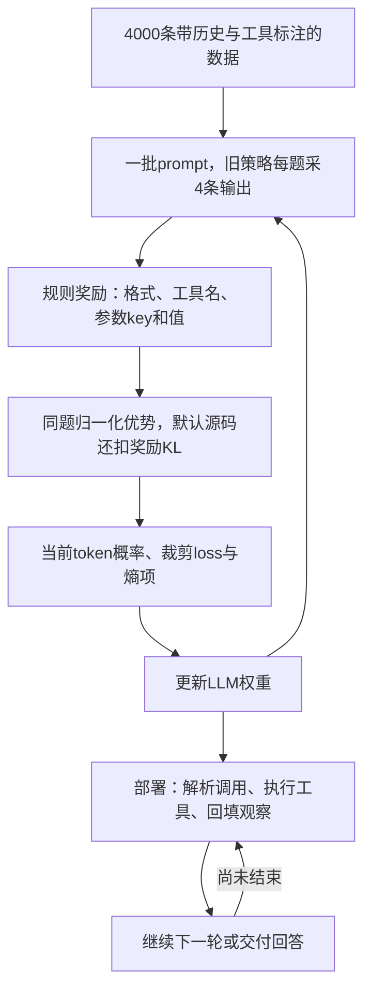

[[00-Agentic-RL|← Agentic RL 索引]] · [[Planner-R1-2025-Reward-Shaping-Agentic-RL|上一篇 Planner-R1]]

# ToolRL：工具调用奖励怎样设计才有用？

> [!abstract] 作者到底做了什么？
> 给定用户需求、工具说明和已有对话，让模型生成下一轮思考、工具调用或回复；把工具名、参数名、参数值分别与标注比较，得到规则奖励，再用GRPO更新LLM参数。重点是奖励设计的系统实验，不是发明新GRPO。
> 输入是工具文档与带历史的查询；训练输出是下一轮文本，部署可循环执行工具直到回答。改变的是LLM权重，不是外部经验库、技能程序或MCTS搜索树。

## 1. 论文、代码与本次证据范围

- **完整题目**：ToolRL: Reward is All Tool Learning Needs。
- **作者**：Cheng Qian、Emre Can Acikgoz、Qi He、Hongru Wang、Xiusi Chen、Dilek Hakkani-Tür、Gokhan Tur、Heng Ji。
- **机构**：University of Illinois Urbana-Champaign（伊利诺伊大学厄巴纳—香槟分校）。
- **发表**：[NeurIPS 2025主会，官方论文集条目](https://papers.nips.cc/paper_files/paper/2025/hash/97c5b2707228e7e3fb67e4ecc2e0e607-Abstract-Conference.html)，不是Workshop。DOI：10.52202/085713-3524。搜索引擎有2026抓取/元数据，但卷与会议身份以官方NeurIPS 2025为准。
- **实读原文**：[正式会议PDF，31页](https://proceedings.neurips.cc/paper_files/paper/2025/file/97c5b2707228e7e3fb67e4ecc2e0e607-Paper-Conference.pdf)。阅读正文与附录A–J，重点核对C算法、D提示、E配置、F补充结果、G/H/I奖励消融与J主张边界；视觉核对第4页奖励公式及第24页GRPO公式。未将早期arXiv HTML的章节编号和数字混入会议版。
- **其他入口**：[arXiv:2504.13958](https://arxiv.org/abs/2504.13958) · [作者项目页](https://lifelongagent.github.io/Project-Lifelong-Agent/ToolRL/index.html) · [官方代码](https://github.com/qiancheng0/ToolRL) · [作者模型/数据集合](https://huggingface.co/collections/emrecanacikgoz/toolrl)。集合可见Qwen2.5-7B-Instruct-ToolRL-grpo-cold，不据此声称所有模型/种子权重齐全。
- **代码固定版本**：[8cee13ec0ca72f0461da372a93a6fd8140dbb840](https://github.com/qiancheng0/ToolRL/tree/8cee13ec0ca72f0461da372a93a6fd8140dbb840)，核对日期2026-10-25。静态检查数据、奖励、采样/训练调度、优势、actor loss与三套评测适配；只运行纯Python奖励构造样例，未训练GPU模型，未复现榜单分数。
- **去重与进度**：读取最新README、Agentic RL索引、模板、文件树、Planner-R1及记忆主题索引。此前队列RAP/LATS/VOYAGER/Planner-R1四篇完成；本篇是第5篇，下一篇ARTIST。CB-PbRL为队列外补充，保持原文件与内容。去重范围为仓库和可访问会话，不声称查遍所有历史。

> [!warning] 先记住三个边界
> **训练数据有正确工具调用标注**，不是没有监督；cold start指不先做本项目的工具SFT，不是从随机权重训练。
> **训练将多轮轨迹拆成单步样本**，给定历史后生成下一步；不能将概念图直接读成每次rollout都实时执行整条工具链。
> **论文主设置称去掉KL，当前公开默认脚本仍有奖励端KL和熵项**。下面分别讲论文意图和已核验代码，不能混写成唯一无争议loss。

## 2. 出发点与研究逻辑：为什么不能只模仿调用示范？

工具能力至少包含三个决定：工具是否适用，选哪个工具，参数怎样填。学会输出JSON只解决语法，不保证理解工具说明。论文附录A举出的失败模式是：SFT模仿了长思考的语言样式，但碰到不适用工具仍会乱调用；出现“but wait”等表达并不能证明推理有效。

与只检查最终答案相比，工具调用本身提供天然可拆分的结构。一个调用工具名正确、两个参数中一个正确，通常比调用完全无关的工具更接近标注。若两者都只得0，训练浪费了已有结构信息。

**依据公开设计重建的逻辑**：调用有结构→把错误定位到工具/参数层；只学格式可能投机→提高正确性相对权重；长思考可能只是模仿→独立做长度奖励消融；格式与语义的学习阶段不同→比较硬切换与平滑调权。这是可从方法和实验推导的设计逻辑，不宣称知道作者未公开的心理过程。

### 贯穿教学例子：查询明天上海的天气

> [!example] 下例是构造教学样例，不是论文真实案例
> 假设当前日期已由提示确定，用户要查2026-10-26上海天气。工具文档为`weather(city, date)`，正确调用为：
> `{"name":"weather","parameters":{"city":"Shanghai","date":"2026-10-26"}}`。
> 城市、日期、API签名和后面的候选/分数都只用于解释。

模型可能生成三种错误：调用`calendar`；调用`weather`但把参数写成`location`；工具/参数名都对但日期填成2026-10-25。二值奖励把三种错都压成失败，而ToolRL奖励可以给第三种更高分。

SFT直接增加参考输出的概率；ToolRL先让当前策略尝试多个输出，再用规则得分比较它们。它不要求RL模型复刻DeepSeek-R1的思考文本，工具标注只通过评分器进入奖励。

## 3. 执行框架与训练样本：多轮能力怎样进入单步训练？

### 3.1 部署中的完整循环

正文§2.1/2.2定义历史为此前各轮的思考、调用集合、工具观察和可能的新用户输入。策略读取历史，输出：

```text
<think>下一步的分析</think>
<tool_call>
{"name":"weather","parameters":{"city":"Shanghai","date":"2026-10-26"}}
</tool_call>
<response>如需要，可同时给用户回复</response>
```

`<tool_call>`和`<response>`可共存。一轮也可列出多条JSON调用；执行器解析调用、执行工具，把结果以`<obs>`追加历史，再由模型决定后续动作。天气例子中，得到预报后下一轮再回答用户即可。

这些标签是模型生成文本的一部分，不是天然就会执行的神奇API。必须有外部程序解析、分派和回填观察。正式终止与预算由具体评测驱动：例如公开Bamboogle实现最多4轮；不能把这个上限推广到所有任务。

### 3.2 主训练实际优化的是“给定历史的下一轮”

论文§3.1明确将多步轨迹拆成单步实例，将以前的对话放在输入中。训练数据包含ToolACE 2000条、Hammer Masked 1000条、xLAM 1000条。Hammer随机化工具/参数名，意在迫使模型参考描述而不是只记名字；这属于数据设计，不是部署时的检索模块。

固定代码`ray_trainer.py`对一批prompt调用一次`generate_sequences`，直接对生成completion评分，没有在该训练循环内执行候选工具并继续采样后继状态。因此，**本轮新生成的工具调用不会改变同一次训练rollout随后访问的历史**。历史可以包含观察，但来自数据，而非当前候选刚刚执行的结果。

若原记录为“用户→查天气→观察→回复”，可拆为：

1. 给工具说明和用户需求，训练生成查天气的调用。
2. 给包括既有观察在内的历史，训练生成回复或后续调用。

这使训练具备多轮上下文，仍不同于端到端在线探索整条任务。从操作层面可将它理解为带上下文的下一轮策略优化；它没有用价值函数评估当前错误调用对未来状态的长期影响。在线/同策略采样说的是当前completion由当前策略生成，不代表输入历史也全部由该策略在线产生。

### 3.3 数据与监督边界

公开原始RL JSON实际4000条；预处理脚本种子31415、随机打乱后2%留出，按脚本得到3920训练/80验证。该验证集不是BFCL/API-Bank/Bamboogle测试集。本次未比较预处理parquet逐条内容，3920/80是原始文件与脚本核对结果。

原始4000条中391条input含`<obs>`，这只说明显式观察标签出现次数，不能当作全部多轮样本数，因为也可能有其他历史形式。RL输出含占位/简短thought，不作为SFT目标；SFT基线用DeepSeek-R1蒸馏的思考。论文附录说SFT400与RL4K分布相同但内容不同；SFT4K+RL重复使用同4K，不能把所有对照概括为“完全相同样本和训练预算”。

更新对象为Qwen2.5-Instruct 1.5B/3B/7B与Llama-3.2-3B-Instruct的策略权重。没有在主GRPO配置训练价值模型；PPO对照另外有critic。没有长期记忆生成/筛选/检索/共享或多智能体图优化；已有历史上下文不等于跨任务记忆。

## 4. 手算奖励：格式与语义分别判断什么？

### 4.1 格式奖励是相加，不是整项门控

正文§2.3：

$$
R=R_{\mathrm{format}}+R_{\mathrm{correct}},\qquad
R_{\mathrm{format}}\in\{0,1\},\quad
R_{\mathrm{correct}}\in[-3,3].
$$

总分范围为[-3,4]。格式检查参考标注需要哪些字段及其先后次序。公开代码用正则检查起止标签、换行和数量，比“只要是JSON即可”更严格。

和[[Planner-R1-2025-Reward-Shaping-Agentic-RL|Planner-R1]]不同，本篇格式分与正确性分直接相加；格式失败不必使全部语义分归零。但若需要工具而调用标签缺失/JSON无法解析，代码会给正确性最低分-3。

### 4.2 三种匹配分数

设正确调用列表为G，预测列表为P，工具名集合为N。先比较工具名交并比（Jaccard）：

$$
r_{\mathrm{name}}=\frac{|N_G\cap N_P|}{|N_G\cup N_P|}.
$$

随后给正确调用配对同名预测调用。每一对比较参数key的交并比，再累计值完全相等的key数。把这些分数相加：

$$
r_{\mathrm{match}}=r_{\mathrm{name}}+r_{\mathrm{param}}+r_{\mathrm{value}},\qquad
S_{\max}=1+|G|+\sum_{g\in G}|\operatorname{keys}(g)|.
$$

第一项工具名匹配最多1分；第二项每个正确调用的参数key匹配最多1分；第三项每个正确参数值最多1分，所以最大值要按调用数、参数数变化。再归一化到[-3,3]：

$$
R_{\mathrm{correct}}=6\frac{r_{\mathrm{match}}}{S_{\max}}-3.
$$

这是规则评分，不是学习出来的奖励模型，也不检查thought推理文本是否正确。参数“语义相同”若未被规则规范化，不自动获得相同分数；时间别名、同义地名或不同但有效的调用方案都可能与单一标注不一致。

### 4.3 天气例子的完整分数

正确调用只有1个，含city/date两个参数，所以Smax=1+1+2=4。假设各输出均格式合格：

| 候选 | 工具名分 | 参数名分 | 参数值分 | 正确性分 | 总分 |
| --- | ---: | ---: | ---: | ---: | ---: |
| weather，city正确但缺date | 1 | 0.5 | 1 | 0.75 | 1.75 |
| weather，两key正确，date填错一天 | 1 | 1 | 1 | 1.5 | 2.5 |
| 与正确调用完全相同 | 1 | 1 | 2 | 3 | 4 |
| 调用完全不同工具 | 0 | 0 | 0 | -3 | -2 |

这些是假设样例；前三行的正确性分已用固定代码的纯Python函数验证。它说明细分奖励如何排序，不意味着“缺日期”是真正可执行调用，也不代表作者原实验中的奖励分布。

### 4.4 公开代码的两个重要例外

**集合与多重集合**：论文用名字集合，代码`match_score`用Counter计重复频次，重复调用会影响名字相似度。

**全局最优与贪心匹配**：论文称求预测与标注间的最优匹配；代码按正确调用顺序挑当前最高分的未使用同名预测，属于贪心，并不保证全局最优。构造两个同名f调用：正确参数依次为(a=0,b=0)、(a=1,b=0)，预测为(a=1,b=0)、(a=0,b=1)。本地调用代码得到正确性0.4286；仅调换预测顺序后为2.1429。原因是首轮并列时选了不同候选，影响余下匹配。该反例证明当前实现存在顺序敏感性，不证明它对论文总体成绩影响有多大。

**无正确工具调用的样本**：`customize_correctness_reward_tool`直接返回0，不进一步比较自然语言答案，也没有单独奖励“不乱调用”。格式项会根据标注要求response而间接约束是否调用。故论文展示拒绝无关工具的案例，不等于存在显式的语义拒绝奖励。标注没有调用时，模型回答是否事实正确主要不由这个训练评分器检查。

## 5. 最终优化的损失是什么？先讲主干，再讲真实配置

### 5.1 从4条候选到一个组相对优势

论文每个prompt采4个completion（组大小n=4，不是标准差），训练温度1。令第i个输出得分为Ri，同组均值μ、标准差σ，则：

$$
A_i=\frac{R_i-\mu}{\sigma+\eta}.
$$

这是相对同题其他候选的好坏，不是绝对正确性标签。负奖励也可能高于同组均值而获得正优势；整组同分时优势为零。主GRPO没有单独训练V价值网络。

论文附录C标准差采用n作分母（总体标准差）；代码调用默认`torch.std`，按该PyTorch语义使用n-1校正，epsilon=1e-6。代码在`no_grad`中计算并广播优势。这个小差异影响优势尺度，不能把公式逐字当源码。

### 5.2 代码是token级比率，不是整句概率乘积

对第i个completion的第t个生成token定义：

$$
\rho_{i,t}=\exp\!\left[
\log\pi_\theta(y_{i,t}\mid x_i,y_{i,<t})
-\log\pi_{\mathrm{old}}(y_{i,t}\mid x_i,y_{i,<t})
\right].
$$

x包含工具文档、问题和既有历史。旧策略采样本批候选；当前策略在更新时重新计算相同token的log概率。旧概率、奖励、优势固定，梯度只经当前log概率回传。`old`会随训练批次更新；`ref`是额外冻结参照模型，二者角色不同。

附录C写的是整段响应π(s|Q)比率，并把内层期望记为当前策略；公开执行是旧策略采样、token比率与裁剪。不能把附录的响应级简写直接当成GSPO式句级比率，更不能把一组输出的所有token概率相乘来实现当前代码。

### 5.3 裁剪策略loss：优化器实际最小化的主项

记m为有效生成位置mask，ε=0.2：

$$
\boxed{
L_{\mathrm{PG}}=
-\frac{\sum_{i,t}m_{i,t}
\min\!\left(\rho_{i,t}A_i,
\operatorname{clip}(\rho_{i,t},1-\epsilon,1+\epsilon)A_i\right)}
{\sum_{i,t}m_{i,t}}
}
$$

这是固定代码`compute_policy_loss`在**单个microbatch**里的真实聚合形式：`max(-A*ratio,-A*clipped_ratio)`等于负的min目标，再`masked_mean`。外层还有microbatch梯度累积、minibatch和分布式平均，不能把它不加条件地称作整个训练batch严格一次全局token平均。动态microbatch有效token数不同会影响最终权重。

同一个completion的所有有效生成token共享一个Ai；thought、调用、回复都在生成区域内。历史观察在prompt中，不进入response loss；本训练路径不需要为新rollout中插入的工具观察另外做mask，因为没有这样的插入循环。padding排除。不是只训练工具JSON中的token。

没有每条输出先除Ti再做序列平均；这个代码形式会让较长输出在同microbatch中占更多token权重。不能仅据此推出训练一定偏长或偏短。

负号把最大化策略目标变为最小化损失。比率已含当前概率，其导数满足∇ρ=ρ∇logπ，所以未显式写Alogπ仍可做策略梯度；不能无推导把裁剪目标替换成普通交叉熵。

### 5.4 论文称无KL，默认公开脚本实际保留奖励端KL

论文§2.4/§3.4称主实验移除KL。若按论文意图，Ai从上面规则奖励计算；但当前固定代码默认路径是：

1. `main_ppo.py`始终注册RefPolicy，`ray_trainer.py`计算ref_log_prob。
2. `run_grpo.sh`设置`actor.use_kl_loss=False`，但同时设置`algorithm.kl_ctrl.kl_coef=0.001`。
3. 当use_kl_loss为False时，trainer反而调用`apply_kl_penalty`，在奖励端扣KL。

因此默认代码传入组归一化的是：

$$
\widetilde R_i=R_i-
0.001\sum_t m_{i,t}
\left(\log\pi_{\mathrm{old},i,t}-\log\pi_{\mathrm{ref},i,t}\right).
$$

规则得分本来放在最后有效token；KL扣分分布到有效生成位置，随后求和得到上式。这是旧策略样本上的k1型KL估计，单样本可为负；不是在当前actor loss里显式求一个精确词表KL。优势Ai按这个调整后的回报计算，并stop-gradient。

默认YAML另有`entropy_coeff=0.001`，脚本未覆盖，actor实际反传：

$$
\boxed{L_{\mathrm{actor}}=L_{\mathrm{PG}}-0.001\,\overline H}
$$

H是当前策略分布熵，在同microbatch有效生成位置平均；负号鼓励保持探索。之后代码将loss除gradient_accumulation再backward。

**所以“use_kl_loss=False”只说明不直接加actor KL loss，并不代表无奖励端KL。当前公开默认源码与会议文中主实验配置存在差异。**没有历史运行配置与日志，不能判定文中分数究竟由哪条路径产生。若要按论文无KL意图复现，需明确关闭奖励端系数并复核日志；这属于复现配置决策，不能静默改源码后宣称原版即如此。熵项是否为论文历史运行设置也缺日志确认。

## 6. 一轮训练与部署分别保留什么？



训练主配置：batch512个prompt，每题4输出；学习率1e-6，minibatch128，15epochs；prompt最多2048token、response最多1024token；vLLM生成，FSDP更新。PPO对照不仅多critic，表10还使用1024/512的prompt/response上限，和GRPO的2048/1024不同，因此不是严格同token预算算法比较。

工具标注只给训练评分器，不给测试模型；部署不需要G=4、优势计算、裁剪loss或正确调用标注，只保留策略模型、工具文档、标签解析和工具执行环境。测试查询仍可能多轮调用，这与训练采样单步不矛盾。

没有SFT/经验库蒸馏作为主方法前置。SFT基线的DeepSeek-R1轨迹蒸馏不等于ToolRL主模型先蒸馏再RL；cold start仍从已经预训练/指令微调的模型开始。

## 7. Benchmark：任务是什么，谁判断成功？

### 7.1 BFCL V3：不只看会不会输出函数名

输入是需求、工具文档，可能包含已有会话与执行状态；输出是调用或拒绝/澄清。论文报告Non-Live AST、Non-Live Exec、Live、Multi-Turn、相关性/无关性判断等列。

- AST类检查调用结构与允许参数；不是自由文本LLM裁判。
- Exec类实际执行再比较结果；函数调用文本不必逐字符相等。
- Multi-Turn检查多轮任务与状态；不能拿总体高分代替完整任务能力。
- Live在BFCL命名中主要指众包真实用户分布，不应误译为所有样本都调用真实在线API。

作者仓库只提供Qwen的handler适配，评测汇总依赖外部BFCL框架。官方V3说明给出历史总体4441项、多轮计分800项及分层加权/不加权聚合，但没有作者历史框架精确commit，不能保证文章实际运行完全对应该快照，也不把Overall简单称为七列表格的算术平均。复现需固定V3数据/评测版本，而不是今天最新榜单。

### 7.2 API-Bank：本文公开适配不是逐题跑完整API后台

论文说有73种API、三个难度层级。其处理后数据给定历史与工具信息，让模型预测下一调用。固定文件可核对Level1=399、Level2=67、Level3=131，总597个评分项，Overall分母是这597项，不是73个API。

`generate.py`每项只生成一次下一输出；`evaluate.py`检查预测工具列表中是否**存在**工具名和parameters字典与标注完全相同的调用。有多条预测时仍可通过；标注answer若为list只取第一个，并非要求整个预测调用集完全一致。对缺name/parameters的预测还有将字典当参数的兼容分支。

这里主要是确定性字典/规则匹配，不是LLM语义评审，也不是执行了真实金融/日程后台后验证最终状态。因此论文API-Bank分数不能自动等同原基准所有原生执行语义。

### 7.3 Bamboogle：真的搜索多轮，但答案由GPT-4o裁判

125个多跳问答，例如先查某作品作者，再查作者出生地。测试模型可直接回答，也可调用网页搜索，读取结果后继续。训练没有用Bamboogle最终答案作奖励。

公开脚本用Serper搜索，top5结果；每轮只执行解析出的第一条调用，最多4轮，第4轮之后不能继续。`max_model_len=4096`，生成上限4096，温度0.001；API-Bank生成温度0.0001。接近确定性但不应写成温度严格0。

最终将问题、标准答案、模型答案交给GPT-4o，判断语义是否相同，以Yes/No计分；分母125。这解释了自然语言多样表达如何被处理，也带来裁判版本/判断误差与动态搜索内容的复现不确定性。不能把“所有结果都是accuracy”理解为三个基准用同一种验证器。

脚本恢复时会跳过已经正确的题、重新生成其余题；若多次对同一输出目录运行，会保留成功、重试失败，使结果不再等于一次独立pass@1。**这是可见实现风险，不是论文确曾多次重跑的证据。**干净输出目录和固定一次运行是必要评测约定。

## 8. 精选结果：支持什么，不支持什么？

### 8.1 Qwen收益明显，Llama不是全面超SFT

正式论文表1/2/3，单位%：

| 模型与指标 | 原Instruct | SFT4K | GRPO cold start |
| --- | ---: | ---: | ---: |
| Qwen2.5-3B，BFCL Overall | 33.04 | 41.97 | 52.98 |
| Qwen2.5-7B，BFCL Overall | 41.97 | 36.53 | 58.38 |
| Qwen2.5-3B，API-Bank Overall | 51.59 | 50.92 | 67.00 |
| Qwen2.5-7B，API-Bank Overall | 62.48 | 47.07 | 64.66 |
| Qwen2.5-3B，Bamboogle | 52.0 | 49.6 | 60.0 |
| Qwen2.5-7B，Bamboogle | 69.6 | 30.4 | 72.0 |
| Llama-3.2-3B，BFCL Overall | 22.09 | 44.16 | 44.10 |

3B的BFCL相对原模型提高19.94个百分点，相对SFT4K提高11.01个百分点；7B的Bamboogle相对原模型只提高2.4个百分点。Llama的BFCL 44.10略低于SFT4K的44.16，不能复述为所有模型、所有基准都严格最好。

摘要“17%/15%”不能当每项提升或相对比例。按四模型×三基准、对表中百分数差做简单宏平均，本笔记重算相对raw约17.09个百分点，相对SFT4K约14.94个百分点；这是对摘要量级的可复核解释，不是作者明确给出的统计定义，更不是统一样本级提升。

7B的BFCL Multi-Turn虽从4.25升至18.12%，仍不到两成。总体58.38不等于长程多轮完成率58.38。模型会用工具不代表稳健解决复杂完整任务。

论文表中无多随机种子置信区间，不能将小差异都写成统计显著；定性澄清、拒用工具案例支持出现这些行为，不足以证明普遍“元认知”机制。训练分数高而测试差支持过拟合解释，但不构成SFT天生只会记忆的普遍定理。

### 8.2 细粒度奖励与长度奖励消融

图6的Qwen1.5B：原始细分46.20%，整套调用全匹配才给分36.72%，相差9.48个百分点。3B相应52.98→51.40，仅差1.58个百分点；收益随模型变化，不能只挑最大数字。

图4的3B：原始52.98%，额外奖励思考长度后48.89%，动态长度奖励48.24%。1.5B原始46.20→33.23，动态28.51。Llama静态长度奖励44.10→44.98是例外。因此结论是**更长不保证更好，在这些设置常退化**，不是所有延长推理都无用。

长度项按think长度/目标上限饱和；代码实际使用空格分词数，不是tokenizer token数。动态长度代码从384逐步升到640并按step/105计算，与附录512(1+p)的表达并不相同；只设SCHEDULELENGTH而没开WITHLENGTH，代码不会加入长度分。

### 8.3 调权随时间平滑变化，不能只读“动态更好”

图5对3B：原始52.98%，前30步后硬切换权重50.66%，平滑动态53.81%；Llama44.10→动态46.85；但1.5B原始46.20、动态45.71，略降。

附录H平滑方案随进度p将格式范围从[-2,2]变为[-1,1]，正确性从[-2,2]变为[-3,3]。注意终点格式有负分，与默认格式[0,1]不同，所以不是只做保持全部结构不变的温和缩放。代码用step/150并截断，而非读取实际总步数。

图5 Equal Max给3B 51.76%，表7正确性scale1却给40.62%，两处看似同类设置数字不一致；本笔记同时保留，不能自行选择或平均。需运行配置/作者说明才能解释。表8无KL/有KL：3B52.98/53.05，7B58.38/57.21；这些结果支持影响不大，不证明当前公开默认源码已关闭KL。

### 8.4 其他结论的适用范围

表6同分布4K→6K→10K：52.98→53.02→53.31。只支持这类同分布扩量边际收益小，不是多样数据无用；保持epochs会增加总训练步数，也非相同训练计算量比较。

表5与Search-R1比较：3B60.0 vs23.2、7B72.0 vs40.0。但两者数据、工具后端、预算、提示和检查点没有完整统一的可复核对照，不据此给算法本身下优劣结论。BFCL/API-Bank公开数据来源可能存在交叠风险，本文未提供足够逐项污染审计；不能据此指控已泄漏，也不能声称已彻底排除。

## 9. 贡献与近邻比较：Know why比“又用了GRPO”重要

**核心贡献**是围绕通用工具选择与参数化调用，对奖励的类型、尺度、粒度和时间变化做系统研究，提出一个可运行的结构分解规则，展示较小Instruct模型可不经过本任务SFT直接RL，并开放数据、模型和训练代码。

不是新策略梯度算法，不是首次提出部分得分，也不是无标注自主发现正确工具。标题里的“All”应按附录J限定为强调奖励设计；规则奖励仍然使用标注监督。

| 邻近路线 | 信号/对象 | ToolRL的区别 |
| --- | --- | --- |
| SFT/工具轨迹蒸馏 | 模仿参考token，包括示范思考 | 自行采样候选，规则评分选择相对好输出；不模仿thought |
| Search-R1 / ToRL | 搜索QA或代码数学任务的结果奖励 | 多工具名称、schema和内容的结构匹配，训练主路径单步历史条件化 |
| [[Planner-R1-2025-Reward-Shaping-Agentic-RL\|Planner-R1]] | 整份旅行计划约束部分分 | 本篇评下一轮调用结构；不是最终行程全局可行性 |
| [[VOYAGER-2024-Executable-Skill-Lifelong-Agent\|VOYAGER]] | 成功程序进入技能库 | 本篇改模型权重，不存跨任务技能 |
| [[LATS-2024-Language-Agent-Tree-Search\|LATS]] | 同题搜索/反思 | 本篇采样服务于参数训练，不是部署时MCTS |

过程导向/细粒度在这里主要指可拆分的调用反馈，不等同逐token过程奖励模型，也不保证完成长程因果信用分配。最值得借鉴的是从任务对象的可验证结构出发设计奖励，而不是照抄标签与系数。

## 10. 复现资源与代码阅读入口

论文附录E明确每次GRPO/PPO运行2×A100 80GB。不是两张任意显卡都能复现，也不是确定一张只负责训练、一张只负责推理；代码是混合引擎/分布式配置。没有完整GPU小时、各规模峰值显存与云费用；不依据参数量编造最低租卡方案。作者报告去KL约1.5倍训练时间效率，缺逐模型完整测量与当前源码对齐，不作普遍成本承诺。

依赖示例torch2.4.0、vLLM0.6.3、Ray、FlashAttention2、仓库自带verl；应固定版本，直接套今天上游verl很可能改变默认loss和KL路径。数据和训练代码公开；模型集合可用。联网评测还需搜索服务与GPT-4o裁判，搜索结果会变；不要提交或复用仓库中的任何认证信息文件。本笔记未读取secret.json内容。

固定版本调用路径：

1. `train_grpo.sh`设置模型、卡数、奖励开关→`examples/grpo_trainer/run_grpo.sh`配置Hydra。
2. `dataset/rlla_4k_raw/rlla.py`把history作为prompt，output作为评分ground_truth。
3. `verl/trainer/main_ppo.py:RewardManager`解码并调用`rlla.compute_score`，把标量放在最后有效生成位置。
4. `verl/utils/reward_score/rlla.py`依次算格式/调用正确性/可选长度；检查没有正确工具标注时的分支。
5. `verl/trainer/ppo/ray_trainer.py`采样、参考概率、奖励KL、组优势和actor更新。
6. `verl/trainer/ppo/core_algos.py`组标准差、token裁剪与masked_mean。
7. `verl/workers/actor/dp_actor.py`按response mask算loss，加入熵项并梯度累积。
8. `benchmarks/API-Bank/evaluate.py`看存在匹配宽松评分；`benchmarks/Bamboogle/generate.py`看搜索、4轮限制、GPT-4o裁判与恢复行为；BFCL handler对接外部版本。

> [!warning] 复现前应明确的差异
> 论文全局最优匹配 vs 代码贪心；名字集合 vs Counter；附录响应级比率 vs token级裁剪；总体std vs 样本std；声称无KL vs 默认奖励端KL；未写熵项 vs 默认0.001；动态长度/尺度表达与硬编码步数；Equal Max数字冲突；项目页API-Bank摘要写72%，正式表2最高67.00%，72%实际为7B Bamboogle。项目页7B API-Bank分项也有差异，本笔记主要数字以会议PDF表2为准。

## 11. 简短联系与一个小规模可检验实验

本篇直接帮助理解参数Agentic RL、规则奖励、组内采样与token loss。对记忆/MCP项目可迁移的是把调用质量拆为选择、参数与真实效果；当前文章没有经验库维护、多agent图或蒸馏，不能直接称RSI系统。

**建议实验，未执行**：用本地天气/日历/计算器三个确定性工具，准备有工具、无工具、缺参数澄清等训练样本与独立测试；固定同一小模型、每题4输出、相同token/训练步预算，比较整调用二值奖励与分解奖励。另用可执行结果相同但参数表达不同的测试，检测参考字符串过拟合。记录完整调用正确率、实际执行成功率、错误调用/拒用率、非零优势组比例、token成本；至少3种子。先明确是否去KL、是否有熵、匹配算法，才能解释差异。

## 12. 阅读路线与三个研究问题

**推荐次序**：§1问题动机→§3.1单步拆分与图8/9提示→§2.3奖励手算→附录C对照`core_algos.py`→默认脚本/YAML/奖励KL路径→表1/2/3先看任务成功→图4/5/6看长度、调权、粒度→附录J看标题主张边界→评测代码确认分母和判定器。

1. 细分奖励收益主要来自非零优势组增加，还是更准确的调用排序？保持可学习信号比例一致后还剩多少收益？
2. 给定正确历史的单步RL，何时能迁移到模型自己产生的错误历史？独立比较离线历史与真实在线rollout，能否定位长期失败来源？
3. 对同一目标存在多种有效调用时，参考匹配奖励与执行验证奖励谁更稳健？贪心/最优匹配、参数规范化是否改变结论？

## 原始来源

- [NeurIPS 2025官方主会条目](https://papers.nips.cc/paper_files/paper/2025/hash/97c5b2707228e7e3fb67e4ecc2e0e607-Abstract-Conference.html) · [31页正式PDF](https://proceedings.neurips.cc/paper_files/paper/2025/file/97c5b2707228e7e3fb67e4ecc2e0e607-Paper-Conference.pdf)：§2方法，§3实验与表1–8，§4消融，附录C–J。
- [官方代码固定提交](https://github.com/qiancheng0/ToolRL/tree/8cee13ec0ca72f0461da372a93a6fd8140dbb840) · [奖励函数](https://github.com/qiancheng0/ToolRL/blob/8cee13ec0ca72f0461da372a93a6fd8140dbb840/verl/utils/reward_score/rlla.py) · [优势与策略loss](https://github.com/qiancheng0/ToolRL/blob/8cee13ec0ca72f0461da372a93a6fd8140dbb840/verl/trainer/ppo/core_algos.py)。
- [作者模型/数据集合](https://huggingface.co/collections/emrecanacikgoz/toolrl) · [项目页](https://lifelongagent.github.io/Project-Lifelong-Agent/ToolRL/index.html)：展示信息与正式PDF有冲突，正文已注明。
- [BFCL V3官方说明](https://gorilla.cs.berkeley.edu/blogs/13_bfcl_v3_multi_turn.html)：论文所用版本入口；最新版本不替代历史固定协议。

[[00-Agentic-RL|返回 Agentic RL 索引]]
