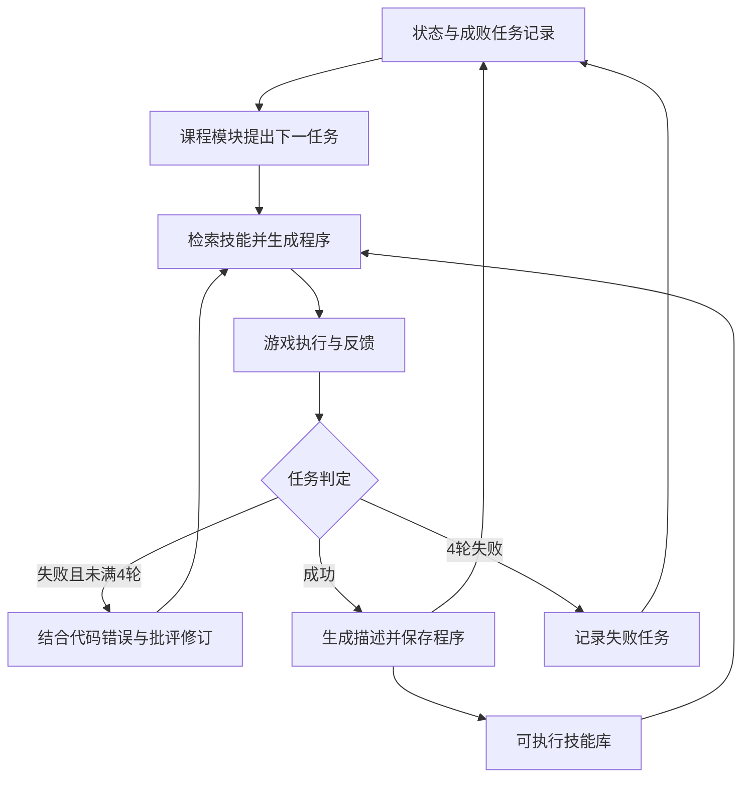

[[00-Agentic-RL|← Agentic RL 索引]] · [[LATS-2024-Language-Agent-Tree-Search|上一篇 LATS]] · [[00-Agent-Memory-Experience-Reuse|对照记忆与经验复用]]

# VOYAGER：用可执行技能库积累能力的 Minecraft 智能体

> [!abstract] 作者到底做了什么？
> 让冻结的 GPT-4 在 Minecraft 中自己提出下一项适合练习的任务，编写并执行 JavaScript 程序，依据环境与错误反馈修改程序，再把被判定成功的程序存成后续可检索、可调用的技能。
> 输入是游戏的结构化状态、高层控制 API、已有技能和探索目标；输出是游戏中的行动结果及逐渐增长的技能库。真正改变的是程序、任务记录和外部记忆，而不是语言模型权重。

## 1. 论文信息、版本和证据范围

- **完整题目**：Voyager: An Open-Ended Embodied Agent with Large Language Models。
- **作者**：Guanzhi Wang、Yuqi Xie、Yunfan Jiang、Ajay Mandlekar、Chaowei Xiao、Yuke Zhu、Linxi “Jim” Fan、Anima Anandkumar。
- **机构**：NVIDIA、Caltech、UT Austin、Stanford、UW Madison；各人具体署名见原文首页。
- **发表身份**：Transactions on Machine Learning Research，TMLR 2024 **期刊论文**，作者实验室页面标注 March 2024。初始预印本为2023年，不是 ICML/NeurIPS 主会论文。
- **正式记录**：[TMLR / OpenReview](https://openreview.net/forum?id=ehfRiF0R3a)；[作者实验室发表页](https://ut-austin-rpl.github.io/publications/2024/03/14/wang-tmlr24-voyager/)。
- **本次实际通读原文**：[arXiv v2 PDF，2023-10-19，42页，含附录](https://arxiv.org/pdf/2305.16291v2)；[可在线阅读的全文 HTML](https://arxiv.org/html/2305.16291v2)。读了主文、算法、完整提示、技能例子、评测与附录表；渲染核对第7–9页的表1、表2及图9。
- **项目与代码**：[项目页](https://voyager.minedojo.org/)；[官方仓库](https://github.com/MineDojo/Voyager)。静态核对固定提交 [55e45a880755d0c8c66ca7fb5fe7962ac8974f89](https://github.com/MineDojo/Voyager/tree/55e45a880755d0c8c66ca7fb5fe7962ac8974f89)，2026-10-21读取时的 main；未实际调用 API、启动游戏或复现成绩。
- **选择与去重**：用户队列第3篇。读取最新 README、Agentic RL 索引、模板、LATS笔记和记忆主题索引，并检查文件树；RAP/LATS已完成，VOYAGER尚无独立笔记。CB-PbRL为队列外补充，不改变这次选择。未声称查遍不可访问的历史。

> [!warning] 不混淆“发表身份”与“读到的版本”
> 本次 OpenReview 期刊记录及 PDF 受到浏览器验证限制，未获得可逐页比对的 TMLR 终稿。下面的章节、表号与实验数字均以已实际获取的 **arXiv v2** 为依据；不能说已通读期刊终稿。公开传播记录有3.1×与3.3×的不同摘要数字，本笔记采用v2正文的3.3×，不把版本差异悄悄合并。代码也早于v2，不自动视为最终实验的完整快照。

> [!info] 证据标签
> **论文事实**指上述v2；**代码核对**指固定提交；**教学例子**是构造的过程；**分析/建议**不冒充论文结论。本文没有策略训练 loss，下面的简式只是帮助理解信息流的教学记号。

## 2. 出发点：做完一次，为什么下一次还不会？

设一个语言智能体每次收到任务后都从头写计划和代码。它即使上一次已成功采石、合成工具，下次做铁镐仍可能重新写错相同的前置步骤。把全部聊天历史塞回提示会越来越长，且“曾经说过怎么做”不等于“现在有一个可以直接调用的程序”。

Minecraft 还有第二个问题：开放探索没有唯一终点。“尽可能获得更多不同物品”太宽泛，而“立即拿钻石”又可能超出空手智能体的能力。它需要选择当前可以推进、又能打开新能力的任务。

VOYAGER 把这两件事接起来：**选择合适的下一步 → 修好实际能运行的程序 → 保存程序 → 用旧程序搭建更复杂的新程序**。这里“终身学习（lifelong learning）”主要发生在外部程序库。

> [!example] 贯穿教学例子：合成一把铁镐
> 假设角色已拥有石镐、工作台、原铁和煤，但尚无铁镐；技能库已有采石、制作木棍、制作熔炉等程序。任务是“合成1把铁镐”。
> 这是基于真实游戏机制构造的教学情景，并非声称复述某个论文实验轨迹；下文的轮次与假设背包状态不当作论文结果。函数名也仅用于教学。

一个从头规划的程序可能直接调用合成铁镐，忘记把原铁烧成铁锭；也可能使用游戏里不存在的物品名。普通一次性生成若到此结束，就只留下失败。VOYAGER让错误影响本题下一次生成，并让最后成功的代码影响以后的任务。

## 3. 输入输出、动作粒度与两个循环

### 3.1 智能体到底看到什么、控制什么？

| 对象 | 论文中的实际含义 | 铁镐例子 |
| --- | --- | --- |
| 环境 | Minecraft；实验建立在MineDojo相关环境之上，Mineflayer负责高层游戏控制 | 地形、方块、怪物、背包与合成规则 |
| 观察 | 背包、装备、附近方块/实体、生物群系、时间、健康/饥饿、位置、箱子等结构化文本 | 有原铁与煤，但没有铁锭 |
| 动作 | LLM生成的一段可执行JavaScript，含条件、循环及函数调用 | 找炉子、冶炼、做木棍、合成铁镐 |
| 低层控制 | 人工提供的控制原语和Mineflayer插件，负责寻路、采集、战斗等 | `smeltItem`、`craftItem` |
| 输出 | 实际游戏状态变化、当前任务成败；探索后还留下程序库 | 背包出现铁镐，存下相应函数 |

“模型按token生成代码”不意味着强化学习动作粒度就是token。VOYAGER的控制循环按**程序生成—执行**组织；一个程序可以包含许多持续一段时间的游戏动作。任务轨迹是多个这样的尝试及其环境事件，而不是MCTS中的多条候选分支。

观察也不等于完整世界状态。模型得到的是API转写的局部信息，不是整个地图；它没有在主实验中从屏幕像素学习视觉或从按键学习运动控制。附近方块/实体的提示范围见附录A.3.1，32格。

### 3.2 内循环执行任务，外循环积累技能

- **内循环**：固定一个任务，检索技能、生成程序、执行、读取反馈、让critic判断、修改代码；至多4轮，成功可提前结束。
- **外循环**：记录任务成功或失败；成功代码入库；根据更新后的状态和任务记录提出下一个任务。
- **没有参数训练循环**：GPT-4/GPT-3.5/嵌入模型均经API调用，没有本文自己的SFT、PPO、GRPO、价值网络训练或蒸馏。

这张图是模块调用关系，不能把它称为论文学习出的多智能体运行拓扑。不同LLM角色由人工写好的控制器调度。

## 4. 方法：从选任务到技能入库逐步走一遍

### 4.1 自动课程：先决定现在值得做什么

自动课程（automatic curriculum）由GPT-4根据探索目标、当前状态和已完成/失败任务提出一个具体目标。它不是先把“成为最强玩家”永久拆成一棵完整计划树，而是依据当下条件自下而上推进。

在铁镐教学情景中，角色已经有石镐和原铁，课程可能提议冶炼或制作铁工具；若尚且空手，就应先采木。课程提示要求任务具体、可验证、难度适中、尽可能新颖，允许为更复杂目标补充资源而重复必要子任务。附录A.3.4还明确避免需要额外视觉确认的建造、种植等目标；因此“开放”并非完全没有人工领域约束。

GPT-3.5提供辅助问答，例如“铁镐需要什么材料？”其答案既帮助选任务，也构成随后检索与执行的上下文。论文A.3.2允许先检索Minecraft wiki再回答，也指出这个知识库是可选项；**不能说所有实验每次都联网查wiki**。核对的公开代码主要调用模型并缓存问答，没有在这条路径中实现wiki文档检索。

为防止模型过早被复杂信息带偏，课程使用信息预热（warm-up）：完成0个任务时给核心背包、装备、附近方块、位置；5个后加入附近实体；7个后完整背包；10个后历史方块与生物群系；15个后健康、饥饿、时间及额外问答。这里增加的是**提示可见信息**，不是预训练或SFT冷启动。（表A.1）

代码还包含实际工程规则：第一项任务硬编码为采1块木头；背包将满时先存箱子/制作箱子；部分新增观察在达到阈值后以0.8概率包含。不能将公开实现称为所有决策都完全由模型自行发现。

### 4.2 技能检索：为什么不只用任务名搜？

任务名“制作铁镐”与最需要的程序“冶炼铁锭”字面并不相同。论文图4先用GPT-3.5生成通用解决建议，再结合环境反馈构造查询，检索最相关的5个技能。查询中的中间需求帮助找出前置能力。

技能库每项至少包括：程序名称、可执行代码、语言描述及其嵌入向量。索引的核心是**代码描述的嵌入**，不是把原始代码直接当成语义向量。

下面是教学记号，不是原文提出的新目标函数：

$$
K_t=\operatorname{Nearest}_{\min(5,|\mathcal M|)}
\big(E(q_t),\{E(d_j):j\in\mathcal M\}\big).
$$

其中，\(\mathcal M\)是技能库，\(d_j\)是第j项的描述，\(E\)是冻结嵌入服务，\(q_t\)是本轮的任务建议与反馈，\(K_t\)是返回的技能集合。Nearest表示按向量库距离检索；本笔记不额外指定论文未明确给出的余弦相似度或归一化公式。库不足5项就取已有项；空库不检索到任何项。

**代码核对**：`reset()`最初用`context`检索；`step()`后用`context + summarize_chatlog(events)`重检索。后者不是任意轨迹全文摘要，而是用正则提取缺少材料、没有工作台、采矿工具不足等几类消息。运行错误与critic文字会进入下一轮提示，但不都直接进入这个检索query。

### 4.3 生成程序：旧技能既是示例，也是可以直接调用的函数

动作生成器接收：控制API示例、检索出的技能代码、任务与上下文、最新状态，以及上一轮代码/执行错误/chat log/批评。提示要求先解释失败和列步骤，再给出接收`bot`参数的异步函数；要求检查现有材料，避免强依赖一次特定背包。

教学中的铁镐程序可以先检查铁锭和木棍数量，缺铁锭则调用冶炼技能，再合成木棍、放好工作台、调用合成原语。这里有两种复用：模型阅读旧代码后改写新代码；新程序也可以直接调用已存在的旧函数。

程序化表示的价值在于把“几十次移动和交互”封装成一次有内部控制流的调用。后续复杂任务不必让LLM重写每个低层动作。这与分层RL里时间延展动作有直觉联系，但论文没有训练option的启动集、终止概率或option策略。

**代码核对**：`ActionAgent.process_ai_message()`通过Babel解析生成代码，提取函数声明，选择最后一个异步函数作为主函数，要求其唯一参数名为`bot`，再生成`await 主函数(bot)`。不是把回答中的任何自然语言直接交给游戏执行。

### 4.4 第一轮执行：三类反馈解决不同问题

假设教学程序第一轮忘记冶炼，直接合成铁镐：

1. **环境反馈（environment feedback）**：原语通过`bot.chat()`报告材料不足等情况，例如缺少铁锭。这反映操作的中间结果，不是模型凭空猜测环境。
2. **执行错误（execution errors）**：无效物品名、API使用或JavaScript错误产生错误信息。论文图5的真实示例是不存在的`acacia_axe`；应使用木斧对应物品名。环境chat消息与解释器错误不能混为一类。
3. **任务自验证（self-verification）**：另一个GPT-4调用读取任务、当前状态和上下文，返回`success`布尔值，并在失败时给`critique`。教学中它应指出铁镐尚未出现，而不因“已有材料”就宣布任务完成。

公开`craftItem`在配方可用时执行，在不可用时生成失败提示；有些失败走chat而非立即抛异常。因此“程序没有报错”远不等于“任务达成”。这是另设critic的具体理由。

### 4.5 第二轮修改：反馈怎样改变下一次？

缺铁锭的chat信息可让下一轮query召回冶炼技能；动作模型同时看到当前原铁/煤、上一轮程序和critic的建议，于是添加冶炼与必要的熔炉步骤。

修改后的程序继续在已被第一轮改变的世界中执行。它不会自动回到最初状态重放整个任务。若第一轮已经采到材料或放了设备，第二轮可使用这些副作用。这种连续修正和LATS恢复分支后搜索不同。

第2轮若成功就停止；否则继续，最多4轮。4轮都失败则记为失败任务，换课程目标，日后仍可能重新尝试。附录A.2和代码都使用重构后的system+user两条消息，而不是无限追加全部历史；上一轮相关内容被显式放回提示。

没有把“第1轮失败、第2轮成功”转成token奖励，也没有计算哪个token该得多少优势。反馈通过**检索、提示和是否入库**影响下一步，这是程序修订和记忆筛选。

### 4.6 成功入库：生成、筛选、存储、更新分别是什么？

| 环节 | 实际机制 | 不应额外声称的能力 |
| --- | --- | --- |
| 生成 | GPT-4生成并逐轮修改程序 | 不是训练一个新的代码生成模型 |
| 筛选 | 当前执行被critic判定成功后才入库 | 没有独立多世界回归测试保证普适正确 |
| 描述 | GPT-3.5读成功程序，生成简短功能说明 | 描述不等于从多条轨迹提炼抽象规则 |
| 存储 | 代码、描述、名字映射与向量库持久化 | 不是只保存自然语言聊天记录 |
| 检索 | 任务建议+部分反馈检索top-5 | 没有论文中的任务价值学习式重排 |
| 更新 | 增加成功程序；代码实现支持同名覆盖和历史文件保留 | 没有自动遗忘/全库正确性验证/依赖版本迁移机制 |
| 共享 | 把技能库带到新世界，或供AutoGPT使用 | 不等于研究多agent在线通信与协作学习 |

用教学记号表示，当前程序\(P_t\)被接受时：

$$
\mathcal M' = \operatorname{Upsert}
\big(\mathcal M;\operatorname{name}(P_t),P_t,d_t,E(d_t)\big).
$$

\(d_t\)是生成的描述，Upsert表示按名称新增或更新。式子没有梯度，嵌入计算也不是本文的参数优化。任务失败时不会把该失败程序作为已掌握技能加入库，但失败目标会影响之后的课程。

**关键可信度边界**：成功表示“当前状态下最终达到目标”，未必证明最后一个程序独立完成了全部前置过程。入库代码可能依赖先前失败尝试积累的材料。提示要求可复用，不等于运行过新状态重放验证；这是从代码路径推导的风险，不是作者报告的实际污染率。

## 5. 到底哪些东西在学习？为什么列入Agentic RL队列？

| 项目 | VOYAGER实际情况 |
| --- | --- |
| 训练任务/数据 | 没有参数RL训练集；课程在线提出任务，执行生成经验 |
| 行为策略 | 冻结LLM结合当前提示、技能和状态生成程序 |
| 轨迹采样 | 每任务至多4次生成—执行，跨任务持续探索；非组内优势采样 |
| 奖励 | 控制流程使用任务成败及文字反馈，没有本文定义的标量回报优化 |
| 信用分配 | 失败信息提示如何改程序，成功决定存储；无token/动作回报回传 |
| 优势/价值/KL/重要性比率/裁剪/熵 | 本方法未采用这些RL训练组件 |
| 可训练参数 | 本方法不更新LLM、嵌入或外部数值策略参数 |
| 训练loss | 无本文的策略loss；代码`step()`返回的reward位置是常数0 |
| 跨任务保留 | 技能代码、描述索引、成功/失败任务、问答缓存、箱子记忆 |
| 部署保留 | LLM服务、控制器、游戏接口、critic、技能库；不是导出一个新模型就能替代整个系统 |

因此它对Agentic RL的价值在于提供一个**外部技能积累的比较基线**：同样是多轮环境反馈、长期能力增长，机制却不必是权重优化。之后读参数RL论文时，应问“新增的收益来自更好的参数策略，还是更好的课程、执行接口、验证与记忆？”

“课程鼓励新颖”也不意味着实现了一个可微新颖性奖励或数学最优化器；论文称其为上下文形式的新颖性搜索，实际是提示驱动的选题。

## 6. 创新与最接近方法：新增的环节在哪里？

| 近邻 | 已有思想 | VOYAGER具体补充 | 实验证据边界 |
| --- | --- | --- | --- |
| ReAct | 思考—行动—观察 | 适配能力的自动课程、跨任务可执行技能库和更完整修订反馈 | 比较的是作者改写的Minecraft版本 |
| Reflexion | 根据失败反思再尝试 | 不仅保留文字批评，还把成功行为变成可调用程序，并自主选下一任务 | 基线已获本文critic与执行错误，不是完全无反馈弱基线 |
| AutoGPT | 为宽泛目标分解子任务 | 按实时能力自下而上提出目标，独立判定任务是否完成，累积技能 | 作者重新实现版本，不代表所有AutoGPT配置 |
| Code as Policies / ProgPrompt | 用代码表示长动作与控制流 | 在线执行修正、自动课程与持久检索程序库组合为持续探索系统 | 不能把“代码作为动作”本身全算为新发明 |
| RAP / LATS | 对当前任务进行推理时搜索 | 重点从本题多分支探索转向跨任务积累可执行能力 | VOYAGER无UCT、访问统计、MCTS回传 |

**依据机制重建设计理由**：任务太大就先选择可推进的小目标；从头写易重复犯错就保存已成功程序；一次生成不可靠就把实际反馈送回；库变大无法全放提示就按描述检索。这是分析性的逻辑重建，不宣称知道作者未公开的思维过程。

作者将系统称为首个LLM驱动的开放世界具身终身学习智能体，这是论文的优先权主张；更稳妥的实证结论是：在其Minecraft接口和预算下，这组机制的组合比所实现的基线探索更有效。实验不证明它适用于任意开放世界，也不证明外部库完全避免了技能退化。

## 7. Benchmark究竟测什么？

### 7.1 开放探索：没有固定答案，统计实际获得的物品

所有基线总体目标是探索并获得尽可能多物品。每种方法3次试验，每次最多160次**代码生成提示轮次**。论文采用`gpt-4-0314`、`gpt-3.5-turbo-0301`、`text-embedding-ada-002`；除课程温度0.1，其他温度0。（§3.1）

一个iteration不是一条游戏动作，也不等于所有模型总调用数。一次生成可执行很多操作，课程、问答、critic和嵌入还有额外成本。该预算便于比较程序生成效率，但没有同时对齐总token、美元、模拟步数或墙钟时间。

“不同物品数”统计探索过程中曾获取的物品类型，不是最终背包物品数量，也不等于技能函数数量。代码`EventRecorder.update_items()`累积背包键的集合，图1/附录B.4.1列实际物品。它比critic自报成功更接近客观环境记录，但仍受实验环境与物品注入辅助机制影响。

### 7.2 科技树：达到木、石、铁、钻石工具层级

它要求一连串前置能力，不能靠说出工具名字。表1同时报告轮数与成功次数；`0/3`意味着预算内没有成功，`N/A`不是零轮完成。`102 (1/3)`不等于三个试验平均都102轮完成。

### 7.3 新世界指定任务：带着旧技能，从空背包执行

清空背包，重置到新世界，要求制作钻石镐、金剑、装熔岩的桶、指南针，每个目标3次尝试，最多50轮。VOYAGER和AutoGPT都让GPT-4将最终任务拆成子目标。（§3.3，表2）

所谓“零样本（zero-shot）”是对新指定任务/世界没有任务专属参数微调；并非没有Minecraft预训练知识、先前技能经验、人工控制原语或测试时反馈。执行时仍会检索、规划、修订，并非一次生成答案。

### 7.4 成败判断：环境事实与LLM推断分开

内循环成功由GPT-4 critic读取最终状态判断，不是每个自动任务各写一条确定性程序断言。论文A.5的提示允许把不同木材加总，也知道铁矿挖出原铁。这能处理自然语言目标与游戏物品名不一致，比原始字符串匹配灵活。

代价是它可能用代理现象推断历史动作：持有腐肉就认为打过僵尸，饥饿值满就认为吃过东西，附近有小麦就认为完成种植。若物品本就存在或来自其他途径，最终状态不一定证明刚才完成目标；这是依据提示可构造的反例，并非论文测出的误判率。论文§4确实报告过未把蜘蛛丝识别为战胜蜘蛛的失败案例。

表中工具/目标物品与游戏状态紧密关联，但未见对所有最终成绩做独立盲审的详细协议；不应把全部任务成绩描述成无误的确定性验证。论文未报告critic的假阳性/假阴性矩阵。

### 7.5 人工辅助与环境简化

- 论文B.1：死亡后在附近地面复活，保留物品；执行后回收工作台和熔炉。这降低失误的长期代价。
- 代码还使用固定昼夜/调节难度、卡住时传送、某些物品恢复与满背包辅助；`returnItems()`甚至可能发放箱子。应区分哪些是环境包装贡献，不能把所有背包变化归因于学习出的采集合成行为。
- 主实验没有视觉输入。图10建房/传送门使用人类提供视觉批评或分解课程，是另行演示，不是自主文本系统已经解决视觉建造。
- 不与像素输入、低层按键输出的Minecraft RL方法直接比成绩，作者也明确承认接口不对等。

## 8. 关键结果：少量数字说明哪些结论成立

以下全部是 **arXiv v2** 数字，不冒充已比对的TMLR终稿。原表保留`±`，未在此自行推断其一定为标准差或标准误。样本只有3次试验，不能据此给出稳定的高置信成功率。

### 8.1 63种物品、3.3倍：系统探索更有效

§3.3报告160轮获得约63种不同物品，为基线约3.3倍。附录给出3次试验的逐项清单，可用于回查统计单位。这个指标支持在该设置下覆盖更多物品类型，**不等于63种独立鲁棒技能**，也不是语言模型知识量增大3.3倍。

### 8.2 科技树表1：收益集中在长任务，但钻石仍不稳定

| 方法 | 木工具 | 石工具 | 铁工具 | 钻石工具 |
| --- | --- | --- | --- | --- |
| AutoGPT | 92±72，3/3 | 94±72，3/3 | 135±103，3/3 | 未达成，0/3 |
| VOYAGER无技能库 | 7±2，3/3 | 9±4，3/3 | 29±11，3/3 | 未达成，0/3 |
| VOYAGER | 6±2，3/3 | 11±2，3/3 | 21±7，3/3 | 102，1/3 |

ReAct与Reflexion在这张表四级均为0/3。这里指作者的开放探索适配版，不能推成这些方法在任何明确采木任务上都不会成功。

92/6≈15.3，是木工具的提示轮数比，不是15.3倍实时速度。技能库对后期的意义比“每个早期里程碑都更快”更符合数据：无库石工具9轮反而少于完整系统11轮；只有完整系统有一次达到钻石级。小样本和大方差也提醒我们不要把1/3说成可靠掌握钻石。

### 8.3 新世界表2：旧程序确实能帮助新的组合任务

| 方法 | 钻石镐 | 金剑 | 熔岩桶 | 指南针 |
| --- | --- | --- | --- | --- |
| AutoGPT+VOYAGER技能库 | 39，1/3 | 30，1/3 | 未达成，0/3 | 30，2/3 |
| VOYAGER无技能库 | 36，2/3 | 30±9，3/3 | 27±9，3/3 | 26±3，3/3 |
| VOYAGER | 19±3，3/3 | 18±7，3/3 | 21±5，3/3 | 18±2，3/3 |

原始ReAct、Reflexion、AutoGPT四项都是0/3。不要把正文“baselines cannot solve any task”扩展到含技能库的AutoGPT或无库VOYAGER变体，它们在表2明显有成功。

钻石镐完整系统为19轮、3/3，无库为36轮、2/3：支持已有程序减少重新构建前置能力的负担。AutoGPT加库也有收益，支持库具有一定可移植价值；但远未达到VOYAGER表现，说明课程/验证/修订的整体控制也重要。

这仍是同一个游戏内的四个目标，不是跨领域泛化；预训练Minecraft知识和公共配方不是未知环境知识。论文未给出可量化的预训练数据污染审计，本笔记不据此指控数据泄漏。

### 8.4 消融与检索：课程和验证不是可有可无

- 图9/§3.4：随机课程相对完整系统物品数下降93%；随机池是从VOYAGER获得物品中整理的101项（B.3），并非对所有Minecraft任务均匀采样。说明可达性和顺序重要，不证明课程算法已求得最优次序。
- 去自验证下降73%。它同时移除成功判定与批评、改变何时换任务，不能把全部差值解释为“更好的一句反思”的独立效果。
- 只把代码生成换成GPT-3.5，课程和critic仍用GPT-4；报告完整系统不同物品数为该变体5.7倍，不是整套系统全换小模型的比较。
- 无库后期趋于平台，配合表2支持跨任务程序积累有用；但未独立分离检索示范效应与直接调用已学程序效应。
- 表A.4：309个样本，top-1检索准确率80.2±3.0%，top-5为96.5±0.3%。不是任务完成率；正文未充分交代相关技能真值标注、所有候选集合及聚合方式，不能直接解释成线上检索96.5%一定有效。
- 地图距离2.3倍：附录B.4.2基于与GPT-4交互时的位置记录，图7以包围轨迹的最小圆展示覆盖。不能把圆面积看成每个格子都探索过，也不自行把2.3倍距离换算成面积或完整逐tick路径长度。
- 附录B.4.5在GPT-4-0613上补实验表现近似。它只支持这两个历史快照间的有限稳定性，不保证任意新模型都相同。

## 9. 代码核对：真正影响理解和复现的边界

以下链接均固定到上述官方提交，不依赖未来main的变动。

### 9.1 调用路径与持久化

| 入口 | 已核对行为 |
| --- | --- |
| [voyager.py](https://github.com/MineDojo/Voyager/blob/55e45a880755d0c8c66ca7fb5fe7962ac8974f89/voyager/voyager.py) | `learn → propose_next_task → rollout → reset/step → env.step → critic`；成功`add_new_skill`，随后更新探索记录 |
| [action.py](https://github.com/MineDojo/Voyager/blob/55e45a880755d0c8c66ca7fb5fe7962ac8974f89/voyager/agents/action.py) | 拼装两条消息、Babel解析代码、箱子记忆、缺材料消息正则提取 |
| [skill.py](https://github.com/MineDojo/Voyager/blob/55e45a880755d0c8c66ca7fb5fe7962ac8974f89/voyager/agents/skill.py) | GPT-3.5生成描述，OpenAIEmbeddings+Chroma检索；代码/描述/skills.json/向量库落盘 |
| [critic.py](https://github.com/MineDojo/Voyager/blob/55e45a880755d0c8c66ca7fb5fe7962ac8974f89/voyager/agents/critic.py) | 最终状态+任务+context；解析JSON，事件含`onError`时直接不成功 |
| [curriculum.py](https://github.com/MineDojo/Voyager/blob/55e45a880755d0c8c66ca7fb5fe7962ac8974f89/voyager/agents/curriculum.py) | 自动/手动课程、预热、问答缓存、任务记录、固定目标的分解 |
| [环境index.js](https://github.com/MineDojo/Voyager/blob/55e45a880755d0c8c66ca7fb5fe7962ac8974f89/voyager/env/mineflayer/index.js) | 载入程序并eval异步执行；状态/错误事件、寻路插件、卡住处理、物品回收 |
| [record_utils.py](https://github.com/MineDojo/Voyager/blob/55e45a880755d0c8c66ca7fb5fe7962ac8974f89/voyager/utils/record_utils.py) | 累积物品类型、程序轮数与事件记录；并非策略训练replay buffer |

### 9.2 提示可见技能与运行时可用技能不同

`ActionAgent.render_system_message(skills=...)`仅放检索返回的技能代码；但`SkillManager.programs`拼接**整个技能库**和控制原语，再传给`env.step(programs=...)`执行。因此检索是限制模型看到什么，不是严格限制解释器可调用什么。新程序调用旧技能时，可能还间接依赖未召回的其他旧技能。

由此，技能组合可形成普通函数调用依赖，但系统没有显式学习依赖图、自动拓扑搜索或图数据库检索；也不能简单把top-5解释为执行时只有5个函数存在。

### 9.3 更新、部署和版本偏差

- 同名技能重新生成时，向量库删除同名旧条目、覆盖活动映射；历史代码以`V2/V3`等文件名留存。没有发现依据调用依赖做一致性回归的更新逻辑。依赖者是否受覆盖影响需要另外测试。
- 存箱子的清理任务不会进入技能库；`skills.json`的条目数与向量库数量有同步断言。
- `inference()`依次执行分解出的子目标并记录成败，没有调用`add_new_skill()`。不要把探索阶段不断入库与指定任务推理阶段完全等同。
- 默认模型名用`gpt-4/gpt-3.5-turbo`，论文是固定0314/0301快照；默认课程temperature=0，论文为0.1。复现需要显式记录配置，不能只运行README就称完全复现。
- 当前`learn()`在任务外层判断`recorder.iteration > max_iterations`，内层可继续跑完整任务，可能超过预算；需从日志截取同一预算评测。`inference()`没有自动实现论文每目标50轮上限，失败子目标还可能继续重试，需另外加评测停止器。
- 代码`render_system_message()`在模型名恰为`gpt-3.5-turbo`时少放`useChest/mineflayer`上下文。因此当前代码的默认小模型比较还可能有提示接口差异；不能断言论文历史的5.7倍差距全部由这一点造成，也不能假装当前代码自动保证同提示。
- 论文附录示例也非形式验证代码：`craftWoodenPlanks`先找`logInInventory`，若没有则采木，但随后使用旧变量、不重新查询。按打印代码，初始缺木时会有失效风险。它是“成功一次不代表全部初态鲁棒”的具体例子，不是对整库错误率的统计。

## 10. 复现与研究联系（简短）

代码MIT开放，官方提供trial1–trial3技能库；有状态检查点、程序、描述及向量索引，不等于完整、统一的训练/测试数据包。Minecraft本体及账户需自行准备；本文没有训练模型checkpoint可下载。

官方README：Python≥3.9，Node.js≥16.13，测试Ubuntu20.04/Windows11/macOS；示例Minecraft1.19与Fabric-loader0.14.18。先按固定提交安装游戏、Fabric及控制插件，检查桥接，再处理旧LangChain/Chroma/API兼容。本文未报告可核对的完整CPU/GPU/RAM规格、单次实验墙钟时间及总美元成本；这些均记为未知。无需本地训练LLM不等于无需游戏运行资源或远端推理成本。§4的GPT-4价格倍数是历史陈述，不当作今天报价。

**与研究方向**：长期程序性记忆、检索和经验优化执行流程直接相关；短期失败反馈与长期成功技能分工清楚。程序调用依赖可迁移到图工程，但没有多agent角色/通信/路由/拓扑优化。没有RL参数增强或蒸馏；其自我改进仅在既定Harness内积累程序，未自动改写整个学习框架。

**建议小实验，非论文结论**：固定同一批游戏状态和20个制作目标，每目标4轮、同一模型与API，对比无库、仅检索文本示例、检索且允许调用技能三组；每组相同上下文token上限，另报告实际token、调用数和游戏步数。用独立背包断言评成功，统计成功率、生成轮数、执行错误和美元成本；对成功入库的程序再在3种新初态重放，测泛化成功率。它检验“收益来自示例提示还是可执行复用”，以及一次通过筛选是否足够。状态重置与多seed资源预算需自行实现，未声称已经运行。

## 11. 阅读路线与三个可检验问题

**推荐顺序**：图2与§2理解三模块 → 附录A.1伪代码走一遍 → 图4/5/6分别看检索、失败、判定 → A.3预热及完整课程提示 → A.4控制原语与程序例子 → A.5判定提示 → 表1/2、图9及B.1–B.4核对实验条件 → 代码`voyager.py → action.py/skill.py/critic.py → 环境index.js`。不要先从摘要的倍数认识整篇论文。

1. **成功筛选是否可靠？** 换成独立规则验证并对最终程序做新初态重放，技能入库误判率和后续任务成功率怎样变化？
2. **技能库改善的是生成还是执行？** 同预算下，禁用旧程序调用但保留其文本，与保留调用能力相比还剩多少收益？
3. **库越大是否一定更好？** 固定模型与任务，用增长的技能库测检索命中、依赖错误、同名覆盖后回归失败及实际成功率；是否需要前置条件、版本和依赖验证？

## 原始来源

- [TMLR正式记录](https://openreview.net/forum?id=ehfRiF0R3a)：本次受访问验证限制，终稿未逐页比对。
- [作者实验室发表页](https://ut-austin-rpl.github.io/publications/2024/03/14/wang-tmlr24-voyager/)：TMLR2024、作者与官方入口。
- [arXiv v2原文](https://arxiv.org/pdf/2305.16291v2) / [HTML全文](https://arxiv.org/html/2305.16291v2)：本次实读证据；§2方法，§3/表1–2/图9实验，§4局限，A.1–A.5算法及提示，B.1–B.4协议与补充实验。
- [项目页](https://voyager.minedojo.org/) / [固定版本官方代码](https://github.com/MineDojo/Voyager/tree/55e45a880755d0c8c66ca7fb5fe7962ac8974f89) / [提供的技能库](https://github.com/MineDojo/Voyager/tree/55e45a880755d0c8c66ca7fb5fe7962ac8974f89/skill_library)。

[[00-Agentic-RL|返回 Agentic RL 索引]]
