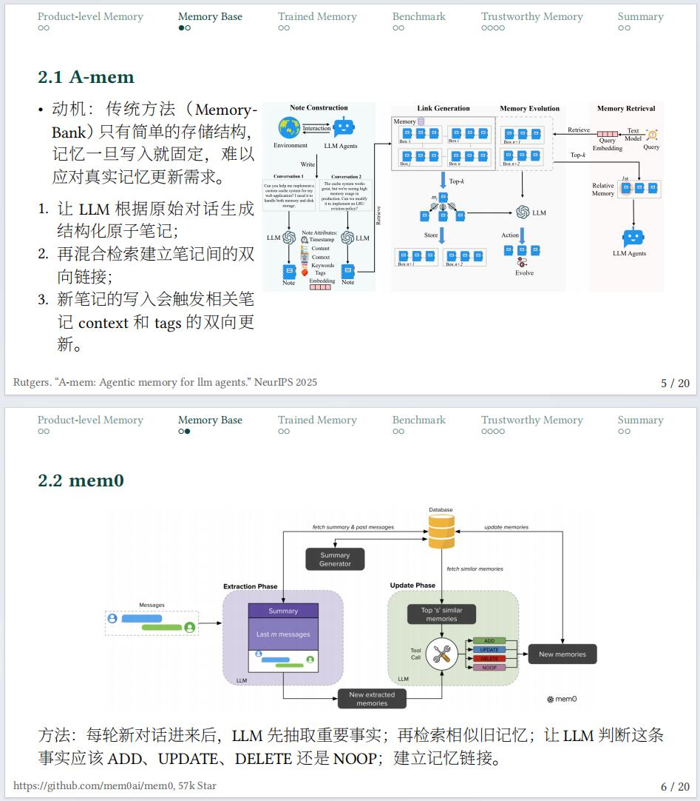
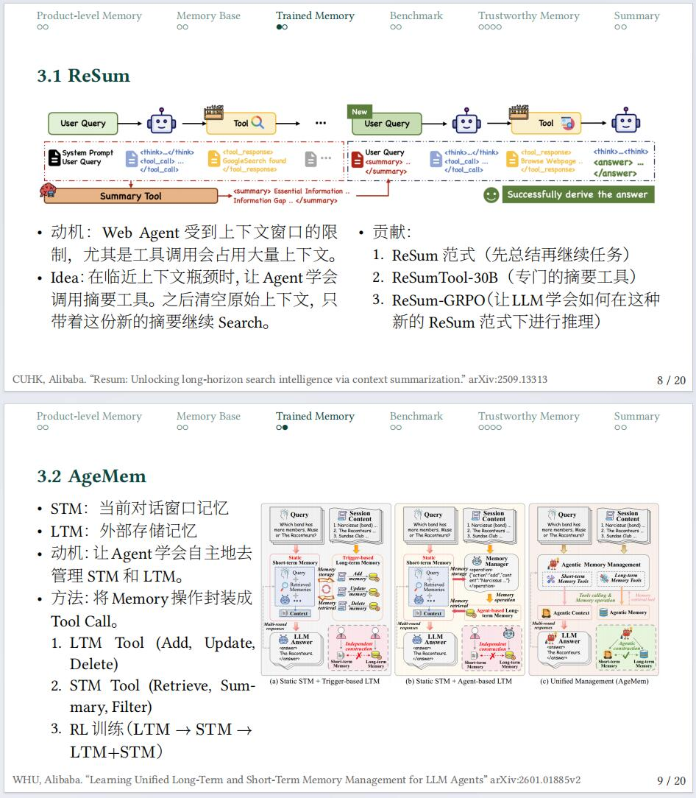
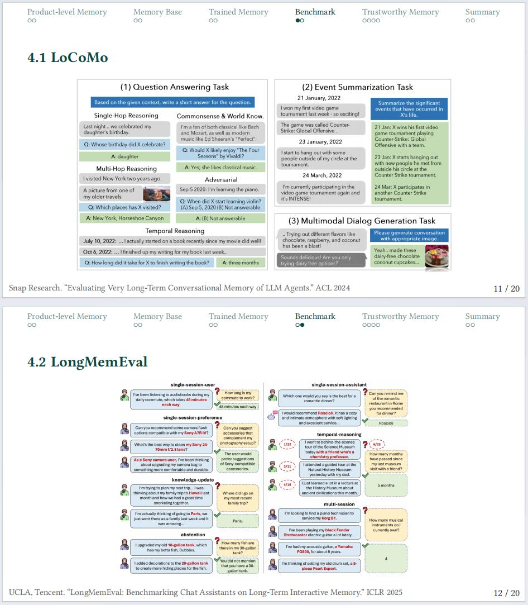
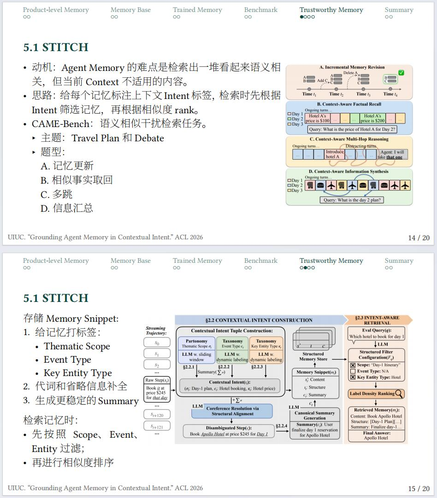
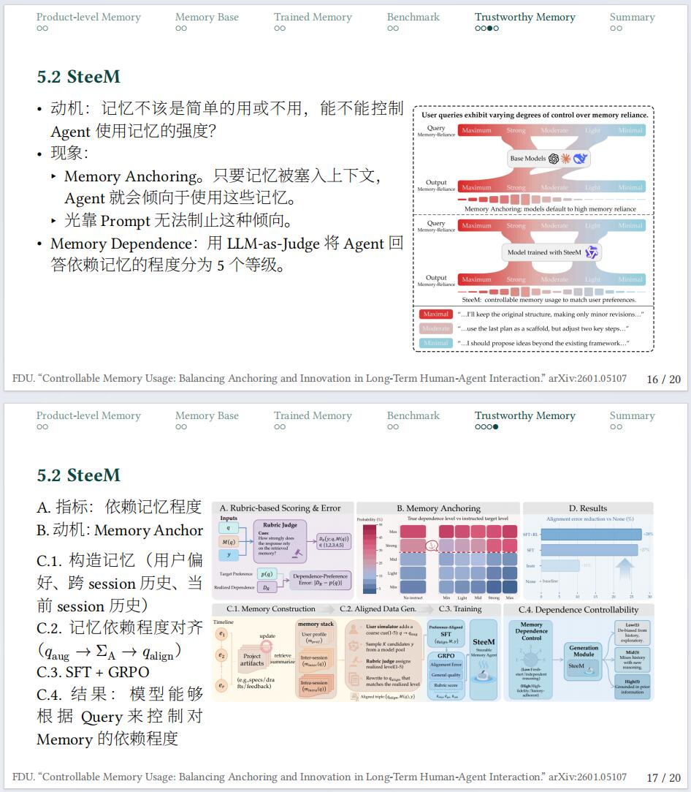
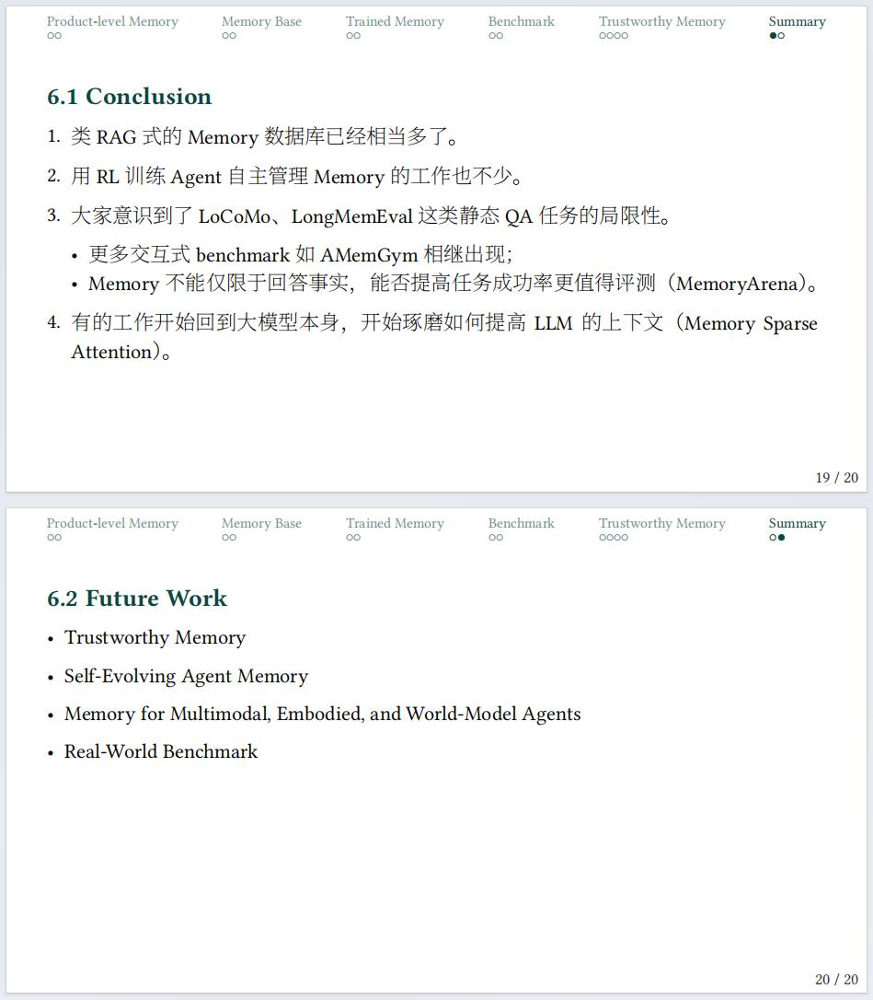

# Agent Memory 些许感悟

最近一段时间重新审视了一下前段时间读过的论文。有一点点思考，零 AI 生成内容：
0. RAG + 记忆更新 = memory 。
1. 首先是类 A-Mem 和 mem0 都做的太 Rule-based，每次对话都触发记忆的更新、检索一系列机制，这种延迟对于 AI Assistant 不太能接受。如何优化这种延迟和 token 消耗又会变成工程问题（浙大 LightMem）
2. RL 方面的 ReSum 看起来 Agentic 了，实际还是“到达 context 瓶颈”后规则触发，同时这种压缩上下文的范式也不新；AgeMem 感觉是 CURD 包上 RL。
3. Memory 还不够可靠。STITCH 说不能把 memory 简单做成检索问题，按照相似度召回 memory 会取回不合 context 的记忆。但是他们的做法太启发式了。凭啥记忆就得长这样（Scope、Event、Entity）？CAME-bench 辩论赛也很假，哪有 memory 用来记录第一人称两个人的记忆的...
4. 复旦的 SteeM 有点牵强，动机很有意思：输出回答有多大程度是依赖 Memory 了？但是解法像是压制了输出，Agent 还是有这些记忆，只是被堵住了嘴巴。
	
未来的 memory 可能有这些新问题：
1. 会有很多 benchmark 比 LoCoMo 和 LongMemEval 更贴近现实。
2. 记忆只是历史吗？能不能带来真正的提升（进化）更有意思些对吧，就像人读书才能进步。

